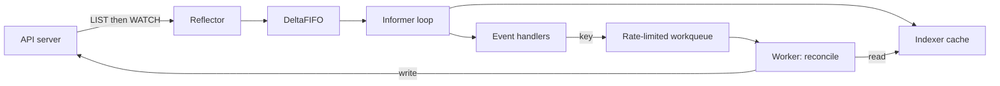

# Informers, Reflectors, and Workqueues

## Definition

The caching machinery inside client-go and controller-runtime. It watches the API server over HTTP streams, keeps an in-memory local cache to avoid overloading etcd, and queues object keys (namespace/name) for worker threads to process. [[sources/krm-platform-vocabulary]]

## Why it matters

This machinery is why one controller can watch thousands of objects cheaply, and it is where scaling limits appear: cache memory, queue depth, worker concurrency, and rate limiting. The scale gap in [[open-knowledge-gaps]] centers on this topic.

## The pipeline, stage by stage

A Reflector performs an initial LIST to obtain a consistent snapshot and then opens a WATCH on the same resource, streaming changes. Each change goes into a DeltaFIFO queue, which keeps per-key order and collapses consecutive identical deltas. The informer's process loop pops deltas, writes the object into a thread-safe Indexer (the local cache, keyed by `namespace/name` through `MetaNamespaceKeyFunc`, with optional secondary indexes on namespace, labels, owner references, or custom fields), and then calls the registered event handlers. Controller code reads through read-only Listers that query the Indexer and never the API server. [[sources/research-informers-reflectors-and-workqueues]]

The handlers are meant to do almost nothing. They compute the object's key and add it to a rate-limited workqueue, and the client-go architecture document states that informer event handlers only add an object's key to the work queue. Worker goroutines then take a key, read the current object from the cache, and reconcile it. The secondary explainer in the dossier compresses the design as one watch per resource type, one cache per process, one reconcile per key, and one rate limiter per workqueue. See [[examples/kubebuilder-owns-and-a-field-indexer-wire-child-changes-to-the-owner]] for the framework view.

## The workqueue contract

The workqueue package offers a base queue (Add, Get, Done, ShutDown), a delaying queue (`AddAfter`), and a rate-limiting queue (`AddRateLimited`, `Forget`). It gives three guarantees: fair FIFO ordering, deduplication of items added before they are processed, and no concurrent processing of one item. Many events for one object therefore collapse into one key, and a reconciler never races with itself on that key. The default limiter combines per-item exponential backoff (5 ms base and a 1000 s cap, as extracted by the dossier) with an overall token bucket (10 per second, burst 100), and authors must call `Done()` and `Forget()` or retry tracking persists. [[sources/research-informers-reflectors-and-workqueues]] See [[findings/skipping-done-or-forget-on-the-workqueue-leaves-items-stuck-or-retrying]] and [[findings/retry-storms-and-unbounded-retries]]. The numbers come from a condensed extraction and should be verified against current code before they are quoted.

## How a watch recovers

The resource version is the cursor that lets a watch resume. When a cursor is too old, the API server answers 410 Gone and the client must relist. Watch bookmarks refresh the cursor during quiet periods, the server's watch cache lets clients resume from recent versions, and jittered backoff keeps many clients from relisting at the same moment. See [[findings/an-expired-resourceversion-forces-a-relist-and-synchronized-relists-can-storm]].

## Events as hints and cache lag

Watch events delivered through informers are hints that enqueue an object key, and the reconciler then reads the full object from the cache. Because the cache can lag the controller's own writes, controllers need deterministic names or expectations to avoid acting twice. [[sources/research-level-triggered-vs-edge-triggered]] See [[decisions/events-as-hints-state-as-truth]] and [[findings/stale-cache-and-double-action]]. The controller-runtime cache blog adds that the cache-backed client reads from the cache while writes and status updates go straight to the API server, and that authoritative reads need an explicit uncached reader. [[sources/research-informers-reflectors-and-workqueues]]

## Resync

A resync replays every object in the informer's local cache to the handlers as an update event and does not contact the API server. In client-go the reflector calls `store.Resync()` on a timer, `DeltaFIFO.Resync` re-queues keys from the local known-objects store, and a zero period means no resync. `HasSynced` is unrelated to resync, because it reports that one full LIST has completed. controller-runtime's `SyncPeriod` defaults to 10 hours with jitter, emits an artificial Update event with identical old and new objects that `GenerationChangedPredicate` filters out, and the documentation recommends `RequeueAfter` to cover missed watch events. The word names different mechanisms elsewhere: ACK's "resync" is a `RequeueAfter` after success, and kro's flag text calls its resync a "re list". [[sources/research-gap-m5-informers-caches]] See [[findings/a-resync-replays-the-informers-local-cache-to-the-handlers-and-never-contacts-the-api-server]], [[findings/the-word-resync-names-three-different-mechanisms-in-client-go-kro-and-ack]], and [[decisions/keep-informer-resync-disabled-or-set-a-periodic-resync]].

Correction note, 2026-11-26: this section previously said periodic resync is "usually disabled" and that no source explained what it replays. In controller-runtime it is enabled by default at 10 hours, and the replay semantics are now sourced.

## Costs and tuning knobs

The cache holds every watched object with no eviction, so memory grows with the number of objects watched. Worker concurrency and rate limits decide how many reconciles run and how fast failing items return, and for controllers that call external APIs they decide the call rate. Tool stacks expose these knobs differently: Flux through `--concurrent` and Helm cache flags, Argo CD through sharding, processor counts, and `GOMEMLIMIT`, and Crossplane through `--max-reconcile-rate`. See [[findings/informer-caches-hold-every-watched-object-and-memory-grows-with-cluster-size]], [[comparisons/concurrency-and-cache-memory-controls-across-flux-argo-cd-and-crossplane]], and [[comparisons/load-and-fairness-controls-across-controller-runtime-flux-argo-cd-and-kro]].

## Staleness and observability in v1.36

Informer caches can lag the API server when watch events are delayed or missed, so controllers may act on outdated state. The work queue deduplicates keys and applies exponential backoff to failures, and kro's tuning page gives concrete queue numbers. [[sources/research-eventual-consistency-and-convergence]] See [[findings/stale-cache-and-double-action]] and [[examples/kro-shared-queue-tunes-throughput]].

Kubernetes v1.36 made the lag both observable and actionable (KEP 5647). In client-go, the `AtomicFIFO` gate (Beta, default true from 1.36) makes the FIFO process list and relist batches atomically, and a `Store` can report `LastStoreSyncResourceVersion()`, the latest resource version the cache has seen, which may be an empty string before the first sync. Four kube-controller-manager controllers (DaemonSet, StatefulSet, ReplicaSet, Job) record the resource version of their own writes and skip a sync until the cache has caught up, each behind a `StaleControllerConsistency<API type>` gate (Beta, default true from 1.36). A `ConsistencyStore` helper with `WroteAt`, `EnsureReady`, and `Clear` serves other informer authors. The lag shows up in the alpha gauge `informer_store_resource_version` (labels name, group, version, resource, carrying the 15 least significant digits of the resource version) and in per-controller skip counters such as `daemonset_controller_stale_sync_skips_total`. Kubernetes v1.37 adds the HorizontalPodAutoscaler controller (`StaleControllerConsistencyHPA`, Beta) and publishes the informer metrics from the scheduler. [[sources/research-gap-g3-k8s-and-controller-runtime]] See [[examples/kubernetes-v1-36-daemonset-statefulset-replicaset-and-job-controllers-skip-a-sync-until-the-cache-catches-up-with-their-own-write]] and [[findings/the-kubernetes-v1-36-staleness-blog-names-metrics-differently-from-the-changelog-and-source]].

Correction note, 2026-11-26: this section previously called the dossier's summary of the v1.36 mechanisms generic and in need of verification. The paragraph above replaces it.

## Pitfalls

Heavy handlers and expensive reconciles waste API calls ([[findings/heavy-event-handlers-and-expensive-reconciles-waste-api-calls]]). Many list-and-watch clients can overload an API server and block the remediation that would fix it ([[findings/control-plane-overload-blocks-the-remediation-that-would-fix-it]]). Mutating cached objects or reading an unsynced cache corrupts reconcile input ([[findings/mutating-objects-from-a-shared-cache-or-reading-an-unsynced-cache-corrupts-reconcile-input]]).

## Related

[[concepts/reconciliation-loop]], [[concepts/level-triggered-vs-edge-triggered]], [[concepts/gvk-and-gvr]], [[concepts/operator-pattern]], [[entities/client-go]], [[entities/controller-runtime]]

## To research

Open items after the 2026-11-26 informer dossier: memory measurements for any cache-narrowing option, what a running informer does when its CRD is deleted or its served versions change, and Backstage's cache behavior. See [[open-knowledge-gaps]].

## Cache narrowing, per-tool caches, and keying (m5 dossier)

controller-runtime narrows the cache with `ByObject`, namespace, label and field selectors, transforms such as `TransformStripManagedFields`, `DropManagedFields`, metadata-only informers, and a client-side `DisableFor` list, and each option trades memory against coverage, fields, or live API calls ([[findings/controller-runtime-narrows-its-cache-with-selectors-transforms-metadata-only-informers-and-disable-for-and-each-option-has-a-cost]], [[decisions/narrow-the-controller-cache-with-selectors-transforms-or-metadata-only-informers-or-bypass-it-for-some-types]]). Flux controllers each run their own manager with a watch label selector and leave Secrets and ConfigMaps uncached by default ([[findings/flux-controllers-keep-separate-caches-narrowed-by-a-watch-label-selector-and-leave-secrets-and-configmaps-uncached-by-default]]). Crossplane core strips CRD schemas from one cache ([[findings/crossplane-core-strips-crd-schemas-from-its-cache-and-no-crossplane-performance-or-sharding-guide-was-found]]). The choices of kro, Config Connector, ACK, and Cluster API are in [[comparisons/informer-and-cache-choices-across-kro-config-connector-ack-and-cluster-api]]. controller-runtime keys informers by GVK, client-go's typed factory by Go type, and its dynamic factory by GVR ([[findings/controller-runtime-tracks-informers-by-gvk-while-client-go-factories-key-by-go-type-or-gvr]]). [[sources/research-gap-m5-informers-caches]]

## Scale limits in the scale dossier

The scale dossier adds that the workqueue never processes one key concurrently, so worker count and reconcile duration, and not object count, bound throughput, that leader election makes extra replicas standbys, and that API Priority and Fairness is the server-side counterpart to the client's QPS and burst. The wider picture is in [[concepts/scale-and-sharding]] and [[sources/research-scale-and-sharding]].

## Lost-event and resync evidence from the operator loop dossier

Kubernetes issue 115658 shows that a relist racing a queued CREATE could drop the DELETE event for a short-lived object, so a consumer kept the object forever, until pull requests 115620 (merged 2023-02-17) and 116623 (merged 2023-03-16, for 1.27) fixed it. See [[examples/kubernetes-issue-115658-a-client-go-relist-could-drop-the-delete-event-for-a-short-lived-object]]. KubeFleet documents a 30-minute safety resync as protection against bugs, and an Argo Rollouts user says `--rollout-resync=60` guards against missed events (SECONDARY-ONLY). What a resync replays is still not settled. See [[findings/projects-add-periodic-resync-as-a-safety-net-against-missed-events-and-bugs]] and [[sources/research-gap-g1-operator-loop-failures]].

## Staleness metrics pinned to releases

Update 2026-11-26: the per-controller skip counter `stale_sync_skips_total` is read at v1.36.0 and v1.37.0, with full names under the subsystems `daemonset_controller`, `job_controller`, `replicaset_controller`, `statefulset_controller`, and from v1.37 `horizontal_pod_autoscaler_controller`. The StatefulSet counter was defined but not registered at v1.36.0 and registered from v1.37 ([[findings/the-statefulset-stale-sync-skip-metric-was-defined-but-not-registered-in-v1-36-0-and-registered-in-v1-37]]). KEP 5647's `kep.yaml` lists a different gate shape from the code, and `MonitorInformerStaleness` was not found in Kubernetes source ([[findings/kep-5647-lists-a-different-gate-shape-from-the-shipped-code-and-monitorinformerstaleness-is-not-found-in-kubernetes-source]]). [[sources/research-gap-b1-recheck-flux-k8s]]

## Staleness gates and absent mechanisms from the o9 dossier

Update 2026-11-26: the per-controller gates depend on client-go `AtomicFIFO`, the HPA gate is in v1.37.0 ([[findings/kubernetes-v1-37-0-already-carries-the-horizontal-pod-autoscaler-staleness-gate-and-every-per-controller-gate-depends-on-atomicfifo]]), and `MonitorInformerStaleness` and a handler-level `BookmarkFunc` are absent from v1.36.0, v1.37.0 and master ([[findings/monitorinformerstaleness-and-the-handler-bookmarkfunc-are-absent-from-kubernetes-v1-36-0-v1-37-0-and-master-source]]). The `Store` interface has a different `Bookmark(rv string)` method. KEP 5647 status is in [[findings/kep-5647-is-implementable-with-a-beta-v1-37-target-and-an-open-tracking-issue-labelled-lifecycle-stale]]. [[sources/research-gap-o9-cadence-and-staleness]]
