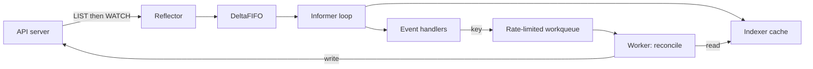

# Informers, Reflectors, and Workqueues

## Definition

The caching machinery inside client-go and controller-runtime. It watches the API server over HTTP streams, keeps an in-memory local cache to avoid overloading etcd, and queues object keys (namespace/name) for worker threads to process. [[sources/krm-platform-vocabulary]]

## Why it matters

This machinery is why one controller can watch thousands of objects cheaply, and it is where scaling limits appear: cache memory, queue depth, worker concurrency, and rate limiting. The scale gap in [[open-knowledge-gaps]] centers on this topic.

## The pipeline, stage by stage

A Reflector performs an initial LIST to obtain a consistent snapshot and then opens a WATCH on the same resource, streaming changes. Each change goes into a DeltaFIFO queue, which keeps per-key order and collapses consecutive identical deltas. The informer's process loop pops deltas, writes the object into a thread-safe Indexer (the local cache, keyed by `namespace/name` through `MetaNamespaceKeyFunc`, with optional secondary indexes on namespace, labels, owner references, or custom fields), and then calls the registered event handlers. Controller code reads through read-only Listers that query the Indexer and never the API server. [[sources/research-informers-reflectors-and-workqueues]]

The handlers are meant to do almost nothing. They compute the object's key and add it to a rate-limited workqueue, and the client-go architecture document states that informer event handlers only add an object's key to the work queue. Worker goroutines then take a key, read the current object from the cache, and reconcile it. The secondary explainer in the dossier compresses the design as one watch per resource type, one cache per process, one reconcile per key, and one rate limiter per workqueue. See [[examples/kubebuilder-owns-and-a-field-indexer-wire-child-changes-to-the-owner]] for the framework view.

## The workqueue contract

The workqueue package offers a base queue (Add, Get, Done, ShutDown), a delaying queue (`AddAfter`), and a rate-limiting queue (`AddRateLimited`, `Forget`). It gives three guarantees: fair FIFO ordering, deduplication of items added before they are processed, and no concurrent processing of one item. Many events for one object therefore collapse into one key, and a reconciler never races with itself on that key. The default limiter combines per-item exponential backoff (5 ms base and a 1000 s cap, as extracted by the dossier) with an overall token bucket (10 per second, burst 100), and authors must call `Done()` and `Forget()` or retry tracking persists. [[sources/research-informers-reflectors-and-workqueues]] See [[findings/skipping-done-or-forget-on-the-workqueue-leaves-items-stuck-or-retrying]] and [[findings/retry-storms-and-unbounded-retries]]. The numbers come from a condensed extraction and should be verified against current code before they are quoted.

## How a watch recovers

The resource version is the cursor that lets a watch resume. When a cursor is too old, the API server answers 410 Gone and the client must relist. Watch bookmarks refresh the cursor during quiet periods, the server's watch cache lets clients resume from recent versions, and jittered backoff keeps many clients from relisting at the same moment. See [[findings/an-expired-resourceversion-forces-a-relist-and-synchronized-relists-can-storm]].

## Events as hints and cache lag

Watch events delivered through informers are hints that enqueue an object key, and the reconciler then reads the full object from the cache. Because the cache can lag the controller's own writes, controllers need deterministic names or expectations to avoid acting twice. [[sources/research-level-triggered-vs-edge-triggered]] See [[decisions/events-as-hints-state-as-truth]] and [[findings/stale-cache-and-double-action]]. The controller-runtime cache blog adds that the cache-backed client reads from the cache while writes and status updates go straight to the API server, and that authoritative reads need an explicit uncached reader. [[sources/research-informers-reflectors-and-workqueues]]

## Resync

Periodic resync is usually disabled. One dossier source calls it a defense against reconciler bugs, while the pitfalls blog lists misunderstanding it as a common error, and defaults differ by framework. No source in the wiki yet explains whether resync replays cached state to handlers or refetches from the API server. See [[decisions/keep-informer-resync-disabled-or-set-a-periodic-resync]] and the resync gap in [[open-knowledge-gaps]].

## Costs and tuning knobs

The cache holds every watched object with no eviction, so memory grows with the number of objects watched. Worker concurrency and rate limits decide how many reconciles run and how fast failing items return, and for controllers that call external APIs they decide the call rate. Tool stacks expose these knobs differently: Flux through `--concurrent` and Helm cache flags, Argo CD through sharding, processor counts, and `GOMEMLIMIT`, and Crossplane through `--max-reconcile-rate`. See [[findings/informer-caches-hold-every-watched-object-and-memory-grows-with-cluster-size]], [[comparisons/concurrency-and-cache-memory-controls-across-flux-argo-cd-and-crossplane]], and [[comparisons/load-and-fairness-controls-across-controller-runtime-flux-argo-cd-and-kro]].

## Staleness and observability in v1.36

Informer caches can lag the API server when watch events are delayed or missed, so controllers may act on outdated state. The Kubernetes v1.36 blog describes staleness mitigation and metrics for cache synchronization and watch latency, which makes the lag observable. The dossier's summary of the specific mechanisms was generic and needs verification. The work queue deduplicates keys and applies exponential backoff to failures, and kro's tuning page gives concrete queue numbers. [[sources/research-eventual-consistency-and-convergence]] See [[findings/stale-cache-and-double-action]] and [[examples/kro-shared-queue-tunes-throughput]].

## Pitfalls

Heavy handlers and expensive reconciles waste API calls ([[findings/heavy-event-handlers-and-expensive-reconciles-waste-api-calls]]). Many list-and-watch clients can overload an API server and block the remediation that would fix it ([[findings/control-plane-overload-blocks-the-remediation-that-would-fix-it]]). Mutating cached objects or reading an unsynced cache corrupts reconcile input ([[findings/mutating-objects-from-a-shared-cache-or-reading-an-unsynced-cache-corrupts-reconcile-input]]).

## Related

[[concepts/reconciliation-loop]], [[concepts/level-triggered-vs-edge-triggered]], [[concepts/gvk-and-gvr]], [[concepts/operator-pattern]], [[entities/client-go]], [[entities/controller-runtime]]

## To research

Resync semantics, controller sharding in Flux and Crossplane, cache-narrowing options such as selectors and transforms, and the informer choices of kro, Config Connector, ACK, and Cluster API. See [[open-knowledge-gaps]].
