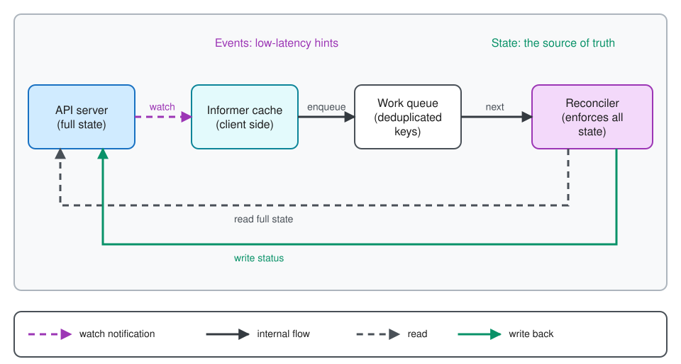
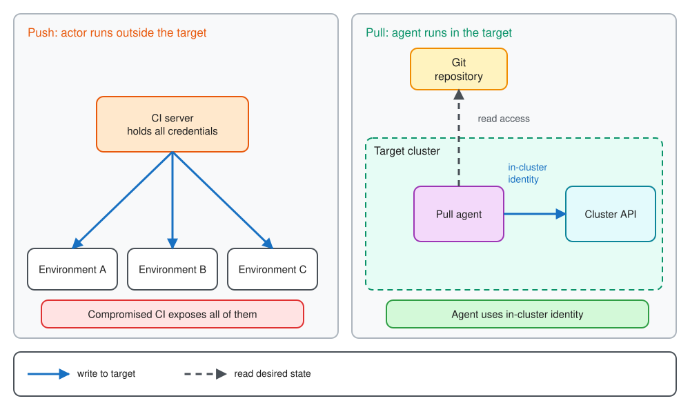
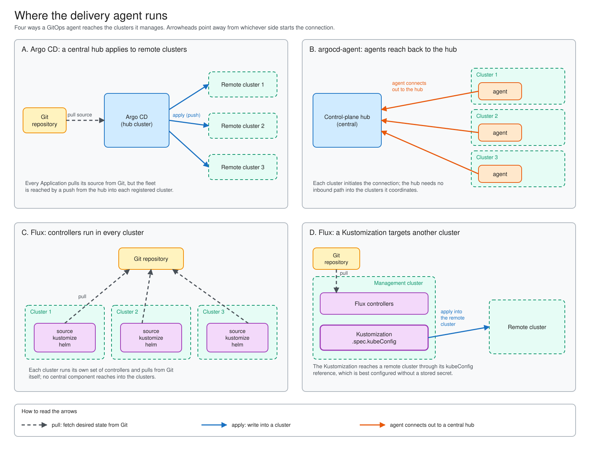
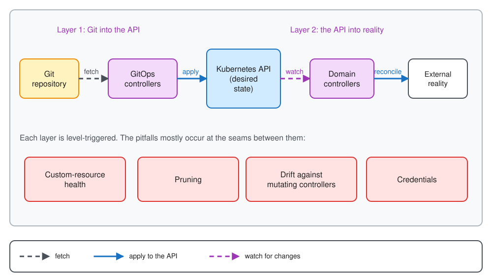

# Part 1: Why Kubernetes Works as a Universal Control Plane

> [!NOTE]
> **Audience:** Engineers who operate Kubernetes (pods, deployments, services, RBAC, kubectl) but have not yet studied controllers, API machinery, or platform abstractions<br>
> **Purpose:** Explain the five architectural principles that let Kubernetes manage resources far beyond containers, and show how Flux, Crossplane, and neighboring tools inherit them<br>
> **Status:** Active<br>
> **Created:** 2026-11-25<br>
> **As of:** 2026-11-27<br>
> **Draws on:** [[concepts/universal-control-plane]], [[concepts/declarative-vs-imperative]], [[concepts/level-triggered-vs-edge-triggered]], [[concepts/eventual-consistency-and-convergence]], [[concepts/self-healing-and-drift-detection]], [[concepts/gitops-pull-based-delivery]], [[concepts/reconciliation-loop]], [[concepts/tooling-landscape]], [[concepts/pitfalls-and-case-studies]], [[findings/a-requeue-true-result-backs-off-exponentially-because-only-requeueafter-forgets-the-failure-history]], [[findings/no-named-organization-postmortem-was-found-for-kro-config-connector-ack-or-cluster-api]], [[findings/argo-cd-ignoredifferences-only-affects-the-diff-unless-respectignoredifferences-is-set-and-then-only-for-resources-that-already-exist]], [[findings/a-flux-ignore-rule-without-a-target-selector-matches-every-object-the-kustomization-manages]]<br>

## 1. Who this series is for and how to read it

This series is written for people who already run Kubernetes. You know what a Pod is, you have written a Deployment, you have fought with a Service selector, and you have granted or denied access with RBAC. What you may not have studied is the machinery underneath those objects: the controllers that make a Deployment produce Pods, the API conventions that make every object look alike, and the abstractions that tools like Flux and Crossplane build on top. That machinery is the subject of the series, and this first part supplies the foundation for everything after it.

The thesis of this part is simple to state. Kubernetes generalizes beyond containers because a small set of principles compose into a control plane that can manage any resource. Those principles are declarative intent, level-triggered reconciliation, eventual consistency, continuous drift correction, and pull-based delivery. Each one is useful alone. The reason the design works is that they reinforce one another, and the reason good platforms built on Kubernetes tend to behave well is that they inherit all five at once. Platforms that quietly break one of the five tend to be the ones that surprise their operators.

Here is how to read this part. Section 2 frames Kubernetes as a general control plane, and sections 3 through 7 introduce the five principles one at a time, starting from first principles and ending with a practical use case. Section 8 steps back and asks which design rules fall out of the model, using Flux and Crossplane as worked implementations. Section 9 collects industry use cases. Section 10 covers the pitfalls that appear in practice, and section 11 compares how Argo CD, Terraform, Cluster API, and others differ on these principles. Section 12 says where the series goes next. A short list of further reading closes the document.

A word about evidence. This part rests on a research wiki whose sources are mostly tool documentation, design documents, practitioner blog posts, and a small number of public postmortems. Where the wiki has only a vendor claim or a single practitioner account, the prose says so. The claims about the tools around that core, namely Argo CD and its ApplicationSets, Flux internals, Config Connector, ACK, kro, Kratix, Radius, Score, Backstage, tofu-controller, KRM functions, and Crossplane packaging, rest on each project's documentation and source code, and many of those documentation pages describe a project's default branch and not a pinned release. This part teaches mechanisms and design trade-offs, so it names no tuning values. The principles are stable across tools, and the specific settings each tool exposes are best read from the documentation of the release you run.

A short vocabulary note will save time later. A **controller** is a program that watches objects in the Kubernetes API and works to make the world match what those objects say. A **custom resource** is an object type that you or a tool adds to the API, and a **CRD** (CustomResourceDefinition) is the registration that teaches the API server about it; see [[concepts/custom-resource-definition]]. The **spec** of an object holds the intent a user wrote, and the **status** holds what controllers observed; see [[concepts/spec-status-split]]. Each term will be explained again where it matters.

## 2. From container scheduler to universal control plane

Most of us first meet Kubernetes as a way to run containers. You hand it a Deployment, and Pods appear on nodes. That experience hides the fact that Kubernetes ships two separable things together. One is a container scheduler. The other is a general, extensible API machine: an API server that handles authentication, RBAC, admission, validation, and watch, backed by etcd for storage, plus a convention for controllers that reconcile an object's `spec` toward reality and report back in `status`. The research behind this wiki makes the separation explicit: the second part has no inherent tie to Pods, so anything that can be described declaratively and reconciled by a loop can be modeled as a custom resource, whether that is a cloud database, a whole cluster, a firewall rule, or an application bundle ([[concepts/universal-control-plane]]).

Consider what you get for free when you represent an external thing as a Kubernetes object. The object inherits authentication, RBAC, audit logging, watch semantics, and a large ecosystem of tooling. The API conventions fix `spec` and `status`, conditions, `resourceVersion`, and finalizers for every kind. A condition is a named true, false, or unknown flag in `status` that reports one aspect of an object's health. The `resourceVersion` is an opaque marker the API server stamps on each object so that a writer holding an out-of-date copy can be detected and rejected. A finalizer is a marker on an object that blocks its deletion until the responsible controller has finished its cleanup work, such as removing a cloud resource. Because these conventions are shared, generic tools such as GitOps engines, policy engines, and user interfaces work across all kinds without knowing anything about the particular one. That uniform contract is the real product. A team that wants a managed database to follow the same review, access control, and delivery workflow as its Deployments can get that by making the database an object.

The wiki describes the resulting ecosystem as four layers ([[concepts/universal-control-plane]], [[concepts/tooling-landscape]]). The bottom layer is the primitives: controllers as control loops, CRDs stored in etcd, and the operator pattern, which packages operational knowledge into a controller paired with a custom resource ([[concepts/operator-pattern]]). Above that sit provider controllers that project an external API into Kubernetes. AWS Controllers for Kubernetes (ACK), Google's Config Connector, Azure Service Operator, and Cluster API are the examples; they follow what the Kubernetes controller documentation calls direct control, where a controller acts on an external system instead of creating Pods ([[entities/ack]], [[entities/config-connector]], [[entities/cluster-api]]). Above those are composition layers such as Crossplane and kro, which let a platform team publish a small API that expands into many resources ([[entities/crossplane]], [[entities/kro]]). At the top are delivery layers, Flux and Argo CD, which reconcile Git into the API server ([[entities/flux]], [[entities/argo-cd]]).

Figure 1.1 stacks the four layers inside the API server and shows where Git and the external cloud APIs connect to them.


*Figure 1.1. Four layers of the Kubernetes ecosystem. The four layers sit inside the Kubernetes API server, each built on the one below. Git feeds the delivery layer at the top, and the provider controllers reach out to external cloud APIs by direct control.*

The same sources note a consequence worth pausing on. A delivery tool and a provisioning tool are not rivals, because one moves manifests into the API and the other turns objects in the API into cloud calls. Asking whether Argo CD or Crossplane is better confuses the layers, and most production stacks pick one tool from each ([[concepts/tooling-landscape]], [[comparisons/delivery-versus-provisioning-versus-platform-layers-in-the-kubernetes-tooling-landscape]]). The wiki flags that the layers are a learning aid and not a hard taxonomy: Crossplane reaches into the platform layer through its composition API, and Kratix reaches into provisioning through pipelines.

At the far edge of the idea is a project like kcp, a project that hosts many isolated, node-less API workspaces so a SaaS provider can serve a Kubernetes-style API to tenants without giving each one a cluster ([[entities/kcp]], [[examples/multi-tenant-api-hosting-with-kcp]]). Its tenant counts come from vendors and its larger scale numbers are stated goals, not measurements. Ænix, a company that argues for purpose-built distributions that are not container platforms, makes the most explicit version of the claim in an opinion post: the API server and controller convention are the product, and the container scheduler is optional ([[examples/non-container-appliances-on-the-kubernetes-api]]). The wiki records that vision as having limited production evidence, and Ænix lists its own risks, including a small maintaining team and limited production testing.

So the claim of this part is not that Kubernetes is magically suited to everything. It is that a specific set of design decisions, taken together, produce a substrate that is unusually good at holding intent and driving the world toward it. The next five sections take those decisions one at a time.

## 3. Declarative versus imperative: intent as the contract

The first principle is declarative intent. To manage something declaratively means to describe the end state you want, usually as YAML in an object's `spec`, instead of writing the sequence of commands that would produce it. The Kubernetes documentation calls an object a record of intent: you store what you want, and the control plane works to make the observed `status` match the `spec`. Imperative management is the opposite. You tell the system what action to take now, as with `kubectl create`, `kubectl scale`, or a shell script ([[concepts/declarative-vs-imperative]]).

The distinction matters more than it first appears, because a declared end state gives a controller something to compare against reality. An imperative script has no standing definition of correct that it can return to. If a script runs once and the world later changes, nothing in the script notices. A declared spec is a persistent statement that the system can evaluate over and over, which is what makes reconciliation, drift correction, and GitOps possible at all.

The official kubectl documentation treats the choice as a spectrum, not a binary ([[comparisons/kubectl-object-management-techniques]], [[decisions/choosing-an-object-management-technique]]). Imperative commands have the lowest learning curve but leave no review or audit trail, so they suit development. Imperative object configuration, such as `kubectl replace -f`, keeps files but still issues explicit verbs, which suits a single writer in production. Declarative object configuration, `kubectl apply -f dir/`, suits multiple writers and gives reviewable files, but it is harder to debug because of the merge and patch logic underneath. The page also warns against mixing techniques on the same object, a hazard the wiki collects under [[findings/mixing-management-techniques-on-one-object]].

Here is a small declarative example, a Deployment you have seen many times, read with fresh eyes.

```yaml
apiVersion: apps/v1
kind: Deployment
metadata:
  name: web
spec:
  replicas: 3
  selector:
    matchLabels: { app: web }
  template:
    metadata:
      labels: { app: web }
    spec:
      containers:
        - name: web
          image: registry.example.com/web:1.4.2
```

Notice that the manifest says `replicas: 3`, not "start three pods." The Deployment controller is the machine that notices when the number of ready Pods differs from three and acts. If a node dies and takes a Pod with it, no one runs a command; the next comparison finds two Pods where three were declared and creates another. The API conventions add that fields should express desired outcomes and not actions, which is what keeps a spec declarative ([[concepts/declarative-vs-imperative]]).

The model repeats at every layer. Flux and Argo CD treat Git as the declared state and reconcile the cluster to it. Crossplane, Config Connector, ACK, and Cluster API extend the idea to cloud resources and whole clusters. kro and Crossplane compositions let platform teams define new declarative APIs that expand into many resources. Each layer is the same bet: write down what you want, and let a loop pursue it.

The honest caveat is that pure declarative management is not absolute in practice. Kubernetes keeps imperative commands for development and one-off tasks, and tools expose escape hatches such as Flux suspend, retain or orphan deletion policies, force, and abandon. The wiki's view is that those escape hatches exist because declarative reconciliation is dangerous when ownership, deletion, or drift semantics are misunderstood. The sources also note that ordering, one-shot operations, and data migrations remain weak spots for a purely declarative model, and that the sources do not explain how tools work around them beyond hooks and sync waves.

## 4. Level-triggered versus edge-triggered: why state beats events

The second principle answers a question that sounds technical and turns out to be fundamental: what should a controller react to? There are two answers, borrowed from electronics. An edge-triggered system reacts to a transition, such as a signal going high or a Pod being deleted. A level-triggered system reacts to the current value, such as the signal being high or three replicas being desired while two exist ([[concepts/level-triggered-vs-edge-triggered]]).

The difference is easiest to see when something goes wrong. Imagine an autoscaler that receives events. The replica count changes from 1 to 5 and then from 5 to 2. An edge-triggered handler applies each event as a delta: add four, then remove three. If it misses or reorders events, it can act on the wrong deltas, and the 2018 level-triggering article the wiki relies on shows it terminating more replicas than exist and ending at zero, a state the source of truth never held ([[examples/an-edge-triggered-scaler-ends-at-zero-replicas-where-a-level-triggered-one-converges]]). A level-triggered controller compares the declared count of 2 with the observed count each time it runs, so it ends at 2 regardless of which intermediate events it saw ([[examples/deployment-replica-changes-converge-to-the-final-count]]). Joe Beda is quoted in the source explainer as saying that if you are edge triggered you run the risk of compromising your state and never being able to re-create it. An online book sums up the trade: edge-triggered systems require reliable event delivery, while level-triggered systems only require eventual state observation.

This is why the Kubernetes reconcile function receives only a namespace and a name. It is not told whether the object was created, updated, or deleted. The controller-runtime documentation says reconciliation is driven by actual cluster state, read from the API server or a local cache, and not by individual events ([[concepts/reconciliation-loop]]). A sketch of the structure of such a function makes the point.

```go
func (r *WebReconciler) Reconcile(ctx context.Context, req ctrl.Request) (ctrl.Result, error) {
    // Read everything needed from observed state; never branch on "what event woke me".
    var web examplev1.Web
    if err := r.Get(ctx, req.NamespacedName, &web); err != nil {
        return ctrl.Result{}, client.IgnoreNotFound(err)
    }
    // Compare web.Spec with the child objects that exist, then create, update, or delete to close the gap.
    // Write what was observed back to web.Status.
    return ctrl.Result{}, nil
}
```

Read the comments rather than the Go. The function is handed a key, fetches the current object, compares desired with actual, and writes the result into status. Returning an empty result with a nil error means the object has converged. Returning an error asks the work queue to retry with exponential backoff, meaning progressively longer waits between attempts. The work queue is the deduplicating list of object keys waiting for reconciliation, so ten events for one object collapse into one pending key. A `RequeueAfter` value means the object is healthy but waiting, and it is the supported way to poll on a schedule. The controller-runtime source shows what `Requeue: true` does. A nil error together with `Requeue: true` is treated as a rate-limited requeue: the controller's rate limiter chooses the delay, and the per-item failure counter is not reset, so a reconciler that returns `Requeue: true` on every pass waits exponentially longer each time. The one path that clears that history is `RequeueAfter`, which makes the queue forget the item's failure count before scheduling the next visit, and it takes precedence when both are set. A common assumption is that a bare requeue is immediate, but the queue's behavior is rate limited, which is worth remembering when a controller seems to slow down for no obvious reason. The practical rule is to return an error for failures that should back off and `RequeueAfter` for planned polling, and never to use `Requeue: true` as a poll timer, because the growing delay will keep you from ever getting a steady cadence ([[findings/a-requeue-true-result-backs-off-exponentially-because-only-requeueafter-forgets-the-failure-history]], [[concepts/reconciliation-loop]]).

It would be a mistake to conclude that Kubernetes ignores events. In practice it is a hybrid. A watch is a long-lived request that streams changes from the API server, and an informer is a client-side cache that a watch keeps up to date and that notifies the controller when something changes. Together they deliver events with low latency, which is an edge-triggered optimization, but each event is only a hint to enqueue an object key. The reconciler then reads full state and enforces all of it. The Kubernetes design archive says controllers are level-based to maximize fault tolerance and that watches restore the latency benefits of edge triggering without making correctness depend on them ([[decisions/events-as-hints-state-as-truth]]). Tim Hockin's slides are cited for the shorter version: state is more useful than events. Edge triggering is not always wrong, either, since it transmits only changes and can be made safe with periodic full resync or ordered, versioned events.

Figure 1.2 traces the path from a watch event to a reconcile, showing that the event only enqueues a key and the reconciler reads state for itself.



*Figure 1.2. Events are hints, state is truth. A watch feeds changes into the informer cache, and each change only puts an object key on the work queue. The reconciler then reads the full state from the API server and writes status back, so correctness rests on state rather than on any single event.*

Level triggering also pays off when a controller is simply offline. The sig-api-machinery guide warns that your controller may be off for an indeterminate time before running again. A controller that keys its behavior on remembered events, such as a Pod having been deleted, will miss whatever happened during the outage and then act on a stale picture. A level-driven controller starts, reads the world, and repairs it ([[findings/a-controller-that-relies-on-seeing-every-event-misses-changes-made-while-it-is-down]]). Because a level-triggered loop may run at any time and any number of times, its logic must also be idempotent, meaning that running it again leaves the system in the same end state as running it once ([[concepts/idempotency]]).

The cost is real and the wiki lists it. A cache read can lag the controller's own writes, so a controller can act twice on one gap; core controllers handle this with deterministic names or with expectations that remember in-flight actions ([[findings/stale-cache-and-double-action]]). Constant re-checking costs reads and external API calls, covered in section 6. A pattern, not just a Kubernetes detail, emerges: the ApeiroRA reference architecture recommends the same controller idiom for digital-twin systems far outside container scheduling, framing level triggering as favoring resilience over efficiency ([[examples/controller-pattern-for-digital-twins]]).

## 5. Eventual consistency and convergence: what "done" means

The third principle changes what we mean by finished. In a system with many independent controllers, nothing happens instantly, and nothing is applied in a strict global order. The Kubernetes answer is to accept that. Instead of building a dependency graph up front, resources are applied concurrently, and anything whose prerequisites are missing fails and retries until those prerequisites exist ([[concepts/eventual-consistency-and-convergence]]).

The convergence research states the guarantee precisely. Kubernetes does not promise that the gap between desired and actual state closes instantly, or that every intermediate change is seen. It promises that the system keeps working toward the latest declared state, and convergence is the observable result: actual state settles on desired state once disruptions stop. The API conventions say the system drives toward the most recent spec regardless of previous versions. The practical lesson is the one from the replica example: if you edit a value five times quickly, treat it as one edit to the final value, because the last declared state wins.

You have probably seen this when applying a large set of manifests for the first time. A custom resource may be rejected because its CRD has not been established yet, or a workload may fail because a ConfigMap has not appeared, and then everything settles on a later pass. That is not a bug in your manifests. It is the design working as intended, and it explains why platform tools lean on retries and status conditions instead of strict ordering ([[concepts/conditions]]).

Status is how users learn where convergence stands. Conditions and `observedGeneration` tell you whether a given generation of the spec has been acted on. The API server increments an object's `metadata.generation` every time its spec changes, and a controller copies the value it last processed into `status.observedGeneration`, so a mismatch between the two means the controller has not yet caught up with your latest edit. Crossplane offers a clear illustration with two separate conditions on each managed resource: `Synced` says the provider can reconcile the resource, and `Ready` says the external thing is available. While a cloud database provisions, a user sees `Synced` true and `Ready` false, which means the controller is working and the thing is not usable yet. Reading only one of the two gives the wrong answer, and even the pair can mislead. A provider that performs its cloud calls asynchronously can leave `Synced` true while an operation is still in flight, so a single condition cannot be trusted alone. Read the provider's own operation-status signal and `observedGeneration` as well as `Synced` and `Ready` ([[examples/crossplane-database-claim-reports-synced-and-ready]]). Generic tooling that must decide "is this done?" for any kind uses a convention called kstatus, and the wiki's reading of it shows why the `observedGeneration` check matters. It checks deletion first, then generation, then the Reconciling and Stalled conditions, and only then Ready, and it reads only the top-level `status.observedGeneration` because the condition struct has no per-condition field. A stale top-level value therefore overrides a `Ready: True` condition, and a kind with no Ready condition at all is treated as always reconciled ([[findings/kstatus-checks-deletion-then-generation-then-reconciling-and-stalled-then-ready-so-a-stale-top-level-observedgeneration-overrides-ready-true]], [[findings/kstatus-reads-only-the-top-level-observedgeneration-because-its-condition-struct-has-no-per-condition-field]], [[findings/kstatus-treats-an-unknown-kind-without-a-ready-condition-as-always-reconciled]]). Note the polarity as well: Reconciling and Stalled are abnormal-true conditions, where true means something needs attention, while Ready is normal-true, so a naive "any condition false is bad" rule misreads them.

Convergence has costs, and the wiki lists them with mitigations. Informer caches lag the API server, so reads can be stale; optimistic concurrency turns a stale write into a retried conflict. Retries can amplify load when there is no backoff or no limit on the number of attempts. Multiple replicas without leader election, the mechanism by which replicas of a controller agree that exactly one of them acts at a time, duplicate work. Kubernetes does not order dependent resources, so Flux, Argo CD, and Crossplane add health-based ordering. And drift correction is slow when the check interval is long. The ordering point deserves a concrete example, because the ordering tools show where a purely concurrent model is stretched. Flux provides `dependsOn` between Kustomizations plus health checks, so a dependent waits for the thing it needs to be Ready. Argo CD orders a sync by phase, then wave number, then kind and name, and it advances to the next wave only when the current wave is healthy ([[entities/flux]], [[entities/argo-cd]]).

## 6. Self-healing and drift detection, and the cost of constant reconciliation

The fourth principle is the one operators notice first. Self-healing is the continuous process by which a controller compares declared state with observed state and acts to close the gap, automatically reverting out-of-band changes such as a manual `kubectl edit` or a cloud console change. Drift is the gap itself: someone or something changed a live object or external resource away from what the source of truth says ([[concepts/self-healing-and-drift-detection]]). The mechanism is the same non-terminating control loop from section 4. Nothing new is added; the loop simply never stops, so the declared spec becomes an enforced contract instead of a suggestion.

There are two layers of drift, and the wiki separates them. For in-cluster objects, Flux and Argo CD detect drift by comparing desired manifests with live objects. Flux runs a server-side apply dry run on each interval (server-side apply is the mode in which the API server itself merges a submitted manifest into the live object and records which writer owns each field, and a dry run asks it to compute the result without saving it), and Argo CD marks the application OutOfSync and, if `selfHeal` is on, syncs again. For external infrastructure such as databases, buckets, and IAM, the same loop calls a provider API. Crossplane treats the `forProvider` field of a managed resource as the source of truth, so an edit made in a cloud console is reverted on the next poll ([[examples/cloud-console-changes-reverted-by-provider-controllers]]). Cluster API extends the idea to machines, where a MachineHealthCheck replaces unhealthy Machines ([[examples/cluster-api-machine-health-check-replaces-failed-nodes]]).

Figure 1.3 lays the two layers out as separate lanes, one inside the cluster and one reaching out to external infrastructure.


*Figure 1.3. Two layers of drift detection. The top lane shows Flux and Argo CD comparing desired manifests in Git with live objects and reverting drift inside the cluster. The bottom lane shows the same loop reaching outside the cluster, where Crossplane corrects cloud-side edits and Cluster API replaces unhealthy Machines.*

The scenario is easy to reproduce. Someone hand-edits a Deployment in production. With Flux, the next reconcile re-applies the manifest from Git, and with Argo CD self-heal on, the same happens after a short delay. The edit is not lost through a bug. It is lost because the system is doing exactly what a level-triggered controller does, and teams that need emergency changes must pause reconciliation first ([[examples/gitops-reverts-a-hand-edited-deployment]]).

The cost side is where design judgment enters. Observing the world is not free, and detection latency equals the check interval ([[findings/drift-detection-latency-is-the-interval]]). How often a controller re-checks the outside world is a trade-off between how quickly drift is noticed and how many calls are spent on the external API. In-cluster tools read the Kubernetes API, which is cheap, so they can check often. Controllers that talk to cloud APIs pay for every observation in rate-limit quota and time, so they check far less often, and many let you choose the cadence per resource. Most also add jitter, a small random offset on each interval so that many objects do not all poll at the same instant.

What gets compared also differs by tool. Flux runs a server-side apply dry run against live objects, and for Helm releases a dry-run apply of the stored manifest that can either warn about drift or correct it. Argo CD compares target manifests with live state. Crossplane compares the `forProvider` fields of a managed resource with the state of the external resource, and Config Connector and ACK compare the spec with the state of the cloud service. Cluster API's periodic sync refreshes its own cache and is not a poll of the cloud infrastructure.

The cadences differ for a reason that follows from the cost argument above. In-cluster tools such as Flux and Argo CD compare against the Kubernetes API, which is cheap to read, so they can afford to re-check often. Controllers that sit on top of cloud APIs or large resource graphs spend rate-limit quota and time on every full check, so they re-check far less often. Cadence is also a property of the component doing the checking and not of the product as a whole: a core controller, a generated provider, and a hand-written provider can each poll at their own pace, so a statement about drift latency for a platform is meaningful only when it names the component. Webhooks that trigger an immediate sync sit on top of polling in tools that support them. Config Connector shows a different design choice. All of its reconcilers, whatever kind of controller sits behind a resource, end a successful pass by requeuing through one shared jittered function, and a per-resource annotation can override the cadence, so the controller type alone does not change how often drift is noticed. The case that needs periodic reconciliation switched off is a resource that cannot be read back after creation, because otherwise the controller would find nothing and create it again on every pass ([[findings/config-connector-direct-terraform-and-dcl-reconcilers-share-one-jittered-requeue-so-the-controller-kind-alone-does-not-change-the-cadence]]).

The word "resync" names different mechanisms, and the difference matters because two tools that both advertise a long resync may do very different work. In client-go and controller-runtime, a resync replays every object in the informer's local cache to the event handlers, and the client-go interface comment states that it adds no interaction with the authoritative storage. It never contacts the API server or the external system, and it produces an artificial update event whose old and new objects are identical, so a predicate that filters on generation changes discards it ([[findings/a-resync-replays-the-informers-local-cache-to-the-handlers-and-never-contacts-the-api-server]]). Some tools describe a resync as a re-list while their code performs the cache replay, so read the mechanism and not the label; kro is an example, and that reading is an interpretation of its source code and is not stated in its documentation. A provider controller such as ACK does something different: after a successful reconcile the runtime requeues the resource after a long delay, which causes a real re-read of the cloud resource on each pass. The consequence is that a provider's requeue delay sets the longest time an out-of-band change can go unnoticed, whereas a cache resync gives handlers another chance to enqueue keys they may have dropped and cannot notice a change the informer never received. Cluster API's periodic sync is of the cache kind, so its self-healing for machines comes from health checks and not from that setting, and the sources describe no Cluster API drift handling that polls the cloud ([[findings/the-word-resync-names-three-different-mechanisms-in-client-go-kro-and-ack]]).

The consequence of a very long check interval on an external resource is that a console change may sit uncorrected for a long time, whereas a resource polled frequently is rechecked quickly, at the price of an API call per resource per poll ([[decisions/choosing-a-drift-check-interval-for-external-resources]]). Shorter intervals correct faster and cost more quota, and the guidance in the sources is to choose intervals per resource class, with short ones where drift is costly ([[findings/cost-of-constant-reconciliation]]). Jitter spreads polls across a window, which is why a fleet of objects configured with the same interval does not apply on the same second and why drift latency is about the interval and not exactly the interval ([[comparisons/drift-detection-mechanisms-across-tools]]).

A second cost is that a continuous loop reverts intentional changes along with accidental ones. The wiki calls this the main operational lesson for platform teams: decide who owns each field ([[findings/continuous-loops-override-intentional-changes]]). Every tool ships an off-switch, which suggests the problem is common. Flux has `suspend`, Argo CD has a self-heal toggle, Crossplane has a pause annotation and management policies such as Observe-only, and Config Connector lets you switch periodic reconciliation off for a resource. A short Flux example shows several of these settings together.

```yaml
apiVersion: kustomize.toolkit.fluxcd.io/v1
kind: Kustomization
metadata:
  name: apps
  namespace: flux-system
spec:
  interval: <how stale Git may be>       # periodic full reconcile; drift is detected at this cadence
  retryInterval: <cadence for failures>  # separate schedule when a reconcile fails
  path: ./apps/production
  prune: true            # delete objects removed from Git
  wait: true             # treat readiness of applied objects as part of success
  suspend: false         # set to true during incident work to stop applying and drift detection
  sourceRef:
    kind: GitRepository
    name: fleet
```

Read it as a set of decisions. The `interval` is how stale the cluster can be relative to Git. The `retryInterval` keeps a failing object from sharing the healthy cadence. `prune` decides whether a missing manifest means deletion, which section 10 returns to. `suspend` is the deliberate pause an operator uses during an incident. Because the interval is a statement about how long drift may persist, it belongs in each manifest as an explicit choice and not as something a team assumes a tool supplies, and the right value depends on how costly drift is and how cheap the comparison is.

## 7. GitOps pull: Git as desired state and push versus pull delivery

The fifth principle applies the first four to the problem of delivery. GitOps is a way of operating a system in which the whole desired state is written declaratively, stored in a versioned and immutable store (usually Git, increasingly an OCI registry, meaning a container registry used to store OCI artifacts such as manifests and charts, not only images), and applied by software agents instead of by humans or pipelines running commands. The OpenGitOps working group under the CNCF reduces it to four principles: the state is declarative; it is stored versioned and immutable with full history; agents automatically pull it; and agents continuously observe actual state and try to apply the desired state ([[concepts/gitops-pull-based-delivery]]).

The last two principles are what separate GitOps from CI/CD that happens to read YAML from Git. A pipeline that pushes once and never looks again does not qualify, because it has no continuous loop. This is exactly the declarative-intent, level-triggered, self-healing machinery from the earlier sections, pointed at a source of truth that lives in Git.

Push and pull differ in where the actor runs and what it holds. A push pipeline runs outside the target on a CI server and needs credentials for every environment it deploys to, so a compromise of that server exposes all of them. A pull agent runs in or next to the target, fetches desired state with read access to the source, and writes with in-cluster identity ([[comparisons/push-versus-pull-delivery]]). INNOQ makes the security case in an article the wiki cites, and also argues that the pattern does not require Kubernetes: a custom operator running inside a virtual machine fleet or cloud environment could read desired state from Git and reconcile it, though INNOQ warns that the hard part is continuous reconciliation and not fetching YAML ([[examples/gitops-agent-on-non-kubernetes-targets]]). The wiki found no named production deployment of that design.

Figure 1.4 contrasts the two models by showing which side holds the credentials.



*Figure 1.4. Where push and pull delivery hold credentials. A push pipeline runs on a CI server outside its targets and holds credentials for every environment, so one compromise exposes them all. A pull agent runs inside the target, reads the source with read access and writes to the cluster with its in-cluster identity.*

Pull is not a free lunch. The agent becomes a powerful identity itself, so tools add counters. Flux impersonates a per-tenant service account when applying, so a team's Kustomization can only create what that account may create ([[findings/blast-radius-and-privilege-centralization]]). ControlPlane's Flux D2 reference architecture goes further for regulated fleets: CI builds and signs artifacts and pushes them to an OCI registry, and clusters pull the signed artifacts so they never connect to the Git host ([[examples/flux-d2-gitless-gitops-fleet-with-signed-oci-artifacts]]). That is a vendor write-up, and whether Git or OCI should be the source of record is left open by the sources. Morgan Stanley's reported setup used S3 buckets as a source for another reason, which the write-up gives as availability and compliance.

The word pull also hides a distinction that matters once you run many clusters. Argo CD pulls from Git, but a single central Argo CD instance reaches into each registered remote cluster to apply changes, so delivery to a fleet is still a push from a hub even though every Application pulls its source. A separate project in the argoproj-labs organization, argocd-agent, describes the inverse, in which lightweight agents in each cluster reach back to a central hub. Flux more commonly runs a set of controllers inside every cluster, although a Kustomization can also target a remote cluster through `.spec.kubeConfig`, which the specification recommends configuring without a stored secret ([[findings/argo-cd-reaches-into-registered-clusters-from-a-hub-and-the-argocd-agent-pull-model-is-a-labs-project-of-unverified-maturity]], [[decisions/reach-spoke-clusters-from-a-central-argo-cd-hub-or-with-argocd-agent-pulling-from-the-spokes]]). On the Argo CD side, an ApplicationSet is a controller that stamps out many Applications from generators, such as a list of registered clusters or a set of pull requests. ApplicationSets have structural limits worth knowing. Generators can be combined only in restricted ways, so a matrix of generators accepts few children and combinations nest only shallowly. Generators that poll an outside system, such as the pull request generator, trade freshness against that system's rate limits, and anonymous requests are throttled more tightly than authenticated ones. The staged-rollout strategy takes over sync control from the generated Applications, so automatic sync is switched off on them, and it judges progress only by Application health, so anything the health check cannot see does not hold a rollout back. The sources give no quantified scale limit for ApplicationSets or hub-and-spoke Argo CD, which says only that none is documented and is not a claim that none exists.

Figure 1.5 shows the four arrangements side by side.



*Figure 1.5. Where the delivery agent runs. Argo CD pulls its source from Git but pushes into remote clusters from a central hub. The argocd-agent project inverts that, with agents in each cluster reaching back to the hub. Flux more often runs its own controllers inside every cluster, and a Kustomization can instead target a remote cluster.*

Secrets are the other place where pull-based delivery meets a hard question, because a repository that holds the whole desired state must not hold secrets in the clear. Argo CD's secret-management page says it strongly recommends populating secrets on the destination cluster with an operator such as Sealed Secrets, External Secrets Operator, the Secrets Store CSI Driver, or Vault Secrets Operator. It cautions against plugins that inject secret values while Argo CD renders manifests, because Argo CD stores generated manifests in plaintext in its Redis cache, secret updates become coupled to syncs, and the approach is incompatible with the Rendered Manifests pattern. The page never mentions SOPS, so Argo CD's documented position on it is unverified. Flux takes the opposite stance: its kustomize-controller decrypts SOPS-encrypted files itself, and requires that `metadata`, `kind`, and `apiVersion` stay in plaintext ([[findings/argo-cd-recommends-destination-cluster-secret-operators-and-warns-that-generation-plugins-cache-plaintext-manifests-in-redis]], [[findings/flux-kustomize-controller-decrypts-only-sops-and-requires-metadata-kind-and-apiversion-to-stay-in-plaintext]], [[decisions/supply-gitops-secrets-from-a-destination-cluster-operator-a-generation-plugin-or-controller-side-sops]]). The same split shows up for OCI sources. Flux's OCIRepository, which pulls OCI artifacts (the container-registry packaging format that also carries manifests and charts), can verify Cosign or Notation signatures (Cosign and Notation are two tools for signing and verifying such artifacts), including keyless identity matching, whereas the Argo CD documentation describes OCI sources and a Git-commit GPG check and document no OCI signature verification; that describes only the pages in the sources and is not proof the feature is absent from the code ([[findings/flux-verifies-cosign-and-notation-signatures-on-oci-artifacts-while-the-argo-cd-pages-read-document-no-oci-signature-verification]], [[decisions/git-versus-oci-as-the-canonical-source]]).

A useful way to hold the whole picture is the two-layer loop. GitOps controllers reconcile Git into the Kubernetes API, and domain controllers such as Crossplane or Cluster API reconcile the API into reality. Each layer is level-triggered, and the pitfalls mostly occur at the seams: custom-resource health, pruning, drift against controllers that mutate fields, and credentials.

Figure 1.6 draws the two layers as one loop and marks the four seams where those pitfalls occur.



*Figure 1.6. The two-layer loop and its seams. GitOps controllers reconcile Git into the Kubernetes API, and domain controllers reconcile the API into external reality. The four red boxes mark the seams between the layers where the pitfalls mostly occur.*

## 8. Design principles that fall out of the model, with Flux and Crossplane as worked implementations

Once the five principles are on the table, a set of design rules follows from them. This section states the rules with their reasoning and then shows Flux and Crossplane obeying them.

**Make intent the only input.** If the contract is a spec, then every behavior should be derivable from the spec and observed state. Anything that depends on a remembered event or an unrecorded action breaks level triggering. This is why the Kubebuilder good-practices page requires an idempotent reconcile and warns that logic keyed to specific events can leave resources stuck ([[findings/event-specific-logic-in-reconcilers]]).

**Make every action safe to repeat.** A loop that runs forever will run the same operation twice, and sometimes in a crash window where it does not know whether the first attempt succeeded. The wiki describes idempotency at three layers: the controller loop, the Kubernetes API (deterministic names and server-side apply), and external cloud APIs. The third is hardest, because creating a cloud resource is not naturally idempotent. If a controller calls a create API and crashes before recording the returned ID, a blind retry can leak the first resource. The documented answers include caller-chosen names, a persisted external identity such as Crossplane's `crossplane.io/external-name` annotation, recording intent before acting and halting when the result is unknown, and server-side client tokens ([[concepts/idempotency]]).

**Split work into many small controllers that coordinate through shared objects.** The Kubernetes controller documentation favors many controllers that each own one aspect. A DevOps Toolkit walkthrough shows three controllers, for ingress, certificates, and DNS, all reacting to one Ingress object with no controller calling another, each converging on its own concern ([[examples/ingress-cert-manager-and-dns-controllers-react-to-one-object]]). Reconciliation composes without orchestration code.

**Give every writer an explicit identity and every field an owner.** When humans, a GitOps tool, an autoscaler, and other controllers all write to one object, someone will overwrite someone. Server-side apply tracks which manager owns each field and raises a conflict when another manager owns a differing field ([[concepts/server-side-apply-and-field-ownership]], [[findings/multiple-writers-on-one-object]]).

**Ship a brake with every accelerator.** Self-healing needs a way to stop. Cluster API's MachineHealthCheck short-circuit stops remediation when too many machines look unhealthy at once, because the cause is probably shared. The setting is a threshold on how many machines may be unhealthy at once before remediation stops. The brake protects you only if you configure it, because with no threshold in place remediation proceeds no matter how many machines look unhealthy, and remediation can amplify an outage ([[findings/remediation-can-amplify-an-outage]], [[findings/the-cluster-api-machine-health-check-short-circuit-is-off-by-default-so-remediation-is-unbounded-until-a-threshold-is-set]]). Argo CD makes prune and self-heal opt-in, and Flux offers a warn-only drift mode that reports differences before it corrects them.

**Report state honestly.** Conditions, `observedGeneration`, and separations like `Synced` versus `Ready` let people and other tools tell the difference between a controller that is working and a thing that is usable.

Now the two worked implementations. Flux is a set of single-purpose controllers for sources, Kustomize, Helm, notifications, and image automation, and they communicate through CRDs that users or other automation can also write, which makes the control plane an integration bus ([[entities/flux]]). The source controller pulls Git, OCI, Helm, and bucket content into artifacts. The kustomize and helm controllers apply them. The notification controller accepts webhooks that start a reconcile immediately, so events are a latency optimization on top of the polling interval. Image automation writes new tags back to Git, so Git remains the audit record. Notice how each rule appears: intent is in Git, the loop is level-triggered with an interval as the safety net, ordering uses `dependsOn` and health checks, and tenancy uses service-account impersonation.

Figure 1.7 follows the source controller's artifacts through the apply controllers and marks the webhook and write-back paths.


*Figure 1.7. Flux as single-purpose controllers. Follow the source controller as it pulls Git, OCI, Helm, and bucket content into artifacts that the kustomize and helm controllers apply to the cluster. Notice the webhook shortcut through the notification controller and the image automation write-back to Git.*

The internals of Flux show two more of these rules at work, and they matter when you size an installation. First, extra replicas of a Flux controller add failover and not capacity: only the elected leader reconciles, so running three replicas does not triple throughput. Capacity grows by giving the active instance more concurrency and resources, or by sharding, which runs separately named controllers that each watch a disjoint set of objects selected by a label. Sharding suits very large fleets, and not every Flux component can be sharded; the notification controller, for example, cannot. A dependent object must carry the same shard label as its parent, so that the shard that produced an artifact is the shard that consumes it ([[findings/extra-replicas-of-a-flux-controller-add-failover-not-capacity]], [[findings/sharded-flux-dependents-must-carry-the-same-shard-label-as-their-parents]], [[decisions/shard-flux-controllers-or-tune-intervals-and-concurrency-first]]). Second, the source controller is the one place where state is kept outside the API. It keeps its artifacts on local ephemeral storage with short retention and starts serving them only after it wins leader election, so standby replicas are not ready to serve. The manifest suggests, though no source states it, that artifacts do not survive a pod restart and are rebuilt on the next reconcile, so a platform that restarts the source controller often should expect dependents to wait ([[findings/flux-source-controller-starts-its-artifact-server-only-after-winning-leader-election-and-standbys-fail-readiness]]). Image automation, finally, is the piece that writes back to Git. The official guide offers semver ranges for production, a separate push branch so that a person or CI can open a pull request and approve updates, and reverting a bad update by narrowing the range. The multi-tenancy reference repository restricts automation to staging, and a loose regex or an over-wide range can promote a release nobody reviewed. No adopter write-up on which promotion policy teams actually use was found ([[findings/the-flux-image-update-guide-offers-semver-for-production-a-separate-push-branch-for-review-and-revert-by-narrowing-the-range]], [[findings/automatic-image-tag-updates-can-roll-unintended-versions-into-production]], [[decisions/gate-flux-image-automation-with-semver-ranges-a-separate-push-branch-or-staging-only-automation]]).

Crossplane is the provisioning-side example. Providers expose cloud resources as managed resources, each with a `spec.forProvider` block that is the source of truth for the external resource. Here is a trimmed sketch, with field names as documented for Crossplane managed resources; the `apiVersion` strings in this and the later manifests are illustrative, and the real values come from the CRDs installed in your cluster.

```yaml
apiVersion: s3.aws.upbound.io/v1beta1
kind: Bucket
metadata:
  name: team-artifacts
  annotations:
    crossplane.io/external-name: team-artifacts-prod   # persisted external identity
spec:
  forProvider:
    region: us-east-1                                   # edits made in the console are reverted
  managementPolicies: ["*"]                             # narrow to ["Observe"] to import without modifying
  deletionPolicy: Orphan                                # keep the real bucket if this object is deleted
```

The snippet shows three guard rails in a few lines. The external-name annotation ties the Kubernetes object to a cloud identifier so retries do not create duplicates. `managementPolicies` limits what the controller may do, so an existing resource can be observed without being changed. `deletionPolicy` decides whether deleting the Kubernetes object deletes the real bucket. The policy list `["*"]` gives the controller complete control, a list containing only `Observe` imports a resource without modifying it, an empty list pauses reconciliation, and a list without `Delete` orphans the real resource when the Kubernetes object is deleted; taking control of an imported resource means widening the list from `Observe` to the full set. Namespaced managed resources express deletion behavior through these policies alone, while cluster-scoped ones also carry a separate `deletionPolicy` field, and where both are present the cloud resource is deleted only when both allow it. Above managed resources, a Crossplane composition lets a platform team publish a small API of its own. The documentation describes a pipeline of functions that accumulate desired state, which Crossplane applies and re-observes on each reconcile, moving composition logic out of templating and into code with feedback ([[entities/crossplane]]). Two details about those functions help explain why Crossplane behaves as it does. A composition function is a long-running gRPC server that the package manager, the Crossplane component that installs providers and functions, deploys as an ordinary Deployment, and Crossplane calls it on every reconcile of a composite. A function speaks a gRPC `RunFunction` contract, which is a different wire format from the `ResourceList`-over-stdio contract of the KRM Functions specification that kpt and Kustomize use, so the two function ecosystems are not interchangeable ([[findings/crossplane-functions-speak-a-grpc-runfunction-contract-that-differs-from-the-krm-resourcelist-over-stdio]]). Packages also have their own machinery. Crossplane resolves package dependencies in a controller that builds a graph from the cluster-scoped `Lock` object, never modifies the Lock, and creates only the first missing dependency on each pass, so a chain of missing dependencies fills in over several reconciles, consistent with eventual convergence. Upgrading a provider leaves older revisions behind so that a rollback is possible, and a downgrade can orphan resources, which is why automatic version changes are treated cautiously. Upgrading a function changes every composition revision that references it, even one whose version was pinned by hand, so a function upgrade is a platform-wide event and not a local one ([[findings/the-crossplane-lock-resolver-never-modifies-the-lock-and-creates-only-the-first-missing-dependency]], [[findings/provider-upgrades-leave-old-revisions-and-block-automatic-downgrades]], [[findings/upgrading-a-crossplane-function-changes-every-composition-revision-that-uses-functionref-including-manual-pins]], [[decisions/let-crossplane-resolve-package-dependencies-or-pin-versions-and-skip-resolution]]). On scale, the core process keeps its memory footprint down by stripping CRD schemas from its cache, which matters because large provider catalogs install hundreds or thousands of CRDs, and no Crossplane performance or sharding guide was found ([[findings/crossplane-core-strips-crd-schemas-from-its-cache-and-no-crossplane-performance-or-sharding-guide-was-found]]).

Together the two tools show why the principles compose. Flux uses the control plane to deliver intent, Crossplane uses it to realize intent against external systems, and both rely on the same loop, the same status conventions, and the same ownership model.

## 9. Industry use cases: GitOps fleets, cloud services as Kubernetes objects, non-container appliances

The strongest adopter evidence in the wiki concerns GitOps fleets. Morgan Stanley described its Flux adoption in a FluxCon NA 2025 talk, which the Flux team wrote up. The reported footprint is over 500 clusters, over 2,000 nodes, over 100,000 containers, and tens of thousands of Flux resources, up from push pipelines that suffered from drift and made cluster rebuilds fragile. Multi-tenancy rests on service-account impersonation with Kubernetes RBAC. A self-service onboarding platform checks entitlements, registers the service, primes a namespace with a source and a Kustomization, and scaffolds a repository. At scale the platform team lengthened reconciliation intervals, gave the controllers more concurrency and resources, and moved the source of truth from a self-hosted Git provider to S3 buckets. The wiki is careful to call this a self-reported conference account and not an audit, and sharding and OCI artifacts were still on the roadmap, so no production sharding numbers exist ([[examples/morgan-stanley-runs-flux-across-more-than-500-clusters-with-self-service-onboarding]]).

Beyond that single detailed case, the adopter lists show breadth without depth. Argo CD's self-maintained users file, which organizations add themselves to by pull request, lists several hundred organizations and names Adobe, IBM, Intuit, Red Hat, and Tesla among others. Flux's adopters data file lists more than 200 organizations, including Xenit, Sortlist, Tietoevry, Nexxiot, SoulCycle, and Luma Health. Both lists are self-reported and unaudited, none of the entries is tied to an incident, and no migration story or measurement accompanies any of the Flux names, so the sources show who lists itself and say nothing about how well it works for them. A press repost of a CNCF survey says nearly 60 percent of Kubernetes clusters managed by respondents rely on Argo CD, but the repost does not give the survey year and links no original, so treat that figure as secondhand ([[examples/the-argo-cd-users-file-lists-452-self-reported-adopters]], [[examples/the-flux-adopters-data-file-lists-xenit-sortlist-tietoevry-nexxiot-soulcycle-and-luma-health-among-others-with-no-write-ups]]). On the sharding side, Cozystack, a project that turns commodity servers into a Kubernetes-based cloud, ships an operator that creates helm-controller shards automatically as the number of HelmReleases grows. That is the project's own design and not a measured production outcome, and none was found.

Intuit is the other named organization. In a Red Hat interview, Intuit said it built Argo CD to manage deployment complexity in a controlled and auditable way, with Git history as the audit trail and the cluster continuously pulled toward what Git says ([[examples/intuit-argo-cd-gitops-origin]]). The wiki notes it is a podcast-style account and not an engineering postmortem. For teams adopting GitOps, the sources describe a staged pattern: stateless applications run with automated sync and self-heal, while risky production workloads stay on manual sync so Argo CD reports drift without applying it. That example comes from a vendor blog, so it is illustrative and not benchmarked ([[examples/incremental-gitops-adoption-with-manual-sync-and-self-heal]]).

For cloud services as Kubernetes objects, the scenario is a team that already uses Kubernetes and wants S3 buckets, databases, and IAM roles to follow the same RBAC, audit, and GitOps workflow as Deployments. ACK on AWS and Config Connector on Google Cloud expose these services as custom resources. ACK scopes one controller and its IAM permissions per AWS service, and both tools offer adoption of existing resources and a deletion policy ([[examples/cloud-services-as-kubernetes-objects]]). A platform team can go a step further and hide the details. Google's kro announcement describes a self-service GKE cluster API where a user supplies a name, a node pool, a maximum node count, and a location, while the cluster, IAM, and policies stay behind those few parameters ([[examples/self-service-gke-cluster-with-kro]]). That source is a vendor announcement. Adoption evidence for these provisioning layers is thin but not absent. Built Technologies lists itself in the Crossplane ADOPTERS file and says that at times it has exceeded 10,000 AWS resources managed by Crossplane, though the entry is undated, self-reported, and describes a developer environment and not production ([[examples/built-technologies-reports-peaks-above-10000-aws-resources-managed-by-crossplane-in-a-developer-environment]]). Adobe appears in the ACK community's self-reported adopters file for global Kubernetes cluster provisioning and stateful service infrastructure using several ACK controllers, again with no object counts and no date ([[examples/adobe-lists-ack-for-global-kubernetes-cluster-provisioning-and-stateful-service-infrastructure]]). Few entries in Crossplane's adopters file give numbers, and no adopters file was found for kro, Cluster API, or Config Connector, so named production evidence for kro in particular is missing. No benchmark or named production adopter for kro appears in the sources either. The nearest evidence of productization is that AWS documents kro as a managed capability of Amazon EKS and walks through composing ACK S3 Buckets with Deployments and ConfigMaps, where kro infers the creation order from a reference to the bucket's `status.ackResourceMetadata` and validates the graph when it is created, not at runtime; that shows a hyperscaler offering the pairing and does not settle how widely it is used in production. The same AWS documentation names Argo CD as the other managed EKS capability that integrates with kro ([[examples/the-eks-kro-capability-composes-ack-s3-buckets-with-deployments-and-config-maps]]). One caution applies to ACK: it treats references that cross namespaces as something an operator must opt into, which protects namespace isolation but means manifests that cross namespaces need that behavior enabled first.

For clusters themselves, Cluster API designates a management cluster that runs its controllers and the provider controllers for AWS, vSphere, and other infrastructure. Operators describe workload clusters as Cluster, Machine, MachineDeployment, and MachineHealthCheck resources, and Machines are treated as immutable, replaced by rollout in the way Deployments replace Pods ([[examples/cluster-fleet-lifecycle-with-cluster-api]]).

The third group stretches the idea furthest. Ænix's examples include a router and firewall appliance, a KVM hypervisor, an industrial controller, and an IoT gateway speaking Modbus and MQTT, none of which exist to run containers ([[examples/non-container-appliances-on-the-kubernetes-api]]). The ApeiroRA recommendation of controllers for digital twins is a related, though differently motivated, endorsement ([[examples/controller-pattern-for-digital-twins]]). The wiki is open that this group is mostly vision with limited production evidence.

## 10. Pitfalls: stale caches, revert loops, retry storms, and control-plane overload

The wiki's pitfalls hub makes a point that is easy to miss: serious failures are usually cascades in which a small change meets a controller loop, a default, or a shared dependency, and the loop amplifies it ([[concepts/pitfalls-and-case-studies]]). Several of the failure modes below are the cost side of the five principles, which is why they recur.

**Stale caches and double action.** A level-triggered controller reads from an informer cache, and that cache can lag the controller's own writes. If it creates a Pod and reconciles again before the cache shows it, the gap still appears to exist and it may create a second Pod. Core controllers avoid this with deterministic names, as StatefulSet and Deployment do, or with expectations that track the controller's own unseen writes, as ReplicaSet does ([[findings/stale-cache-and-double-action]]). The lesson is that pure level triggering is not enough, and mature controllers add bookkeeping about in-flight actions.

Kubernetes core controllers also include a built-in version of that bookkeeping. The DaemonSet, StatefulSet, ReplicaSet, and Job controllers record the resource version of their own writes and skip a sync when the informer cache has not yet caught up to that version, then try again later, so the protection is a comparison of resource versions and not a sleep or a time-based wait. Controller authors can approximate the same idea with a client that reads its own writes. Cache lag can be observed through metrics that count skipped syncs.

**Revert loops and controllers fighting over fields.** When a mutating webhook (an admission hook that rewrites objects as they are submitted), an HPA (the HorizontalPodAutoscaler, which changes a workload's replica count based on observed load), or an image updater rewrites a field that a GitOps tool also manages, the result is endless OutOfSync status or a revert loop. A Flux blog post recounts a SEV2 (an incident severity label, where a lower number means a more serious incident) in which Flux kept resetting replicas to a high value while the HPA kept lowering it, and the cluster autoscaler added and removed nodes in a loop; in the author's words, the two controllers ping-pong indefinitely ([[examples/flux-resetting-hpa-replicas-caused-a-sev2-scaling-loop-until-ignore-rules-existed]]). The Kubernetes maintainers use the same scenario to explain server-side apply: because the autoscaler owns `replicas`, a CD system's apply conflicts instead of silently resetting the field ([[examples/hpa-and-git-both-set-replicas-surface-an-ssa-conflict]]). The mitigation is to decide who owns the field and tell the other tool to leave it alone, which has its own cost, since Git changes to an ignored field are no longer applied ([[findings/controllers-fighting-over-fields-cause-revert-loops]]).

A quieter variant is false drift. Servers and clouds fill in defaults, so a tool that compares its own rendering with the live object can see a difference that is not real. A controller that copies server-filled defaults back into its own spec chases them forever and produces endless reconcile loops, so mature tools leave unspecified fields unspecified. Argo CD's default diff has a related symptom with server-defaulted fields in StatefulSet volume claim templates, and its Server-Side Diff option addresses it by asking the API server what an apply would produce, so the comparison includes the server's defaults and not only the tool's own rendering ([[findings/defaulting-and-drift-reconcile-loops]], [[findings/diff-is-not-apply-server-defaults-look-like-drift]]).

**Unintended deletion.** A reconciler that compares full desired state with observed state treats anything observed but not desired as surplus. With prune permission, an accidental omission from the source becomes a deletion ([[findings/a-level-based-loop-deletes-what-it-no-longer-sees-in-desired-state]]). With provider controllers, the deletion can reach real cloud resources ([[findings/destructive-deletion-of-external-resources]]). The opposite risk also exists: with prune off, Flux leaves removed manifests running as orphans, which breaks the claim that Git is the source of truth ([[findings/without-prune-flux-leaves-removed-manifests-running-as-orphans]]). The largest named case is Skyscanner's outage of 25 August 2021. An engineer merged a templating change that was meant to alter no behavior, but it omitted the `{{ }}` template markers, so templating stopped applying to a file at the root of the cells configuration, which rolled out to every region at once. Argo CD was then reconciling clusters against a configuration that listed no valid namespaces and began deleting every service, 478 in all, across every availability zone and region. Because the clusters pull their state, recovery meant putting correct configuration back and letting each cluster reconcile itself. skyscanner.net was serving travelers from a single region within hours, and the remaining regions and non-critical services returned over the following two days. The post does not say which Argo CD sync options were set or whether pruning was automated, so the wiki records the deletion as documented behavior and does not claim a specific misconfiguration ([[examples/skyscanner-s-2021-global-outage-an-incorrect-template-change-was-reconciled-by-argo-cd-into-deleting-478-services]]). Spotify's account is a cousin that involves Terraform and not a GitOps controller: in November 2018 an operator deleted a production GKE cluster in the console by clicking the wrong browser tab, and about a month later a Terraform review build wrote to a shared state file and an out-of-order merge deleted the Asia cluster, and after the team widened a service account's permissions to recreate it, Terraform deleted a second cluster, so two of the three production clusters were gone at once (the console deletion a month earlier had been restored), with no reported end-user impact because teams ran only part of each service on Kubernetes and service discovery used pod IPs ([[examples/spotify-deleted-one-production-gke-cluster-by-console-click-and-two-more-through-terraform-with-no-end-user-impact]]). The dates are the speaker's, and the talk is self-reported.

Smaller cases show the same mechanism at the scale of a single object. When a GitOps tool prunes a custom resource that a provider controller manages, the provider deletes the real cloud resource, and if the controller cannot interpret the cloud's not-found answer on the next pass, the custom resource can sit in `Terminating` on its finalizer until someone patches the finalizer off by hand. A finalizer is the deletion-blocking marker described in section 2, and removing it is safe only when nothing is left to clean up in the cloud; if the cloud resource still exists, the same patch skips real cleanup and leaks it ([[findings/finalizers-strand-objects-in-terminating-when-the-controller-is-missing-or-failing]], [[findings/unintended-deletion-through-prune]]).

**Rollback friction.** Argo CD blocks rollback while automated sync is on, because a rollback would put live state out of line with Git and the controller would re-sync it at once. The path is a Git revert, which surprises teams used to fast imperative rollbacks ([[findings/rollback-is-blocked-while-automated-sync-is-on]]).

**Provider-managed objects under a GitOps agent.** The two layers of the loop meet most awkwardly when a delivery tool must judge and order objects that another controller owns. A generic agent cannot read a custom resource's health without help, because custom resources do not share a status format, so Argo CD ships health scripts, written in Lua, that cover whole provider groups, including Config Connector, ACK, Crossplane and Upbound, kro, and Cluster API kinds, and that map each provider's conditions to health states. For example, ACK's terminal condition maps to Degraded and Config Connector's up-to-date reason maps to Healthy. Because Argo CD advances sync waves only when the current wave is healthy, a script that mishandles one kind blocks every later wave, and a script that reports Healthy before the controller has observed a spec change lets later waves start too early. The second case is hard to prevent for providers whose conditions carry no `observedGeneration`, which is true of ACK. Flux has no per-provider logic at all: it judges these kinds through kstatus or through health-check expressions you write in CEL, the Common Expression Language, a small expression syntax also used for validation rules and field references. Its CEL cheatsheet lists Crossplane but not Config Connector or ACK, and how kstatus treats ACK's abnormal-true terminal condition is not documented in the sources. A kind with no initial Ready condition can look ready before anything has happened, and the usual defense, which maintainers recommend, is an expression that also checks `observedGeneration` ([[findings/argo-cd-ships-built-in-lua-health-checks-for-config-connector-ack-crossplane-upbound-kro-and-cluster-api-kinds-and-an-unhealthy-provider-object-blocks-later-sync-waves]], [[findings/flux-judges-provider-managed-resources-through-kstatus-or-cel-health-check-expressions-and-its-cel-cheatsheet-lists-crossplane-but-not-config-connector-or-ack]]).

Field ownership gives a second seam. Some provider controllers resolve references between resources and write the resolved value back into the custom resource's spec. A GitOps tool that applies server-side then restores the Git value, so the controller sees changed desired state and may redeploy resources needlessly; a reporter has described this with ACK and Flux, and no maintainer has confirmed it. The general rule is the one from section 8: decide which writer owns each field, and tell the other tool to leave it alone.

Ordering and deletion are a third seam. Per-resource provider controllers do not build a Terraform-style dependency graph, so a delivery tool that deletes parents and children in no particular order can leave a child stuck on a missing dependency, and a Config Connector design document says a child whose parent was deleted first sticks in that state with no documented ordered teardown. Deletion policy in ACK is resolved in layers, from the resource to the namespace to the controller default, so the most direct protection is a retain policy set on the resource itself ([[findings/config-connector-has-no-terraform-style-dependency-graph-and-argo-cd-deletes-children-without-ordering]], [[findings/a-config-connector-design-document-says-a-child-whose-parent-was-deleted-first-sticks-on-dependencynotfound-and-no-read-documentation-describes-ordered-teardown]], [[decisions/protect-a-provider-managed-object-from-gitops-prune-with-a-provider-retain-policy-or-an-agent-side-prune-opt-out]]).

The widest blast radius sits in the delivery layer itself. A reporter described an ApplicationSet-generated Application being deleted together with everything it deployed, including namespaces and Argo CD itself, with no root cause found. The ApplicationSet `create-only` policy would not have stopped it, because the documentation says it does not prevent deletion through owner references ([[findings/the-applicationset-create-only-policy-does-not-stop-owner-reference-deletion-of-applications]]).

**Retry storms.** When a controller retries a failing write against an overloaded dependency, the retries can keep it overloaded. Each tool limits retries in its own way: kro combines exponential backoff, a token bucket, and a cap on retries; Argo CD uses configurable backoff and does not repeat an automated sync of the same commit and parameters unless self-heal is active; and Flux keeps its failure retry schedule separate from its healthy interval ([[findings/retry-storms-and-unbounded-retries]]). The most complete case in the wiki is Zalando's January 2019 outage. A downstream call timed out, clients retried, and DNS queries spiked. A resolver setting that makes short names be tried against each search domain first multiplied the DNS lookups behind every external call roughly tenfold, Node.js did not cache DNS, and the CoreDNS pods were killed by the kernel for exceeding their memory limit, together. Monitoring ran inside the cluster and depended on DNS, so it went blind. Zalando raised the memory limits, adopted a node-local DNS design, and moved alerting outside the cluster ([[examples/zalando-s-2019-coredns-outage-turned-a-retry-storm-into-a-total-dns-failure]], [[findings/monitoring-that-runs-inside-the-cluster-and-depends-on-cluster-dns-goes-blind-in-the-outage-it-should-report]]). The postmortem is a first-party 2019 account.

**Control-plane overload.** The shared store and API server are a single point of contention. Every custom resource lives in etcd, which has a single write leader, a finite storage quota, a maximum request size that rejects an oversized custom resource before the API server's own limit applies, and revision growth that needs compaction ([[findings/etcd-scale-limits-of-the-shared-store]]). The clearest primary account is OpenAI's own status-page postmortem from December 2024. A newly deployed telemetry service was configured so that every node in each cluster executed resource-intensive Kubernetes API operations whose cost scaled with cluster size. OpenAI operates hundreds of clusters, and all of its services were significantly degraded for several hours. The API servers were overwhelmed, and removing the telemetry service needed control-plane access that the load had taken away, which is why recovery was slow. Cached DNS records hid the failure while the rollout continued, and expiring caches then added load. Staging missed it because the failure scaled with cluster size and the pre-rollout checks covered CPU and memory and not API server load. The root cause was telemetry load and not an informer bug, and the account is self-reported by OpenAI ([[examples/an-openai-outage-shows-many-api-clients-can-overload-the-control-plane]], [[findings/control-plane-overload-blocks-the-remediation-that-would-fix-it]]). Two more named incidents round out the control-plane picture. Jetstack's 2019 post describes a regional GKE master upgrade that stalled because the API server's own startup write to a `kube-system` ConfigMap was subject to an OPA validating webhook whose backend was not responding. OPA, the Open Policy Agent, is a policy engine that Kubernetes can call as a validating admission webhook, a hook that approves or rejects each write before it is stored. Because the API server's own write was subject to that hook, the master failed its health check, crash-looped, and GKE node auto-repair then recreated nodes in a loop that took down every tenant of the shared dev cluster. The fix was to delete the webhook, and the follow-ups were to scope it, add a liveness probe, and alert on API latency. The tools in this part ship fail-closed webhooks of their own, which means that when a webhook's backend is unavailable, writes to the kinds it covers are rejected and the components that depend on those writes stall. How far that reaches depends on the webhook's namespace selector and timeout, and the sources do not establish whether these tools exclude system namespaces ([[findings/config-connector-and-cluster-api-register-many-webhooks-and-every-one-uses-failure-policy-fail]], [[examples/jetstack-s-2019-gke-master-upgrade-stalled-on-an-unresponsive-opa-validating-webhook]]). Neon's 2025 postmortem covers two incidents in which a slow query on Neon's own control-plane database stopped idle pods from being suspended, so the pod count rose far above plan and subnets ran out of IP addresses; restoring an emergency networking setting then triggered a second outage. That failure was in a platform layered on Kubernetes, not in the Kubernetes API ([[examples/neon-s-may-2025-delayed-start-incidents-exhausted-subnet-ips-after-a-slow-control-plane-database-query]]). Both are self-reported primary accounts. The server-side protection is API Priority and Fairness, and platform tools face their own scale dimensions, such as the number of CRDs installed by large providers. No official limit on CRDs per cluster, custom resources per type, or API server memory per CRD was found, and the SIG Scalability thresholds document covers built-in resource types only. The evidence is reporter measurements and not benchmarks: reporters have seen API server CPU spike while publishing the OpenAPI document for several hundred CRDs posted at once, memory grow into the gigabytes near two thousand CRDs, and one etcd client created per CRD. These are order-of-magnitude warnings that the number of CRDs is a real scaling dimension, not documented limits ([[concepts/scale-and-sharding]], [[findings/crd-scale-evidence-is-issue-reports-of-a-cpu-spike-near-700-crds-and-about-8-gib-of-apiserver-memory-near-1900-crds-with-no-official-limit]]).

**Privilege centralization.** A control plane that manages everything concentrates authority. ACK limits this with one controller and scoped IAM per AWS service. A Cluster API management cluster, by contrast, becomes a single point of failure for the fleet, and Crossplane applies composed resources with its own service account, so RBAC on the composite API is the main guard rail ([[findings/blast-radius-and-privilege-centralization]]).

Finally, an honest note on the evidence. The evidence base is uneven. Zalando's is a detailed first-party postmortem, much of the wider failure index dates from 2017 to 2021, and the OpenAI, Jetstack, and Neon primaries described above add recent first-party accounts. Four other tools show failure modes that follow from their designs. A controller that calls a cloud API can duplicate a resource when a create response is lost and the controller restarts, which is the idempotency problem from section 8 in practice and has been reported with ACK. Multi-cluster leader election protects each cluster separately, so a former leader in one cluster can act on stale state against a cloud resource that another cluster now owns, a risk reported with Config Connector. kro serves all definitions from one shared controller, so one misconfigured ResourceGraphDefinition (the kro object that declares a new API together with the graph of resources behind it) can block updates to every other definition, and a crash in the middle of an instance deletion can leave the finalizer and child resources behind. In Cluster API, certificate rotation can briefly make webhooks unreachable during an upgrade, and deleting a parent before the controller has added its finalizer can orphan the parent's resources. These come from individual reporter accounts and not organization postmortems, and no named-organization postmortem exists for any of the four tools, so treat them as reproductions and leads and not as established evidence ([[findings/no-named-organization-postmortem-was-found-for-kro-config-connector-ack-or-cluster-api]]).

The picture for the delivery layer is firmer than the individual reporter issues above, because the Skyscanner, Reddit, and Spotify incidents are told in the organizations' own accounts. Skyscanner's deletion of 478 services is described in the unintended-deletion paragraph above. Reddit's Pi-Day outage of 14 March 2023 began shortly after the team started upgrading a large legacy cluster to the next Kubernetes minor version. Reddit's route reflectors in Calico selected nodes by a well-known control-plane node label, the upgrade removed that label from running clusters, the selectors matched nothing, and routing collapsed. Responders lost all metrics, fixed forward for hours because Kubernetes has no supported downgrade and the backup restore was untested against production, and removed the Open Policy Agent webhook configurations after noticing API server write timeouts that came from admission calls. That removal ended the timeouts but did not recover the cluster, because the webhook was a symptom and not the cause. Recovery then meant restoring etcd by a procedure written for an older Kubernetes, and bringing traffic back in stages ([[examples/reddit-s-march-2023-pi-day-outage-a-kubernetes-1-24-upgrade-removed-the-master-node-label-that-calico-route-reflectors-selected]]). The three incidents are self-reported by the organizations involved, and none of them was a failure of the Kubernetes reconcile model itself: they were failures of rollout process, configuration drift between hand-built clusters, and the permissions and state handling of the automation.

## 11. How Argo CD, Terraform, Cluster API and others differ on these principles

Comparing tools is easier once the principles are a checklist. For each tool, ask five questions. Does it take declared intent? Does it act on state or on events? How does it handle the gap between apply and ready? Does it correct drift continuously, and how fast? Does it pull or push? The answers below come from documentation pages and practitioner sources recorded in the wiki, and several comparisons are vendor-authored, as the wiki flags ([[findings/landscape-comparisons-of-argo-cd-flux-port-and-kratix-come-from-vendors-with-no-independent-benchmarks]]).

**Flux versus Argo CD.** Both are CNCF GitOps tools, and both run reconcile loops. The architectural contrast is that Argo CD ships as an integrated application with an API server, a repository server that renders manifests, and an application controller, while Flux is a toolkit of small controllers that each own custom resources, described in the wiki's architecture comparison as controllers all the way down ([[comparisons/flux-versus-argo-cd-architecture]]). On drift, Flux reverts manual changes on each reconcile unless suspended, while Argo CD marks the application OutOfSync and corrects only when self-healing is enabled, so one tool treats the cluster as something to enforce and the other treats it as something to report on until told otherwise. The same split appears for pruning: Argo CD makes deletion opt-in and adds a guard against syncing an empty source, while Flux prunes when enabled and offers a per-object opt-out and a deletion policy ([[comparisons/flux-versus-argo-cd-drift-and-prune-defaults]]). These contrasts are drawn from separate documentation pages and are not a head-to-head test.

Figure 1.8 sets the two architectures side by side and shows how each carries into the drift and prune defaults.


*Figure 1.8. Argo CD as one application, Flux as a toolkit. Argo CD packages its API server, repository server and application controller as one integrated application, while Flux splits the work across small controllers that each own their own custom resources. The boxes below each tool show how that difference carries into the defaults for drift and pruning.*

A minimal Argo CD sketch shows the same decisions in its vocabulary.

```yaml
apiVersion: argoproj.io/v1alpha1
kind: Application
metadata:
  name: web
  namespace: argocd
spec:
  project: default
  source:
    repoURL: https://git.example.com/fleet.git
    path: apps/web
    targetRevision: main
  destination:
    server: https://kubernetes.default.svc
    namespace: web
  syncPolicy:
    automated:
      prune: false        # keep the deletion brake engaged until the source is trusted
      selfHeal: true      # revert live drift back to Git
  ignoreDifferences:
    - group: apps
      kind: Deployment
      jsonPointers:
        - /spec/replicas  # leave replicas to the autoscaler
```

The `automated` block turns on continuous correction, `prune: false` keeps the deletion brake engaged, and `ignoreDifferences` declares a field that another controller owns on purpose. There is a catch in that last rule that surprises people. By default Argo CD uses `ignoreDifferences` only when it computes the diff that decides whether an application is OutOfSync, so the ignored field stops showing as a difference, yet the next sync still applies the whole manifest from Git and can overwrite the field. A separate sync option makes the sync honor the rule, but the documentation says that option is effective only when the resource already exists in the cluster, so a first create still writes every field. A team that silences a false OutOfSync with an ignore rule can therefore still see the field reset on every sync, which looks like a revert loop even though the diff is clean ([[findings/argo-cd-ignoredifferences-only-affects-the-diff-unless-respectignoredifferences-is-set-and-then-only-for-resources-that-already-exist]]). These readings come from the documentation on the default branch, not from a pinned release. Flux expresses the same ideas through drift-detection ignore rules, a server-side apply annotation, and field-level ignore rules in Kustomizations that act directly during drift detection and correction. Those rules carry their own trap in the opposite direction: a rule with no target selector matches every object the Kustomization manages, so a rule written for one Deployment's replicas path would quietly exempt that path on every other object too, and real drift there would go uncorrected without any signal. The safe reading of the documentation is to give every rule an explicit target ([[findings/a-flux-ignore-rule-without-a-target-selector-matches-every-object-the-kustomization-manages]], [[comparisons/flux-ignore-rules-versus-argo-cd-ignoredifferences-and-force-conflicts-for-drift-fights]]).

**Crossplane versus Terraform.** The Crossplane project's own framing is that Crossplane is a control plane, where Terraform is a command-line tool, an interface to control planes. Crossplane runs controllers that reconcile continuously, so drift is corrected without anyone running a command. Terraform and OpenTofu compute a plan and apply it when a person or CI job invokes them, so drift shows up at the next plan, and a plan is a reviewable preview that Crossplane lacks. SuperOrbital's 2022 evaluation, the most independent substantive source the wiki holds, says Crossplane has no equivalent to a dry-run mode like `terraform plan`, and reports that a change to a field that would force recreation in Terraform may be ignored while the native AWS provider keeps reporting the resource as in sync. The preview is a check and not a guarantee, because one practitioner reports a plan that showed an update while the apply recreated the resource and lost data, which he attributes to a fault in an official provider. Crossplane also needs a running Kubernetes cluster as its control plane, a cost that the Crossplane project, a competitor, and SuperOrbital all name, and a 2025 post by a self-described non-expert in Crossplane argues for OpenTofu with merge requests on grounds of setup time, portal cost, disaster recovery, and plan review. Terraform is simpler and more familiar, as the Crossplane blog itself concedes, and it needs no running cluster. The wiki labels both main sources partisan and records that the sources include no neutral comparison ([[comparisons/crossplane-versus-terraform-reconciliation-versus-plan-and-apply]], [[entities/terraform]]). The two meet in places: Crossplane can reuse the Terraform provider ecosystem through generated providers, and tofu-controller runs Terraform inside a reconcile loop with a detection-only drift model.

**Provider controllers.** ACK, Config Connector, and Azure Service Operator expose roughly one CRD per cloud resource and are single-vendor, while Crossplane is multi-cloud and adds compositions so a platform team can publish its own API without writing a controller ([[concepts/tooling-landscape]]). They differ on cadence, controller implementation, tenancy, and conflict handling. ACK rechecks a synced resource only rarely and lets operators tune that per kind, which suits stateful resources where frequent reads cost quota ([[examples/ack-resync-period-tuning-for-stateful-resources]]). Config Connector corrects drift periodically once a resource is up to date, retries failures with exponential backoff, and lets an operator switch periodic correction off for a resource, a choice its documentation treats as one that is not undone by later configuration ([[findings/setting-a-config-connector-reconcile-interval-to-zero-switches-off-drift-correction-and-the-docs-call-it-irreversible]]). Config Connector also has more than one controller behind its kinds: a kind is routed to a controller by a namespace override and then by a static default, and a live label on the CRD shows which controller runs, so the same API surface can be implemented by different engines. Its namespaced mode needs one configuration context per namespace that maps namespaces to projects and service accounts, whereas cluster mode takes exactly one credential, which is a tenancy trade-off between isolation and simplicity ([[findings/config-connector-routes-a-kind-to-its-controller-by-namespace-override-then-static-default-and-a-live-crd-label-shows-which-one-runs]], [[findings/config-connector-namespaced-mode-is-the-crd-default-and-needs-one-configconnectorcontext-per-namespace-while-cluster-mode-takes-exactly-one-credential]]). Teams weighing Config Connector against Crossplane should know that no neutral comparison was found: the evidence is two vendor positions, and a Crossplane maintainer wrote that Config Connector through the Kubernetes provider is not a replacement for a provider ([[findings/no-neutral-comparison-of-config-connector-and-crossplane-was-found-so-the-evidence-is-two-vendor-positions]], [[decisions/use-config-connector-directly-wrap-it-in-crossplane-through-the-kubernetes-provider-or-use-a-crossplane-gcp-provider]]). Both delete the real cloud resource by default when the Kubernetes object is deleted, and both offer a retain or abandon policy ([[comparisons/deletion-policies-across-gitops-and-provider-tools]]). Config Connector also does not prevent conflicts unless asked. It maps a Kubernetes resource to a Google Cloud resource by name, container, and location, and it acquires an existing resource of the same name, so two objects in different namespaces can manage one cloud resource, which its documentation calls possible but not recommended. An opt-in lease policy stores a lease on the cloud resource so that a losing object reports a management conflict. The guard does not work for resources that do not support labels, and two objects in one namespace that name the same cloud resource through an explicit resource ID create conflicts that Config Connector cannot manage ([[findings/config-connector-conflict-prevention-defaults-to-none-so-two-objects-can-manage-one-cloud-resource-unless-a-lease-policy-is-set]]). Per-resource controllers do not build a Terraform-style dependency graph, so ordering falls to the delivery tool or a composition layer.

**kro.** kro expands one end-user CRD into a graph of resources through a ResourceGraphDefinition and infers dependency order from CEL expressions that reference other resources in the graph ([[entities/kro]], [[findings/immature-abstractions-in-the-control-plane-ecosystem]]). It handles all instances through one shared rate-limited queue, with a periodic resync that replays cached instances through its informers as section 6 explains, a cap on retries, and per-instance exponential backoff for an unready instance. The consequence of a shared queue is that one busy definition can starve others, and a maintainer has proposed weighted queues as a remedy. No benchmark and no measured scaling limit exist, so capacity has to be tested before it is trusted ([[findings/kro-s-single-shared-queue-can-starve-resources-and-a-maintainer-proposed-weighted-queues]]). kro deletes an instance's children by default, so orphaning is something to check for before you rely on it. The kro graph engine can also run as a Crossplane pipeline step through function-kro, which approximates kro's built-in conditions from a single run and lists documented differences from upstream, so its full-parity claim reads as the same engine with gaps ([[examples/function-kro-runs-a-kro-resource-graph-as-a-crossplane-pipeline-step]], [[findings/function-kro-lists-documented-behavioral-differences-from-upstream-kro-so-its-full-parity-claim-reads-as-same-engine-with-gaps]], [[decisions/choose-kro-crossplane-or-both-for-a-platform-abstraction-layer]]).

**Cluster API.** Cluster API applies the same loop to clusters, with infrastructure, bootstrap, and control-plane providers behind one API. Its self-healing is replacement: a MachineHealthCheck evaluates Node conditions against timeouts and remediates unhealthy Machines, with a short-circuit threshold as a brake that stops remediation when too many machines look unhealthy at once. The brake does nothing until a deliberate threshold is set ([[entities/cluster-api]], [[findings/the-cluster-api-machine-health-check-short-circuit-is-off-by-default-so-remediation-is-unbounded-until-a-threshold-is-set]]).

**Plain controllers.** A hand-written operator built with Kubebuilder or controller-runtime follows all five principles by default, because the framework supplies informers, a work queue, and a reconcile signature that receives only a key. The cost is that the author must supply idempotency, status conventions, and finalizer discipline, and the wiki observes that hand-written operators sometimes duplicate what a composition could express ([[concepts/operator-pattern]], [[findings/hand-written-operators-duplicate-what-composition-could-express]]).

**Platform frameworks, portals, and developer-facing abstractions.** Several tools in the wider landscape sit above or beside the reconcile loop, and asking the five questions of them shows where they stop short of the model. Kratix, from Syntasso, packages a platform API as a Promise and schedules its output to Destinations in two stages: dependencies go to every Destination, or only those whose labels match the Promise's destination selectors, and a second stage picks a Destination at random when several match. A Destination can be set to accept only Promises whose selectors match, and a workflow can add selectors, with a fixed order of precedence among them. The sources are the documentation and type files and do not include the scheduler code, and Syntasso's PCI-segmentation illustration is a vendor example that does not say whether it relied on strict matching ([[findings/kratix-schedules-in-two-stages-by-label-matching-and-picks-a-destination-at-random-when-several-match]], [[examples/kratix-promises-scatter-workloads-across-standard-pci-and-terraform-destinations]]).

Backstage is a portal and not a controller: its Scaffolder runs each template as a unique task and is an imperative run-once tool, its Kubernetes plugin matches entities to cluster objects by label, and no Backstage document in the sources describes an operator pattern. The nearest thing is the community TeraSky Kubernetes Ingestor, a sync loop in the Backstage backend that ingests Crossplane claims and kro instances into the catalog ([[findings/the-backstage-scaffolder-is-a-one-shot-task-runner-and-the-nearest-operator-style-integration-is-a-third-party-plugin]], [[examples/the-terasky-kubernetes-ingestor-ingests-crossplane-claims-and-kro-instances-into-the-backstage-catalog]], [[comparisons/backstage-versus-port-versus-kratix-as-portal-and-orchestration-layers]]).

Score and Radius let a developer describe a workload and abstract backing resources such as a database, leaving the implementation to a platform team, and they differ in whether anything keeps running afterward. The sources for Radius and Score are repository files and one third-party review, and neither project's documentation site is cited, so the descriptions of what each does rest on those files and that review ([[comparisons/score-versus-radius-as-developer-facing-workload-abstractions]]).

Teams with large Terraform estates have a way to join this model without rewriting: tofu-controller, a community project under the Flux organization, runs Terraform and OpenTofu inside a reconcile loop, keeps state in Secrets, and makes apply wait on Git approval. It is community maintained, whereas the alternative terraform-operator is effectively single-maintainer ([[decisions/run-existing-terraform-in-the-cluster-with-tofu-controller-or-terraform-operator-or-model-resources-natively-in-crossplane]]).

KRM functions deserve a note because they are the other way platforms generate resources. The KRM Functions specification in the Kustomize repository says a function must be implemented as a container that reads a `ResourceList` on stdin and writes one on stdout, and a non-zero exit code signals failure. It is a client-side standard decoupled from the cluster. kpt and Kustomize can run functions without containers only through opt-in exec extensions that both projects' documentation discourages as insecure, and kpt containers get no network and no host filesystem by default. The container requirement is why moving Helm inflation into functions needs a container runtime that laptops, CI, and Argo CD often lack. The sources do not discuss WebAssembly runtimes, so whether functions can run on them is not established ([[findings/the-krm-functions-spec-requires-a-container-with-a-resourcelist-on-stdin-and-stdout-and-a-non-zero-exit-on-failure]], [[findings/kpt-and-kustomize-run-functions-without-containers-only-through-opt-in-exec-extensions-that-both-docs-discourage]], [[findings/kpt-containers-get-no-network-and-no-host-filesystem-by-default]], [[decisions/run-a-krm-function-as-a-container-or-as-an-exec-binary]], [[comparisons/render-time-versus-controller-driven-abstraction-helm-kustomize-kpt-score-crossplane-kro-and-radius]]).

What do the differences add up to? Tools agree on the principles and differ on how they expose correction, pruning, and escape hatches. In-cluster delivery tools can check often and correct quickly. External-API controllers check less often because every observation costs quota and time. Some tools make destructive actions opt-in, Flux exposes explicit switches, and Crossplane scopes behavior with policies. Any of them can be configured into the failure modes of section 10, and any of them can be adopted safely in stages: observe first, correct selectively, and enforce broadly with documented ignore rules ([[decisions/staged-adoption-of-automated-drift-correction]]).

## 12. Where the series goes next and what to carry forward

This part gave you the five principles and the design rules that follow from them. The later parts in the series build on them. The next parts move down into the Kubernetes Resource Model and API machinery, which is the shared substrate that makes the uniform contract possible: type and endpoint coordinates, CRDs, the split between spec and status, server-side apply, and admission. After that, the series opens the controller itself, covering informers, work queues, finalizers, owner references, and conditions, which are the mechanics behind most of the failures in section 10. Later parts cover abstraction layers, such as managed resources, composite resources, compositions, and kro resource graphs, and give Flux and Crossplane their own ramp-ups.

Here is what to carry forward. First, treat the spec as the contract and anything outside it as unmanaged. Second, remember that events are hints and state is truth, so any logic that depends on seeing every event is a bug waiting for a restart. Third, expect convergence and not instant completion, and read status conditions to tell working from ready. Fourth, remember that continuous correction is a policy: every drift-correcting tool needs an owner for each field, a pause for incidents, a deliberate answer on deletion, and an interval chosen for the cost of the thing it checks. Fifth, remember that pull-based delivery moves credentials and trust, and does not remove them; the agent is a powerful identity that deserves the same scrutiny as the pipeline it replaced.

Finally, keep the limits of the evidence in mind. Adoption evidence for the provisioning and composition layers is thin and self-reported, the most detailed fleet evidence is a single self-reported Flux account, the Argo CD and Flux adopter lists name organizations without write-ups, no organization says it runs sharded Flux (Cozystack describes an automated sharding design and no measurements), kro has no benchmark or named production adopter, much of the other-tool evidence is documentation from a project's default branch and not a pinned release, Radius and Score rest on a few repository files and a third-party review, and the pitfalls rest on a small set of first-party postmortems (Skyscanner, Reddit, Spotify, OpenAI, Jetstack, Neon, Zalando), all self-reported, plus individual issue reports. The principles are well established, and the way each tool applies them is best confirmed against the documentation for the release you run.

## Further reading

The following wiki pages were relied on. Source URLs follow the pages.

- Concepts: [[concepts/universal-control-plane]], [[concepts/declarative-vs-imperative]], [[concepts/level-triggered-vs-edge-triggered]], [[concepts/eventual-consistency-and-convergence]], [[concepts/self-healing-and-drift-detection]], [[concepts/gitops-pull-based-delivery]], [[concepts/reconciliation-loop]], [[concepts/idempotency]], [[concepts/operator-pattern]], [[concepts/tooling-landscape]], [[concepts/pitfalls-and-case-studies]], [[concepts/scale-and-sharding]]
- Entities: [[entities/flux]], [[entities/crossplane]], [[entities/argo-cd]], [[entities/kro]], [[entities/cluster-api]], [[entities/terraform]], [[entities/kcp]], [[entities/ack]], [[entities/config-connector]]
- Comparisons and decisions: [[comparisons/push-versus-pull-delivery]], [[comparisons/drift-detection-mechanisms-across-tools]], [[comparisons/flux-versus-argo-cd-architecture]], [[comparisons/flux-versus-argo-cd-drift-and-prune-defaults]], [[comparisons/crossplane-versus-terraform-reconciliation-versus-plan-and-apply]], [[comparisons/kubectl-object-management-techniques]], [[decisions/events-as-hints-state-as-truth]], [[decisions/staged-adoption-of-automated-drift-correction]], [[decisions/choosing-a-drift-check-interval-for-external-resources]]
- Sources: [[sources/research-universal-control-plane]], [[sources/research-declarative-vs-imperative]], [[sources/research-level-triggered-vs-edge-triggered]], [[sources/research-eventual-consistency-and-convergence]], [[sources/research-self-healing-and-drift-detection]], [[sources/research-gitops-pull-based-delivery]], [[sources/research-reconciliation-loop]], [[sources/research-landscape]], [[sources/research-pitfalls-and-case-studies]], [[sources/krm-platform-vocabulary]]

Source URLs recorded in those pages:

- https://kubernetes.io/docs/concepts/architecture/controller/
- https://github.com/kubernetes/community/blob/master/contributors/devel/sig-architecture/api-conventions.md
- https://hackernoon.com/level-triggering-and-reconciliation-in-kubernetes-1f17fe30333d
- https://speakerdeck.com/thockin/edge-vs-level-triggered-logic
- https://github.com/kubernetes/design-proposals-archive/blob/main/architecture/resource-management.md
- https://github.com/kubernetes-sigs/controller-runtime/blob/main/FAQ.md
- https://opengitops.dev/
- https://fluxcd.io/flux/components/kustomize/kustomizations/
- https://fluxcd.io/blog/2026/08/ignore-rules-drift-detection/
- https://argo-cd.readthedocs.io/en/stable/user-guide/auto_sync/
- https://argo-cd.readthedocs.io/en/stable/user-guide/sync-waves/
- https://docs.crossplane.io/latest/managed-resources/managed-resources/
- https://aws-controllers-k8s.github.io/community/docs/user-docs/drift-recovery/
- https://docs.cloud.google.com/config-connector/docs/concepts/reconciliation
- https://cluster-api.sigs.k8s.io/user/concepts
- https://cloud.google.com/blog/products/containers-kubernetes/introducing-kube-resource-orchestrator
- https://aenix.io/blog/2026/10/kubernetes-as-the-linux-kernel/
- https://control-plane.io/posts/d2-reference-architecture-guide/
- https://github.com/zalando-incubator/kubernetes-on-aws/blob/dev/docs/postmortems/jan-2019-dns-outage.md
- https://ahmet.im/blog/openai-kubernetes-incident/
- https://k8s.af/
