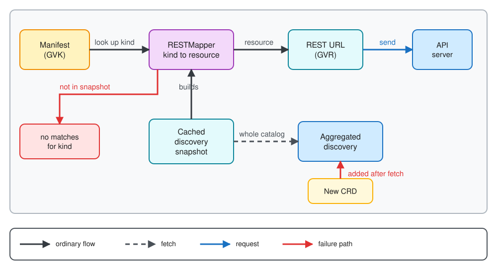
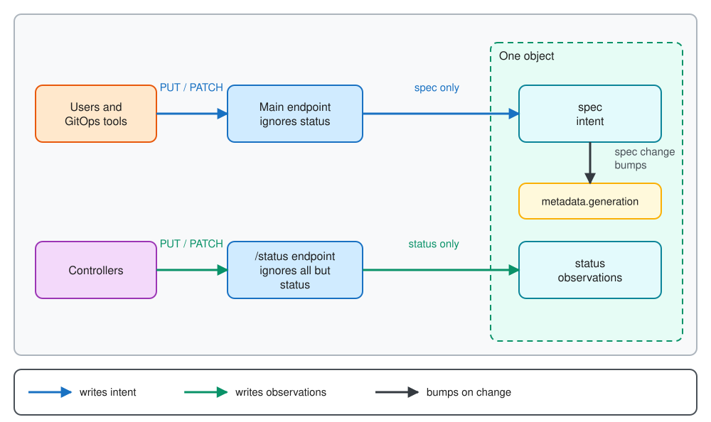
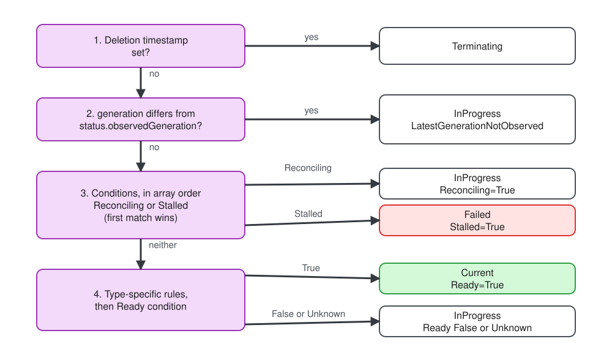

# Part 2: The Kubernetes Resource Model and API Machinery

> [!NOTE]
> **Audience:** Engineers who operate Kubernetes day to day (pods, deployments, services, RBAC, kubectl) but have not yet studied controllers, API machinery, or platform abstractions.<br>
> **Purpose:** Teach the shared substrate that Flux, Crossplane, kro and their neighbors all build on, so that platform failures and design choices can be explained from first principles.<br>
> **Status:** Active. Part 2 of the series on Kubernetes platform engineering.<br>
> **Created:** 2026-11-25<br>
> **As of:** 2026-11-27<br>
> **Draws on:** The wiki's concept, example, finding, comparison, decision and entity pages on GVK and GVR, CRDs, the spec and status split, server-side apply and admission, plus the research dossiers listed under Further reading.<br>

## 1. Why the resource model is the real platform

When people first meet Flux, Crossplane or kro, the natural question is which one to pick. A more useful question comes before it: what do these tools have in common, and why can they run side by side in one cluster without a shared codebase or a shared vendor? The answer is that none of them ships its own database, its own authentication system, its own API server, or its own way of describing desired state. They all lean on the same substrate, which this tutorial calls the Kubernetes Resource Model, usually shortened to KRM, together with the API machinery that serves it.

The idea behind this is what the wiki calls the [[concepts/universal-control-plane]]. Kubernetes ships two things bundled together. One is a container scheduler. The other is a generic, extensible API server backed by etcd (the cluster's key-value store), with authentication, RBAC, admission, validation and a watch mechanism, plus a convention for controllers that reconcile what a user declared toward what actually exists. The second part has no inherent tie to pods. Anything that can be described declaratively and reconciled by a loop can be modeled as an object in the API, whether that is a cloud database, a DNS record, a whole cluster, or an application bundle. Once an external thing is represented as a Kubernetes object, it inherits authentication, authorization, audit, watch and a uniform client experience without anyone writing those features again.

The idea can be pushed further than a normal cluster pushes it. kcp is a project that serves many isolated Kubernetes API endpoints, which it calls workspaces, and a workspace is the Kubernetes API with the workload and infrastructure resources taken away: there are no nodes, pods or deployments, the user is cluster admin, and the user can register CRDs and use kubectl, Helm and other client-go tools against it. The appeal of this design is that a workspace is cheap to create and carries none of the workload machinery that a CRD-focused use case never needs, so a team can hand each tenant or each platform experiment its own isolated API endpoint without standing up a whole cluster. The sources for this are a conference talk and a project page, with no measurement behind the claim, no tenant count and no named adopter, so treat the cheapness as a design claim and not a measured result. See [[entities/kcp]].

This is why the resource model, and not any single tool, is the real platform. Flux fetches manifests from Git and writes objects into the API server. Crossplane defines new object types for infrastructure and runs controllers that act on them. kro lets a platform team publish a new object type that expands into a graph of other objects. Argo CD, Kyverno, cert-manager, Cluster API and the cloud add-ons (Config Connector for Google Cloud, ACK, which stands for AWS Controllers for Kubernetes, and Azure Service Operator) all read and write the same kinds of objects through the same HTTP API. They coexist because they agree on a small set of contracts: how a type is named, how its schema is declared and evolved, who owns which half of an object, who owns which individual field, and how writes are checked before they are stored.

The thesis of this part is that those contracts explain most platform failures and most good design choices. When a Flux reconcile fails with "no matches for kind," when an Argo CD application sits permanently out of sync, when a webhook outage stops a cluster from being repaired, or when a Crossplane upgrade quietly changes who owns a field, the cause is almost always a contract in this substrate behaving exactly as designed while an operator or tool assumed something else. Learning the contracts first makes the tools far easier to reason about later. The tutorial walks from the structure of a single object up through naming, schemas, versioning, ownership and admission, then looks at pitfalls, at how individual tools use the machinery, and finally at principles for building APIs that platforms can sit on.

## 2. Anatomy of a Kubernetes resource: apiVersion, kind, metadata, spec, status

Every object you have ever applied with kubectl has the same skeleton. Before looking at the machinery, it is worth reading that skeleton slowly, because each part exists for a reason that later sections depend on.

Consider a small Deployment as it might look when read back from a cluster, trimmed for clarity.

```yaml
apiVersion: apps/v1
kind: Deployment
metadata:
  name: web
  namespace: shop
  generation: 4
  resourceVersion: "812345"
  labels:
    app: web
  ownerReferences: []
  finalizers: []
spec:
  replicas: 3
  selector:
    matchLabels:
      app: web
  template:
    metadata:
      labels:
        app: web
    spec:
      containers:
        - name: web
          image: example/web:1.4.2
status:
  observedGeneration: 4
  readyReplicas: 3
  conditions:
    - type: Available
      status: "True"
```

The first two fields, `apiVersion` and `kind`, say what type of thing this is. Together they form what the next section calls a GVK, and they let the API server pick the right schema, the right storage format and the right endpoint. The `metadata` block holds identity and bookkeeping that is common to every object: the name, the namespace, labels, and several fields that platform tooling relies on heavily. The `generation` counter increases whenever the desired state changes. The `resourceVersion` is an opaque token that supports optimistic concurrency, meaning that a write based on a stale copy is rejected with an HTTP 409 conflict instead of silently overwriting a newer change. The `ownerReferences` field links a child object to its parent so that deleting the parent cascades to the child, a behavior covered in [[concepts/owner-references-and-garbage-collection]]. The `finalizers` field lists tokens that stop the object from being removed from storage until a controller has finished cleanup, as described in [[concepts/finalizers]]. Finalizers are the reason an object can sit in `Terminating` for a long time when its controller is missing or failing, and they are the main way a controller makes deletion safe for things that live outside the cluster, such as a cloud database.

Finalizers are plain strings, and each controller chooses its own, so when an object is stuck in `Terminating` the first move is to read its finalizer list and work out which controller owns each entry. One rule governs when a controller may add its finalizer: once a delete request has set `deletionTimestamp`, no new finalizer can be added. A controller therefore has to register its finalizer on the first reconcile, before it creates anything outside the cluster. Otherwise a delete that lands between the create and the registration leaves the external resource with no cleanup hook. See [[findings/a-finalizer-added-after-the-delete-request-is-too-late-and-new-ones-are-refused]].

Because a finalizer is only a key in a list, and does not have to name any code, anyone with write access can remove it, which is exactly why removing one by hand is dangerous. The official Kubernetes blog post on finalizers demonstrates a deliberately dead finalizer: the namespace key `kubernetes` placed on a ConfigMap that no controller handles. Deleting that ConfigMap leaves it in the API with a `deletionTimestamp` until a JSON patch removes `/metadata/finalizers`. Built-in examples include `kubernetes.io/pv-protection` and `kubernetes.io/pvc-protection`. Clearing the list makes the object disappear, but it does not perform the cleanup the finalizer guarded. Practitioner and vendor guidance lists the consequences: cloud storage that keeps billing, StatefulSets on shared storage at risk of corruption, and pods that keep running after their API object is gone. Forcing a stuck namespace through its `finalize` subresource can also delete the namespace while leaving orphan objects inside a namespace that no longer exists, and the same post says that re-creating the namespace sometimes brings those objects back. A common way to reach this state is to delete the credentials a controller needs for cleanup before deleting the objects it manages. The finalizers can then never complete, and the only way out is to remove them by hand, which orphans the external resources. No source measures how often forced removal orphans something, so these are documented risks and not rates. The safer routine is to find the blocking finalizer, read its controller's logs, repair the controller, and clean up external resources by hand if a forced removal cannot be avoided; [[decisions/remove-a-stuck-finalizer-by-force-or-repair-the-owning-controller]] sets out the options, and [[findings/forcing-a-finalizer-off-skips-cleanup-and-can-leak-billing-resources-or-corrupt-data]] records the evidence. One practitioner automated the forced route for Config Connector BigQuery tables whose dataset had been deleted first, using a CronJob that periodically patches the finalizers off. He argues that this is safe for that one pair because deleting a dataset in Google Cloud also removes its tables, which is his own reasoning and not a general rule ([[examples/a-practitioner-ran-a-cronjob-that-removed-finalizers-from-config-connector-bigquery-tables-whose-dataset-was-deleted-first]]). Cluster API shows the opposite design choice for Machine deletion: its Machine Deletion Phase Hooks proposal uses named annotations instead of finalizers, because, in the proposal's words, "A misbehaving controller that accidentally removes finalizers could have undesirable effects" ([[findings/cluster-api-chose-annotation-hooks-over-finalizers-for-machine-deletion-because-a-misbehaving-controller-could-remove-finalizers]]).

The cascade that `ownerReferences` triggers has three modes, chosen by `propagationPolicy` on the delete call or by `kubectl delete --cascade=background|foreground|orphan`, and they differ in what they guarantee about ordering. Background, the kubectl default, deletes the owner immediately and lets the garbage collector remove the dependents afterward, in no guaranteed order. Foreground gives the owner a `deletionTimestamp` and a `foregroundDeletion` finalizer and keeps it visible until every dependent that sets `blockOwnerDeletion=true` is gone, so an owner can hang if one blocking dependent cannot be deleted. Orphan uses an `orphan` finalizer to strip the owner references from the dependents, which then survive with empty `ownerReferences` until someone deletes them. Different tools and different built-in operations choose different propagation modes, so when a delete does not behave as expected, check which mode the tool actually requested. Finalizers are still honored during a cascade, so a tree can end up partly deleted. This matters later for garbage-collection stalls, for Argo CD prune behavior and for kro's decision not to use owner references. The side-by-side table is in [[comparisons/background-foreground-and-orphan-propagation-modes]].

Figure 2.1 compares background, foreground and orphan deletion for the same owner and dependents.


*Figure 2.1. Background, foreground and orphan deletion compared. Each panel shows the same owner and dependents under one propagation mode, so the order of removal can be compared directly. Look at when the owner disappears and what happens to the dependents.*

The last two top-level blocks, `spec` and `status`, are the heart of the model. The `spec` records intent: what somebody wants to be true. The `status` records observation: what a controller has actually found. This separation is explained in section 6, and it is what makes Kubernetes declarative. A person or a tool states intent once, and independent control loops work to make reality match it and report progress without rewriting the intent. The wiki's page on [[concepts/declarative-vs-imperative]] draws the contrast with imperative commands like `kubectl scale`, which act on a live object once and leave no record of why.

A controller is simply a program that watches objects of some type and acts to reduce the gap between spec and observed reality. Because a controller can crash, restart, miss an event, or run twice, the loop has to be written so that running it again does no harm. That property is [[concepts/idempotency]], and it is why controllers are written as "look at the current world and compute what should change" rather than as scripts of one-shot commands. Keep this picture of a control loop in mind, because every contract discussed below exists to make many such loops, written by different teams, safe to run against the same API.

Two further pieces of the skeleton deserve a name now. `status.conditions` is a standardized list of entries, each with a type, a status, a reason, a message and an `observedGeneration`, which gives tools a common language for readiness. The wiki covers it in [[concepts/conditions]]. And the `generation` and `observedGeneration` pair gives anyone reading an object a cheap way to ask whether the status still describes the latest spec.

## 3. GVK versus GVR, discovery and the RESTMapper

Kubernetes names things in two different ways, and confusing them is a common stumbling block for people who start writing tooling. A GVK, short for GroupVersionKind, names a type: the schema of an object, such as `apps/v1` with `Kind=Deployment`. A GVR, short for GroupVersionResource, names an HTTP endpoint collection: the lowercase plural that appears in a URL, such as `apps/v1` with `Resource=deployments`. The Kubernetes API concepts page puts the split in one sentence: a resource type is the name used in the URL, and every resource type has a concrete representation, its object schema, which is called a kind. The wiki's seed vocabulary gives a provider example, where `s3.aws.upbound.io/v1beta1` with `Kind=Bucket` is the GVK and `buckets` is the resource. See [[concepts/gvk-and-gvr]] and the side-by-side table in [[comparisons/gvk-versus-gvr]].

Manifests and wire payloads speak GVK through their `apiVersion` and `kind` fields. REST URLs speak GVR, in the form `/apis/<group>/<version>/<plural>`, with the core group served under `/api/v1`. In the great majority of cases the mapping is one to one and the resource is the lowercased plural of the kind, but that is a convention and not a guarantee. The classic exception is the `Scale` kind. Many resources expose a subresource that returns the same `Scale` kind, for instance `deployments/scale` and `replicasets/scale`, and this is how the HorizontalPodAutoscaler adjusts replica counts on very different workloads without knowing any of their schemas. One GVK is served at many GVR endpoints there. A custom resource definition, by contrast, gives each kind exactly one resource. [[examples/hpa-scales-any-workload-through-the-scale-subresource]] walks through the HPA case, and [[examples/a-scalable-composition-lets-hpa-and-keda-drive-an-xr-through-the-scale-subresource]] shows the same trick applied to a Crossplane composite resource, where the composition author must patch the desired replica count down into the Deployment and write the observed count back up to the composite's status.

Why does the distinction matter in practice? Because different parts of the system speak different dialects. Humans and Git repositories speak GVK. RBAC rules, audit logs and URLs speak GVR. A generic tool that is handed a manifest and has to send it to the server must translate from one to the other, and it does so using API discovery. The API server publishes a catalog of what it serves, in two forms: the Discovery API, which lists group-versions and their resources, and OpenAPI, which describes schemas. Discovery historically required one request per group-version after fetching the `/api` and `/apis` roots. Aggregated discovery serves the whole catalog in one request when the client asks for it with the right Accept header, so modern clients make far fewer startup calls, and OpenAPI v3 is the preferred schema description. Aggregated discovery exists because serving discovery as many small per-group-version documents "causes a storm of requests for clusters and is a source of latency and throttling", and without aggregation a client could need dozens of requests just to learn the API surface. Clients such as kubectl also cache discovery results for a while instead of refreshing them constantly. That caching is a freshness trade-off made precisely to limit the traffic: the longer a client trusts its cached catalog, the less it sends, and the longer it can remain unaware of newly installed types. See [[findings/aggregated-discovery-exists-because-per-group-version-discovery-caused-a-request-storm]] and [[concepts/api-discovery-and-restmapper]].

Clients feed discovery output into a component called the RESTMapper, which translates a kind into the resource that appears in a URL. In client-go, the Go client library that most controllers use, the restmapper package builds one from discovery, prefers the preferred version of each group, and can add shortcut names such as `po` for pods. A separate registry called the Scheme maps GVKs to Go types so that typed clients can decode JSON, while dynamic and unstructured clients skip the Scheme and take a GVR directly. See [[entities/client-go]].

Figure 2.2 traces how the kind in a manifest becomes the resource in a request URL.



*Figure 2.2. How a manifest kind becomes a URL. A client turns the kind in a manifest into the resource in a URL by asking a RESTMapper that was built from a cached copy of the server's discovery catalog. Follow the red path to see why a type installed after that copy was fetched produces a no-matches-for-kind failure.*

The key operational fact is that discovery is a snapshot. A mapper built once at startup reflects the cluster at that moment. If a CRD is installed later, the mapper does not know about it, and any lookup fails with the familiar "no matches for kind X in version Y" error. The wiki records this in [[findings/stale-restmapper-hides-newly-installed-crds]]. The usual cure is a dynamic mapper that notices when a lookup fails, re-reads discovery and retries, with a rate limit so that a burst of misses cannot flood the API server. Modern controller frameworks commonly use this approach, and cheaper discovery makes reloading on a miss less costly than it once was, though that connection is an inference and not something the sources state. [[comparisons/restmapper-strategies-static-deferred-and-dynamic]] contrasts the three strategies: a static mapper that fails until rebuilt, a deferred mapper that lazily rebuilds, and a dynamic mapper that heals on demand.

The same failure shows up at the delivery layer in a very ordinary form. A Helm chart or GitOps application includes a Prometheus Operator `ServiceMonitor`, and the CRD for it is absent or not yet established when the manifest is applied. The dossier calls this the most common everyday GVK-missing scenario, and [[examples/servicemonitor-no-matches-for-kind-in-helm-and-argo-cd]] collects the causes, which include the CRD not existing yet, a wrong apiVersion, and version skew between an operator and its CRDs. The mitigations the sources describe are ordering (Flux `dependsOn`, Argo CD sync waves), mapper invalidation, and not depending on the CRD being present at all. [[comparisons/missing-crd-handling-flux-versus-argo-cd]] sets the two tools side by side, though the Argo CD side of that comparison rests on thinner evidence than the Flux side, so it should not be treated as a settled comparison. See also [[findings/custom-resources-applied-before-their-crd-exists]].

One more wrinkle is that GVK is not always a unique key. A scaffolding tool that composes external APIs can meet two external types that share the same group, version and kind under different domains. The practical consequence is that a scaffolding tool needs an explicit way to disambiguate such types instead of assuming that a GVK identifies exactly one type.

## 4. Custom resource definitions: schemas, scope, structural schemas and pruning

A CustomResourceDefinition, or CRD, is the extension point that makes the universal control plane practical. It is itself a Kubernetes object, and creating one registers a brand new resource type with the API server at runtime. Once the CRD exists, the built-in kube-apiserver serves a REST endpoint for the new kind with the same machinery it uses for built-in types: list and watch, RBAC, audit logging, schema validation, and storage in etcd. No new server is needed, and the official documentation observes that custom resources can appear and disappear in a running cluster through dynamic registration. See [[concepts/custom-resource-definition]].

A CRD by itself only stores data. The usual pattern pairs a custom resource with a custom controller that reconciles the declared `spec` and reports progress in `status`, which is the operator pattern. The wiki's decision page [[decisions/crd-versus-aggregated-api]] records the alternative: an aggregated API server, a separate server behind the API aggregation layer that gives more control over storage and REST behavior at a higher operational cost. The guidance is to choose a CRD unless the kind needs storage other than etcd or unusual REST semantics, because a CRD inherits storage, authentication, authorization, versioning and watch from the API server with almost no code.

Here is a small CRD for a hypothetical `Database` type that a platform team might publish.

```yaml
apiVersion: apiextensions.k8s.io/v1
kind: CustomResourceDefinition
metadata:
  name: databases.platform.example.com
spec:
  group: platform.example.com
  scope: Namespaced
  names:
    kind: Database
    plural: databases
    singular: database
  versions:
    - name: v1
      served: true
      storage: true
      subresources:
        status: {}
      schema:
        openAPIV3Schema:
          type: object
          properties:
            spec:
              type: object
              properties:
                storageGB:
                  type: integer
                  minimum: 10
                minReplicas:
                  type: integer
                maxReplicas:
                  type: integer
              x-kubernetes-validations:
                - rule: "!has(self.minReplicas) || !has(self.maxReplicas) || self.minReplicas <= self.maxReplicas"
                  message: "minReplicas must not exceed maxReplicas"
            status:
              type: object
              x-kubernetes-preserve-unknown-fields: true
```

The CRD's name must be `<plural>.<group>`, and the group and plural names are what clients and RBAC rules will use forever, which section 10 returns to. The `scope` says whether instances live inside a namespace or are cluster-wide. The `versions` list declares which versions exist, which are served over the API, and which one is the storage version, the form actually persisted in etcd. The `schema` is a structural OpenAPI v3 schema. The `subresources.status` entry turns on the separate status endpoint discussed in section 6. The `x-kubernetes-validations` entry carries a rule written in CEL, the Common Expression Language, a small typed expression language that the API server evaluates, which section 8 covers in detail. Notice that the rule begins with two `has()` checks. Neither `minReplicas` nor `maxReplicas` is required in this schema, and in CEL, reading a field that is absent from the object is an error ("no such key") and not a quiet null. A bare `self.minReplicas <= self.maxReplicas` would therefore reject perfectly valid objects that simply leave one of the two fields out. The alternative is to list both fields under `required` in the spec schema, which is the right choice when they must always be present; the `has()` form is the right choice when they are truly optional and the comparison should apply only when both are set.

CEL rules also carry a cost budget, and it affects schema design more than most authors expect. When a CRD is created, the API server estimates the worst-case cost of every rule, and for a list, map or string with no declared size it assumes the worst. The Kubernetes documentation's own example, a rule that iterates over an array of strings with no declared limits, is rejected because the estimator must assume the worst, and the same rule is accepted once the schema declares a maximum number of items and a maximum string length. Nested lists multiply, so the estimate grows quickly. The same budget idea applies again when a rule runs against a real request, so that one expensive object cannot monopolize the API server. This failure appears at CRD creation and not at request time, which is why authors of generated CRDs, such as authors of a Crossplane XRD (a CompositeResourceDefinition, the object a platform team writes to declare a new platform API that Crossplane turns into a CRD) or of a kro ResourceGraphDefinition (kro's equivalent, which describes a new API together with the graph of objects behind it; a later section of this part returns to both), meet it when they add iterating rules to schemas that declare no size limits. See [[findings/an-unbounded-list-or-string-makes-the-cel-cost-estimate-reject-a-crd-rule-until-maxitems-and-maxlength-are-set]].

The word structural deserves attention, because it explains a behavior that routinely surprises authors. Plain OpenAPI describes what must be present but not what is forbidden, so a possibly incomplete spec used to let unknown fields leak into storage. Structural schemas, introduced to make validation, pruning and defaulting reliable, are a constrained subset of OpenAPI v3. Under a structural schema, the API server drops any field the schema does not declare, unless the author sets `x-kubernetes-preserve-unknown-fields`. The effect is that someone who forgets to declare a field sees the value vanish from stored objects without any error. [[findings/unknown-fields-are-silently-pruned-under-structural-schemas]] records the behavior and its rationale. When a custom resource seems to ignore a field you set, pruning is the first thing to check, and the fix is nearly always to declare the field in the schema.

CRDs are cheap to add but they are not free. Each one adds API surface, etcd data, possibly webhook dependencies, and upgrade-ordering concerns. Two operational facts are worth knowing early. First, deleting a CRD deletes every custom resource of that kind. This is standard behavior, though the sources collected here describe it secondhand and none states it in a primary page, and it is consistent with the caution that delivery tools show around CRD deletion. See [[findings/deleting-a-crd-deletes-every-custom-resource-of-that-kind]]. Second, Helm does not upgrade or delete CRDs, because doing so risks unintentional data loss: a chart upgrade leaves the old definition in place, and removing a chart leaves its CRDs behind. Delivery tools such as Flux therefore add their own CRD lifecycle policy, with choices that range from leaving CRDs alone, to creating them once, to replacing existing definitions on upgrade. Even the most permissive choice updates existing CRDs without deleting ones that a newer chart version no longer ships, so CRD lifecycle still deserves its own deliberate plan. See [[findings/helm-does-not-upgrade-or-delete-crds]].

Scale is the third cost. Crossplane's model gives every external resource type its own CRD, so a multi-cloud provider set implies thousands of them ([[findings/one-crd-per-external-resource-type-overloads-api-server-discovery-and-openapi-computation]]). Every one of those CRDs adds memory use in the API server and adds to the discovery and OpenAPI work that clients and the server must repeat, and the OpenAPI document has to be recomputed each time a CRD is registered. Reports from practitioners describe API servers becoming slow after large provider sets were installed, with causes in that recomputation and in client discovery rate limits. (Terrajet and its successor Upjet are Crossplane's Terraform-based provider generators, which section 9 describes further.) Custom resources share the same storage and watch paths as built-in objects, which is why an unrelated write-up of large-cluster tuning, [[examples/ant-group-large-cluster-tuning-of-apiserver-watch-cache-and-etcd]], is relevant here: it shows that serving list requests from the watch cache can substantially reduce API server memory pressure in very large clusters.

It is worth being clear about how firm the evidence is in this area. No official limit exists for the number of CRDs per cluster or the number of custom resources per type, and the SIG Scalability thresholds document covers built-in resource types only. What exists are practitioner reports that a few hundred to a couple of thousand CRDs strain API server CPU and memory. Those come from individual environments and are not benchmarks, so read them as orders of magnitude. Two storage constraints do come from primary documentation: etcd limits the size of a single request and enforces a total storage quota, so a very large object or a very large collection of custom resources can hit etcd's limits before it hits any Kubernetes limit.

Crossplane shows how a project answers the CRD-count problem, and the answer has several layers. The first is provider families: a large provider, such as the AWS one, is split into service-scoped providers that install together, so a typical user installs far fewer CRDs at the cost of running more provider pods ([[decisions/split-a-large-provider-into-families-or-filter-or-lazy-load-its-crds]]). The second is activation. Because providers ship namespaced types beside the legacy cluster-scoped ones, each provider carries roughly twice as many managed resource types, so Crossplane lets a platform team activate only the resource types a cluster actually needs through a managed resource activation policy. A type that is not activated has no CRD at all, which is where the saving comes from; the platform team chooses which types a cluster needs, and the choice trades a complete catalog against a lighter API server. The third layer is inside Crossplane core, which builds a dedicated cache for its API-extension kinds and strips the bulky OpenAPI schemas from it, since those schemas make up most of a CRD's size. The sources include no independent benchmark of any of these measures and no Crossplane page that describes sharding, and the absence of a page does not prove that none exists. Upjet, the provider generator, reuses Terraform's resource logic, and depending on the resource that logic can run as a subprocess or in process, so how much a generated provider costs to run has no single answer. The trade-off throughout is between a complete, always-present API surface and an API server that stays responsive.

The API server is also a shared resource that clients can exhaust, which is the reason these costs matter beyond memory. OpenAI's primary post-mortem for a 2024 outage says a new telemetry service made every node in each cluster run Kubernetes API operations whose cost scaled with cluster size, the API servers were overwhelmed in most large clusters, and remediation was slow because removing the service needed control-plane access that the load had taken away. All of its figures are self-reported, and the post does not say the calls were list or watch calls, so any claim that discovery or CRD count was the trigger would be inference ([[examples/an-openai-outage-shows-many-api-clients-can-overload-the-control-plane]]).

## 5. Versioning, storage versions and conversion for CRDs

An API that is useful lives long enough to need change, and a CRD supports that by listing several versions of the same kind. Exactly one version is the storage version, which is how objects are written to etcd. Any number of versions can be marked `served`, meaning the API server answers requests for them. When a client asks for a version other than the stored one, the API server converts the object on the fly. See [[concepts/crd-versioning-and-storage-migration]].

The conversion strategy is either `None` or `Webhook`. With `None`, the server rewrites only the `apiVersion` field, so it is safe only when the two versions have compatible schemas. With `Webhook`, the server calls a service that performs the translation, configured with `conversionReviewVersions` and a `caBundle`. When a project has several versions, the Kubebuilder book recommends a hub-and-spoke arrangement: one version is the hub, every other version (a spoke) converts only to and from the hub, and a request for any version converts through the hub. That keeps the number of conversion functions near 2(N-1) for N versions instead of one for every pair, as shown in [[examples/kubebuilder-hub-and-spoke-conversion-for-multi-version-crds]]. [[comparisons/crd-conversion-strategies-none-webhook-and-hub-and-spoke]] lays the three options out in a table. The guidance in the sources is to prefer `None` when schemas are compatible, because it removes a runtime dependency.

Figure 2.3 shows how a request for any version is converted through the hub version.


*Figure 2.3. CRD conversion through a hub version. A request for any version is converted by the API server through the hub version, while the object itself is written to etcd as the storage version. Each spoke version converts only to and from the hub, and a conversion webhook service is called only when the Webhook strategy is used.*

Retiring a version has a documented sequence that is easy to get wrong. Add the new version, migrate clients to it, set the old version to `served: false`, upgrade the stored objects so that none remain in the old storage form, and only then remove the old version from the CRD. The task page tells authors to check `status.storedVersions` before dropping a version. Skipping the migration step strands objects that the API server can no longer decode, which [[findings/crd-version-removal-without-migration-strands-stored-objects]] describes. The upgrade step uses a StorageVersionMigration object, a small API object whose creation asks the cluster to read every stored object of a given resource and write it back in the current storage version.

The more important point is that the migration API and its controller do not start migrations on their own. Creating the migration object is left to the user or to a tool, so retiring a CRD version still needs an explicit step in your runbook: create the object, wait for its Succeeded condition, confirm that `status.storedVersions` on the CRD lists only the preferred version, and only then remove the old version.

Figure 2.4 lays out the retirement sequence as seven ordered steps.


*Figure 2.4. Retiring a CRD version step by step. The seven steps run in order, from adding the new version to removing the old one. Nothing starts the storage version migration for you, so it is an explicit step, and skipping it leaves objects stranded when the old version is removed.*

Waiting on the right signal matters, because the object does not report progress as a number. A StorageVersionMigration has an immutable target resource and reports its outcome through standard conditions named `Running`, `Succeeded` and `Failed`, with no numeric progress field. Progress appears only as human-readable text in the message of the `Running` condition, which says whether the migration is running, how many objects remain, and whether a transient error occurred. When the pass finishes, `Running` flips to False and the controller sets `Succeeded` to True or, on failure, `Failed` to True. For a CRD target the controller also marks the CRD as migrating and, once the pass finishes, removes the old versions from the CRD's `status.storedVersions`, which is the step that leaves only the preferred version there. A script should therefore wait for the `Succeeded` condition and treat the `Running` message as text whose wording can change, never as a value to parse. See [[findings/storageversionmigration-reports-progress-as-text-in-the-running-condition-message-and-has-no-numeric-progress-field]].

Several caveats apply to that runbook. Migration needs an integer resource version, so it fails for resources that lack one, such as those served by aggregated APIs. If `storedVersions` still shows an old entry afterwards, the CRD changed while the migration was running, and the migration should be retried. No incident report caused by skipping this step turned up in the sources, so the consequence described above is inferred from the documented sequence and not from an observed outage. See [[findings/storage-version-migration-is-not-triggered-automatically-so-a-retired-crd-version-needs-a-user-created-object]].

The risk with webhook conversion is that it puts a network service in the path of reads. For readers new to the term, an informer is a client-side cache of objects that a controller keeps current by holding a watch open against the API server, so a controller can read from memory instead of querying the server on every decision. The garbage collector in kube-controller-manager keeps an informer for every resource type, and a down conversion webhook behind one CRD can prevent that informer from syncing ([[findings/a-down-conversion-webhook-can-stall-garbage-collection]]). The collector can carry on for other types when one type cannot be listed or watched, but objects of the unsynced type are invisible to it. Any dependents of that type that carry owner references with `blockOwnerDeletion` set are therefore not tracked, and cascading deletes for owners and dependents of that type are not handled until the webhook recovers. A conversion webhook for one CRD can thus quietly degrade cleanup behavior for that type. The lesson is that a conversion webhook is a network service placed in the read path of a type, so its availability affects every component that lists or watches that type, not only the clients that asked for a conversion, and it deserves to be treated as critical infrastructure.

For platform teams, versioning is where product management meets API machinery. Crossplane recommends Kubernetes-style alpha, beta and stable versions for XRDs, and says that breaking schema changes should ship as new XRDs or through conversion webhooks, because an XRD's group and names cannot change. [[decisions/conversion-webhook-versus-new-xrd-for-breaking-changes]] records the trade: a webhook keeps one type and one name but adds a service to run, while a new XRD avoids conversion machinery but forks the API so that consumers must migrate. The wiki does not rank the two.

Upstream Kubernetes treats its own beta types the same way. It removes beta GVKs on a published schedule, and manifests, charts and clients pinned to those GVKs break once the cluster upgrades. Section 10 explains the mechanism and how to check ahead of time. Two common deprecated-API scanners are worth knowing about. Pluto checks manifests, Helm charts and live Helm releases against a bundled rule list and labels each hit as deprecated or removed. Kubent queries the cluster and its Helm releases and evaluates rule sets for upcoming removals. Neither tool knows Crossplane's own API versions out of the box, so deprecated Crossplane versions pass unflagged unless you add custom entries to the scanner's rules ([[findings/pluto-and-kubent-ship-no-crossplane-rules-so-deprecated-crossplane-gvks-pass-unflagged]]). See [[findings/removed-beta-gvks-break-pinned-manifests-and-clients]].

The same discipline applies to the tools themselves. Projects that publish CRDs promote and retire API versions, and a team that wrote manifests against an alpha or beta version has to migrate before the upgrade that drops it. Crossplane's composition functions illustrate how deep an API change can go, because a function is a long-running gRPC server that the package manager deploys, so the way functions are built and run is part of the contract and not only the name of a version. Pre-stable versions of a platform tool's API are a real promise of change, which is why a platform team should prefer the stable versions of every API it depends on.

## 6. The spec and status split and the status subresource

Section 2 introduced spec as intent and status as observation. The Kubernetes API conventions describe spec as the complete description of desired state, including defaults and modifications by ecosystem components, and status as a summary of current state, usually written by automated processes. The split is more than a naming convention. It is a division of ownership: users and GitOps tools own `.spec`, and controllers own `.status`. See [[concepts/spec-status-split]].

Why does that matter? Consider a GitOps tool that re-applies a manifest every few minutes. If the object's status lived in the same writable space as its spec, every re-apply could overwrite what a controller observed. With the split, the tool applies only intent, and the controller reports observations in a separate place. The split also gives the reconcile loop a clean input (spec) and a clean output (status).

The split is enforced through the `/status` subresource, which a CRD opts into with `subresources.status: {}`. Once enabled, a PUT or PATCH on the main resource ignores changes to status, a PUT or PATCH on `/status` ignores everything except status, and only changes to the main resource bump `metadata.generation`. The subresource has its own authorization scope, so you can give users write access to spec while giving controllers write access to status. That is a security property as much as a convenience.

Figure 2.5 shows the two write paths into the same object.



*Figure 2.5. Spec and status written through separate endpoints. Follow the two rows from left to right. Users and GitOps tools write spec through the main endpoint, and that is the only path that bumps metadata.generation, while controllers write status through the /status endpoint into the same object.*

The generation counter gives controllers a cheap staleness check. A controller copies the generation it acted on into a field called `observedGeneration`, so that any consumer can compare the two numbers. Flux exposes the comparison directly: an `observedGeneration` below `metadata.generation` means a spec change is pending. Where the field lives varies between projects, and three placements coexist in practice. The Kubernetes API conventions describe both a top-level `status.observedGeneration` and a per-condition `observedGeneration` (the field on the standard `metav1.Condition` type, which says the condition is out of date relative to the current spec), without ranking them. The generic readiness library kstatus parses a condition struct that has no per-condition field at all, so it consults only the top-level value, and Argo CD's health-check documentation likewise tells authors to use `status.observedGeneration`. Flux's condition setter stamps the current generation on every condition it sets and also keeps a top-level field, so that both kinds of reader work. Config Connector's direct controllers write only the top-level value. The practical advice that follows from the evidence is to publish both placements when generic consumers matter, though no source states a rule for choosing, and the decision page deliberately makes no recommendation. See [[decisions/place-observedgeneration-at-the-top-level-on-each-condition-or-both]], [[findings/kstatus-reads-only-the-top-level-observedgeneration-because-its-condition-struct-has-no-per-condition-field]], [[examples/flux-stamps-the-current-generation-on-every-condition-and-also-keeps-a-top-level-observedgeneration]] and [[comparisons/observedgeneration-top-level-versus-per-condition]].

The kstatus evaluation order shows why the top-level field is so valuable to generic tools. Read from its source in the cli-utils repository, kstatus checks in a fixed sequence: first whether a deletion timestamp is set (Terminating), then whether `metadata.generation` differs from the top-level `status.observedGeneration` (InProgress, with the synthetic reason `LatestGenerationNotObserved`), then the conditions in array order, where `Reconciling=True` means InProgress and `Stalled=True` means Failed and the first match wins, and only then type-specific rules and a `Ready` fallback, where True means Current and both False and Unknown mean InProgress. Because the generation check runs before the `Ready` check, a stale top-level field overrides a `Ready=True` beside it. That consequence is an inference from code order and not a documented rule. The opposite case is the dangerous one: for a custom resource whose controller never writes the top-level field, the generation check is skipped, and if no `Reconciling`, `Stalled` or `Ready` condition has been written yet the final default reports Current, so the resource can read as reconciled before its controller has done anything. See [[findings/kstatus-checks-deletion-then-generation-then-reconciling-and-stalled-then-ready-so-a-stale-top-level-observedgeneration-overrides-ready-true]] and [[findings/a-kstatus-resource-whose-controller-never-writes-status-observedgeneration-skips-the-generation-check-and-can-read-current-early]].

Figure 2.6 walks through the kstatus checks in the order they are applied.



*Figure 2.6. The kstatus decision order. kstatus checks a resource in a fixed top-to-bottom sequence, and the first check that matches decides the result. Follow the left column down to see why a stale top-level observedGeneration is reached before the Ready condition.*

Skipping the subresource has a concrete cost. Without it, a status write is a write to the whole object, so it bumps `generation`, which fires the controller's own watch, which reconciles again, which can write status again. A tutorial quoted in [[findings/status-writes-through-the-main-resource-retrigger-reconcile-loops]] puts it simply: keeping them separate is how you avoid infinite reconcile loops. With the subresource enabled, a Kubebuilder controller's `r.Status().Patch()` updates only status and leaves generation alone.

Missing `observedGeneration` has a different cost. A provider whose conditions carry no `observedGeneration` is the clearest example: a stale `ResourceSynced=True` looks exactly like a current one, and consumers resort to fragile workarounds such as comparing managed-field timestamps. One proposed mitigation is to publish `ResourceSynced=False` at the start of each reconcile, so a reader sees a changing signal while work is in flight. See [[findings/missing-observedgeneration-hides-stale-status]].

The same missing field causes consumers to see Ready too early across several kinds of tooling. When a controller does not record which generation of the spec a condition describes, a consumer that reads the condition cannot tell whether it is fresh. A `Ready` condition produced before a spec change looks identical to one produced after it, so a script that runs `kubectl wait` for `Ready` can return immediately after a patch, a delivery tool that waits for health can mark a rollout healthy while the last pods are still starting, and a built-in health check can report an object Healthy a moment before its controller has re-stamped its conditions after a spec change. These three paths, scripts, delivery tools and health checks, all depend on the controller publishing `observedGeneration`, and the cure is the same in every case: the controller records the generation it has observed, and the consumer compares it to the object's current generation before trusting a condition. See [[findings/ready-can-be-reported-for-a-spec-generation-the-controller-has-not-yet-observed]].

A fourth case comes from the delivery tools themselves and shows what the maintainers recommend. Crossplane resources that lack an initial `Ready` condition can look ready to kstatus, so a Flux Kustomization with health checks can move on before those resources have been reconciled. The maintainers' answer is that kstatus relies on `observedGeneration` and controllers should set it, and that a user can add a CEL health-check expression requiring `observedGeneration` to equal `metadata.generation`. The same race can affect any object whose controller does not publish a readiness signal tied to the current generation ([[findings/premature-readiness-in-kstatus-based-tools]]). The delivery tools take opposite positions on who owns the knowledge of each kind's status. Flux has no per-provider health logic: it judges any custom resource through kstatus or through CEL expressions that the user writes. Argo CD instead ships Lua health scripts that cover whole provider groups, including the Config Connector, ACK, Crossplane and kro groups and several Cluster API kinds, and those scripts spell out how a provider's conditions map to Healthy, Progressing and Degraded. A group-wide script is also a single point of mismatch for every kind in the group: if one kind reports health through a different field, it can stay Progressing forever, and because Argo CD advances sync waves only when the current wave is healthy, one stuck kind blocks every later wave ([[findings/argo-cd-ships-built-in-lua-health-checks-for-config-connector-ack-crossplane-upbound-kro-and-cluster-api-kinds-and-an-unhealthy-provider-object-blocks-later-sync-waves]]). The structural limit remains: where a provider's conditions carry no `observedGeneration`, even a shipped health script can report Healthy before the controller has seen a spec change.

Not every CRD should get a status. [[decisions/which-crds-get-a-status-subresource]] records Prometheus Operator's answer. Its `Prometheus`, `Alertmanager`, `PrometheusAgent` and `ThanosRuler` CRDs run as pods and have a single owning reconciler, so they gained replica and availability counts plus `Available` and `Reconciled` conditions. `ServiceMonitor`, `PodMonitor` and `PrometheusRule` stayed without status, because they are configuration read by more than one reconciler and a single status block would collect conflicting data from several writers ([[findings/config-style-crds-with-several-reconcilers-get-no-status]]). The decision also carries a warning for retrofits: enabling the subresource on an existing CRD changes write semantics, since writes to the main resource then ignore status. See [[examples/prometheus-operator-retrofits-status-onto-workload-crds]].

Status is also an integration surface. Flux, Argo CD, kstatus (a Kubernetes SIGs library that computes a generic ready or not-ready verdict for any object from its status conditions), Cluster API and Crossplane all read conditions to decide whether something is ready. Where conventions are followed, generic tooling works. Where they are not, every consumer needs custom code. A provider that omits `observedGeneration` is one example, and a project that renames its readiness condition leaves generic tools needing custom handling. Crossplane's split of `Synced` (is the controller able to reconcile this object) from `Ready` (is the resource usable) keeps two different meanings from sharing one signal.

That split has a limit worth knowing about. For providers built on Upjet, long asynchronous cloud operations, such as updating a large managed cluster, are reported through a separate `AsyncOperation` condition, while `Synced` keeps reporting success on every reconcile, because while an operation is ongoing the async client treats the resource as existing and up to date. For these providers, alert on `AsyncOperation` as well as `Synced`, and do not read `Synced=True` as proof that no long operation is running. Crossplane's composite and claim conditions do record `observedGeneration`, so generic readers can compare it with `metadata.generation` ([[findings/upjet-and-crossplane-runtime-source-still-reports-reconcilesuccess-while-an-async-operation-runs]]).

Condition polarity, meaning whether a condition is true when things are fine or true when something is abnormal, is a place where the published guidance really does conflict, and the sources disagree with each other, so no side is chosen here. kstatus favors abnormal-true conditions, `Reconciling` and `Stalled`, which are present only when true. The Kubernetes API conventions say that neither polarity can be recommended as a general rule, and Cluster API's own proposal quotes that same text. The conventions add that a negative condition can be easier for people to read but that `Failed=False` invites double-negative confusion. An author who follows one source therefore produces conditions the other source's tooling reads poorly. Flux publishes both styles together, a positive `Ready` plus `Reconciling` and `Stalled`, and that pairing, together with `observedGeneration`, is the mitigation the sources describe. One hazard of abnormal-true is that a stopped controller writes nothing, so nothing looks wrong. See [[findings/condition-polarity-guidance-conflicts-between-kstatus-and-the-api-conventions]] and [[findings/abnormal-true-polarity-makes-a-stopped-controller-look-healthy]]. See also [[concepts/conditions]] and [[entities/kstatus]].

Composition tools repeat the split one level up. A platform author defines a spec schema for users and a status schema that surfaces rolled-up readiness or selected fields from composed resources. A Crossplane composite resource ([[concepts/composite-resource]]) puts composition selection in its spec and reports `Synced` and `Ready` in its status, while kro uses CEL expressions that reference the status of underlying resources. See [[concepts/composition]].

## 7. Server-side apply, managed fields and field ownership

The contracts described above have concerned naming, schemas and the two halves of an object. This section covers the contract that lets several writers share one object, which is the hardest problem in a platform with many controllers.

Start with what was wrong before. Client-side apply, the original `kubectl apply`, performs a three-way merge in the client between the new manifest, a copy of the last applied manifest stored in the `kubectl.kubernetes.io/last-applied-configuration` annotation, and the live object. The wiki's [[comparisons/client-side-apply-versus-server-side-apply]] lists its problems, drawn from the server-side apply design proposal: surprises after a `kubectl edit`, last writer wins silently, dependence on client version and on a strategic merge patch format (the older kubectl patch format, which relies on per-list merge keys that are hard-coded for built-in types) that grew organically, and a last-applied annotation that is subject to the API server's annotation size limit, which large objects can exceed.

Server-side apply, abbreviated SSA, moves the merge into the API server. A client sends a partial object, its intent, along with a `fieldManager` name. The server merges the intent into the live object and records, for every field, which manager owns it. The records live in `metadata.managedFields`, where each entry names a manager, an operation of `Apply` or `Update`, and the set of fields owned. A sketch of how ownership looks in practice follows.

```yaml
metadata:
  managedFields:
    - manager: kustomize-controller
      operation: Apply
      fieldsV1:
        f:spec:
          f:template:
            f:spec:
              f:containers:
                k:{"name":"web"}:
                  f:image: {}
                  f:name: {}
    - manager: kube-controller-manager
      operation: Update
      fieldsV1:
        f:spec:
          f:replicas: {}
```

The snippet shows a Deployment where Flux's kustomize controller owns the container image and another writer owns the replica count. The replicas owner appears as `kube-controller-manager` because the HorizontalPodAutoscaler scales through the scale subresource, and the write is recorded under the manager that performs it, not under a separate autoscaler manager. The sketch is trimmed: real output also carries an `apiVersion`, a `fieldsType: FieldsV1` and a `time` on every entry. The `k:{"name":"web"}` key shows that lists can be tracked per entry when the schema declares a key, and the entry records the key field itself (`f:name`) next to `f:image`. That key exists because the container list is declared as a map-type list keyed by `name`, which the next paragraphs explain. Because each manager owns only the fields it set, Flux can re-apply its manifest every few minutes without touching the replica count, and an autoscaler can change replicas without Flux reverting it. By default `kubectl get -o yaml` hides this block unless you explicitly ask kubectl to show managed fields, which is why people debugging ownership from default output may wrongly conclude that no ownership is recorded ([[findings/managedfields-are-hidden-from-kubectl-output-by-default]]).

When two managers set a field to different values, the later apply gets a conflict error instead of silently overwriting. The applier has three choices: force the write and become the sole owner, drop the field from its request and give up the claim, or set the same value and become a co-owner. If two managers set the same value they share ownership, and a later change by either conflicts with the other. The standard illustration is [[examples/hpa-and-git-both-set-replicas-surface-an-ssa-conflict]]: Git says three replicas, the autoscaler has moved to ten, and a CD system applying Git's manifest now sees a conflict instead of resetting to three. The Kubernetes maintainer blog uses this case to argue that conflicts are information, and that a tool that resets silently is hiding a real disagreement.

Figure 2.7 illustrates how several writers share one object under server-side apply.


*Figure 2.7. Server-side apply and field ownership. Each writer sends only a partial intent, and the API server merges it into one live object while recording an owner for every field in managedFields. When a later applier sets a different value on an owned field, the conflict error goes back to that applier, who chooses to force, drop the field or match the value.*

How lists and maps merge depends on schema markers. Two vocabularies are in play here, and it helps to keep them apart. CRD authors who write Go with Kubebuilder add comment markers (`+listType=map`, `+listMapKey=name`, `+mapType=granular|atomic` and `+structType`), and the generator turns them into the schema extensions `x-kubernetes-list-type`, `x-kubernetes-list-map-keys` and `x-kubernetes-map-type` that a reader actually sees in a CRD or OpenAPI document; `structType` has no CRD YAML field of its own. The `k:{"name":"web"}` key in the sketch above exists because the container list is declared as `listType=map` with the key `name`. A CRD with no markers is treated as unstructured, with atomic lists, so only one manager can own such a list. Flux documents that atomic lists such as `.spec.tolerations` cannot be shared between managers, and Crossplane's SSA page says complex-field merging works only when provider CRD schemas carry the markers. This is why CRD authors should add them. See [[findings/atomic-lists-and-unmarked-crds-block-shared-field-ownership]].

Three pitfalls follow from the ownership model. First, a controller that reads an object and applies the whole thing back claims every field in it, including fields set by users and other controllers. The recommended patterns are extract-modify-apply, where the controller extracts only its own fields, and building the desired fields from scratch. The Kubebuilder book shows its controllers applying status with a named owner and `ForceOwnership`, as in [[examples/kubebuilder-controller-applies-status-with-a-field-owner]]. See [[findings/applying-a-whole-read-back-object-claims-every-field]]. Second, migrating from client-side apply leaves old managers (`kubectl` with operation `Update`, and `before-first-apply`) co-owning fields, so removing a field from the manifest leaves it in the cluster because someone else still owns it and force cannot take a field that is no longer in the applied object. Delivery tools face this when they move objects from client-side to server-side apply, and Crossplane faces it when moving composed resources to composition functions, where a managed-fields migration clears the old manager before applying under a new one. See [[findings/client-side-to-server-side-migration-leaves-stale-co-owners]], [[examples/flux-migration-from-client-side-apply-strands-removed-fields]] and [[examples/crossplane-clears-managed-fields-when-migrating-to-composition-functions]]. Third, a stale manager that owns a list entry key can leave an invalid half-removed object, as can happen when a legacy manager co-owns a container entry's key but not its required `image` field, and the dry-run then failed on every reconcile (a server-side dry-run asks the API server to run the full request path, including admission, without persisting anything, which makes it a cheap way to find out whether an apply would succeed) ([[findings/a-stale-manager-owning-a-list-entry-key-breaks-the-dry-run-after-removal]]).

The question of who should force is a design decision that tools answer differently. The Kubernetes documentation strongly recommends that controllers always force conflicts on objects they own, since a controller usually cannot resolve a disagreement about fields it manages. The same maintainers argue that CI/CD systems are controllers that behave like users, and should surface conflicts to humans. In practice Argo CD (when server-side apply is enabled) and Flux (force-applying its own intent) both force, then add escape hatches. Kluctl decides per field, treating changes by known interactive managers like kubectl and k9s as temporary and leaving alone fields that other controllers set. The record is in [[decisions/force-conflicts-or-surface-them-to-humans]], [[comparisons/ssa-conflict-policy-across-tools]], [[findings/forcing-conflicts-hides-disagreements-between-writers]] and [[examples/kluctl-decides-field-level-conflicts-with-known-manager-heuristics]]. Helm adds a useful data point. When a person runs Helm with server-side apply, a conflict is surfaced as an error unless the person asks to force it,. helm-controller is the opposite: it always forces conflicts on server-side apply. So the same chart installed by a person gets a conflict error, while the same chart under Flux takes the fields, which is the same split between human-driven and controller-driven tools described above. The sources do not settle the best default for platform teams that run GitOps alongside in-cluster controllers.

## 8. Admission: mutating and validating webhooks, validating admission policy and CEL

Admission control is the stage of the API server's request path that runs after authentication and authorization and before an object is persisted. Its job is to rewrite defaults or to validate rules so that an object is accepted, rejected or modified no matter which client or tool sent it. For a platform this is the enforcement point that does not depend on any particular tool behaving well. See [[concepts/admission-webhooks-and-cel]].

Built-in admission plugins run inside the API server. Dynamic admission control adds two extension routes. The first is the admission webhook: an HTTPS callout in which the API server sends an AdmissionReview request and expects an AdmissionReview response. Mutating webhooks run first and may return patches. The object then passes schema validation, and validating webhooks run and may only allow or deny. A webhook configuration says which requests match, using `rules`, `namespaceSelector`, `objectSelector`, `matchPolicy` and CEL `matchConditions`, and how to behave on trouble: a failure policy decides whether an unreachable or slow webhook blocks the request or lets it through, a timeout limits how long the API server waits, `sideEffects` declares whether dry-run requests are safe, and `reinvocationPolicy` lets a mutating webhook be called again after later mutations.

Figure 2.8 places the admission stages in the path a request takes through the API server.


*Figure 2.8. Admission in the API server request path. A request passes through authentication and authorization, then mutating webhooks, schema validation and validating webhooks, before it is persisted in etcd. The webhook stages call out over HTTPS to separate services, while the CEL route (admission policies and CRD validation rules) runs inside the API server with no service to operate.*

The second route is in-process CEL, the Common Expression Language, a small typed expression language that is not Turing-complete. ValidatingAdmissionPolicy splits the work into a policy holding the CEL `validations`, a binding that sets scope and `validationActions` (`Deny`, `Warn`, `Audit`), and an optional parameter resource that supplies configuration. MutatingAdmissionPolicy extends the same structure to mutation using `ApplyConfiguration` or `JSONPatch`, so defaulting and mutation can also run inside the API server without a webhook service. CRD validation rules (`x-kubernetes-validations`) put CEL directly inside the schema, with `self` and `oldSelf` for transition rules. The wiki's [[comparisons/admission-mechanisms-webhooks-vap-map-and-crd-rules]] gives the four-way table.

A concrete CEL case is the minimum-replicas example from section 4. A plain OpenAPI schema can check each field alone but cannot compare two, so before CEL the usual answer was a validating webhook. The rule `self.minReplicas <= self.maxReplicas`, guarded by `has()` checks as section 4 explained because the fields are optional, solves it with no external service, as [[examples/cel-rule-replaces-a-validating-webhook-for-cross-field-checks]] explains. Transition rules reach further. The Kubernetes immutability post shows `self == oldSelf` making a field immutable, and `self.all(x, x in oldSelf)` making a list append-only, which is how a platform can forbid changing a claim's region after creation without writing any code ([[examples/cel-transition-rules-enforce-crd-immutability]]).

Policy that spans many types uses ValidatingAdmissionPolicy. The Kubernetes tutorial builds a policy requiring Deployments to have at least two replicas, binds it to a scope, then exercises the three actions. A parameter resource lets different environments carry different minimums without copying the policy, which [[examples/vap-minimum-replicas-policy-with-per-environment-parameters]] describes. This is the pattern that replaced many guardrails that used to be webhooks with their own service and certificates.

Webhooks remain the general escape hatch. Controller frameworks scaffold them, as in [[examples/kubebuilder-operator-scaffolds-defaulting-and-validating-webhooks]], where the author implements `Default()` and the validation methods and markers generate the manifests. cert-manager is the best documented operator that uses all three roles (validation, defaulting and conversion) for its own CRDs, and it solves the bootstrapping problem every webhook owner faces with a self-signed CA and automatic renewal ([[examples/cert-manager-runs-validation-defaulting-and-conversion-webhooks]]). The decision page [[decisions/validate-with-cel-rules-or-a-validating-webhook]] summarizes the guidance: use CEL where it can express the check, since that removes a failure point, and reserve webhooks for logic that needs external data or arbitrary code. CEL has real limits. Rule cost is capped to protect the API server, so schemas with unlimited lists or strings can be rejected unless iterating rules set `maxItems` and `maxLength`, and CEL cannot call out to registries or signature services. Section 4 explains where the first limit comes from. See [[comparisons/cel-validation-rules-versus-validating-webhooks]] and [[findings/cel-policies-cannot-reach-external-data-and-have-bounded-cost]].

Policy engines sit on top. Kyverno began as a webhook-based engine, and its ValidatingPolicy is a CEL-first policy type described as a superset of ValidatingAdmissionPolicy that adds background scanning of existing objects, policy exceptions, PolicyReports and an evaluation mode for non-Kubernetes JSON such as Terraform plans. A ValidatingPolicy can generate native ValidatingAdmissionPolicy objects, so enforcement runs in the API server instead of Kyverno's webhook. The two are related and not rivals. See [[entities/kyverno]], [[examples/kyverno-validatingpolicy-generates-native-vap-objects]] and [[comparisons/kyverno-versus-native-validating-admission-policy]]. Kyverno's documentation describes its webhook failure behavior. Policies fail closed, which rejects the request when the call to Kyverno times out or errors, and Kyverno's own namespace has to be exempt from its webhook so that it cannot block its own repair. Because every matching request is a synchronous call to it, Kyverno has to run as several replicas and be scoped narrowly, so that broad matches do not multiply its load. The documented failure mode is the familiar deadlock: if all Kyverno pods are down and policies are fail-closed on Pods, API requests time out, usually only when the Kyverno namespace has not been excluded, and the recovery is to delete its webhook configurations, which Kyverno recreates. Kyverno's documentation gives no measured availability figures and does not compare the resilience of generated native ValidatingAdmissionPolicy objects with webhook mode, so that benefit is plausible but unquantified. See [[findings/kyverno-fail-closed-policies-time-out-api-requests-when-all-kyverno-pods-are-down-unless-the-kyverno-namespace-is-excluded]].

Gatekeeper, the other widely used policy engine, takes the opposite default: its webhooks fail open, and its documentation describes an admission deadlock risk when failing closed, which can normally be mitigated by deleting the webhook configuration. It keeps a separate check-ignore webhook that fails closed, excludes namespaces that carry an ignore label, and relies on its audit process as the backstop for requests that passed while the webhook was failing open. It also integrates with ValidatingAdmissionPolicy. The choice between the two defaults remains a decision for the cluster owner, recorded as options in [[decisions/failure-policy-fail-or-ignore-for-an-admission-webhook]]. See [[findings/gatekeeper-defaults-its-webhooks-to-fail-open-and-documents-a-fail-closed-deadlock-with-an-emergency-delete-of-the-webhook-configuration]].

## 9. Use cases: platform API schemas as contracts, CRD-generating tools, policy at admission

With the contracts in view, three recurring use cases make the machinery concrete.

The first is the platform API as a contract. Crossplane and kro let a platform team declare a type, and the tool generates the CRD that application teams consume. A Crossplane CompositeResourceDefinition declares `group`, `kind`, `plural`, a list of versions and a `scope`, and the XRD's name must be `<plural>.<group>`. A kro ResourceGraphDefinition takes a simple schema plus a resource graph with CEL expressions, and registers a CRD with the API server. In both cases the GVK becomes the platform's public contract, so naming and versioning decisions are product decisions. [[examples/xrd-and-rgd-declare-platform-gvks]] and [[comparisons/crossplane-xrds-versus-kro-resourcegraphdefinitions-as-crd-generators]] describe the mechanics. Both tools treat the schema as a contract with live consumers. For Crossplane, group and names cannot change without deleting the XRD. For kro, a breaking schema change on a ResourceGraphDefinition is blocked unless the author explicitly opts in, where breaking means removing a field, changing a type, adding a required field without a default, or changing an enum or pattern, and kro warns that forcing a change can invalidate existing instances. See [[findings/platform-api-schemas-are-contracts-and-breaking-changes-are-blocked-or-need-conversion]]. When a kro instance is deleted, kro deletes the children it created.

The second use case is generating CRDs from some other authority. Azure Service Operator v2 generates CRDs from Azure Resource Manager schemas, so supported resources and fields track what Azure publishes ([[examples/azure-service-operator-generates-crds-from-azure-resource-manager-schemas]]). Upjet, the successor to Terrajet, is Crossplane's Terraform-based provider generator and creates Crossplane providers from Terraform providers: it reads Terraform schemas at build time and produces Go types and controllers, so users see only a Kubernetes API while the runtime reuses Terraform's resource logic ([[examples/upjet-generates-crossplane-providers-from-terraform-providers]]). Generated providers inherit shared behavior and shared bugs, and their CRD counts feed directly into the scale problem from section 4.

The third use case is policy at admission. A platform team that wants "no Deployment below two replicas in production" or "no change to a claim's region after creation" can put that in CEL, scoped by binding and parameterized per environment, so it holds regardless of whether a request came from Flux, Argo CD or a person with kubectl. This is where admission matters most for GitOps: the tools are not admission systems, but their server-side dry-runs pass through admission, so webhook configuration is a GitOps concern too.

A wider landscape grows around these three use cases, and it helps to place each neighbor against the same contracts. Helm, Kustomize, kpt and Score are render-time tools. They produce manifests once, and something else, usually Flux or Argo CD, must keep them correct afterward. Crossplane, kro and Radius are controller-driven, which means the abstraction is itself a live control loop. The wiki's comparison sorts them that way, and it labels the Radius row secondary evidence ([[comparisons/render-time-versus-controller-driven-abstraction-helm-kustomize-kpt-score-crossplane-kro-and-radius]]). Score, in that sorting, takes one workload specification with abstract resources and translates it with a command-line tool into Docker Compose or Kubernetes manifests, so it has no continuous correction of its own. Radius takes an application with connections and chooses recipes per environment. Both are community projects, so treat them as emerging approaches and not as settled standards, and the sources name no adopter for Radius.

Kratix sits between the two families, because it is a controller-driven platform orchestrator whose output is documents and not live objects. A Kratix Promise packages a platform API together with the workflows and dependencies behind it. A Destination is a cluster-scoped record of a system that Kratix can write to, and Kratix does not apply anything to it. It writes `dependencies` and `resources` directories into a Git or S3-compatible state store, and Flux or Argo CD on the Destination pulls them, so the GitOps agent from section 11 is the last hop. Scheduling happens in two stages by label matching, so a request is routed only to Destinations whose labels fit, and when several Destinations match, Kratix chooses among them without any further preference unless the platform team narrows the labels ([[findings/a-kratix-destination-writes-dependencies-and-resources-directories-and-its-filepath-mode-is-immutable]]). The evidence is Kratix's documentation and Go types and not the scheduler source, and a vendor illustration shows Promises routing workloads to standard, PCI and Terraform Destinations without saying whether strict label matching kept ordinary workloads off the PCI cluster ([[examples/kratix-promises-scatter-workloads-across-standard-pci-and-terraform-destinations]]).

Backstage sits at the other end, as the human-facing portal, and its relationship to operators is thinner than the marketing suggests. Its Kubernetes plugin matches catalog entities to cluster objects through the `backstage.io/kubernetes-id` label or a label-selector annotation, and it fetches the custom resources an administrator configures by group, version and plural. A custom resource whose CRD is not installed is silently skipped and logged only at debug level, which is the portal-side twin of the missing-CRD failures in section 3. The Scaffolder, which creates new projects from templates, is a run-once task runner and not a reconcile loop, so no Backstage document describes an operator pattern. The nearest operator-style integration is a community plugin, the TeraSky Kubernetes Ingestor, which runs a sync loop inside the Backstage backend from the cluster into the catalog and can ingest Crossplane claims and kro instances automatically. That evidence is the plugin's own README, and the upstream community plugins repository has no Crossplane or kro workspace ([[findings/the-backstage-kubernetes-plugin-matches-entities-to-cluster-objects-by-label-and-no-backstage-document-describes-an-operator-pattern]], [[findings/the-backstage-scaffolder-is-a-one-shot-task-runner-and-the-nearest-operator-style-integration-is-a-third-party-plugin]] and [[examples/the-terasky-kubernetes-ingestor-ingests-crossplane-claims-and-kro-instances-into-the-backstage-catalog]]). The sources do not include the Scaffolder's built-in action list, so a built-in action that creates custom resources is not ruled out.

Terraform users meet the same machinery from a different direction. Terraform can run inside a cluster either through a Flux-integrated controller such as tofu-controller, which is community maintained, or through a separate operator. No neutral comparison of Crossplane with Terraform or with single-cloud operators was found, and the independent writing that exists predates Crossplane's current model, so the choice among them rests on vendor and consultancy positions ([[findings/no-neutral-comparison-of-crossplane-with-terraform-or-single-cloud-operators-was-found-and-the-independent-material-is-dated]]).

Function runtimes are the last place where the landscape borrows a name. The KRM Functions Specification, kept in the kustomize repository, says a function must be implemented as a container, must read input on stdin and write a `ResourceList` object to stdout, must support YAML, and signals failure with a non-zero exit code. The specification describes itself as decoupled from Kubernetes API machinery and from any in-cluster component, so it is a client-side standard for tools such as kpt and Kustomize to run over files, and not a way for a controller to run code inside a cluster ([[findings/the-krm-functions-spec-requires-a-container-with-a-resourcelist-on-stdin-and-stdout-and-a-non-zero-exit-on-failure]] and [[findings/the-krm-functions-spec-is-a-client-side-standard-decoupled-from-the-cluster-and-reserves-internal-annotations]]). kpt and Kustomize can run functions without a container only through opt-in exec extensions, and both documents discourage them, with Kustomize stating that it provides no execution sandbox of any kind ([[findings/kpt-and-kustomize-run-functions-without-containers-only-through-opt-in-exec-extensions-that-both-docs-discourage]] and [[decisions/run-a-krm-function-as-a-container-or-as-an-exec-binary]]). Crossplane composition functions share the name and the idea of a function in a pipeline but not the contract. A Crossplane function implements a gRPC `RunFunction` service whose request carries observed state, desired state and required resources, and it runs as a long-lived server, so a KRM function cannot be dropped into a Crossplane pipeline without a wrapper ([[findings/crossplane-functions-speak-a-grpc-runfunction-contract-that-differs-from-the-krm-resourcelist-over-stdio]]).

## 10. Pitfalls: client-side apply limits, conflicts, webhook outages, removed beta APIs, permanent names

Most of the failures already mentioned are instances of a few patterns. This section collects them with the evidence that exists for each.

**Client-side apply limits.** A very large generated CRD can exceed the size limit on the annotation that client-side apply uses to remember the last applied manifest, and the apply fails with an error about annotation size. The reported case is a large CRD installed from a Helm chart with client-side apply. Switching to server-side apply avoids the problem, because ownership is recorded in `managedFields` and not in an annotation, and Kluctl moved to direct server-side apply for the same reason after hitting the limit with large operator CRDs. See [[findings/large-crds-exceed-the-client-side-apply-annotation-limit]] and [[examples/argo-cd-applicationsets-crd-too-large-for-client-side-apply]].

**Conflicts and false drift.** SSA changes how drift fights look. In the Flux community case, an edited Service port made the helm-controller dry-run fail with duplicate port names, so the controller stopped at "unable to determine cluster state" and never corrected anything, and ignore rules did not help because they apply after the dry-run ([[findings/field-ownership-blocks-drift-correction]]). The cause lies in how the list is keyed. A Service's `spec.ports` is a list keyed by port and protocol, so a hand-edited port number turns the edited entry into a different key, and the API server rejected even a forced apply that tried to correct it. Argo CD users see the same duplicate port name error. This shows the limit of forcing: choosing force or yield does not settle a conflict when the forced apply itself fails. The order of operations in the Flux controllers matters here. Kustomize-controller can reclaim fields from named legacy managers, but ordinarily it does so only after a successful server-side dry-run, so that takeover cannot rescue an object whose dry-run keeps failing, and it can also be told to move ownership before the dry-run for that case. helm-controller is the reverse by design: its diff removes the disallowed managers from `managedFields` before it runs the dry-run, so it can clear a stale manager, such as one left behind by `kubectl edit`, that wedges the dry-run. Which component takes over field ownership before the dry-run decides whether a wedged object can recover on its own. Forcing also cannot fix a dry-run failure caused by validation of the merged object, which is not a conflict at all. Argo CD with server-side apply enabled can stay OutOfSync because its default diff compares Git-rendered manifests with live state in its own process, so server defaults such as `volumeMode` in a StatefulSet's `volumeClaimTemplates` appear as differences until Server-Side Diff is used ([[examples/argo-cd-server-side-diff-ends-false-out-of-sync-from-server-defaults]]). Server-Side Diff runs a dry-run server-side apply per resource, so the API server computes the merged result, defaults and mutations included, and Argo CD compares that against live state. This is more accurate than the in-process comparison, though it moves the diff onto the API server and depends on `managedFields` being accurate, so a stale managed-fields entry can still show up as permanent phantom drift. Flux offers per-object annotations that change how it applies an object, from always overriding to merging, creating only if absent, or leaving it alone, and it offers ignore rules for fields that other controllers legitimately change ([[examples/flux-ssa-annotations-and-ignore-rules-share-fields-with-other-controllers]]). The tools' answers are compared in [[comparisons/flux-ignore-rules-versus-argo-cd-ignoredifferences-and-force-conflicts-for-drift-fights]]. External providers add a related problem: they fill in defaults the user never set, and a naive comparison sees a difference. Crossplane's `LateInitialize` management policy lets the controller copy the provider's value into spec without treating it as drift ([[findings/late-initialized-fields-create-false-drift]]). Mixing management techniques on one object is the older form of the same trouble ([[findings/mixing-management-techniques-on-one-object]]).

**Controllers that write back into spec.** A more awkward variant appears when the controller itself edits the object that Git also owns. An ACK controller can rewrite reference fields in a custom resource, and Flux's server-side apply then restores the references to match Git, so the controller sees a changed desired state and acts on it, which can cause unnecessary downstream changes at the next resync. Merge-style apply settings do not help because the two writers disagree about the value of the same field. Config Connector shows the same family of problem by design. It can copy live cloud state into spec fields the user left unspecified, populating them, including subfields inside lists. Because both the configuration tools and Config Connector treat list fields as atomic, GitOps tools read those additions as a difference from Git. The same pattern appears when external controllers change fields on resources that a composition layer such as kro manages: kro resets those changes on its next reconciliation, which reads as a server-side apply ownership problem. The general lesson is that when a controller writes to an object that a delivery tool or composition layer also owns, the two must agree on field ownership, or the controller's additions will be fought as drift.

The ignore controls that tools offer for these fights behave differently enough to trip people up. Argo CD's ignore rules, as its documentation describes them, apply to the diff behind the sync status, so an ignored field stops showing as OutOfSync while a later sync can still apply the full manifest from Git and overwrite it, and extending the ignore into the apply step covers only resources that already exist ([[findings/argo-cd-ignoredifferences-only-affects-the-diff-unless-respectignoredifferences-is-set-and-then-only-for-resources-that-already-exist]]). Flux's ignore rules act during drift detection and correction directly, but a rule written without a target selector matches every object the Kustomization manages, so a rule meant for one Deployment's replica count would exempt that path on all of them and let real drift pass without a signal ([[findings/a-flux-ignore-rule-without-a-target-selector-matches-every-object-the-kustomization-manages]]). Neither tool's documentation describes an observe-only mode, though that absence does not prove none exists ([[comparisons/exemption-and-ignore-controls-across-tools]]).

**Webhook outages.** Because the API server calls webhooks synchronously, an unreachable backend with `failurePolicy: Fail` blocks every matching write, including writes needed to repair the webhook, such as the Deployment that runs it. The clearest named case is Jetstack's 2019 outage, self-reported in their own post. During a GKE master upgrade, the API server's `ca-registration` post-start hook had to update the ConfigMap `extension-apiserver-authentication` in `kube-system`. A validating webhook backed by Open Policy Agent (OPA), a general-purpose policy engine, matched that write and its backend was not responding, so the write timed out. The post states that this operation must complete for a master to pass a health check, so the master crash-looped and the upgrade halted, and node auto-repair then recreated nodes in a loop. Recovery was possible only because the API server answered intermittently, which let the webhook configuration be deleted. This is the repair-deadlock described above in a concrete form: the write the webhook blocked was one the cluster needed to fix itself. Jetstack reduced the exposure by scoping the webhook to the namespaces where policy applies, enabling it only for Ingress and Service resources, adding a liveness probe to OPA, and updating the OPA documentation, and it noted that alerting on API server latency for CREATE and UPDATE requests could have caught the problem earlier. A second named case is Reddit's Pi-Day outage of 2023, as described in Reddit's own post-mortem (self-reported). Reddit began upgrading a large legacy cluster to the next Kubernetes minor release, and within minutes the site stopped. While responders worked, they found API server write timeouts caused by calls to admission webhooks, and removing the Open Policy Agent webhook configurations ended the timeouts without recovering the cluster. The root cause was elsewhere. That upgrade removed the `node-role.kubernetes.io/master` label from running clusters, the Calico route reflectors' selectors targeted that label, and routing collapsed, and the outage lasted several hours. So the webhook is best read as a contributing hazard that slowed diagnosis and not as the trigger, and the case also shows why removing a label or API in an upgrade deserves the same pre-upgrade scrutiny as removed beta GVKs ([[examples/reddit-s-march-2023-pi-day-outage-a-kubernetes-1-24-upgrade-removed-the-master-node-label-that-calico-route-reflectors-selected]]). See [[examples/jetstack-s-2019-gke-master-upgrade-stalled-on-an-unresponsive-opa-validating-webhook]], [[findings/an-unresponsive-validating-webhook-can-block-the-api-server-s-own-startup-write-and-crash-loop-a-master-upgrade]] and [[findings/intermittent-api-server-downtime-can-send-node-auto-repair-into-an-endless-recreate-loop]]. Official guidance is to scope matches narrowly, exclude system namespaces, keep timeouts short, run multiple replicas, and use `Fail` only for security-critical checks. See [[findings/admission-webhook-outages-are-a-recurring-failure-class]], [[findings/fail-closed-webhooks-can-block-the-writes-needed-to-repair-them]] and [[decisions/failure-policy-fail-or-ignore-for-an-admission-webhook]]. Related hazards include certificate and network bootstrap windows (cert-manager documents connectivity trouble on GKE private clusters and EKS with custom CNIs, and an unready period after install; see [[findings/webhook-tls-and-network-bootstrap-leaves-an-unready-window]]), webhooks that omit `sideEffects` and so break dry-run clients with "admission webhook does not support dry run" ([[findings/webhooks-without-sideeffects-declared-break-dry-run-clients]], [[examples/flux-dry-run-fails-against-webhooks-without-dry-run-support]]), mutating webhooks that can run repeatedly in no guaranteed order ([[findings/mutating-webhooks-can-run-repeatedly-and-in-no-guaranteed-order]]), and webhooks built against older APIs that silently drop fields they do not know, so that when the API gains a new field, such as sidecar containers in Pods, an old webhook that rewrites the object can strip it ([[findings/api-evolution-breaks-webhooks-that-drop-unknown-fields]]).

**Removed beta APIs.** The trap here is that nothing is wrong today. A manifest that pins a beta API version applies cleanly on a cluster that still serves it, so tests and dry-runs pass right up until the control plane upgrade. Once the API server stops serving a removed version, any manifest, Helm chart template or client that names it is rejected with the same "no matches for kind" style of error described in section 3, and Helm can also fail on releases whose stored release metadata still references the removed version. Objects already in the cluster are usually not lost, because they were persisted in the storage version and the API server can still read and serve them under a newer GVK; the breakage lands on the tooling and the manifests that write them. To check ahead of an upgrade, the API server exposes a metric that shows which deprecated versions clients are still calling, and scanners such as pluto and kubent can inspect manifests, charts and Helm releases for removed versions, with the caveat from section 5 that neither ships rules for Crossplane's own deprecated versions, so those need custom entries. The advice is to move to stable versions before upgrading ([[findings/removed-beta-gvks-break-pinned-manifests-and-clients]]).

**Permanent names.** Crossplane refuses to change an XRD's group or names after creation, and a practitioner post says that changing them for a CRD controller is "quite the challenge, to say the least." The post is a single practitioner's view, but it matches the mechanics, since group and plural appear in URLs, RBAC rules and every stored reference. See [[findings/group-and-plural-names-are-effectively-permanent]].

**Missing ordering.** Custom resources applied before their CRDs fail, because the API server has no endpoint for a kind it has not yet been told about, and a bulk apply submits everything at once without waiting for the CRD to become established. Flux and Argo CD address that with different ordering tools, as section 3 described. Flux's `dependsOn` makes one Kustomization or HelmRelease wait until another is ready, so the one that installs the CRDs finishes first. Argo CD's sync waves split a sync into numbered stages and advance to the next stage only when the previous one is healthy. Both work by turning a single simultaneous apply into a sequence in which each step can rely on the previous one, and both are far more dependable than hoping a retry will eventually succeed.

## 11. How Flux, Crossplane, kro, Argo CD, Kyverno and cloud add-ons use or differ on the machinery

It helps to read the tools against the contracts rather than against each other.

**Flux** is a set of single-purpose controllers that communicate through CRDs, and it is both a heavy user and a heavy victim of the machinery. It applies with server-side apply after a server-side dry run on every reconcile, so admission behavior surfaces directly as reconcile failures. It offers dependency ordering, health checks and waiting to order CRDs before custom resources, per-resource apply annotations, ignore rules, and an option to reclaim legacy field owners. It surfaces webhook trouble but does not prevent it. See [[entities/flux]].

Flux's internals explain several of those behaviors. Source-controller serves the artifacts it builds from an in-process file server that starts only after the manager wins leader election, so a standby replica never becomes ready ([[findings/flux-source-controller-starts-its-artifact-server-only-after-winning-leader-election-and-standbys-fail-readiness]]). Extra replicas of a Flux controller therefore add failover and not capacity, and a team that wants throughput should tune concurrency and intervals first and shard only when one instance cannot keep up ([[findings/extra-replicas-of-a-flux-controller-add-failover-not-capacity]] and [[decisions/shard-flux-controllers-or-tune-intervals-and-concurrency-first]]). Under sharding each label-selected instance runs its own election, so a shard does not compete with the default instance for a lease. Artifacts are kept in ephemeral storage, so a restart rebuilds them, though the sources do not describe how dependent controllers behave during that window. Sharding splits the set of objects across independent controller instances, so it adds capacity, whereas leader-elected replicas of one instance add only failover.

Flux also has documented answers on sources and secrets. Its OCIRepository supports Cosign and Notation signature verification, while the Argo CD documentation describes only Git commit signatures (GnuPG), which does not prove that Argo CD lacks the feature ([[findings/flux-verifies-cosign-and-notation-signatures-on-oci-artifacts-while-the-argo-cd-pages-read-document-no-oci-signature-verification]] and [[decisions/git-versus-oci-as-the-canonical-source]]). Its kustomize-controller decrypts only SOPS, an open-source tool that encrypts the values inside a file so that secrets can live safely in Git, and requires `metadata`, `kind` and `apiVersion` to stay in plaintext ([[findings/flux-kustomize-controller-decrypts-only-sops-and-requires-metadata-kind-and-apiversion-to-stay-in-plaintext]]). Its image automation lets a controller commit new image tags back to Git, which is why the reference repository limits it to staging, and the official update guide offers semver ranges for production, a separate push branch for review, and reverting by narrowing the range ([[examples/flux-image-automation-commits-new-tags-to-git-and-the-reference-repo-limits-it-to-staging]] and [[findings/the-flux-image-update-guide-offers-semver-for-production-a-separate-push-branch-for-review-and-revert-by-narrowing-the-range]]). For composites it tracks only what it applied through its inventory, and the inference that no owner reference is needed on Crossplane or kro objects is documented nowhere, so it remains an inference ([[findings/flux-tracks-composite-resources-through-its-inventory-and-kstatus-or-cel-health-checks-and-documents-no-owner-reference-recipe-or-kro-guidance]]).

On adopters, the evidence is mostly self-reported. One large financial institution described running Flux across hundreds of clusters, using service-account impersonation for tenants, longer reconciliation intervals and tuned concurrency, with sharding only on its roadmap, which is consistent with the advice above to tune before sharding. That is the adopter's own account and not an audit ([[examples/morgan-stanley-runs-flux-across-more-than-500-clusters-with-self-service-onboarding]]). No Flux postmortem appears in the sources, and that absence does not prove none exists.

**Argo CD** treats server-side apply as an opt-in sync option and separately offers Server-Side Diff, and it forces conflicts when server-side apply is on. It orders by phase, wave, kind and name, advancing only when a wave is healthy, so it addresses missing CRDs with sync waves. Its health model rolls up child status, which makes the status conventions of section 6 matter directly. It also tracks which objects belong to an Application with a mechanism that differs from owner references. Argo CD records which Application owns an object with a marker on the object, either an annotation or a label. Labels are length-limited and can collide with other tools or with other Argo CD instances on the same cluster, which is why annotation-style tracking is the safer choice. A tracking marker that does not reference the object it sits on, as with namespace copies made by the Hierarchical Namespace Controller, makes the object invisible to sync status and pruning instead of reported as drift. See [[findings/argo-cd-tracks-resources-by-annotation-by-default-and-label-mode-truncates-and-collides-with-other-tools]] and [[entities/argo-cd]].

The tracking mechanism has a practical consequence for composition layers. Argo CD sees only the top-level object it applied, so the children that kro creates are invisible to it unless they carry markers. The kro FAQ gives a recipe, which is to add an `ownerReference` and an Argo CD tracking annotation to every templated resource, and its instances page warns that children "may be garbage collected out of order", that cross-namespace or cluster-scoped children fail validation, and that timing can conflict with kro's own reconciliation. The recipe assumes annotation-style tracking, and the sources contain no Flux-specific guidance ([[examples/kro-resources-need-owner-references-and-tracking-ids-to-be-tracked-by-argo-cd]]).

Argo CD's documentation also describes its architecture and its limits. It runs as three components, an API server, a repository server that caches Git and renders manifests, and the application controller, where Flux is a set of controllers that each watch their own custom resources. How often each tool re-checks the outside world is a trade-off between how quickly drift is noticed and how many calls are spent on Git and on the Kubernetes API, and each tool picks its own cadence. Argo CD polls Git on a schedule with some random jitter so that many Applications do not all poll at once. Flux has no single built-in cadence: each object declares how often it should be re-checked, and the controllers spread those checks out a little so they do not all fire together. The same is true of Crossplane, where the cadence depends on the component and on the provider. A drift-latency figure quoted for a tool is therefore only meaningful if it names the specific component and configuration ([[comparisons/flux-versus-argo-cd-architecture]]). A central Argo CD reaches into the clusters registered with it, so delivery to a fleet is a push from a hub even though each Application pulls from Git. A separate project in the Argo ecosystem inverts that, so that lightweight agents in the spoke clusters reach back to the hub instead of the hub reaching in. A Flux Kustomization can instead target a remote cluster through `.spec.kubeConfig`, though the more common Flux layout runs a controller set in every cluster ([[decisions/reach-spoke-clusters-from-a-central-argo-cd-hub-or-with-argocd-agent-pulling-from-the-spokes]]). ApplicationSets generate Applications from generators, and a generator that polls a Git host trades freshness against that host's rate limits. The sources give no quantified scale limit for ApplicationSets or hub-and-spoke Argo CD, though that absence does not prove none exists. On secrets, the Argo CD documentation says it strongly recommends operators that populate secrets on the destination cluster, such as Sealed Secrets, External Secrets Operator, the Secrets Store CSI Driver and Vault Secrets Operator, and it warns that manifest-generation plugins leave generated manifests in plaintext in its Redis cache, while the project says it will keep supporting them but will not prioritize new features for that style. The page does not mention SOPS at all, so it states no position on SOPS tooling ([[findings/argo-cd-recommends-destination-cluster-secret-operators-and-warns-that-generation-plugins-cache-plaintext-manifests-in-redis]] and [[decisions/supply-gitops-secrets-from-a-destination-cluster-operator-a-generation-plugin-or-controller-side-sops]]). No neutral benchmark or CNCF comparison of Argo CD and Flux was found, so every difference above rests on each project's own documentation ([[findings/no-neutral-benchmark-or-cncf-comparison-of-argo-cd-and-flux-was-found-so-the-comparison-rests-on-each-project-s-own-documentation]]).

For named incidents on the Argo CD side, the sources hold one first-party outage account. Skyscanner published a post-mortem of a 2021 outage. An engineer merged a templating change that was meant to change no behavior, it left out the `{{ }}` template markers and rolled out to every region at once, and Argo CD then reconciled the clusters against a configuration that listed no valid namespaces and began deleting every service. Because clusters pull their state, the fix was to restore correct configuration and let each cluster reconcile, and the site was serving travelers from a single region within hours, with the rest recovering over two days. That is the company's own account, and its own summary is that Argo CD did this "ultimately because we told it to" ([[examples/skyscanner-s-2021-global-outage-an-incorrect-template-change-was-reconciled-by-argo-cd-into-deleting-478-services]]). It is the only named first-party GitOps outage among the sources, and it teaches an architectural lesson: a reconciler faithfully applies whatever desired state it is given, so safe rollout of configuration matters as much as the reconciler itself.

**Crossplane** uses the machinery as a code generator and a field-ownership user. XRDs generate CRDs for composite resources, providers ship one CRD per external type, and server-side apply carries intent down the chain, with composed resources applied under a dedicated field manager. In the earlier model a namespaced claim fronts a cluster-scoped composite, and the claim's fields are synchronized to the composite using server-side apply. In the current model a composite resource definition is itself either namespaced or cluster-scoped and does not use claims, so application teams create composites directly in their own namespaces, while claims remain supported only for legacy cluster-scoped composites ([[comparisons/crossplane-v1-claims-versus-v2-namespaced-composite-resources]]). Composition functions are small programs that a composition calls to compute which resources to create; they run as pods that Crossplane talks to over gRPC (a binary remote-procedure-call protocol) and that receive observed and desired state. Crossplane applies composed resources with its own service account, so RBAC on the composite API is the main guardrail. Its `Synced` and `Ready` split and its `forProvider` versus `atProvider` separation are applications of the spec and status contract ([[entities/crossplane]]).

A composition function is a long-running gRPC server that the package manager deploys as an ordinary Kubernetes Deployment behind a headless Service, with mutual TLS between Crossplane and the function and scaling by replicas. That design explains the moving parts. Functions are packages that run as pods and must be healthy for a composite to reconcile, and errors surface at reconcile time and not at definition time, which is the trade-off against kro's single restricted language ([[findings/composition-functions-add-moving-parts-that-must-be-healthy]]). Upgrading a function changes behavior for every composition revision that uses it, including those pinned to a manual update policy ([[findings/upgrading-a-crossplane-function-changes-every-composition-revision-that-uses-functionref-including-manual-pins]]). Readiness for composed resources follows the same status contract as section 6. The `function-auto-ready` function treats a composed resource as ready when it appears in observed state and, for a kind that is not built in, carries a `Ready` condition with status True, and no worked example of Crossplane composing ACK or Config Connector objects was found, so that those kinds satisfy the function is an inference from their documented conditions ([[findings/crossplane-function-auto-ready-and-kro-readywhen-gate-on-the-provider-ready-condition-and-no-worked-example-of-crossplane-composing-ack-or-config-connector-was-found]]).

**kro** also generates CRDs, from a simpler schema plus CEL expressions that reference fields across resources, and it infers dependency order and catches errors at definition time. It guards schema contracts with the breaking-change guard described earlier ([[entities/kro]]). The sources do not describe kro's status schema in depth; the one route they document is function-kro, discussed below.

Unlike most controllers in this part, kro sets no owner references on the children of an instance by default. Its documentation gives two reasons: owner references trigger garbage collection without ordering guarantees, and a namespaced owner cannot own a cluster-scoped child. Instead each child carries labels that mark it as owned by kro and as part of an ApplySet, and kro records each child's dependency wave on the child itself. On deletion it works from the instance's persisted ApplySet inventory and removes children in reverse waves, so cleanup can proceed even when an external reference has disappeared. It does stamp an owner reference to the ResourceGraphDefinition on the CRD it generates and on GraphRevision objects. A tool that draws hierarchy from owner references will therefore not see an instance's children as owned by it ([[findings/kro-sets-no-owner-references-on-instance-children-and-tracks-them-with-labels-and-an-applyset-inventory]]).

Several sources describe how kro runs. kro's documentation pages disagree about whether a dedicated controller runs per ResourceGraphDefinition or one shared work queue serves them all, and the shared design means one busy resource type can starve others ([[findings/the-kro-docs-faq-says-a-dedicated-controller-per-rgd-while-the-tuning-page-and-source-describe-one-shared-queue]] and [[findings/kro-s-single-shared-queue-can-starve-resources-and-a-maintainer-proposed-weighted-queues]]). The scale evidence is thin: the sources hold no benchmark, no measured limit and no named production adopter, and the one article that lists production failure patterns cites no customer and uses outdated names, so it is low reliability. What does exist is a hyperscaler's productization, since AWS documents kro as a managed capability of Amazon EKS and composes ACK S3 buckets with Deployments and ConfigMaps, which shows kro in the composite role over ACK in the leaf role and does not by itself settle the project's maturity ([[examples/the-eks-kro-capability-composes-ack-s3-buckets-with-deployments-and-config-maps]]). The ACK documentation's own kro guide composes a bucket, a DynamoDB table and a Deployment and deletes the Deployment before the AWS resources, and no composition-level deletion ordering across Crossplane, Config Connector or ACK was found beyond that ([[examples/the-ack-docs-kro-guide-composes-an-s3-bucket-a-dynamodb-table-and-a-deployment-and-deletes-the-deployment-before-the-aws-resources]]). The function-kro project runs a kro resource graph as a Crossplane pipeline step, and its documented behavioral differences from upstream, such as returning a fatal result that makes Crossplane apply nothing when an existing resource cannot be rendered, skipping creation-time validation, and approximating the built-in conditions, mean its full-parity claim reads as the same engine with gaps ([[findings/function-kro-lists-documented-behavioral-differences-from-upstream-kro-so-its-full-parity-claim-reads-as-same-engine-with-gaps]]). The sources do not document a standalone kro controller feeding a Crossplane composite.

**Kyverno** sits on the admission contract. It began as a webhook engine, in which every matching request is sent to Kyverno's own service for a decision, and that design carries the availability and `failurePolicy` risks described in section 10. Its newer ValidatingPolicy type is CEL-first and can generate native ValidatingAdmissionPolicy objects, so enforcement can move into the API server and the Kyverno webhook leaves the request path for those checks. What it adds beyond the native feature is background scanning, policy exceptions, reports and evaluation of non-Kubernetes JSON. The contrast with Gatekeeper is documented in both projects' own pages. Kyverno defaults to failing closed and wants several admission replicas, so an outage can block matching requests, while Gatekeeper defaults to failing open and relies on audit to catch what slipped through. Each trades a different risk: Kyverno risks blocking the cluster when it is down, and Gatekeeper risks admitting a bad object during an outage. The failure-policy choices of these tools are compared in [[comparisons/admission-webhooks-and-failure-policies-across-crossplane-kro-argo-cd-config-connector-ack-cluster-api-gatekeeper-and-kyverno]], and section 8 gives the details ([[entities/kyverno]]).

**cert-manager** is a different kind of example, a plain operator and not a policy engine. It does not decide anything about other teams' objects. It runs validation, defaulting and conversion webhooks for its own CRDs, and it solves its own certificate bootstrapping with a self-signed CA, so it shows what an ordinary controller needs from the admission and conversion machinery ([[entities/cert-manager]]).

**Cloud add-ons** expose cloud resources close to one to one. [[entities/config-connector]] reconciles level-triggered (it reacts to the current state of the object and the cloud resource, not to individual change events) against the Google Cloud API, deletes the cloud resource by default when the object is deleted, and acquires an existing cloud resource when the manifest name matches. [[entities/ack]] runs one controller per AWS service with scoped permissions, a periodic resync and not a continuous drift poll, whose cadence is a trade-off between how quickly drift is noticed and how many calls are spent on the AWS API, and a deletion-policy annotation, and it lacks `observedGeneration` on conditions. [[entities/azure-service-operator]] generates CRDs from ARM schemas and uses owner references to model lifecycle relationships. All three rely on [[concepts/finalizers]] to make external deletion safe, and none ships a composition layer, which is the gap kro and Crossplane fill.

The cloud add-ons have operational details that change how they behave under a GitOps agent or inside a composition. Config Connector can scope credentials per namespace or use a single credential for the whole cluster, which decides whether tenants in one cluster can be isolated from each other at the cloud-permission level. Different kinds are served by different controller implementations, but Config Connector corrects drift by periodically re-reconciling each object rather than by a separate drift poller, so how soon drift is noticed is a trade-off between detection speed and calls to the Google Cloud API, and a controller that is told never to re-check will not correct drift. Deletion deletes the cloud resource by default, with an abandon option that leaves it in place, and the sources do not show what the Terraform-based controller does for abandon. Config Connector has no Terraform-style dependency graph, so a child whose parent was deleted first sticks waiting on its dependency, and no documentation read describes ordered teardown ([[findings/config-connector-has-no-terraform-style-dependency-graph-and-argo-cd-deletes-children-without-ordering]]).

ACK lets the deletion policy be set at the resource, the namespace or the whole controller, and a chart that stamps an explicit policy on every rendered resource can defeat a broader setting, so the effective policy has to be checked at the resource level ([[findings/ack-deletion-policy-resolves-from-the-resource-then-the-namespace-then-the-controller-default-and-one-reporter-says-chart-stamped-delete-defeats-a-controller-wide-retain]]). That matters because pruning is a delete. When a custom resource drops out of Git and the GitOps agent prunes it, the deletion policy decides whether the AWS resource is deleted with it, and unless the policy says otherwise it goes irreversibly, so a team that manages cloud resources through a delivery tool must decide deliberately where the policy is set. The reproductions in the sources ran against a stand-in for AWS and are not production incidents. On how these add-ons compare with Crossplane, no neutral comparison exists, and the evidence amounts to two vendor positions ([[comparisons/crossplane-versus-cloud-vendor-add-ons-ack-config-connector-and-aso]]).

**Cluster API** shows the contracts at the opposite end from GitOps. Its topology controller uses server-side apply, stated as a way to "leverage on the API server for handling controllers co-authoring the same object," because the ClusterClass controller and the infrastructure and control plane providers all write to the same generated objects ([[examples/cluster-api-topology-controller-uses-ssa-for-co-authored-objects]], [[entities/cluster-api]]). Its machines are immutable by design, a deliberate rollout model akin to Pod versus Deployment.

**Plain controllers** built with [[entities/kubebuilder]] and [[entities/controller-runtime]] get most of the contracts by convention. The Kubebuilder book teaches rebuilding status from the observed world rather than from prior status, setting owner references on children, writing status through the subresource, and applying with a named field owner. Two practical details from the controller-runtime source are worth knowing. First, its cache can be narrowed to save memory, and each option has a cost the source names: restricting by namespace, label selector or field selector makes objects outside the restriction invisible to the cache, stripping fields with a transform is documented as able to "lead to a significant reduction in memory usage" (a vendor statement, not a measurement) but removes the stripped fields from every cached read, metadata-only informers give only metadata, disabling the cache for a type makes every read of that type a live API call, and skipping the deep copy on reads lets a caller mutate shared cache objects. Unstructured reads bypass the cache unless it is told otherwise. No memory measurement exists for any of these options. See [[findings/controller-runtime-narrows-its-cache-with-selectors-transforms-metadata-only-informers-and-disable-for-and-each-option-has-a-cost]]. Second, choosing an operator framework has no documented selection criteria: the only available evidence is each project's own self-description, so any advice about Kubebuilder versus the alternatives would be opinion, and the comparison page says so ([[comparisons/operator-frameworks-by-self-description-kubebuilder-operator-sdk-java-operator-sdk-kopf-shell-operator-and-metacontroller]]).

The tools above differ in how much of their validation depends on admission webhooks. Crossplane core ships a single fail-closed webhook that blocks deletion of resources that are marked in use, and does its other validation with CEL rules on the CRDs. kro and the ACK service controllers ship no admission webhook and rely on the generated CRD schema and CEL. Config Connector and Cluster API ship many mutating, validating and conversion webhooks, and their entries fail closed, so an outage of those webhook backends can block matching writes. The sources found no webhook in Argo CD, though that search does not rule one out. The more webhooks a tool ships, the more places a webhook outage can block writes, and each choice trades enforcement strength against the availability risk described in section 10. See [[comparisons/admission-webhooks-and-failure-policies-across-crossplane-kro-argo-cd-config-connector-ack-cluster-api-gatekeeper-and-kyverno]] and [[findings/crossplane-core-ships-one-fail-closed-usage-webhook-and-replaced-its-xrd-and-composition-webhooks-with-cel]].

## 12. Design principles for APIs that platforms can build on

The contracts above also suggest what a good platform API looks like. The following principles are drawn from the wiki's findings, each with its reasoning.

**Treat the GVK as a product, and choose group and plural names as if they were permanent.** Group and plural names are baked into URLs, RBAC, stored references and every client, and no tool described in the sources makes renaming easy. Crossplane forbids it outright. Evolve through versions, and take the Kubernetes alpha, beta, stable ladder seriously, because upstream removes betas on a published schedule and your consumers will treat yours the same way.

**Declare complete, structural schemas and decide on pruning deliberately.** If a field is not declared, it vanishes silently. A schema is also where CEL rules, defaults, list markers and printer columns live, so a complete schema makes the type self-describing to every tool that reads OpenAPI.

**Prefer conversion that cannot go down.** Use `None` when schemas are compatible. When a webhook is unavoidable, treat it as critical infrastructure, because its outage can stall reads and even garbage collection. When a change is breaking enough, a new type may be safer than a conversion, as the Crossplane guidance allows.

**Separate intent from observation, and publish observation in the standard form.** Enable the status subresource when a single reconciler owns the object, record `observedGeneration`, and use the conventional conditions structure so generic tools can read readiness. Where several reconcilers read one configuration object, consider leaving it statusless, as Prometheus Operator did, rather than merging conflicting writers into one block.

**Mark lists and maps so that ownership can be shared.** Add the Go markers `+listType=map`, `+listMapKey=name`, `+mapType=granular|atomic` and `+structType` where they apply; they generate the schema extensions `x-kubernetes-list-type`, `x-kubernetes-list-map-keys` and `x-kubernetes-map-type` that the API server reads, and that is why a keyed list shows up in `managedFields` as per-entry `k:{"name":"web"}` keys. Without them, a CRD behaves as atomic, and every tool that wants to co-own a list will conflict. Controllers should apply only the fields they own and name their field manager.

**Make conflicts visible, and decide force policy per actor.** Controllers should force fields they own. CD systems that act on behalf of humans should prefer to surface disagreement or, at least, offer per-field ignore rules. The sources do not settle the best default for combined GitOps and controller environments, so the principle is to make the choice explicit and observable instead of inheriting a tool's default by accident.

**Push validation into the schema and in-process policy first, and keep webhooks for what only webhooks can do.** CEL rules travel with the CRD, need no service, and cannot take the cluster down. Reserve webhooks for external data or arbitrary code, and when you use them, scope narrowly, declare `sideEffects`, run replicas, exclude system namespaces, keep mutations idempotent, and choose `failurePolicy` deliberately.

**Keep the surface small.** CRDs share etcd, discovery and OpenAPI computation. A design that generates thousands of CRDs pays for it in API server memory and discovery latency, so group types sensibly and avoid per-field CRDs.

**Design for deletion and for retrofits.** Use finalizers and owner references so that cleanup is safe, document deletion policies for external resources, and remember that enabling a subresource or a stricter validation on an existing type changes what existing clients experience.

The unifying reasoning is that a shared control plane works only as long as every participant keeps the contracts simple enough to be checked by generic machinery. Names that never change, schemas that are explicit, ownership that is recorded per field, and validation that runs inside the server are all ways of making the cluster, rather than any one tool, the arbiter of what is true. That is why Flux, Crossplane and kro can coexist, and why most of their failures turn out to be contract violations. The next part builds on this by looking at what happens inside the controllers that read and write these objects.

## Further reading

Wiki pages relied on, grouped by topic.

- Naming and discovery: [[concepts/gvk-and-gvr]], [[comparisons/gvk-versus-gvr]], [[concepts/api-discovery-and-restmapper]], [[comparisons/restmapper-strategies-static-deferred-and-dynamic]], [[entities/client-go]], [[findings/stale-restmapper-hides-newly-installed-crds]], [[findings/custom-resources-applied-before-their-crd-exists]], [[comparisons/missing-crd-handling-flux-versus-argo-cd]]
- CRDs and versioning: [[concepts/custom-resource-definition]], [[concepts/crd-versioning-and-storage-migration]], [[comparisons/crd-conversion-strategies-none-webhook-and-hub-and-spoke]], [[decisions/crd-versus-aggregated-api]], [[decisions/conversion-webhook-versus-new-xrd-for-breaking-changes]], [[findings/unknown-fields-are-silently-pruned-under-structural-schemas]], [[findings/group-and-plural-names-are-effectively-permanent]], [[findings/removed-beta-gvks-break-pinned-manifests-and-clients]], [[findings/storage-version-migration-is-not-triggered-automatically-so-a-retired-crd-version-needs-a-user-created-object]], [[findings/crd-version-removal-without-migration-strands-stored-objects]]
- Spec, status and conditions: [[concepts/spec-status-split]], [[concepts/conditions]], [[decisions/which-crds-get-a-status-subresource]], [[findings/missing-observedgeneration-hides-stale-status]], [[findings/status-writes-through-the-main-resource-retrigger-reconcile-loops]], [[comparisons/observedgeneration-top-level-versus-per-condition]], [[findings/ready-can-be-reported-for-a-spec-generation-the-controller-has-not-yet-observed]]
- Server-side apply: [[concepts/server-side-apply-and-field-ownership]], [[comparisons/client-side-apply-versus-server-side-apply]], [[comparisons/ssa-conflict-policy-across-tools]], [[decisions/force-conflicts-or-surface-them-to-humans]], [[findings/atomic-lists-and-unmarked-crds-block-shared-field-ownership]], [[findings/client-side-to-server-side-migration-leaves-stale-co-owners]]
- Admission: [[concepts/admission-webhooks-and-cel]], [[comparisons/admission-mechanisms-webhooks-vap-map-and-crd-rules]], [[comparisons/cel-validation-rules-versus-validating-webhooks]], [[decisions/validate-with-cel-rules-or-a-validating-webhook]], [[decisions/failure-policy-fail-or-ignore-for-an-admission-webhook]], [[findings/fail-closed-webhooks-can-block-the-writes-needed-to-repair-them]]
- Platform background: [[concepts/universal-control-plane]], [[concepts/declarative-vs-imperative]], [[concepts/idempotency]], [[concepts/finalizers]], [[concepts/owner-references-and-garbage-collection]], [[concepts/composition]], [[concepts/composite-resource]], [[sources/krm-platform-vocabulary]]
- Evidence on controller mechanics, storage migration, garbage collection and admission failure behavior: [[findings/storageversionmigration-reports-progress-as-text-in-the-running-condition-message-and-has-no-numeric-progress-field]], [[findings/kyverno-fail-closed-policies-time-out-api-requests-when-all-kyverno-pods-are-down-unless-the-kyverno-namespace-is-excluded]], [[findings/gatekeeper-defaults-its-webhooks-to-fail-open-and-documents-a-fail-closed-deadlock-with-an-emergency-delete-of-the-webhook-configuration]], [[findings/an-unresponsive-validating-webhook-can-block-the-api-server-s-own-startup-write-and-crash-loop-a-master-upgrade]], [[findings/aggregated-discovery-exists-because-per-group-version-discovery-caused-a-request-storm]], [[decisions/place-observedgeneration-at-the-top-level-on-each-condition-or-both]]
- Evidence on GitOps, portal, Terraform and platform-landscape tools: [[comparisons/flux-versus-argo-cd-architecture]], [[comparisons/exemption-and-ignore-controls-across-tools]], [[comparisons/deletion-policies-across-gitops-and-provider-tools]], [[comparisons/score-versus-radius-as-developer-facing-workload-abstractions]], [[comparisons/backstage-versus-port-versus-kratix-as-portal-and-orchestration-layers]], [[comparisons/crossplane-composition-functions-versus-kro-resource-graph-execution-models]], [[entities/kratix]], [[entities/radius]], [[entities/score]], [[entities/backstage]], [[entities/function-kro]], [[entities/kpt]], [[entities/upjet]]
- Research dossiers: [[sources/research-gvk-and-gvr]], [[sources/research-custom-resource-definition]], [[sources/research-spec-status-split]], [[sources/research-server-side-apply-and-field-ownership]], [[sources/research-admission-webhooks-and-cel]], [[sources/research-conditions]], [[sources/research-gap-g3-k8s-and-controller-runtime]], [[sources/research-gap-g1-operator-loop-failures]], [[sources/research-gap-g1-named-incident-reports]], [[sources/research-gap-o1-argocd-flux-gitops]], [[sources/research-gap-o2-flux-internals]], [[sources/research-gap-o3-gitops-provider-managed]], [[sources/research-gap-o4-config-connector-ack]], [[sources/research-gap-o5-kro-ecosystem]], [[sources/research-gap-o6-platform-landscape]], [[sources/research-gap-o7-krm-functions]], [[sources/research-gap-o8-crossplane-residuals]], [[sources/reddit-pi-day-outage-postmortem]]

Source URLs cited by those pages.

- https://kubernetes.io/docs/reference/using-api/api-concepts/
- https://kubernetes.io/docs/concepts/overview/kubernetes-api/
- https://kubernetes.io/docs/tasks/extend-kubernetes/custom-resources/custom-resource-definitions/
- https://kubernetes.io/docs/tasks/extend-kubernetes/custom-resources/custom-resource-definition-versioning/
- https://kubernetes.io/docs/tasks/manage-kubernetes-objects/storage-version-migration/
- https://kubernetes.io/docs/reference/using-api/server-side-apply/
- https://kubernetes.io/blog/2022/10/20/advanced-server-side-apply/
- https://kubernetes.io/docs/reference/access-authn-authz/extensible-admission-controllers/
- https://kubernetes.io/docs/reference/access-authn-authz/validating-admission-policy/
- https://kubernetes.io/docs/concepts/cluster-administration/admission-webhooks-good-practices/
- https://kubernetes.io/blog/2022/09/23/crd-validation-rules-beta/
- https://github.com/kubernetes/community/blob/master/contributors/devel/sig-architecture/api-conventions.md
- https://docs.crossplane.io/latest/composition/composite-resource-definitions/
- https://kro.run/docs/concepts/rgd/overview/
- https://fluxcd.io/flux/components/helm/helmreleases/
- https://cert-manager.io/docs/concepts/webhook/
- https://kyverno.io/docs/policy-types/validating-policy/
- https://book.kubebuilder.io/multiversion-tutorial/conversion-concepts.html
- https://prometheus-operator.dev/docs/proposals/implemented/status-subresource/

