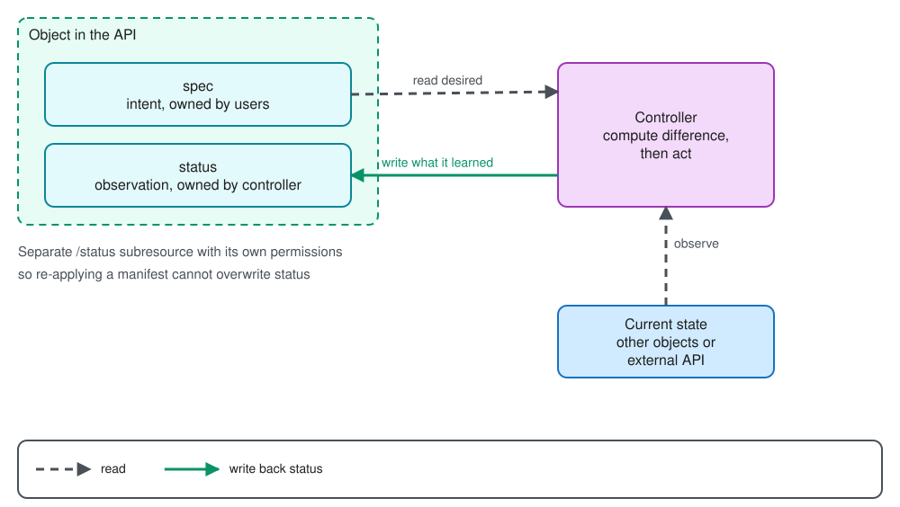
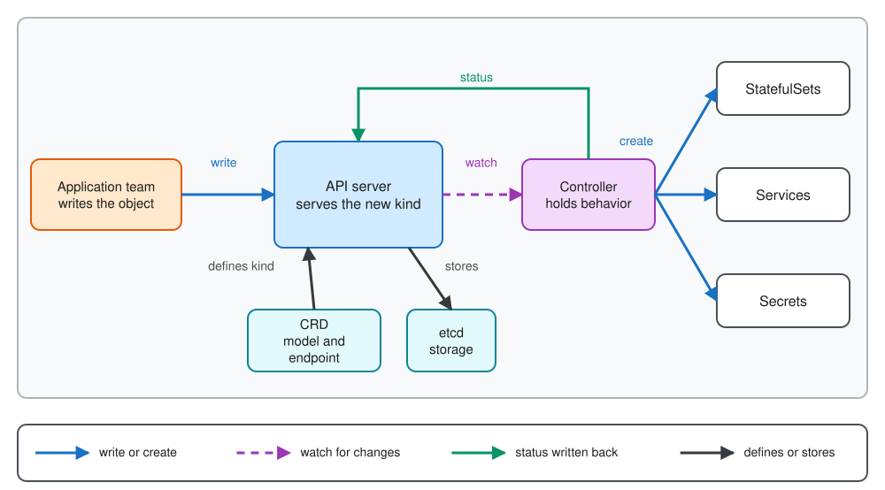
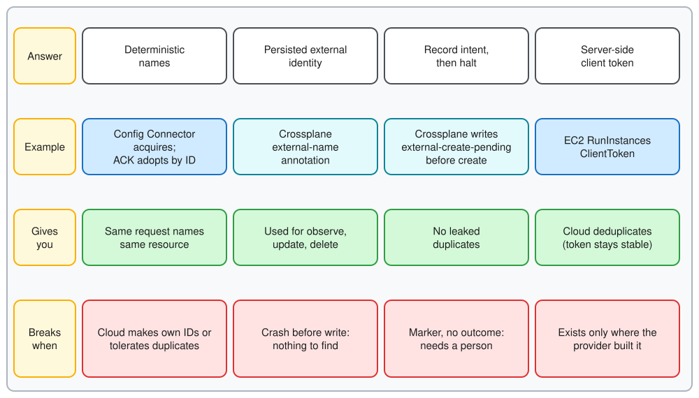
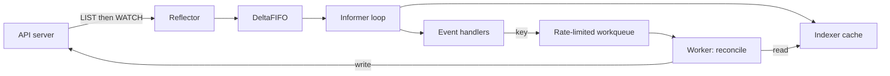
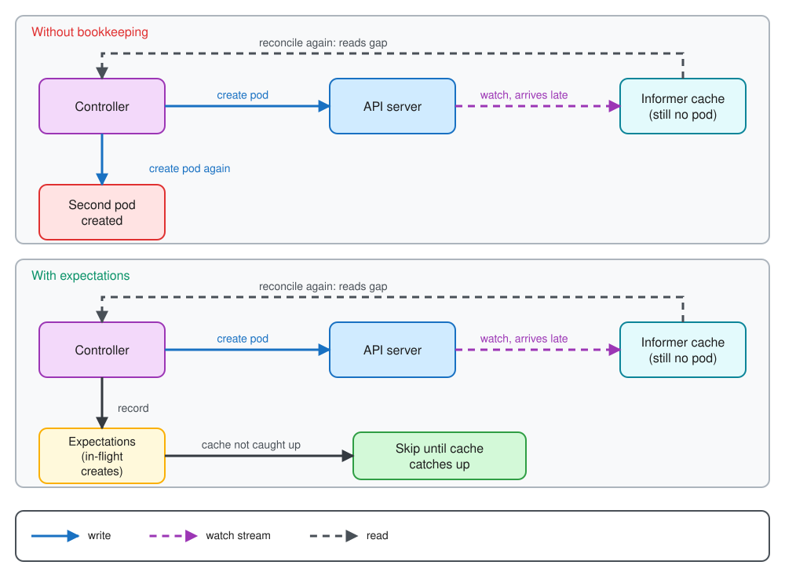
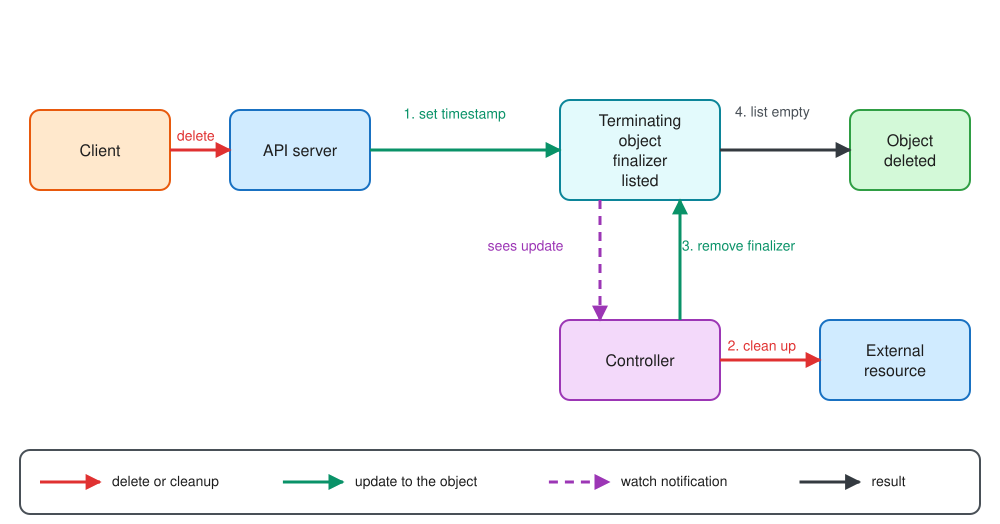
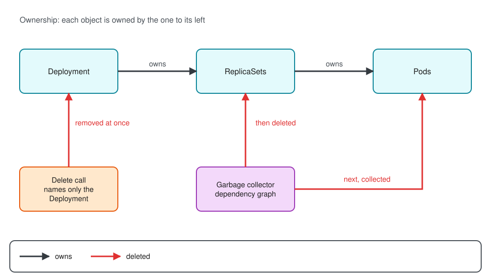
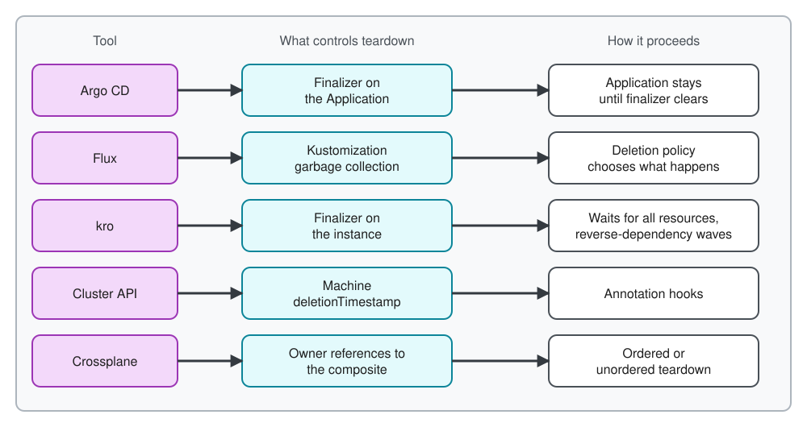

# Part 3: Inside Controllers and Operators

> [!NOTE]
> **Audience:** Engineers with real Kubernetes operating experience (pods, deployments, services, RBAC, kubectl) who have not yet worked inside controllers, API machinery, or platform abstractions.<br>
> **Purpose:** Teach the handful of mechanics that every controller-based platform tool depends on, show how real tools implement them differently, and explain why most production failures are violations of those mechanics.<br>
> **Status:** Active, part 3 of the tutorial series.<br>
> **Created:** 2026-11-25<br>
> **As of:** 2026-11-27<br>
> **Draws on:** [[concepts/operator-pattern]], [[concepts/reconciliation-loop]], [[concepts/idempotency]], [[concepts/informers-reflectors-and-workqueues]], [[concepts/finalizers]], [[concepts/owner-references-and-garbage-collection]], [[concepts/conditions]], [[concepts/level-triggered-vs-edge-triggered]], [[concepts/pitfalls-and-case-studies]], and the example, finding, comparison, and decision pages linked inline.<br>

## Why this part exists

If you have operated Kubernetes for a while, you already trust a quiet miracle. You delete a pod that belongs to a Deployment and a new one appears. You scale a Deployment from three replicas to five and two more pods show up. You never wrote a script to make that happen, and nothing you did resembles a command that runs once and finishes. A small program inside the cluster noticed that reality and your stated wish had drifted apart, and it kept acting until they matched.

That small program is a controller, and this tutorial's argument is that nearly everything interesting in the platform-engineering world is a controller wearing a different name. Flux, Crossplane, Argo CD, Cluster API, the AWS and Google Cloud service controllers, kro, and the operator that runs your team's database are all sets of controllers. Their quality depends on a short list of mechanics: reconcile loops that are safe to run any number of times, informer caches and rate-limited workqueues that feed those loops, finalizers that protect cleanup, owner references that tie children to parents, and status conditions that tell the truth about progress. The thesis of this part is that when one of these platforms fails in production, the failure is almost always a violation of one of those mechanics, and the fixes tools have added over the years are almost always guard rails around the same few ideas.

We will build the ideas from the ground up, because each depends on the one before it. We start with what a controller is, then the operator pattern that packages controllers for a domain, then the loop itself and the discipline of idempotency. After that comes the plumbing that feeds the loop, the rules for requeueing and errors, and the two deletion mechanisms, finalizers and owner references. We then turn to conditions, look at some real use cases, catalogue the pitfalls, compare how six tool stacks implement the mechanics, and finish with design principles. Earlier parts of the series introduced the universal control plane idea and the resource model; this part opens the box and looks at the machinery inside.

## 1. What a controller actually is

The Kubernetes documentation describes controllers with a thermostat. You set a temperature, which is your desired state. The thermostat measures the room, which is the current state. When the two differ it turns the heat on or off, and it keeps doing this forever. It does not complete a task and exit. In the documentation's words, controllers are control loops that watch cluster state and make changes where needed, moving current state closer to desired state. A cluster never has to reach a final stable state, and a controller keeps correcting failures indefinitely. The design also favors many small controllers that each own one aspect of the system, instead of one large controller that knows everything ([[concepts/reconciliation-loop]]).

The built-in Job controller is the simplest worked example. It watches Job objects. When it sees one that needs work, it creates pods by asking the API server to create them, and when the work finishes it removes the pods and reports status on the Job. It never starts a container itself. Kubernetes documentation contrasts this with controllers that touch an outside system directly, using the cluster autoscaler as the example, because adding a node means calling something outside the API server ([[examples/job-controller-acts-through-the-api-server-while-the-cluster-autoscaler-acts-directly]]). That contrast matters for the rest of this tutorial, because a database operator, a cloud-resource controller, and a GitOps controller are all of the second kind: they talk to some external system and record what they did.

Every controller has the same four parts. It has a source of desired state, which is the `spec` section of an object that users and tools write. It has a way to observe current state, either by reading other Kubernetes objects or by calling an external API. It has a function that computes the difference and acts to close it. And it has a place to write what it learned, which is the `status` section of the same object. The split between `spec` (intent, owned by users) and `status` (observation, owned by the controller) is enforced by a separate `/status` subresource with its own permissions, so a GitOps tool that re-applies a manifest cannot accidentally overwrite what a controller observed ([[concepts/spec-status-split]]).

Figure 3.1 shows the four parts of a controller and which side of the object each one touches.



*Figure 3.1. The four parts of a controller. A controller reads intent from the spec of an object, observes current state elsewhere, and writes what it learned back to the status of that same object. The dashed frame shows the ownership split: users own the spec, and the controller owns the status.*

There is one more property to absorb before going further: a controller is level-triggered. The terms come from electronics. An edge-triggered circuit reacts to a transition, such as the signal going high. A level-triggered circuit reacts to the current value, such as the signal being high. A level-triggered controller does not ask what just happened; it asks what is true now and what should be true, and it acts on the difference. The Kubernetes design archive says controllers are level-based to maximize fault tolerance, and the API conventions say the system's behavior is level-based and not edge-based ([[concepts/level-triggered-vs-edge-triggered]]).

The classic demonstration is a Deployment whose replica count is changed quickly from 1 to 5 and then to 2. A handler that applies each change as a delta can end at the wrong number if an event is lost or reordered, and in the HackerNoon example it can land at zero. A level-triggered controller compares the final desired value of 2 against what exists and acts on the gap, so it ends at 2 however many intermediate values it saw ([[examples/deployment-replica-changes-converge-to-the-final-count]]). The practical consequence for anyone who edits resources is that a rapid sequence of edits behaves like one edit to the last value. Convergence, the usual term for this, does not promise that every intermediate state is processed. It promises that the last declared state wins ([[concepts/eventual-consistency-and-convergence]]).

Kubernetes is a hybrid in practice, and this is worth stating carefully. Watches deliver events with low latency, and that is an edge-triggered optimization. But the event is treated only as a hint to look at an object, and the controller then reads the full state and enforces all of it. The design archive says watches restore the latency benefits of edge triggering without making correctness depend on them ([[decisions/events-as-hints-state-as-truth]]). Keep that sentence in mind, because the informer machinery in section 4 exists to deliver those hints cheaply.

## 2. The operator pattern: encoding runbooks as reconcilers

A controller for built-in kinds such as Jobs and ReplicaSets ships with Kubernetes. The operator pattern asks what happens when you apply the same idea to your own domain. An operator is a controller that understands two domains: Kubernetes and something else, such as a database, a cloud API, or cluster lifecycle. The pattern pairs a custom resource definition, which adds a new kind to the API server, with a controller that watches instances of that kind and drives the world toward the declared spec. The runbook knowledge a human operator carries, how to install, upgrade, back up, and fail over, becomes code that runs continuously. The Kubernetes documentation puts it as software extensions that use custom resources to manage applications and their components, and describes operators as clients of the Kubernetes API that act as controllers for a custom resource ([[concepts/operator-pattern]]).

Here is the minimal picture. A team wants to offer a database without making every application team learn how to assemble it. They register a kind, say `PostgresCluster`, and an application team writes a small object stating the replica count and version they want. Once the definition exists, the API server serves the new kind like any built-in type: it is listed, watched, validated, covered by RBAC, written to the audit log, and stored in etcd. The definition supplies only the data model and the endpoint. All behavior lives in the controller, which watches these objects and reconciles each into child objects such as StatefulSets, Services, and Secrets, then reports progress in `status` ([[examples/postgrescluster-custom-resource-reconciled-into-child-objects]]).

Figure 3.2 traces how a custom kind, its definition and its controller fit together.



*Figure 3.2. A custom kind and its controller. The CRD only gives the API server a new kind and an endpoint, with etcd storing the objects. Follow the arrows from the application team's object to the controller, which creates the child objects and writes progress back to status.*

```yaml
apiVersion: db.example.com/v1alpha1
kind: PostgresCluster
metadata:
  name: orders-db
  namespace: team-orders
spec:
  version: "16"
  replicas: 3
  backup:
    schedule: "0 2 * * *"
```

The object above is the entire interface the application team sees. Behind it, the operator creates the storage, the pods, the services, and the backup job, and it keeps them correct. The platform's quality now depends on the controller following the conventions for `spec`, `status`, and conditions, because the definition enforces none of that on its own. The Kubernetes documentation uses a hypothetical SampleDB resource to make the same point: a user edits a custom resource, and the operator creates the volume claims, StatefulSets, and Jobs needed to realize it. Runbook steps become reconcile logic instead of commands a human types ([[examples/database-operator-encodes-runbooks]]).

Frameworks exist so that nobody writes the plumbing by hand. Kubebuilder and the Operator SDK, both built on the controller-runtime library, scaffold Go projects, and equivalents exist for Python, Java, Rust, and .NET. The Operator SDK's capability model grades operators from Level 1 (basic install) through seamless upgrades, full lifecycle, and deep insights to Level 5 (auto pilot), which gives teams a shared vocabulary for maturity ([[entities/operator-sdk]], [[entities/kubebuilder]], [[entities/controller-runtime]]). The model was written with operators that manage a workload in mind, so it fits less naturally to operators whose whole job is to call an outside cloud API or to compose in-cluster objects, as Crossplane providers, Config Connector, and kro do. Treat the levels as a rough maturity vocabulary and not as a ranking that every controller-based tool can be placed on ([[findings/operator-sdk-capability-levels-keep-delegating-operators-at-level-1-and-say-nothing-about-composition-tools]]).

No neutral criteria for choosing among the frameworks exist in the sources, so the options are laid out here without ranking them. Kubebuilder is aimed at developers who extend the API and is built on controller-runtime. The Operator SDK adds Ansible and Helm workflows on top of controller-runtime, so a team can build an operator without writing Go. The Java Operator SDK offers dependent-resource handling and automatic retries for Java teams. Kopf brings the idea to Python through decorators. Shell-operator runs ordinary scripts as hooks. Metacontroller lets you write a webhook in any language that receives current state as JSON and returns desired state as JSON, while it supplies the queues, retries, and garbage collection ([[comparisons/operator-frameworks-by-self-description-kubebuilder-operator-sdk-java-operator-sdk-kopf-shell-operator-and-metacontroller]], [[decisions/choose-an-operator-framework-or-language-from-kubebuilder-operator-sdk-josdk-kopf-shell-operator-metacontroller-or-composition]]). The practical question is how much of the controller plumbing you want to own and which language your team can maintain.

Platform tools are this same pattern specialized to a domain. Flux applies it to GitOps delivery, Crossplane to cloud-resource composition, Cluster API to cluster lifecycle, ACK to AWS resources, and kro to runtime-generated APIs. A Crossplane provider is described in the wiki as an operator whose domain is an external API ([[concepts/provider]]). That is why the mechanics in this tutorial carry across so much of the ecosystem, and why a failure mode learned in a hand-written Go operator tends to reappear in a commercial platform.

One piece of guidance is worth stating early. Not every automation deserves a custom resource, and the wiki's decision page records the trade: a hand-written operator gives full control and suits domain logic such as backup, failover, and schema migration, while composition-based tools suit work that is mostly assembling existing resources ([[decisions/build-a-custom-operator-or-compose-existing-resources]], [[comparisons/hand-written-operator-versus-crossplane-composition-versus-kro]]).

## 3. The reconcile loop and why it must be idempotent

At the heart of every controller is a function. In controller-runtime it is `Reconcile(ctx, req)`. It receives a request that contains only a namespace and a name, never an event type. It must read whatever state it needs, compare it to the spec, act through idempotent calls, update status, and return a result and an error ([[concepts/reconciliation-loop]]). That the request carries no event type is deliberate. The framework removes the temptation to write "if this was a create, do X; if it was an update, do Y," and that logic is the first thing a new operator author is tempted to write. The controller-runtime FAQ answers the question flatly: you should not, because reconcile functions should be idempotent and should always read all the state they need before writing updates ([[findings/event-specific-logic-in-reconcilers]]).

Idempotency means that running the same operation twice leaves the system in the same end state as running it once. A level-triggered loop can run at any time, any number of times, after a crash, with coalesced events, or twice in a row because a cache was slightly behind. If the reconcile function is not idempotent, the second run creates a duplicate or fails. The Kubernetes controllers page says controllers can fail and that Kubernetes is designed to allow for that, which is why the loop has to be a convergence process and not a script of one-shot commands ([[concepts/idempotency]]).

Idempotency shows up at three layers, and it helps to treat them separately because the difficulty rises with each.

The first layer is the loop itself: read everything you need, compute, then write. The second is the Kubernetes API. Deterministic object names turn the API server's optimistic locking (a scheme in which a write carrying a stale resourceVersion is rejected) and its name-uniqueness rule into a free duplicate check, because a second create of the same name fails loudly. The StatefulSet controller appends an ordinal to each pod name, so a second attempt to create `web-0` is rejected. The Deployment controller hashes the pod template into the ReplicaSet name, so the same template always maps to the same name. The ReplicaSet controller creates pods with generated names, so the name cannot reject a duplicate, and it instead records the creations it has requested and requeues until its cache catches up. That bookkeeping is called expectations: a per-object count of creates and deletes the controller has issued but not yet seen in its cache, so that it skips acting until the cache catches up ([[examples/built-in-controllers-use-deterministic-names-to-avoid-duplicate-children]], [[examples/how-core-controllers-handle-cache-lag]]). Server-side apply, covered in an earlier part, adds safe repeated writes and turns a clash with another writer into an explicit conflict ([[concepts/server-side-apply-and-field-ownership]]).

The third layer is the hard one: external cloud APIs. Creating a cloud resource is not naturally idempotent. If a controller calls a create API and crashes before it records the returned identifier, the next reconcile cannot tell whether the resource exists, and a blind retry can leak the first one. Four answers exist, and they appear in different tools.

The first answer is to use deterministic or caller-chosen names, so that the same request always names the same resource. Config Connector acquires a same-named resource, and ACK adopts by identifier. This works only if the cloud API rejects a duplicate name or hands back the existing resource, and many cloud APIs generate their own identifiers or tolerate duplicate names, in which case a deterministic name protects nothing. The second answer is a persisted external identity, such as Crossplane's `crossplane.io/external-name` annotation, which the controller then uses for observe, update, and delete. It is reliable once written, but it is useless in exactly the failure that matters most: if the controller crashes after the cloud create succeeds and before it writes the annotation, the identity was never saved and the next pass has nothing to look up.

The third answer is to record intent before acting and to fail safe when the result is unknown. Crossplane writes `external-create-pending` before the create call and stops for a human if it later finds the marker with no recorded outcome. This prevents leaked duplicates, but the price is that every ambiguous case needs a person. The fourth answer is a server-side client token that lets the cloud itself recognize a retry, such as the `ClientToken` on the EC2 `RunInstances` call. It is the most robust option because the cloud does the deduplication, but it exists only where the provider built it, and the token must stay stable across retries of the same logical request.

Figure 3.3 sets the four answers side by side so their strengths and failure points can be compared.



*Figure 3.3. Four ways to make an external create safe. Each column is one answer to the crash window around an external create, read top to bottom as its example, what it gives you and when it breaks. Compare the bottom row to see why no single answer covers every cloud API.*

The EC2 case is instructive. The caller supplies a unique token, the service stores the token atomically with the new resource, and a retry with the same token returns an equivalent response instead of an error. The AWS Builders' Library article that explains this rejects detecting duplicates by hashing the request, because two identical requests may be intentional, such as launching two identical instances. Only the caller can say that a request is a retry ([[examples/ec2-client-token-makes-a-retried-runinstances-call-safe]]). Deriving such a token from a Kubernetes object's UID would be an inference, because no source shows a controller doing it.

The Crossplane case shows the cost of the safe-failure option. A managed resource can stop reconciling after a provider restart. The provider writes the pending marker before the cloud create and a success or failure marker afterward. If it restarts between those writes, the next pass finds a pending marker with no outcome and blocks, with an event telling a person to remove the annotation if it is safe to proceed. A maintainer explained the reasoning: many cloud APIs return a generated ID, so if the response is lost there is nothing to look up, and a second create could leak the first resource. Failing safe prevents duplicates and leaked cost, but it does not scale, because every ambiguity needs a human ([[examples/provider-restart-blocks-a-crossplane-resource-on-external-create-pending]], [[findings/an-ambiguous-create-result-halts-reconciliation-until-a-human-intervenes]]).

Crossplane's shared reconciler offers an opt-out for this safeguard. When the name of the external resource is chosen by the user and is therefore predictable, it is safe to requeue a resource after an incomplete create, because the retry will find or create the same resource. When the name is generated by the cloud, the reconciler stops with a "cannot determine creation result" message and waits for a person. The catch is that each provider has to opt in, so a provider that does not will leave deterministically named resources stuck after a transient error, such as a dropped connection to the Kubernetes API server that loses the response of the pending-annotation update. The same stuck state can arise when a provider that wraps a long-running tool is terminated in the middle of that tool's work. The lesson is that a safeguard built for the hard case, a cloud-assigned identifier, penalizes the easy case unless each provider opts out deliberately.

The same lost-result problem appears in ACK. An audit of its controllers found that for a meaningful number of resource kinds a lost create response either creates a second AWS resource or makes every later reconcile fail because the name is already taken, and it found further kinds that depend on undocumented cloud behavior. That audit was one person's work and is not a count of production incidents. A reproduced case shows the practical result: a controller restarted during a rolling update, a second create call for a VPC endpoint was made, only one endpoint was recorded, and the orphan blocked later subnet deletion until someone removed it by hand. The reporter attributes the cause to the absence of a stable client token, although the overlapping-pod explanation is an inference because only the surviving pod's logs were kept. Writing the status patch immediately after the create call narrows the window in which an identifier can be lost but does not close it, since a crash between the AWS call and the patch can still lose the identifier ([[findings/an-ack-audit-found-48-resources-in-22-controllers-where-a-lost-create-response-duplicates-the-resource-or-wedges-the-custom-resource]], [[examples/ack-issue-3122-a-controller-restart-during-a-rollout-created-a-second-vpc-endpoint-and-blocked-subnet-deletion-for-about-two-hours]]).

SAP's BTP provider takes a middle road, and its design is worth reading as a pattern. Recovery runs only when the pending marker is present, which proves the provider itself started a create. It then searches by a business key such as a subdomain, requires the candidate's creation time to fall inside a window around the pending timestamp, and on a match writes the external name back and requeues. A candidate outside the window produces a warning and is not adopted ([[examples/sap-btp-provider-recovers-lost-ids-by-business-key-and-creation-window]]). The wiki frames the three approaches, halt, search, or tag, as an open decision with no verdict ([[decisions/recover-from-an-ambiguous-create-by-halting-searching-or-tagging]]).

A related failure needs no crash at all. A reconciler makes a successful create call and then fails to write the result into status, perhaps because of a conflict. The next pass sees no record and creates again. Crossplane's create-tracking annotations exist for exactly this case ([[findings/a-create-that-succeeds-while-the-status-write-fails-can-leak-an-external-resource]]). Retries compound the issue: blind retry is safe only when the target API is idempotent, which is why retry storms and idempotency are linked ([[findings/blind-retries-duplicate-side-effects-when-the-cloud-api-is-not-idempotent]]).

Idempotency also reaches into deletion and observation code. The Crossplane provider-development guide states the rule sharply: delete implementations must not return an error when asked to delete a non-existent external resource, and an observe call must report a missing resource as "does not exist" instead of as an error, because the shared reconciler uses that answer to decide whether to call create. A hand-written provider that returns not-found as an error never creates anything ([[examples/provider-authors-implement-an-external-client-behind-the-shared-managed-reconciler]], [[findings/hand-written-providers-that-treat-not-found-as-an-error-break-the-create-flow]]).

Idempotency is also what makes a simple availability story possible. The kube-rs guide observes that most controllers can run as a single replica: they are queue consumers, their watches reinitialize with current state on boot, and idempotent reconcilers make repeated work harmless, so a short outage delays convergence without breaking it ([[decisions/single-replica-versus-leader-election]]).

## 4. Informers, reflectors, caches and workqueues

Where do the requests that arrive at `Reconcile` come from? Imagine the naive design: every controller polls the API server asking for all objects of its kind. With thousands of objects and dozens of controllers, that would crush the API server and etcd behind it. The machinery in client-go, the Go client library, solves this by watching once and caching locally ([[concepts/informers-reflectors-and-workqueues]]).

The pipeline has named stages, and it is easiest to follow in order. A reflector performs an initial LIST to obtain a consistent snapshot, then opens a WATCH on the same resource, which is a long-lived HTTP stream of changes. Each change goes into a DeltaFIFO, a queue that keeps an ordered list of deltas for each key and collapses consecutive identical deltas. The informer's processing loop pops deltas, writes the object into a thread-safe local cache called the indexer (keyed by namespace and name, with optional secondary indexes by label, owner, or any custom field), and then calls any registered event handlers. Controller code reads through read-only listers that query the cache and never the API server.



The diagram follows one change from the API server to a reconcile. The two arrows leaving the worker matter most: reads come from the local cache, which is cheap, while writes go straight to the API server. The event handlers are meant to do almost nothing, because the client-go architecture document states that handlers only add an object's key to the work queue. A worker then takes a key, reads the current object from the cache, and reconciles it. A secondary explainer compresses the design into one watch per resource type, one cache per process, one reconcile per key, and one rate limiter per workqueue.

In controller-runtime you rarely build any of this by hand. Declaring that a controller `Owns()` a child type registers an informer on that type and maps each child event back to its owner's key, so a change to a Job triggers a reconcile of the CronJob that created it. A field indexer on the owner reference lets the reconciler list a CronJob's Jobs from the cache without scanning every Job ([[examples/kubebuilder-owns-and-a-field-indexer-wire-child-changes-to-the-owner]]). The Kubebuilder CronJob tutorial, which the research sources recommend as the best first hands-on exercise, walks through the whole path from API types to a tested controller ([[examples/kubebuilder-cronjob-tutorial-shows-the-end-to-end-shape-of-a-go-operator]]).

The workqueue deserves its own paragraph, because its guarantees are what make the loop safe. It offers a base queue, a delaying queue (`AddAfter`), and a rate-limiting queue (`AddRateLimited`, `Forget`), and it gives three guarantees: items are served in fair order, items added before they are processed are deduplicated, and one item is never processed concurrently. Many events for the same object collapse into one key, and a reconciler never races with itself on that key. The default limiter combines per-item exponential backoff, so one failing object waits longer after each failure, with an overall rate cap implemented as a token bucket (a limiter that refills a fixed number of permits per second), so that many failing objects together cannot flood the API server. Depending on which queue implementation a framework uses, the overall cap may or may not be present, so check what your framework's queue actually does before relying on it ([[findings/a-requeue-true-result-backs-off-exponentially-because-only-requeueafter-forgets-the-failure-history]]). Authors using the raw queue must call `Done()` and `Forget()`, or items stay stuck or keep their accumulated backoff, though frameworks like controller-runtime make those calls for you ([[findings/skipping-done-or-forget-on-the-workqueue-leaves-items-stuck-or-retrying]]).

Two more details complete the picture. The first is how a watch recovers. The resource version is the cursor that lets a watch resume. When the cursor is too old, the API server answers 410 Gone and the client must relist. If many clients lose their watches at the same moment, they all relist at once, which is expensive for the API server and etcd. Watch bookmarks refresh the cursor during quiet periods, the server's watch cache lets clients resume from recent versions, and jittered backoff spreads relists out ([[findings/an-expired-resourceversion-forces-a-relist-and-synchronized-relists-can-storm]]).

The second detail is cache lag, which is the root of one of the most common bugs. Because the cache is updated from the watch stream, it can trail the controller's own writes. If a controller creates a pod and reconciles again before the cache shows it, the gap still appears to exist and the controller may create a second pod. A simulation in one source shows a regulator that cannot see its own recent writes overshooting its target. The fix in the built-in controllers is the pair of techniques from section 3: deterministic names, or expectations, which are per-object counters of the creates and deletes the controller has issued but not yet seen in its cache, so the loop skips acting until the cache catches up and confirms its own writes. Mature controllers are therefore level-based logic plus bookkeeping about in-flight actions ([[findings/stale-cache-and-double-action]]).

Figure 3.4 contrasts a controller that trusts a lagging cache with one that records an expectation for its own write.



*Figure 3.4. How cache lag causes double action. In the top row the controller creates a pod, the watch update reaches the informer cache late, and the next reconcile still sees a gap and creates a second pod. In the bottom row the controller records an expectation for its in-flight create and skips acting until the cache catches up.*

Kubernetes also builds a mitigation into several built-in workload controllers that moves part of this bookkeeping into the informer layer. The DaemonSet, StatefulSet, ReplicaSet, and Job controllers inside kube-controller-manager record the resource version of each write they make, and before syncing an object they check whether their cache has reached that version. If the cache is behind, the controller takes no action on that object and retries it later, so the skip is keyed on resource version and is not a sleep or a timer. That depends on an informer queue that applies list and relist batches atomically and on a store that can report the latest resource version it has seen. The idea is available to the authors of any informer-based controller: instead of counting creates and deletes in flight, ask whether your cache has caught up with your own last write ([[examples/kubernetes-v1-36-daemonset-statefulset-replicaset-and-job-controllers-skip-a-sync-until-the-cache-catches-up-with-their-own-write]]).

This generalizes the expectations idea rather than replacing it. Controller frameworks offer an opt-in, read-your-writes mode in which a client can see its own recent writes even though reads come from the cache, and a controller must ask for it. Deterministic names, expectations, and explicit uncached reads remain the dependable defenses ([[findings/controller-runtime-v0-25-0-ships-an-experimental-opt-in-read-your-writes-client]]). Controller-runtime's cache-backed client reads from the cache while writes and status updates go directly to the API server, so an authoritative read needs an explicit uncached reader.

There is a cost to all this caching. The cache holds every watched object with no eviction, so memory grows with the number of objects watched, and the practical advice from tools reflects it: Argo CD recommends sharding the controller and giving the process an explicit memory limit, and Flux lets you tune its Helm caches and warns that in-memory artifact storage counts against pod memory ([[findings/informer-caches-hold-every-watched-object-and-memory-grows-with-cluster-size]]). Resync, a periodic replay of cached objects to handlers, is usually disabled. Sources disagree on whether it is a useful defense against reconciler bugs or a common misunderstanding ([[decisions/keep-informer-resync-disabled-or-set-a-periodic-resync]]), but what it does is clear from the client-go source. The `SharedInformer` comment says a resync delivers an update notification for every object in the informer's local cache and "does not add any interactions with the authoritative storage", and the delta queue's resync re-adds every object known to the informer's own indexer. A resync is therefore a local replay and never contacts the API server, and it differs from `HasSynced` (at least one full LIST has been seen) and from a relist after a watch failure, which does hit the API server. Controller-runtime's periodic resync is built on that replay: it emits an artificial update with the same object as old and new, so a generation-changed predicate filters it out, and the documentation suggests returning a delayed requeue to cover missed watch events instead of replaying the cache more often. The word "resync" also names different mechanisms in other projects: in some, a setting called resync only replays the local cache and does not poll the cloud ([[findings/a-resync-replays-the-informers-local-cache-to-the-handlers-and-never-contacts-the-api-server]], [[findings/the-cluster-api-sync-period-flag-is-a-cache-resync-and-not-a-poll-of-the-cloud-infrastructure]]).

Controller-runtime also gives you several ways to narrow that cache, and each has a stated cost. Restricting the cache to certain namespaces, labels, or fields reduces what is fetched, at the price that objects outside the restriction are invisible to cached reads. Transforming objects as they are stored, for example by stripping managed-field bookkeeping, can reduce memory, but anything stripped is gone from every cached read, and the size of the saving is a vendor statement and not a measurement. Skipping the defensive copy on reads saves work but lets callers mutate shared objects. Keeping only metadata for a type saves memory but removes the spec and status from cached reads, and some types can be configured to bypass the cache and always do a live lookup. Unstructured reads bypass the cache by default. No source gives memory measurements for any of these choices, so the savings are unquantified ([[findings/controller-runtime-narrows-its-cache-with-selectors-transforms-metadata-only-informers-and-disable-for-and-each-option-has-a-cost]]). Projects combine these differently: kro keeps one metadata-only shared informer per GVR, Config Connector caches only its own configuration kinds, ACK scopes by namespace and label selector, and Cluster API caches only Secrets carrying its cluster label ([[comparisons/informer-and-cache-choices-across-kro-config-connector-ack-and-cluster-api]]). Controller-runtime also keys informers by GVK (group, version, and kind, the full name of an API type) while client-go factories key by Go type or by GVR (group, version, and resource, the REST path form of the same name), which matters when you reason about how many informers a process holds ([[findings/controller-runtime-tracks-informers-by-gvk-while-client-go-factories-key-by-go-type-or-gvr]]).

## 5. Requeue, error handling, backoff and terminal errors

At the end of every pass, the reconciler tells the workqueue what to do next, and the choices are a frequent source of confusion. Return values map this way: an empty result and a nil error mean the object has converged and nothing more is needed until the next watch event. A `RequeueAfter` delay means the object is healthy but waiting, for example for a dependency. A non-nil error means this attempt failed, and the item returns to the queue with exponential backoff. Controller-runtime also offers a `TerminalError`, which is logged and counted but not retried. A plain boolean requeue result also exists, but a delayed requeue or an error states the intent more clearly ([[decisions/choose-error-requeueafter-or-terminalerror-in-a-reconciler]]).

Figure 3.5 follows each of the four return values to what the workqueue does next.


*Figure 3.5. The four ways a reconcile pass ends. Follow each return value from a finished reconcile pass to what the workqueue does next. The two red exits are the failure cases: an error is retried with backoff, while a TerminalError is logged and counted but not retried.*

```go
func (r *DBReconciler) Reconcile(ctx context.Context, req ctrl.Request) (ctrl.Result, error) {
    var db dbv1.PostgresCluster
    if err := r.Get(ctx, req.NamespacedName, &db); err != nil {
        return ctrl.Result{}, client.IgnoreNotFound(err)   // gone: nothing to do
    }
    if !specIsValid(&db) {
        return ctrl.Result{}, reconcile.TerminalError(errors.New("invalid spec"))
    }
    ready, err := r.ensureChildren(ctx, &db)
    if err != nil {
        return ctrl.Result{}, err                          // failed: backoff applies
    }
    if !ready {
        return ctrl.Result{RequeueAfter: pollDelay}, nil // waiting, not failing
    }
    return ctrl.Result{}, r.updateStatus(ctx, &db)
}
```

The sketch is illustrative and compresses a real controller, but it shows the four exits; `pollDelay` stands for whatever wait suits the dependency being polled. A missing object is not an error, because the object may simply have been deleted. An invalid spec is a permanent problem that retrying will not fix, so it is marked terminal. A real failure returns the error and lets the queue back off. A healthy but unready situation returns a delay with no error. A common mistake is to collapse the last two. A third-party guide the wiki cites puts the rule well: errors should mean the reconcile attempt failed, not "come back in thirty seconds." Returning an error for a waiting state triggers backoff and generates noisy failure signals even though nothing failed ([[findings/errors-used-as-timers-in-reconcilers]]).

A requeue requested with the plain boolean `Requeue: true` result goes through the controller's rate limiter, so the limiter chooses the delay and the per-item failure counter is not reset. A reconciler that returns it on every pass therefore waits longer each time and never gets a steady cadence. Only `RequeueAfter` calls `Forget` first, which clears the failure history, and then waits exactly the duration you asked for, and it takes precedence over `Requeue` when both are set. Some write-ups describe the boolean form as an immediate requeue without backoff, but the framework's behavior is the rate-limited one. Monitoring can tell the paths apart, because reconcile outcomes are labeled as error, delayed requeue, rate-limited requeue, and success. New code should return an error when something failed and a delayed requeue when it is merely waiting ([[findings/controller-runtime-issue-808-is-a-documentation-request-and-does-not-claim-that-requeue-true-is-immediate]], [[findings/a-requeue-true-result-backs-off-exponentially-because-only-requeueafter-forgets-the-failure-history]], [[findings/the-requeue-true-result-is-deprecated-and-described-inconsistently]]).

Why does any of this matter beyond tidiness? Because a level-triggered loop has no built-in notion of giving up. A reconcile that always fails retries forever. The controllers the wiki surveys limit that behavior in different ways, which is where the tools start to diverge ([[findings/failure-retry-loops-and-backoff]]). Some tools keep a separate, slower retry cadence for failures, some stop retrying a failed attempt until the input changes, and some cap the backoff or eventually drop an item that keeps failing. Each choice trades quick recovery once a dependency returns against pressure on a dependency that is struggling ([[comparisons/retry-and-backoff-controls-across-tools]]). Permanent errors such as an invalid spec should stop consuming reconciles, while transient errors should retry with backoff so a recovering dependency is not overwhelmed.

Two further rules protect the whole queue. First, never block inside a reconcile. A worker that sleeps, polls, or waits for something occupies one of a limited number of workers, and because a key is never processed concurrently, a slow object delays unrelated objects. The Google Cloud guidance advises asynchronous sync loops that do not block on errors; the standard alternative is to return a requeue and let the worker move on ([[findings/blocking-on-errors-inside-the-sync-loop-stalls-every-other-object]]). The Cluster API Machine controller is a good example of waiting done correctly: it sets owner references, waits for infrastructure and bootstrap data to be ready, and matches nodes to provider IDs, with the waiting expressed through state read on each pass and not through a held-open operation ([[examples/cluster-api-machine-controller-waits-for-infrastructure-and-bootstrap-data]]).

Second, do not wake yourself up. A controller can generate the events that trigger it: status writes that retrigger reconciles, accidental changes to the spec, noisy child objects watched through `Owns()`, an aggressive `RequeueAfter`, or logic that depends on individual events. The result is a hot loop that burns CPU and API capacity while changing nothing of substance ([[findings/self-triggered-reconcile-loops-generate-their-own-events]]). The most common instance is writing status through the main resource. Without the status subresource, a status write is a write to the whole object, which bumps `metadata.generation`, fires the controller's own watch, and starts another pass. With the subresource enabled, a status patch updates only status and leaves the generation alone ([[findings/status-writes-through-the-main-resource-retrigger-reconcile-loops]]). The mitigations are a generation-changed predicate on watches, the status client, patches in place of full updates, and jitter on requeues.

## 6. Finalizers: guarding external cleanup

Everything in the preceding sections concerns creating and maintaining things. Deletion is where controllers face a new problem. When you delete an object, the API server removes it from etcd immediately, and a controller watching it sees only that it is gone, with nothing left to read. If that object represented an RDS instance, the controller has just lost the record of what to delete. Finalizers solve this ([[concepts/finalizers]]).

A finalizer is a string in `metadata.finalizers`. While the list is non-empty, Kubernetes will not remove the object. When a client deletes an object that carries finalizers, the API server sets `metadata.deletionTimestamp`, returns HTTP 202, and leaves the object visible in a Terminating state. Controllers that watch the object see the timestamp, do their cleanup, and remove their own entry from the list. When the list is empty, the object is deleted. A delete becomes a mark followed by a removal, and the controller sees the delete as an update. The simplest built-in case is `kubernetes.io/pv-protection`, which keeps a PersistentVolume that a pod is using from vanishing. The object is only a record, and the real asset is the disk ([[examples/pv-protection-finalizer-keeps-an-in-use-volume-from-vanishing]]). The Kubernetes blog post on finalizers makes a point that is easy to miss here: a finalizer is a key and does not name any code, much like an annotation, so nothing in the API ties it to a particular controller and anyone with edit access to the object can add or remove it. The companion built-in for claims is `kubernetes.io/pvc-protection`. The post demonstrates the consequence with a ConfigMap carrying the namespace key `kubernetes`, which no controller handles for a ConfigMap. After `kubectl delete`, the object stays visible with a `deletionTimestamp` and the finalizer still present, and it is only removed once a JSON patch deletes `/metadata/finalizers`. The demonstration needs no cloud and no operator, so it is a safe way to see the two-phase delete for yourself.

Figure 3.6 shows the two-phase delete in order, from the first delete call to the final removal.



*Figure 3.6. How a finalizer turns delete into two steps. A delete on an object with finalizers first only marks it, and the object is removed only after the controller has cleaned up and taken its own entry out of the finalizer list. Follow the numbered arrows to see the mark, the cleanup, the finalizer removal, and the final deletion.*

The API server enforces a few rules that determine how controllers must be written. Once `deletionTimestamp` is set, no one can add a new finalizer, and the only permitted edit is removal. Custom finalizer names must be qualified, such as `example.com/cleanup`. The consequence for controller design, stated bluntly by one tutorial, is that the finalizer must be on the resource before the delete request arrives ([[findings/a-finalizer-added-after-the-delete-request-is-too-late-and-new-ones-are-refused]]).

The standard Kubebuilder reconcile pattern therefore reads the object and branches on `deletionTimestamp`. The Kubebuilder book calls finalizers asynchronous pre-delete hooks.

```go
if db.DeletionTimestamp.IsZero() {
    // Not being deleted: make sure our finalizer is present BEFORE creating anything external.
    if !controllerutil.ContainsFinalizer(&db, finalizerName) {
        controllerutil.AddFinalizer(&db, finalizerName)
        if err := r.Update(ctx, &db); err != nil { return ctrl.Result{}, err }
    }
    // ...create or update the external resource...
} else if controllerutil.ContainsFinalizer(&db, finalizerName) {
    // Being deleted: clean up first, then release the object.
    if err := r.deleteExternal(ctx, &db); err != nil { return ctrl.Result{}, err }
    controllerutil.RemoveFinalizer(&db, finalizerName)
    return ctrl.Result{}, r.Update(ctx, &db)
}
```

The first branch adds the finalizer on the first pass, before any external work, so the guard is in place before there is anything to guard. The second branch runs only when deletion has begun: it deletes the external resource, and only on success removes the finalizer so the API server can finish the delete. Three details from the wiki's sources keep this safe. The cleanup must itself be idempotent, because the loop may run it more than once. It must treat an already-deleted external resource as success. And the controller needs RBAC permission to update the `finalizers` subresource ([[examples/kubebuilder-reconcile-adds-a-finalizer-before-external-work-and-removes-it-after-cleanup]]). Authors recommend finalizers for external resources, cross-namespace management, and audit logging, and not for in-cluster cleanup that garbage collection already handles.

The same mechanism, applied by platform tools, produces their deletion behavior. Crossplane keeps a finalizer on a managed resource until the external resource is fully gone, and by default deleting the Kubernetes object deletes the cloud resource, with an orphan option that keeps it. ACK deletes the AWS resource and then the Kubernetes object by default, and a retain setting keeps the AWS resource, which the ACK guide recommends for migrating between clusters and for protecting buckets and databases. Config Connector deletes the Google Cloud resource by default, and an abandon setting keeps it ([[examples/crossplane-ack-and-config-connector-delete-the-cloud-resource-before-the-kubernetes-object]]). How ACK, Config Connector, and kro handle the finalizer comes from their source code and not from their documentation pages. ACK adds a finalizer to each resource when it is first reconciled, removes the AWS resource first on delete, and removes the finalizer only then, requeueing while an asynchronous delete is still running. Config Connector uses two finalizers: a separate deletion-defender controller removes only the second one so that the main controller can delete the Google Cloud resource and then remove its own. A code comment indicates that when a resource's CRD is being uninstalled both finalizers are removed and the resource is set to abandon, so uninstalling a CRD does not delete the cloud resources it described, though that reading comes from a single comment and has not been tested. kro puts a finalizer on instances of the APIs it generates and on the objects that define those APIs (ResourceGraphDefinitions, the kro objects that declare such an API and the graph of resources behind it), and removes it only when no managed resources remain to be deleted ([[findings/ack-config-connector-and-kro-each-name-their-finalizers-differently-and-remove-them-only-after-cleanup]], [[findings/config-connector-has-a-second-deletion-defender-finalizer-and-removes-both-finalizers-with-an-abandon-setting-when-its-crd-is-uninstalled]]).

Argo CD and Flux also use finalizers to decide what a delete does. Argo CD recognizes finalizers for cascading deletes in a foreground form and a background form, and the controller uses background propagation only for the background form and otherwise falls through to foreground. Separate finalizers track hook execution and have nothing to do with cascading. A non-cascading delete works by removing the finalizer or never adding it, whether through the command line, by patching the finalizers away, or through the UI's non-cascading choice. A sync option that governs pruning during a sync is a separate setting and does not change how an Application delete propagates, so the two are easy to confuse ([[findings/argo-cd-applications-use-three-cascade-finalizer-names-and-a-non-cascading-delete-removes-the-finalizer]]). Flux adds its finalizer to a Kustomization before any other work, because a finalizer can only be added while no deletion timestamp is set. When it is configured to wait for termination, the controller polls until the children are gone or the Kustomization's own timeout expires. If the wait fails it logs an error, emits an event, and still removes the finalizer, so a timeout does not hold the Kustomization indefinitely, and children that are still terminating afterward are left to their own finalizers ([[findings/flux-kustomization-uses-finalizers-fluxcd-io-and-removes-it-even-when-waitfortermination-times-out]]). Cluster API deliberately chose annotation hooks over finalizers for Machine deletion, because a misbehaving controller could remove a finalizer it should not and so skip the protected step ([[findings/cluster-api-chose-annotation-hooks-over-finalizers-for-machine-deletion-because-a-misbehaving-controller-could-remove-finalizers]]).

Argo CD uses the finalizer as an ownership switch. The resources finalizer on an Application makes deleting the Application also delete the resources it deployed. Deleting an ApplicationSet in orphan mode leaves the Applications in place, but each still carries the finalizer, so removing one of them later still deletes its workloads. The ApplicationSet option that preserves resources on deletion stops the finalizer from being added in the first place ([[examples/argo-cd-resources-finalizer-cascades-an-application-delete-to-its-workloads]]). The lesson for platform teams is that orphaning the parent does not remove its responsibility for the children; the policy must be changed before anything is deleted.

Finalizers are also the most familiar source of operational pain. A finalizer works only while its controller runs. When the controller is missing or failing, the object stays Terminating forever ([[findings/finalizers-strand-objects-in-terminating-when-the-controller-is-missing-or-failing]]). Several variations appear in the wiki's evidence. A cleanup that always errors, or that fails when the external resource is already gone, strands the object ([[findings/cleanup-that-always-errors-or-assumes-the-external-resource-exists-strands-the-object]]). Deleting a cluster that hosts Config Connector stops the controller, leaving the Google Cloud resources it managed behind and still billing, according to one consultancy article, which is limited evidence ([[findings/deleting-the-cluster-first-orphans-cloud-resources-because-the-controller-is-gone]]). Crossplane's documentation warns that removing a provider before its managed resources may abandon the cloud resources ([[findings/removing-a-crossplane-provider-before-its-managed-resources-abandons-the-cloud-resources]]). And a credentials Secret without a finalizer can disappear during namespace deletion, because objects in a deleted namespace go in arbitrary order, leaving managed resources unable to authenticate to the cloud API they must call to finish deleting ([[findings/a-credentials-secret-without-a-finalizer-can-vanish-before-managed-resources-finish-cleanup]]). The remedies, finalizer protection on the Secret, credential caching, or ordered teardown, each trade simplicity against safety, and the choice is itself an open decision ([[decisions/protect-shared-credentials-with-finalizers-caching-or-ordered-teardown]]).

No source quantifies how often forced finalizer removal orphans the resources a finalizer guarded. The Kubernetes finalizers page warns that forcefully removing them can lead to issues and names the safe condition, that the finalizer's purpose was accomplished another way, but it gives no frequency, and none of the sources reviewed, including that page and the Kubernetes, Cluster API, Crossplane, and ACK issue trackers, gives a survey, incident count, or rate. No figure is stated here, though that absence rests on limited search coverage and anonymous reporters ([[findings/no-source-quantifies-how-often-forced-finalizer-removal-orphans-guarded-resources]]). Primary issue reports do document orphaning by other routes, such as a controller that misses the delete or a finalizer added too late ([[findings/resources-are-orphaned-when-a-controller-misses-the-delete-or-the-finalizer-is-added-too-late]]), and one case where a manual patch was safe because the AWS resource was already gone ([[examples/an-argo-cd-prune-left-an-ack-wafv2-webacl-terminating-on-its-finalizer-after-the-aws-resource-was-already-gone]]).

When you face a stuck object, the wiki's guidance is an order of operations. Read `metadata.finalizers` on the object and its dependents, check owner references, find the controller that owns each finalizer, and read its logs. Forcing a finalizer off, by patching the list empty, or for a namespace by editing the `finalize` subresource, is the last resort, because it skips the cleanup the finalizer guarded and can leak billing resources or corrupt data ([[examples/diagnosing-a-pod-stuck-terminating-from-finalizer-to-force-delete]], [[examples/stuck-terminating-namespace-fixed-through-the-finalize-subresource]], [[findings/forcing-a-finalizer-off-skips-cleanup-and-can-leak-billing-resources-or-corrupt-data]]). The wiki frames whether to force or repair as an open judgment call where sources agree on the preference order but not on a threshold ([[decisions/remove-a-stuck-finalizer-by-force-or-repair-the-owning-controller]]). Forcing a namespace through its `finalize` subresource carries a risk that is different from leaking cloud resources. The 2021 Kubernetes blog post on finalizers, written by Aaron Alpar of Kasten, warns that this step can remove the namespace alone and leave orphan objects behind in a namespace that no longer exists, which it calls a confusing state for Kubernetes. The same post says the namespace can be re-created by hand and that the orphaned objects sometimes reappear under the new namespace, which makes manual cleanup possible. The word "sometimes" is the author's, and he gives no condition for when it happens. This is one practitioner's statement on the official blog, with no measurement behind it, so treat the recovery step as something to try and not something to rely on. The practical rule that applies here is to uninstall controllers only after their custom resources are deleted.

## 7. Owner references and garbage collection, and the inventory alternative

Finalizers handle things outside Kubernetes. For child objects inside the cluster, Kubernetes has a lighter mechanism. Each object can carry `metadata.ownerReferences`, entries that name an owner by API version, kind, name, and UID. Delete the owner and the garbage collector deletes the dependents ([[concepts/owner-references-and-garbage-collection]]).

```yaml
metadata:
  name: orders-db-statefulset
  ownerReferences:
    - apiVersion: db.example.com/v1alpha1
      kind: PostgresCluster
      name: orders-db
      uid: 3f1c9a52-8a1e-4b9f-9d0f-0c2b7e5f1a11
      controller: true
      blockOwnerDeletion: true
```

The snippet shows the reference a controller writes on a child it creates. The UID identifies one specific incarnation of the owner, not just its name. `controller: true` marks the single managing owner, since a dependent may have many owners but only one controller owner. `blockOwnerDeletion: true` lets this dependent hold up foreground deletion of its owner. In controller-runtime, `controllerutil.SetControllerReference` writes this entry, and the same reference lets an `Owns()` watch map child events back to the owner, so one call provides both cleanup and event routing. Kubernetes sets these references itself for ReplicaSets, DaemonSets, Deployments, Jobs, CronJobs, and ReplicationControllers ([[examples/controller-runtime-sets-a-controller-reference-so-deleting-the-custom-resource-tears-down-its-children]]).

The everyday example is deleting a Deployment. A Deployment owns its ReplicaSets, and each ReplicaSet owns its pods. In the default background mode, the API server removes the Deployment at once, and the garbage collector then finds ReplicaSets whose owner is gone and deletes them, which leaves the pods ownerless so they are collected too. Nothing in your delete call named a ReplicaSet or pod ([[examples/built-in-workload-controllers-cascade-a-deployment-delete-through-replicasets-to-pods]]). The garbage collector is itself a controller. A graph builder watches all resources through monitors and keeps a dependency graph, feeds queues for deletion and orphaning, remembers owners already confirmed gone, and classifies each reference as dangling, waiting on dependent deletion, or solid ([[examples/the-garbage-collector-builds-a-dependency-graph-from-watch-events-and-sorts-references-into-three-classes]]). It is level-based and cache-driven like every other controller here.

Figure 3.7 draws the ownership chain and the cascade that follows a delete.



*Figure 3.7. Ownership and the delete cascade. Follow the black ownership arrows from a Deployment to its ReplicaSets to their pods, then the red arrows for what happens on delete. The delete call names only the Deployment, and the garbage collector then removes the ownerless ReplicaSets and pods.*

The propagation mode on a delete decides the ordering. Background, the default, deletes the owner immediately and cleans dependents later. Background is the default when deleting with kubectl, and the client lets you choose any of the three modes explicitly. Foreground sets a `foregroundDeletion` finalizer on the owner and removes it only after dependents with `blockOwnerDeletion=true` are gone. Orphan uses the `orphan` finalizer to strip references and leave dependents behind ([[comparisons/background-foreground-and-orphan-propagation-modes]], [[examples/kubectl-cascade-modes-compared-in-a-hands-on-lab]]). Notice that two of the three modes are implemented with finalizers, which is why the two mechanisms are best learned together. The pitfalls follow from the modes. Background deletion gives no ordering between dependents, so a child that must go before its sibling needs foreground deletion ([[findings/background-deletion-gives-no-teardown-ordering-between-dependents]]). Foreground waits only for dependents with `blockOwnerDeletion` set to true ([[findings/foreground-deletion-waits-only-for-dependents-with-blockownerdeletion-true]]). Some client libraries default to a different propagation policy than kubectl, so a delete from code can orphan dependents that the same delete from kubectl would have removed ([[findings/api-client-default-propagation-policy-can-differ-from-kubectl-and-orphan-dependents]]). Orphaned dependents then keep running with empty owner references until someone deletes them by hand ([[findings/orphaned-dependents-keep-running-with-empty-owner-references-until-someone-deletes-them]]).

Namespace rules cause a particularly quiet failure. A namespaced dependent may have a cluster-scoped owner or an owner in its own namespace, and a cluster-scoped dependent may only have a cluster-scoped owner. The documentation says cross-namespace owner references are disallowed by design; one that points to a namespaced owner in a different namespace is treated as absent, the API emits `OwnerRefInvalidNamespace` events to make the mistake visible, and, as the wiki's finding puts it, a dependent whose owner is treated as absent can be collected ([[findings/cross-namespace-owner-references-are-treated-as-absent-and-the-dependent-can-be-collected]]). Controllers that need to relate objects across namespaces should use labels plus finalizer-based cleanup. Two other traps involve identity: recreating an owner under the same name gives it a new UID, so old dependents are not adopted ([[findings/recreating-an-owner-with-the-same-name-gives-a-new-uid-and-strands-its-old-dependents]]), and backup and restore tools can strip references, so controllers must be prepared to re-reconcile them. The Cluster API book says explicitly that owner references should be re-reconciled if they are lost ([[findings/backup-and-restore-tools-can-strip-owner-references-so-controllers-must-re-reconcile-them]]). One permission rule is easy to miss because it only applies on clusters that enforce it. An admission check can validate writes that touch owner references. Where it is active, a write that sets `blockOwnerDeletion: true` requires permission to update the `finalizers` of each referenced owner, and the request is rejected with a Forbidden error if the caller lacks it. For updates and deletes the caller additionally needs permission to delete the dependent. That is a visible reconcile error and not a silent drop. The catch is that the check is not active on every cluster, and on a cluster that does not enforce it the flag is stored with no check at all, so a controller whose RBAC is missing the `finalizers` permission can work in one environment and fail the day it is moved to a cluster that enforces the rule. Grant the `finalizers` permission on owners up front whenever a controller sets this flag. Sources word the rule differently, some in terms of delete permission on the owner and others in terms of `finalizers`, and the admission plugin's own source says `finalizers`, so that is the wording to trust ([[findings/blockownerdeletion-needs-permission-on-the-owner-and-the-failure-mode-is-disputed]]).

The garbage collector can proceed when it cannot watch one resource type. If a broken conversion webhook for a custom resource keeps the collector's cache for that type from syncing, the collector logs that not all resource monitors could be synced and carries on, with a stated cost: objects of the unsynced type that carry owner references with `blockOwnerDeletion: true` will not be known to the collector, so foreground deletion of their owners may not wait for them. How long dependents linger in that state has not been measured ([[findings/since-kubernetes-1-32-the-garbage-collector-proceeds-after-a-failed-cache-sync-but-cannot-see-block-owner-deletion-owners-of-the-unsynced-type]]).

Owner references have a natural limit: they cover in-cluster, same-namespace parent-child cleanup. Cloud resources, cross-namespace relationships, and ordered shutdown fall to finalizers. That is why GitOps tools mostly avoid owner references and use an inventory instead. kro makes the same choice on purpose: it does not set owner references on managed resources by default, for two stated reasons, that owner references trigger garbage collection without ordering guarantees and that a namespaced owner cannot own a cluster-scoped child. Each child instead carries labels that identify the instance and the child's place in the graph, plus a label from the ApplySet convention (a Kubernetes convention in which a parent object and a shared label record which objects were applied together). kro records each child's dependency wave, deletes in reverse order one wave at a time, and finds children from the instance's persisted ApplySet inventory and not by re-evaluating the graph, so cleanup can proceed even when an external reference is gone ([[findings/kro-sets-no-owner-references-on-instance-children-and-tracks-them-with-labels-and-an-applyset-inventory]]). Argo CD's inventory is its tracking method. By default it records ownership in an annotation on each object. A label-based mode is also available, but a label value is limited in length, can collide with other tools that write the same label, and can interfere between several Argo CD instances on one cluster unless they are told apart ([[findings/argo-cd-tracks-resources-by-annotation-by-default-and-label-mode-truncates-and-collides-with-other-tools]]). Flux records what it applied in the status of each Kustomization. With pruning enabled, objects present in an earlier inventory but missing from the current source revision are removed, a per-object annotation exempts an object from pruning, and a deletion policy decides whether the managed objects are deleted or orphaned when the Kustomization itself is deleted. Argo CD cascades an Application delete only when the Application carries its resources finalizer ([[examples/gitops-tools-garbage-collect-through-inventory-and-finalizers-not-owner-references]]). No source states whether Flux ever sets owner references. The comparison shows why: the GitOps tools own sets of objects that Kubernetes does not know are related, so they bring their own list ([[comparisons/how-tools-garbage-collect-owner-references-inventory-and-finalizers]]). An inventory, however, introduces the danger that a loop with prune permission deletes whatever it no longer sees in desired state ([[findings/a-level-based-loop-deletes-what-it-no-longer-sees-in-desired-state]]).

Cluster API treats ownership as a core contract. The chain is Cluster, MachineDeployment, MachineSet, Machine, with infrastructure and bootstrap objects owned by the Machine. Owner references drive cluster deletion, and `clusterctl move` uses them to relocate objects to another management cluster in dependency order ([[examples/cluster-api-owner-reference-chain-drives-cluster-deletion-and-clusterctl-move]]).

## 8. Conditions: status as an API for humans and machines

A controller that does everything right but tells no one is nearly useless, so the last mechanic is reporting. A condition is one entry in `.status.conditions`. It has a `type` (a PascalCase name such as `Ready`), a `status` of `True`, `False`, or `Unknown`, a machine-readable `reason`, a human-readable `message`, a `lastTransitionTime`, and ideally an `observedGeneration`. The list behaves like a map keyed by type, and a missing condition is equivalent to `Unknown` ([[concepts/conditions]]).

```yaml
status:
  observedGeneration: 7
  conditions:
    - type: Ready
      status: "False"
      reason: DatabaseProvisioning
      message: "Waiting for primary to accept connections"
      lastTransitionTime: "2026-11-25T09:14:03Z"
      observedGeneration: 7
```

This is what a healthy-but-not-yet-ready object looks like. The `reason` is a short CamelCase token for programs to match on, the `message` is for humans, and the `observedGeneration` records which spec generation this statement was made about. That last field is the most important and the most commonly forgotten. `metadata.generation` increases whenever the spec changes. If a controller copies the generation it has processed into status, a reader can compare the two numbers: if `generation` is greater than `observedGeneration`, the status describes an older spec and should not be trusted. Without it, a stale `Ready=True` looks identical to a current one ([[findings/missing-observedgeneration-hides-stale-status]]). A clear example comes from ACK, where conditions without `observedGeneration` left Argo CD maintainers comparing managed-field timestamps, which they called fragile ([[decisions/publish-synced-false-at-reconcile-start]]).

Many tools read conditions, so slips in convention are not private. Flux, Argo CD, kstatus (a library from the cli-utils project that infers readiness from standard status fields), Cluster API, and Crossplane all use them to decide readiness, which is why free text in a `reason` breaks consumers ([[findings/free-text-in-a-condition-reason-breaks-consumers]]). Everyday consumers are mundane: `kubectl rollout status` reads the Deployment's `Progressing` condition and fails when the controller sets it to `False` with reason `ProgressDeadlineExceeded`, which happens when a rollout makes no progress within the Deployment's configured progress deadline ([[examples/deployment-progress-deadline-sets-progressing-false-for-a-stalled-rollout]]). A Deployment's conditions describe state over time, not just binary health: a rollout can be `Available` and still `Progressing`, and a stall is an explicit condition with a reason and not merely an absence. The shared `metav1.Condition` type standardizes the structure, but adoption is voluntary, so older APIs keep their own forms ([[examples/deployment-status-reports-ready-replicas-against-spec-replicas]]).

The vocabularies differ by stack, and these differences are worth knowing before you build automation on top of any of them ([[comparisons/condition-vocabularies-across-crossplane-ack-config-connector-flux-kro-and-cluster-api]]):

- Crossplane separates `Synced` (the provider could reconcile) from `Ready` (the external resource is usable). During a slow provision you see `Synced=True` and `Ready=False`, which means the controller is working and the thing is not yet usable ([[examples/crossplane-database-claim-reports-synced-and-ready]]).
- ACK adds `ACK.ResourceSynced`, `ACK.Terminal`, and `ACK.Recoverable`, keeping `Ready` as the roll-up. Separating terminal from recoverable errors lets automation decide between waiting and paging a human, which a single `Ready=False` cannot support ([[examples/ack-splits-terminal-and-recoverable-errors-into-separate-conditions]]).
- Config Connector uses one `Ready` condition whose reason carries the phase, such as updating, up to date, or update failed, along with reasons for missing or unready dependencies, and it writes a top-level `observedGeneration`. That is simple for consumers, but `Ready=False` means both working and failed, so readers must inspect the reason. Argo CD's own Config Connector health script keys on those reasons ([[findings/config-connector-shipped-updatefailed-with-a-single-ready-condition-and-the-first-field-path-message-and-operation-id-reason-are-not-in-code]]).
- Flux uses `Ready` with `Reconciling` and `Stalled`. A HelmRelease also records attempts, failure counters, and the last attempted revision, so status serves as an audit trail for people and as health for tools ([[examples/flux-helmrelease-status-records-attempts-and-health]]).
- kro lets the author of a ResourceGraphDefinition (kro's custom resource that declares a group of related resources as one new API) define instance conditions with CEL expressions (the Common Expression Language Kubernetes uses for inline expressions), including a `readyWhen` per resource; if omitted, a resource counts as ready as soon as it exists, a weak default for slow cloud resources. In a ResourceGraphDefinition, dependents wait until their dependencies are ready, which keeps a template from using status values such as a database endpoint before they exist, whereas in kro's graph-style API `readyWhen` only reports health and a dependent is applied as soon as the fields it references exist ([[findings/kro-readywhen-gates-dependents-in-a-resource-graph-definition-but-only-reports-health-in-the-alpha-graph-api]]) ([[examples/kro-rgd-authors-define-instance-conditions-with-cel-and-readywhen]]).
- Cluster API moved to `metav1.Condition`, split `Available` from `Ready`, and added operation conditions such as `ScalingUp` and `Remediating`, because one mandatory summary `Ready` could not distinguish a broken cluster from a healthy one that was mid-upgrade ([[examples/cluster-api-adds-available-and-operation-conditions-beside-ready]]).

Each design trades something away, and the pitfalls cluster around the trade-offs. A summary condition can stay true while long asynchronous work is running. In one reported case, a team changed an AWS MSK cluster configuration that took more than an hour to apply. The controller reported the resource as up to date, `Synced` stayed `True` for the whole hour, and an `AsyncOperation` condition, which read `False` with the reason `Ongoing` while the work ran, sat outside the alert surface the team watched ([[examples/crossplane-synced-stays-true-through-a-sixty-minute-async-msk-update]], [[findings/a-summary-condition-can-stay-true-while-a-long-async-operation-is-running]]). The inverse is also dangerous: `Synced=False` with `Ready=True` means the thing exists but the controller can no longer manage it, so drift is not corrected, a silent failure whose typical causes are expired credentials or removed permissions ([[findings/synced-false-with-ready-true-is-a-silent-failure-where-drift-correction-stops]]).

Polarity is a more subtle trap. The kstatus library favors an abnormal-true pattern, where conditions appear only when something needs attention, but then a missing condition looks healthy and a stopped or lagging controller is indistinguishable from a working one unless generations are compared. The Kubernetes API conventions do not recommend either polarity as a general rule. They note that names such as `Failed=False` or `Failed=Unknown` can cause double-negative confusion, and that without knowing each condition's polarity it is not possible to compute a generic summary of a resource's conditions. Cluster API's status proposal adopts the same position, although its guidance on names leans toward positive forms such as `Ready` and `Succeeded`. The mix in practice is wide: Flux keeps a positive `Ready` beside abnormal-true `Reconciling` and `Stalled`, and Argo CD's Application conditions carry no status field and behave like abnormal-true. The sources offer no recommendation among the options, and no incident write-up measures misreadings by polarity ([[findings/the-kubernetes-api-conventions-recommended-abnormal-true-then-positive-polarity-and-since-june-2020-recommend-neither]], [[findings/abnormal-true-polarity-makes-a-stopped-controller-look-healthy]], [[decisions/choose-abnormal-true-or-positive-polarity-for-new-condition-types]]).

kstatus's evaluation order explains why the top-level `observedGeneration` matters so much to it. The `Compute` function checks deletion first, then compares `metadata.generation` with `status.observedGeneration` and reports InProgress with the synthetic reason `LatestGenerationNotObserved` on a mismatch, then scans conditions in array order where the first `Reconciling=True` gives InProgress and the first `Stalled=True` gives Failed, then applies rules for built-in kinds, and only then falls back to `Ready`, where True gives Current and both False and Unknown give InProgress. Two consequences follow. `Ready=False` never produces Failed, because its own source comment says a progressing resource cannot be told from a doomed one by `Ready=False` alone. And because the generation check runs before the `Ready` check, a `Ready=True` beside a stale top-level `observedGeneration` reads as InProgress, an inference from code order rather than a documented rule. The opposite case is a controller that never writes the field, which skips the generation check and can read as current early, and a kind with no `Ready` condition at all falls to the unknown-resource strategy of assuming it is always reconciled. The kstatus condition struct has no per-condition `observedGeneration`, so tools that stamp the generation on each condition, as Flux does, get no benefit from it there ([[findings/kstatus-checks-deletion-then-generation-then-reconciling-and-stalled-then-ready-so-a-stale-top-level-observedgeneration-overrides-ready-true]], [[findings/kstatus-treats-an-unknown-kind-without-a-ready-condition-as-always-reconciled]], [[findings/kstatus-reads-only-the-top-level-observedgeneration-because-its-condition-struct-has-no-per-condition-field]]). Related hazards include premature readiness, where kstatus treats a new object with no conditions as reconciled and Flux can move to dependents too early ([[findings/premature-readiness-in-kstatus-based-tools]]), and the habit of bumping `lastTransitionTime` on every loop, which turns a transition timestamp into a heartbeat ([[findings/updating-lasttransitiontime-on-every-reconcile-turns-a-condition-into-a-heartbeat]]). A generic agent also cannot know what ready means for a custom resource, which is why Crossplane's Argo CD guide prescribes custom Lua health checks, small scripts that Argo CD runs to decide whether a resource is healthy ([[findings/generic-gitops-agents-cannot-judge-custom-resource-health]]).

The remedies are cheap compared with the failures. Write an initial `Unknown` condition on first visit so that a started controller is visible. Always set `observedGeneration`. Put long-running progress in a place consumers will read. And if you are building on top of another tool's status, learn which condition that tool considers authoritative. The wiki also records that operators publishing no standard status or metrics leave their state opaque, which is the failure of not doing any of this ([[findings/operators-that-publish-no-standard-status-or-metrics-leave-their-state-opaque]]).

## 9. Use cases: kubebuilder operators, database operators, cluster add-ons, Cluster API

Mechanics become easier to remember when you see them working together, so here are four families of real use. Several of these come from documentation and explainers and not from named adopters' postmortems.

The first family is the custom operator you write yourself. The Kubebuilder CronJob tutorial rebuilds the CronJob controller and shows the full pattern. The reconciler fetches the primary object, lists the children it owns through a field index, updates status, prunes old children, and returns `RequeueAfter` for the next scheduled run. Child objects carry controller references so that deleting the parent cascades. Status is written through the status subresource. The tutorial itself notes that if something else changes in between, the controller may reconcile again sooner, which shows that a requeue time is a hint and not a guarantee. Every mechanic in sections 3 through 8 appears in this one small controller. The Kubebuilder book also shows applying status through server-side apply with a named field owner, recommended when several controllers or users manage one resource, while for a sole-owner controller it says traditional updates are simpler and sufficient ([[examples/kubebuilder-controller-applies-status-with-a-field-owner]]).

The second family is database and stateful-data operators, the classic case because a database needs human operational knowledge a Deployment cannot express: provisioning, high availability, version upgrades, backups, and schema migrations. The CNCF explainer names Postgres operators and the Elastic operator as well-known examples that automate provisioning, upgrades, and backups ([[examples/stateful-data-services-run-on-postgres-and-elastic-operators]]). The caveat is that the CNCF explainer only names these operators and no source describes their object counts, failure behavior, or adopters. What the evidence does support is the nature of the problem. The stakes of deletion are high, so finalizers and clear retain-or-delete policies matter most here, and the wiki records that deleting stateful resources through a provider can lose data, with Config Connector's best practices naming Spanner instances and Bigtable tables as examples ([[findings/deleting-stateful-resources-through-a-provider-can-lose-data]]).

The third family is cluster add-ons. Installing and upgrading monitoring, certificate management, and a service mesh were once manual runbooks. The CNCF explainer names the Prometheus Operator for monitoring, cert-manager for certificate issuance and renewal, and the Istio operator for mesh install and upgrade. Each exposes custom resources, so an administrator declares what is wanted and the operator performs install and day-2 work continuously ([[examples/cluster-add-on-operators-turn-install-and-day-2-work-into-objects]], [[entities/prometheus-operator]], [[entities/cert-manager]]).

The fourth family is Cluster API, which treats cluster lifecycle as the operator domain. A management cluster holds Cluster API resources and runs controllers for them, and pluggable infrastructure providers implement the backend-specific work, so the core controllers stay generic across AWS, GCP, vSphere, and others ([[examples/cluster-api-keeps-core-controllers-generic-with-provider-controllers]]). Its machine deletion is a model of finalizer-like discipline. A `deletionTimestamp` on a Machine starts a multi-phase teardown: pre-drain hooks, node drain, waiting for volumes to detach, pre-terminate hooks, deletion of infrastructure and bootstrap objects, and finally the node. The hooks are implemented as annotations that behave like finalizers, and each phase can block with a documented cause. PodDisruptionBudgets, still-attached volumes, and failing hooks are the common ones, with an opt-out annotation and a drain timeout as controlled escape hatches ([[examples/cluster-api-machine-deletion-drains-detaches-and-runs-hooks-before-removing-the-node]], [[findings/machine-deletion-stalls-on-disruption-budgets-attached-volumes-and-failing-hooks]]). A MachineHealthCheck evaluates node conditions against timeouts and replaces failed machines. It also has a brake that stops a wholesale replacement when many machines look unhealthy at once, for example because of a network partition or a broken control plane, by pausing remediation when too many machines are unhealthy. The brake only protects a fleet if the team sets a limit that suits it, so a team that adds a MachineHealthCheck and assumes the brake will save it can still see wholesale remediation ([[examples/cluster-api-machine-health-check-replaces-failed-nodes]]).

## 10. Pitfalls: stale caches, self-triggered loops, stuck finalizers, cross-namespace owners, retry storms

By now most of the pitfalls will look familiar, which is the point. They are the same mechanics, violated. This section gathers them, adds the ones we have not discussed, and shows what real incidents look like. The pitfalls hub notes that serious incidents are usually cascades, in which a small change meets a controller loop, a default, or a shared dependency and the loop amplifies it ([[concepts/pitfalls-and-case-studies]]).

Stale caches and double action come first. A level-triggered controller that reads from a lagging cache can act twice on one gap. The cure is deterministic names, expectations, or an authoritative uncached read. A neighboring mistake is mutating an object returned from a shared informer cache, which changes what every other consumer of that cache sees, or acting before a cache has synced and deciding from incomplete data. The controller guidelines state the cures plainly: copy objects before modifying them and wait for caches to sync before starting workers. Both mistakes are silent, because the controller keeps running and simply reasons from wrong input ([[findings/mutating-objects-from-a-shared-cache-or-reading-an-unsynced-cache-corrupts-reconcile-input]]).

Self-triggered loops come next, as section 5 described. The cheapest of them to create is writing status through the main resource, and the hardest to find because each pass looks like a normal reconcile. A related status pitfall is implementation error. A Kubebuilder walkthrough lists four recurring ones: using the normal client instead of the status client, forgetting RBAC on the `/status` subresource, not retrying on resource-version conflicts, and not setting `observedGeneration`. They produce controllers that appear fine in a test cluster with broad permissions and fail under least-privilege RBAC ([[findings/status-client-rbac-and-conflict-mistakes]]).

Stuck finalizers are the pitfall every operator meets. Section 6 covered the causes. The case worth remembering is a namespace stuck in Terminating, reporting the condition `NamespaceFinalizersRemaining`, where the culprit in a Red Hat walk-through was a custom resource finalizer whose controller was no longer removing it. The usual cause is a controller or CRD that was uninstalled first or is failing ([[concepts/finalizers]]). A paused Crossplane resource also cannot be deleted until it is unpaused ([[findings/a-paused-crossplane-resource-cannot-be-deleted-until-it-is-unpaused]]).

Cross-namespace owners were introduced in section 7, and they deserve a concrete scenario because the failure is silent. Suppose a controller running for an object in namespace A creates a child ConfigMap in namespace B and sets an owner reference pointing back at the parent. Owner references are only valid within one namespace, so the garbage collector cannot find the owner where it looks, treats it as absent, and may delete the child as an orphan, which looks to the user like a resource that vanishes for no reason. You can spot the problem by looking for `OwnerRefInvalidNamespace` events on the child. The fix is either to keep the parent and child in the same namespace, or to drop the owner reference and instead label the child with its parent's identity and add a finalizer to the parent, so that the controller itself finds and cleans up the labeled children when the parent is deleted.

Retry storms are the pitfall that turns a local fault into a global one. When retries lack backoff, a recovering dependency receives a flood. Zalando's 2019 outage is the wiki's case study. A downstream call timed out and clients retried, which spiked DNS queries. The CoreDNS pods had a tight memory limit and were killed together for running out of memory, and several defaults multiplied the problem: the resolver configuration meant many DNS queries per external lookup, Node.js did not cache DNS, connections were short-lived, CoreDNS had no vertical autoscaler, and the monitoring that would have shown the problem depended on DNS running inside the cluster. Product pages returned errors for a long stretch. Zalando raised the memory limits, adopted a node-local design, and moved alerting outside the cluster ([[examples/zalando-s-2019-coredns-outage-turned-a-retry-storm-into-a-total-dns-failure]], [[findings/retry-storms-and-unbounded-retries]]). That incident was a retry storm among ordinary clients, not an operator, but the lesson transfers directly to controllers that hammer a cloud API. The wiki separates two throttling layers that people confuse: the client-side rate limiter built into the client library, and the server's API Priority and Fairness, which queues or rejects requests with HTTP 429 when a priority level is saturated. A log line saying a request waited due to client-side throttling means that raising server capacity would not have helped ([[findings/client-side-throttling-and-server-side-apf-are-separate-layers]]).

Several further failures deserve names. Heavy handlers and expensive reconciles waste API calls: handlers should only enqueue keys, and a reconciler that makes needless calls multiplies load every time any of its event sources changes ([[findings/heavy-event-handlers-and-expensive-reconciles-waste-api-calls]]). Duplicate work follows from running two replicas without leader election, since each replica consumes the same stream of keys ([[findings/duplicate-work-from-replicas-without-leader-election]]). Multi-kind controllers, three independent sources say, break encapsulation and scale poorly, which is the reason for the single-responsibility advice ([[findings/multi-kind-controllers-break-encapsulation-and-scale-poorly]]). Constant reconciliation costs reads and external calls, and a continuous loop reverts intentional manual changes ([[findings/cost-of-constant-reconciliation]]). With two loops stacked, a GitOps agent above kro or Crossplane, status and drift can be reported at two layers, and a team has to know which one to read ([[findings/two-reconcile-loops-hide-status-and-drift-at-two-layers]]).

Public reports of runaway reconcile loops in real projects point to two recurring causes, and in each case the loop was root-caused by the project's own users and not described in a formal organization-authored postmortem. The first is an unconditional status write: a controller patches or updates status on every pass without checking whether anything changed, so each pass generates the event that triggers the next one, and the loop keeps running even after the original trigger is removed and spreads to neighboring controllers that watch the same objects. The second is volatile text defeating an equality check: an error message containing request identifiers or timestamps was copied into a condition message, so the comparison never matched and the object was rewritten and reconciled continuously. Related reports describe a controller whose two server-side applies of one object carried different labels, bumping the resource version twice per pass and looping through an owned-object watch with no predicate, and a controller that retried continuously with no backoff or health check while a backup target was unavailable, so its memory grew until it was killed. In a test environment the same kind of unconditional status update kept ordering tests from ever converging, while in production the rate limiter turned it into slow churn. Every rate and size in these reports is the reporter's own measurement ([[findings/a-status-patch-or-update-on-every-pass-keeps-a-controller-in-a-self-sustaining-reconcile-loop]], [[findings/volatile-text-in-a-condition-message-defeats-the-equality-check-and-causes-a-reconcile-storm]]).

The lost-event failure that section 1 describes in theory has happened in practice. A client-go informer could miss the delete event for a short-lived object when a relist raced a queued create, and controllers that kept their own state keyed on events drifted out of sync until a later relist. That is why controllers should derive their actions from observed state and treat events only as hints: the layer that produces the hint can occasionally lose one, and the loop must still converge ([[examples/kubernetes-issue-115658-a-client-go-relist-could-drop-the-delete-event-for-a-short-lived-object]]).

One named-organization account exists for the inventory-and-prune side of these mechanics, though it concerns a GitOps tool and not an operator. Skyscanner's published postmortem of its 2021 global outage says an engineer merged a templating change that was meant to change no behavior and that it rolled out to every region at once. The change left out the template markers, so templating stopped applying and the namespaces were corrupted, and Argo CD was soon reconciling clusters against a configuration that listed no valid namespaces and began deleting the services in every availability zone and region. The team served travelers from one region within hours and restored the rest over two days. The post does not say whether pruning was automated, so no specific misconfiguration is claimed. The lesson matches the one in section 7: a loop with delete permission faithfully enforces whatever desired state it is given, and the same loop made recovery routine once the configuration was fixed ([[examples/skyscanner-s-2021-global-outage-an-incorrect-template-change-was-reconciled-by-argo-cd-into-deleting-478-services]]).

Public, organization-authored postmortems of operator failures are scarce in the sources, so this section leans on single-reporter issue reports and a few older case studies, and pitfall coverage for kro, Config Connector, ACK, and Cluster API rests on individual reports without maintainer confirmation. Stuck-finalizer data loss has no named-company account, and no source gives a rate for orphaning after forced finalizer removal ([[findings/no-formal-organization-authored-postmortem-of-an-operator-failure-was-found]], [[findings/no-named-organization-postmortem-was-found-for-kro-config-connector-ack-or-cluster-api]]). The same holds on the GitOps side: Argo CD and Flux both publish lists of adopting organizations, but those lists are self-reported and carry no write-ups of operational failures, and Skyscanner's Argo CD account is the only named GitOps outage in the sources.

## 11. How Flux, Crossplane, ACK, Config Connector, Cluster API and kro implement the mechanics differently

The same mechanics, implemented by different teams with different priorities, produce different trade-offs. This section reads the tools against the mechanics rather than describing each in isolation, and it concentrates on the design differences between the tools.

**How they split controllers.** All of them follow the single-responsibility guidance, but along different axes. Flux splits by concern: source, kustomize, helm, notification, and image automation, as parts of the GitOps Toolkit ([[examples/flux-splits-gitops-into-single-purpose-controllers]]). ACK ships one controller image per AWS service, which scopes permissions and releases per service ([[examples/ack-ships-one-controller-per-aws-service]]). Cluster API separates generic core controllers from provider controllers, for portability. No source provides performance or operability data comparing these approaches ([[comparisons/how-flux-ack-and-cluster-api-split-controllers]]). Crossplane gives every managed resource the same shared reconciler, which walks connect, observe, create, update, and delete, with provider authors implementing only the external calls, so all providers inherit the same `Synced` and `Ready` semantics and finalizer behavior ([[concepts/managed-resource]]). kro handles all instances of all its generated APIs through one shared dynamic controller with a single rate-limited queue, stated to ensure no single ResourceGraphDefinition overwhelms the system ([[examples/kro-shared-queue-tunes-throughput]]). That protects the system from any one definition overwhelming it, but it also means there is no per-definition isolation, so a busy definition can starve the others. A shared queue trades per-definition isolation for simplicity, and partitioned queues are the general remedy for fairness ([[findings/kro-s-single-shared-queue-can-starve-resources-and-a-maintainer-proposed-weighted-queues]]).

Config Connector splits along yet another axis, because it ships three different reconcilers behind one set of custom resource kinds: a direct controller, a Terraform-based one, and one based on DCL, Google's Declarative Client Library, an older Go library for managing Google Cloud resources. Each kind is routed to exactly one of them. The practical lesson is that the same API surface can hide different reconciliation engines, so the behavior you see depends on which engine serves the kind, and the labels on a kind's CRD tell you which one that is. Config Connector can also be installed so that each namespace has its own configuration and credentials, which isolates permissions between teams at the cost of more configuration to manage ([[findings/config-connector-routes-a-kind-to-its-controller-by-namespace-override-then-static-default-and-a-live-crd-label-shows-which-one-runs]], [[findings/config-connector-namespaced-mode-is-the-crd-default-and-needs-one-configconnectorcontext-per-namespace-while-cluster-mode-takes-exactly-one-credential]]).

Crossplane's split is easy to state. Composition functions are long-running gRPC servers. The package manager deploys each installed function as an ordinary Kubernetes Deployment behind a headless Service, so a function is a package, much like a provider, and installing one creates a function pod that Crossplane calls over gRPC. That design lets a composition call a function as a network service, run any logic the function author writes, and scale and upgrade functions independently of the Crossplane core, in contrast with a run-to-completion container model.

The wider KRM function standard is a different thing: its specification says a function must be implemented as a container that reads a `ResourceList` on standard input and writes one to standard output, and that standard is described as decoupled from API machinery and from any in-cluster component, so it defines how an orchestrator such as kpt or Kustomize runs a function on files and not how a controller runs one in a cluster. kpt and Kustomize can run functions without containers only through opt-in exec extensions, and both projects' own documentation discourages them because they run unsandboxed binaries ([[findings/the-krm-functions-spec-requires-a-container-with-a-resourcelist-on-stdin-and-stdout-and-a-non-zero-exit-on-failure]], [[findings/the-krm-functions-spec-is-a-client-side-standard-decoupled-from-the-cluster-and-reserves-internal-annotations]], [[findings/kpt-and-kustomize-run-functions-without-containers-only-through-opt-in-exec-extensions-that-both-docs-discourage]]). 

On the Crossplane side, package installation is itself a controller. A resolver watches the provider, function, and configuration revisions, builds a dependency graph from the cluster-scoped `Lock` object (the "lock file" is that object and not a file), rejects cycles, and when a dependency is missing it creates only the first one, never editing the Lock itself. Only one revision of a package is active at a time, and older revisions are kept inactive so that a rollback is possible ([[findings/the-crossplane-lock-resolver-never-modifies-the-lock-and-creates-only-the-first-missing-dependency]]).

**How they time the loop.** How often a controller re-checks the outside world is a trade-off between how quickly drift is noticed and how many calls are spent on the external API or the Git server, and each tool and provider picks its own cadence. Cadence is chosen per object, per component, or per provider, so a drift latency quoted for a whole tool is rarely meaningful. Most of these tools add random jitter so that many objects on the same schedule do not hit the external system together, and a Git webhook or a similar push signal can trigger a refresh sooner than the schedule would. Tools that manage cloud resources tend to re-check on a slow cycle once a resource has reached its desired state, because every observation is a call to a rate-limited cloud API, and some let operators shorten the period for kinds that deserve fresher checks, such as stateful resources. Where a tool has no separate drift poll, each reconcile reads live state and compares it with the spec, so drift correction runs at the reconcile cadence and slowing or stopping that cadence slows or stops drift correction with it ([[examples/ack-resync-period-tuning-for-stateful-resources]], [[findings/config-connector-direct-terraform-and-dcl-reconcilers-share-one-jittered-requeue-so-the-controller-kind-alone-does-not-change-the-cadence]]).

Each tool also lets an operator stop reconciliation for one object, whether by suspending it, pausing it, or turning automation off. The design point is that a level-triggered loop needs an explicit way to stop correcting drift, for example during a manual repair, and a paused object is not corrected until someone resumes it ([[comparisons/reconcile-cadence-and-off-switches-across-tools]]). The shared trade-off is freshness against API cost, because each observation of an external resource is a call to a rate-limited cloud API.

**How they handle ambiguous creates and existing resources.** Crossplane halts on ambiguity, and the default for its external name depends on the kind. Its managed resources page says providers by default give the external resource the same name as the Kubernetes object, and that systems which generate their own identifiers get the value recorded after creation. The provider source resolves the apparent contradiction between sources: in providers generated from Terraform providers the external name is set to the Kubernetes object's name when none is given, except for identifiers the cloud assigns, such as an AWS VPC's generated ID. Whether the cloud lets the caller choose the identifier decides which idempotency strategy is open. Name-based kinds let a retried create find the same resource, while provider-assigned identifiers leave a window in which the ID exists in the cloud but not yet in the annotation, which is exactly the window the create-pending guard protects ([[findings/crossplane-external-names-default-to-the-object-name-only-for-name-based-kinds-and-upjet-providers-switch-the-default-off-for-provider-assigned-ids]]). 

ACK offers adoption of existing resources and an adopt-or-create mode, the latter making a retried create converge on an existing resource, but only if the identifier was recorded: the ACK audit and reproduced restart case described in section 3 show the case where it was not. 

Config Connector acquires a same-named resource automatically, and its conflict prevention is opt-in, so two objects, even in different namespaces, can manage one Google Cloud resource unless a lease policy is chosen. With the lease policy enabled, one object holds a time-limited lease recorded in labels on the cloud resource, and a losing object reports a management conflict. The mechanism cannot protect resources that cannot carry labels. Deleting an acquiring object deletes the cloud resource unless the deletion policy is abandon ([[findings/config-connector-conflict-prevention-defaults-to-none-so-two-objects-can-manage-one-cloud-resource-unless-a-lease-policy-is-set]]). SAP's BTP provider searches inside a creation window. Each choice trades a risk for another: Crossplane needs a human, ACK's adopt-or-create can take over a look-alike, Config Connector can take over a same-named resource ([[comparisons/ambiguous-create-and-adoption-strategies-across-crossplane-sap-ack-and-config-connector]], [[examples/ack-adopt-or-create-brings-existing-aws-resources-under-management]], [[findings/adopt-or-create-can-take-over-a-look-alike-resource]]).

**How they tear down.** The wiki comparison of finalizer-held teardown is the best summary. Argo CD holds deletion with a finalizer on the Application. Flux handles deletion through Kustomization garbage collection and a deletion policy. kro holds an instance finalizer until all managed resources are gone, deleting in reverse-dependency waves from an inventory, and its documented fix for a stuck instance is to clear finalizers on children in the active wave. Cluster API uses the Machine `deletionTimestamp` with annotation hooks. Crossplane composites use owner references from composed resources to the composite, and they choose whether teardown is ordered or unordered ([[comparisons/finalizer-gated-teardown-across-argo-cd-flux-kro-and-cluster-api]], [[comparisons/deletion-policies-across-gitops-and-provider-tools]]).

Figure 3.8 lines up the five tools by the mechanism each uses to control teardown.



*Figure 3.8. How each tool controls teardown. Read each row from left to right: the tool, the mechanism it uses to control teardown, and how deletion then proceeds. The mechanisms differ across the five tools even though they govern the same responsibility.*

Config Connector shows what happens when no tool orders the teardown. When a parent is deleted before its child, the child's reference to the parent can no longer be resolved, the reconcile reports that the dependency was not found, and finalization never completes, so the child's finalizer stays. No Config Connector documentation page in the sources describes a dependency-ordered teardown, and the issue tracker holds open reports of the same kind. A practitioner's account shows the effect: a BigQuery dataset and table delivered through Argo CD are created in order with sync waves, but Argo CD gives no deletion ordering, so a table whose dataset went first ends in a failed-delete state. The workaround was a periodic job that finds such tables and patches out their finalizers. That is safe only for parent and child pairs where deleting the parent also deletes the child in the cloud, as deleting a dataset deletes its tables. Argo CD's documentation says pruning reverses wave order, and the sources do not show whether a cascading Application delete honors waves, so that half of the practitioner's claim rests on him alone.

**How they report status.** The conditions section covered the vocabularies. The consumer-side differences are equally important. Flux's kustomize-controller waits for health before marking a Kustomization `Ready`, using kstatus for compatible resources and CEL expressions for others. Argo CD aggregates the worst health of an application's immediate children and needs Lua checks for custom resources. Changing a resource's readiness vocabulary, as Cluster API did when it split Available from Ready, breaks consumers that infer health from Ready, so those consumers need expression-based health checks for that kind ([[comparisons/health-and-readiness-models-across-tools]], [[findings/premature-readiness-in-kstatus-based-tools]]). The point to take away is that conditions are a contract between tools, and changing one tool's vocabulary can break another tool's automation.

**How they handle load.** Flux and Argo CD both scale out by sharding controllers, Flux by label across its controllers and Argo CD by destination cluster, and both let you raise concurrency within a controller. Crossplane reduces load by splitting providers into families so users install only the CRDs and controllers they need. Its core also strips the OpenAPI schemas, which are most of a CRD's size, from the typed CRDs in its own cache and reads Secrets live instead of caching them. Runaway-reconcile protection is a design concern each controller has to address, and no Crossplane performance or sharding guide appears in the sources ([[findings/crossplane-core-strips-crd-schemas-from-its-cache-and-no-crossplane-performance-or-sharding-guide-was-found]]). 

Upjet, the generator behind many providers, adds a cost of its own, because a provider built on a Terraform provider has to run Terraform logic somehow. One approach forks the Terraform command-line tool, keeping a Terraform workspace per resource and sharing a forked provider process between invocations, while another calls the Terraform provider in-process as a Go library and avoids the fork. The fork-based approach costs memory and process churn that the in-process approach avoids, which is a general trade-off in wrapping an existing tool inside a controller ([[findings/upjet-supports-three-terraform-execution-modes-selected-per-resource-configuration]], [[findings/upjet-cli-mode-keeps-a-terraform-workspace-per-resource-and-shares-a-forked-provider-process-until-an-invocation-ttl]]). 

kro's scale evidence is thin: the sources contain no benchmark and no named production adopter. The structural limits are clear, though. A single queue serves every resource type, so a very busy type can delay others, and a very large resource type can take long enough to populate its cache that startup stalls, which is the general cost of one process caching everything it watches. A third-party article lists kro memory exhaustion among production failure patterns, but it cites no customer or data and is not corroborated by kro sources, so it is low-reliability evidence ([[findings/kro-scale-evidence-is-two-open-issues-and-a-closed-unmerged-pull-request-with-no-benchmark-and-no-named-production-adopter]]). 

All of these are levers on the same machinery from section 4 ([[comparisons/load-and-fairness-controls-across-controller-runtime-flux-argo-cd-and-kro]], [[concepts/scale-and-sharding]]). One finding to carry forward is that extra replicas of a Flux controller add failover and not capacity, because only the leader reconciles ([[findings/extra-replicas-of-a-flux-controller-add-failover-not-capacity]]).

**How the two GitOps agents behave on drift, prune, and fleets.** The mechanics above explain why Flux and Argo CD feel different in daily use. Flux detects drift with a server-side apply dry run on every interval and reverts manual changes on reconcile unless the object is suspended. Its pruning follows the `prune` setting, with a per-object annotation to opt out. Argo CD compares Git manifests with live state and marks the application OutOfSync, but it reverts manual changes only when self-heal is enabled, and self-heal and prune are both opt-in. It also has an allow-empty protection, and it does not retry a failed automated sync of the same commit and parameters. The sources contain no neutral benchmark or CNCF comparison of the two, so this comparison rests on each project's own documentation, and the sources do not cover Argo CD's AppProject multi-tenancy, either project's notification controller, or the user interface and command-line documentation ([[comparisons/flux-versus-argo-cd-drift-and-prune-defaults]], [[findings/no-neutral-benchmark-or-cncf-comparison-of-argo-cd-and-flux-was-found-so-the-comparison-rests-on-each-project-s-own-documentation]]). 

Their ignore controls differ in a way that surprises people. Argo CD's ignore rules affect only the diff unless it is told to respect them during sync, and then only for resources that already exist, while a Flux ignore rule that lacks a target selector matches every object the Kustomization manages ([[findings/argo-cd-ignoredifferences-only-affects-the-diff-unless-respectignoredifferences-is-set-and-then-only-for-resources-that-already-exist]], [[findings/a-flux-ignore-rule-without-a-target-selector-matches-every-object-the-kustomization-manages]], [[comparisons/exemption-and-ignore-controls-across-tools]]). Neither project's documentation describes an observe-only mode.

For fleets, a central Argo CD instance targets remote clusters that are registered with it, so delivery is a push from a hub even though each Application pulls from Git. A separate Argo CD agent project, which lives outside core Argo CD, describes the inverse, with lightweight agents that reach back to a central hub in managed and autonomous modes. A Flux Kustomization can also target a remote cluster through a kubeconfig reference, where the specification recommends a secret-less form, though the more common Flux layout runs a controller set in every cluster ([[findings/argo-cd-reaches-into-registered-clusters-from-a-hub-and-the-argocd-agent-pull-model-is-a-labs-project-of-unverified-maturity]]). 

ApplicationSets are Argo CD's way of generating many Applications from one template, and they have structural limits. The generators that combine other generators combine only a small number of them and do not nest deeply, and generators that poll an external system, such as a pull request source or a registry, add polling cadence and rate-limit considerations. The staged-rollout strategy, RollingSync, forces autosync off for every generated Application, watches only Application health, and silently leaves out any Application that no step selects, so a team that adopts it gives up the self-heal and automated prune it may have relied on, and its safety check is only as good as the health checks behind it. The sources state no quantified scale limit for ApplicationSets ([[findings/applicationset-rollingsync-is-beta-forces-autosync-off-and-watches-only-application-health]]).

**Secrets, sources, and the Flux internals behind them.** Both agents have a documented position on secrets, and the positions differ. Argo CD strongly recommends that secrets be populated on the destination cluster by an operator such as Sealed Secrets, External Secrets Operator, the Secrets Store CSI Driver, or Vault Secrets Operator, and it warns that manifest-generation plugins cache plaintext manifests in Redis. Flux's kustomize-controller decrypts only SOPS, a tool that encrypts the values inside YAML files so the files can live in Git, and it requires `metadata`, `kind`, and `apiVersion` to stay in plaintext in encrypted files. Argo CD's documentation takes no stated position on SOPS, and the sources describe no failure modes for either approach ([[findings/argo-cd-recommends-destination-cluster-secret-operators-and-warns-that-generation-plugins-cache-plaintext-manifests-in-redis]], [[findings/flux-kustomize-controller-decrypts-only-sops-and-requires-metadata-kind-and-apiversion-to-stay-in-plaintext]], [[decisions/supply-gitops-secrets-from-a-destination-cluster-operator-a-generation-plugin-or-controller-side-sops]]). 

On sources, Flux's OCIRepository can verify signatures made with Cosign or Notation, two tools that sign and verify container and OCI artifacts, including keyless identity matching, where the signer is recognized by an identity and not by a stored key, and a pinned trust root for Sigstore, the public signing infrastructure behind keyless Cosign, while Argo CD's documentation describes no OCI signature verification. No independent evidence in the sources shows that signed OCI artifacts beat Git or what registry rate limits mean in practice ([[findings/flux-verifies-cosign-and-notation-signatures-on-oci-artifacts-while-the-argo-cd-pages-read-document-no-oci-signature-verification]], [[decisions/git-versus-oci-as-the-canonical-source]]).

Flux's source-controller shows how a leader-elected controller can still be a single point of capacity. It starts its artifact file server only after the manager wins the leader election, and a readiness check fails on every replica that has not won the lease, so standby replicas stay not ready by design. It keeps its artifacts on local ephemeral storage and serves them only from the elected leader, so it is a single point of capacity, and a restart or eviction means the artifacts are rebuilt. The sources do not state the behavior of dependent controllers during a restart ([[findings/flux-source-controller-starts-its-artifact-server-only-after-winning-leader-election-and-standbys-fail-readiness]]). 

When sharding is used the leader-election ID is derived from the watch label selector, so each shard elects its leader independently. A generated child object must carry the same shard label as its parent, so the two must be labeled together ([[findings/a-flux-helmchart-generated-from-a-helmrelease-takes-its-shard-label-from-spec-chart-metadata-labels]]).  

Flux's image automation can update manifests in Git when a new image appears, and the official update guide offers three controls for safety: semver ranges for production, a separate push branch so that CI can open a pull request for review, and reverting a bad update by narrowing the range. The sources contain no adopter write-ups on reviewed promotion ([[findings/the-flux-image-update-guide-offers-semver-for-production-a-separate-push-branch-for-review-and-revert-by-narrowing-the-range]]).

**Provider-managed resources under a GitOps agent, and inside compositions.** A GitOps agent that prunes issues an ordinary Kubernetes delete, so the provider controller's deletion default applies to a pruned object. ACK resolves its deletion policy from the resource first, then the namespace, then the controller default, with the first match winning, and the default is to delete the AWS resource. A GitOps prune is an ordinary delete, so a policy stamped on each rendered object defeats a controller-wide retain, which is what the first-match rule predicts. The practical lesson is to decide the retain-or-delete policy at a level that a GitOps tool cannot overwrite ([[findings/ack-deletion-policy-resolves-from-the-resource-then-the-namespace-then-the-controller-default-and-one-reporter-says-chart-stamped-delete-defeats-a-controller-wide-retain]], [[examples/ack-issue-3153-pruning-a-custom-resource-from-git-deletes-the-aws-resource-irreversibly]], [[comparisons/deletion-policies-across-gitops-and-provider-tools]]).

Config Connector's default is also to delete the Google Cloud resource, and an abandon policy keeps it, which is the same trade-off ACK and Crossplane offer ([[findings/config-connector-deletion-policy-has-two-source-values-and-only-abandon-changes-the-delete-path-and-the-terraform-based-controller-path-is-unverified]]). 

On the health side, Argo CD ships built-in Lua health scripts for whole groups of provider resources, covering Config Connector, ACK, Crossplane, Upbound, kro, and several Cluster API kinds, so teams do not need to write their own for those kinds. The ACK script treats a terminal condition as degraded and a not-ready condition as progressing, and the Config Connector script treats a stale observed generation as progressing. The cost of matching a whole group is that a provider object whose status the script mishandles blocks every later sync wave. Flux has no per-provider logic and judges these resources through kstatus or CEL health expressions; its CEL cheatsheet lists Crossplane but not Config Connector or ACK. A status-reading tool treats an object with no conditions yet as ready, so controllers should set `observedGeneration` promptly, and consumers can require that it equal `metadata.generation` before trusting `Ready` ([[findings/argo-cd-ships-built-in-lua-health-checks-for-config-connector-ack-crossplane-upbound-kro-and-cluster-api-kinds-and-an-unhealthy-provider-object-blocks-later-sync-waves]], [[findings/flux-judges-provider-managed-resources-through-kstatus-or-cel-health-check-expressions-and-its-cel-cheatsheet-lists-crossplane-but-not-config-connector-or-ack]], [[examples/flux2-issue-5855-kstatus-saw-crossplane-resources-without-a-ready-condition-as-ready-and-maintainers-recommended-an-observedgeneration-cel-expression]]). 

Flux treats a Crossplane composite or a kro instance as any other custom resource, tracking it through its inventory, and it documents no owner-reference recipe and no kro guidance; that composites need no owner reference under Flux is the wiki's inference ([[findings/flux-tracks-composite-resources-through-its-inventory-and-kstatus-or-cel-health-checks-and-documents-no-owner-reference-recipe-or-kro-guidance]]). 

When provider objects are wrapped by a composition, the one first-party worked example is the ACK documentation's kro guide, which composes an S3 bucket, a DynamoDB table, and a Deployment and deletes the Deployment before the AWS resources. Crossplane's `function-auto-ready` and kro's `readyWhen` both depend on the provider's `Ready` condition, and the sources contain no worked example of Crossplane composing ACK or Config Connector objects and no composition-level deletion ordering for them ([[examples/the-ack-docs-kro-guide-composes-an-s3-bucket-a-dynamodb-table-and-a-deployment-and-deletes-the-deployment-before-the-aws-resources]], [[findings/crossplane-function-auto-ready-and-kro-readywhen-gate-on-the-provider-ready-condition-and-no-worked-example-of-crossplane-composing-ack-or-config-connector-was-found]]). 

**Where kro, Kratix, Radius, Score, Backstage, and the Terraform controllers sit.** The mechanics in this part also help you place the neighboring projects, because several of them are not controllers in the sense of this tutorial. kro is a subproject of Kubernetes SIG Cloud Provider according to four first-party sources, and it offers two ways to define a platform API: ResourceGraphDefinitions and a newer graph-style API, and they differ in whether readiness holds back dependents or only reports health, so a team building platform APIs on kro chooses between the two designs ([[decisions/build-platform-apis-on-resourcegraphdefinitions-or-track-the-alpha-graph-api]]). 

Embedding kro's graph engine inside a Crossplane composition function, as function-kro does, puts the graph under the composition pipeline's all-or-nothing apply model, so errors, readiness, and status are handled differently from standalone kro. A hard error in one resource fails the whole run, and conditions that kro computes continuously have to be approximated from a single run. The documentation describes no standalone kro controller feeding a Crossplane composite ([[findings/function-kro-lists-documented-behavioral-differences-from-upstream-kro-so-its-full-parity-claim-reads-as-same-engine-with-gaps]], [[findings/function-kro-approximates-kro-built-in-conditions-from-one-run-and-writes-only-declared-status-paths-to-the-desired-xr]], [[findings/no-documentation-was-found-of-a-standalone-kro-controller-feeding-a-crossplane-composite-and-function-kro-s-readiness-link-is-unlocated]]).

Kratix inverts the usual relationship with a GitOps agent. A Kratix Destination is a record of a system that Kratix can write documents to, and Kratix does not apply those documents itself; it writes `dependencies` and `resources` directories into a state store, either a GitStateStore or an S3-compatible BucketStateStore, and an agent such as Flux or Argo CD on the Destination reconciles them. Scheduling happens in two stages by label matching, with the dependencies of a Promise, which is Kratix's custom resource that defines a platform offering, going to every Destination unless selectors narrow them, and when several Destinations match for a resource request Kratix selects one of them. Security-relevant state-store settings such as TLS verification deserve a deliberate check when you configure a store. The sources do not include the scheduler and work-creator code ([[findings/a-kratix-destination-writes-dependencies-and-resources-directories-and-its-filepath-mode-is-immutable]], [[findings/kratix-schedules-in-two-stages-by-label-matching-and-picks-a-destination-at-random-when-several-match]]). 

Radius and Score sit at the developer-facing end. Both let a developer describe a workload and its dependencies in a portable way and leave the platform to decide how to satisfy them, which makes them workload abstractions that sit above the controllers described in this part and not controllers themselves ([[comparisons/score-versus-radius-as-developer-facing-workload-abstractions]]). 

Backstage is the clearest non-controller. Its Scaffolder treats each run as a unique task that publishes generated code, which is imperative and run-once and not a reconcile loop, and its Kubernetes plugin ties catalog entities to cluster objects through the `backstage.io/kubernetes-id` label or a label-selector annotation. No Backstage document describes an operator pattern, and the nearest operator-style integration is a third-party plugin, although the sources do not include the Scaffolder's built-in action list, so a built-in action that creates custom resources is not ruled out ([[findings/the-backstage-scaffolder-is-a-one-shot-task-runner-and-the-nearest-operator-style-integration-is-a-third-party-plugin]], [[findings/the-backstage-kubernetes-plugin-matches-entities-to-cluster-objects-by-label-and-no-backstage-document-describes-an-operator-pattern]]). 

Finally, for teams that want Terraform inside the cluster, community controllers such as tofu-controller and Terraform Operator reconcile Terraform runs as custom resources. They apply the same loop to a different engine, with Terraform plan and apply as the external calls ([[comparisons/tofu-controller-versus-terraform-operator-as-terraform-in-cluster-controllers]]). 

No neutral comparison of Crossplane with Terraform or single-cloud operators appears in the sources, nor one of Config Connector with Crossplane, and no independent benchmark stands behind the vendor landscape comparisons, so those positions are vendor, consultancy, or maintainer views ([[findings/no-neutral-comparison-of-crossplane-with-terraform-or-single-cloud-operators-was-found-and-the-independent-material-is-dated]], [[findings/no-neutral-comparison-of-config-connector-and-crossplane-was-found-so-the-evidence-is-two-vendor-positions]], [[findings/landscape-comparisons-of-argo-cd-flux-port-and-kratix-come-from-vendors-with-no-independent-benchmarks]]).

These comparisons have limits. The sources hold no scaling data for kro, ACK, Cluster API, or Config Connector controllers, and no readable source covers kro's idempotency or Cluster API's idempotency. How ACK, Config Connector, kro, Argo CD, and Flux hold and release their finalizers comes from source code (see section 6).

## 12. Design principles for writing controllers that scale and behave

The failures in this tutorial were not random. They cluster around a few ideas, and the principles below are the ideas stated as rules, each with its reasoning. They are assembled from the wiki's sources and are meant as guidance, not as a standard any one project publishes.

**Treat events as hints and state as the truth.** Derive every action from observed state and the spec, never from the event that woke you. This is why a restarted, lagging, or event-missing controller still converges, and it is the single design decision that makes the rest of the model workable. A controller that branches on create, update, or delete has rebuilt the fragility that level-triggering removed ([[decisions/events-as-hints-state-as-truth]]).

**Make every step safe to repeat.** The loop will run extra times, so every action must be idempotent: deterministic child names, a persisted external identity, tolerance for already-exists and not-found, and a recorded intent before any external create that cannot be recognized on retry. The reason is that the alternative is not a crash but a quiet duplicate, and duplicates of cloud resources cost money.

**Keep the cache honest.** Read from the cache, write to the API server, copy before mutating, wait for sync before starting workers, and track your own recent writes so a lagging cache does not make you act twice. Keep handlers trivial so the queue's deduplication and rate limiting still apply.

**Say what a pass meant.** Return nil when converged, `RequeueAfter` when waiting, an error when failed, and `TerminalError` when retrying cannot help. Never block a worker. Keep requeue behavior from generating its own events by using the status subresource and generation-aware predicates. The reasoning is that the return value is the only language the controller shares with the queue, and an ambiguous pass produces a hot loop or a stalled object.

**Put the guard in place before the thing exists.** Add the finalizer before creating any external resource, because it cannot be added after deletion starts. Make cleanup idempotent and treat a missing external resource as success. Decide the delete-or-retain policy explicitly for stateful resources, and give users a documented escape hatch so that forced removal is rare. Protect credentials that cleanup depends on, and uninstall controllers only after their custom resources are gone.

**Use ownership for what Kubernetes can see, and inventory or finalizers for what it cannot.** Set controller references on in-cluster, same-namespace children and let garbage collection do the work. Use finalizers or an inventory for external resources, cross-namespace relationships, and ordered teardown. Ask for foreground deletion when order matters, and expect that owner references can be lost and must be re-reconciled.

**Report honestly and in the shared language.** Publish standard conditions with `observedGeneration`, write an initial `Unknown` on first visit, keep `lastTransitionTime` meaningful, and distinguish "working" from "usable" from "failed" so that terminal and recoverable errors can be told apart. The reason is that other tools, not only people, consume your status, and a status that lies produces automation that moves on too early or never alerts. Choose polarity deliberately and document which condition a generic consumer should read.

**Give each controller one job, and give each tool the right size.** One controller per kind keeps the failure domain small and the code understandable, which is why Flux, ACK, and Cluster API each split theirs, along different axes. Choose a hand-written operator when domain logic is the point, and composition when you are mostly assembling existing resources ([[decisions/one-controller-per-kind-or-one-multi-kind-controller]], [[decisions/build-a-custom-operator-or-compose-existing-resources]]).

**Spend external API calls on purpose.** Make freshness a decision, not an accident: pick a resync or poll interval per kind based on how stale you can tolerate, limit concurrency, and respect server back-pressure. Run a single replica unless faster failover justifies leader election, and remember that replicas add availability, not throughput. The wiki's scale page adds that worker count and reconcile duration, not object count, set throughput, because a key is never processed concurrently ([[concepts/scale-and-sharding]]).

If a single sentence has to carry this part, it is this: a controller is only as trustworthy as its idempotency, its cache discipline, its deletion handling, and its status, and a platform built from controllers inherits whichever of those it neglected.

## Further reading

The pages and sources below were relied on for this part. Wiki pages are the best starting points because each one links to the underlying source summaries.

Concept pages:
- [[concepts/operator-pattern]]
- [[concepts/reconciliation-loop]]
- [[concepts/idempotency]]
- [[concepts/informers-reflectors-and-workqueues]]
- [[concepts/finalizers]]
- [[concepts/owner-references-and-garbage-collection]]
- [[concepts/conditions]]
- [[concepts/level-triggered-vs-edge-triggered]]
- [[concepts/eventual-consistency-and-convergence]]
- [[concepts/spec-status-split]]
- [[concepts/scale-and-sharding]]
- [[concepts/pitfalls-and-case-studies]]
- [[concepts/managed-resource]]
- [[concepts/provider]]

Comparison and decision pages:
- [[comparisons/condition-vocabularies-across-crossplane-ack-config-connector-flux-kro-and-cluster-api]]
- [[comparisons/retry-and-backoff-controls-across-tools]]
- [[comparisons/finalizer-gated-teardown-across-argo-cd-flux-kro-and-cluster-api]]
- [[comparisons/how-tools-garbage-collect-owner-references-inventory-and-finalizers]]
- [[comparisons/reconcile-cadence-and-off-switches-across-tools]]
- [[comparisons/ambiguous-create-and-adoption-strategies-across-crossplane-sap-ack-and-config-connector]]
- [[decisions/choose-error-requeueafter-or-terminalerror-in-a-reconciler]]
- [[decisions/events-as-hints-state-as-truth]]
- [[decisions/remove-a-stuck-finalizer-by-force-or-repair-the-owning-controller]]
- [[decisions/delete-or-retain-the-external-resource-when-the-kubernetes-object-is-deleted]]

Source URLs relied on through the wiki's source summaries:
- https://kubernetes.io/docs/concepts/architecture/controller/
- https://book.kubebuilder.io/reference/good-practices
- https://book.kubebuilder.io/cronjob-tutorial/controller-implementation
- https://book.kubebuilder.io/reference/using-finalizers
- https://github.com/kubernetes/community/blob/master/contributors/devel/sig-api-machinery/controllers.md
- https://github.com/kubernetes/client-go/blob/master/ARCHITECTURE.md
- https://github.com/kubernetes-sigs/controller-runtime/blob/main/FAQ.md
- https://aws.amazon.com/builders-library/making-retries-safe-with-idempotent-APIs/
- https://kubernetes.io/blog/2021/05/14/using-finalizers-to-control-deletion/
- https://github.com/kubernetes/design-proposals-archive/blob/main/api-machinery/garbage-collection.md
- https://github.com/kubernetes-sigs/cli-utils/blob/master/pkg/kstatus/README.md
- https://github.com/kubernetes-sigs/cluster-api/blob/main/docs/proposals/20240916-improve-status-in-CAPI-resources.md
- https://fluxcd.io/flux/components/kustomize/kustomizations/
- https://argo-cd.readthedocs.io/en/stable/operator-manual/applicationset/Application-Deletion/
- https://ahmet.im/blog/controller-pitfalls/
- https://github.com/zalando-incubator/kubernetes-on-aws/blob/dev/docs/postmortems/jan-2019-dns-outage.md
- https://www.redhat.com/en/blog/troubleshooting-terminating-namespaces
