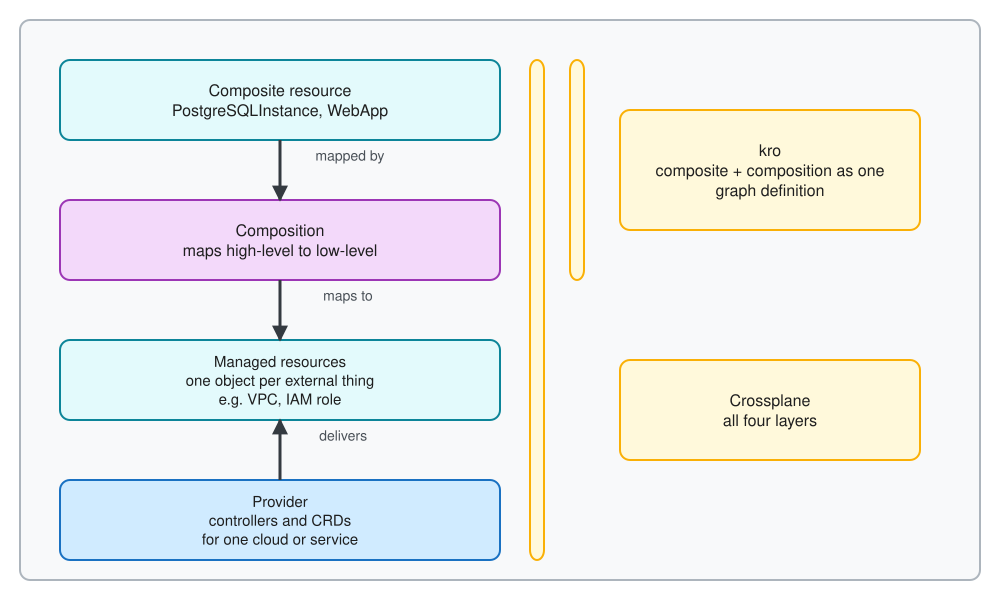
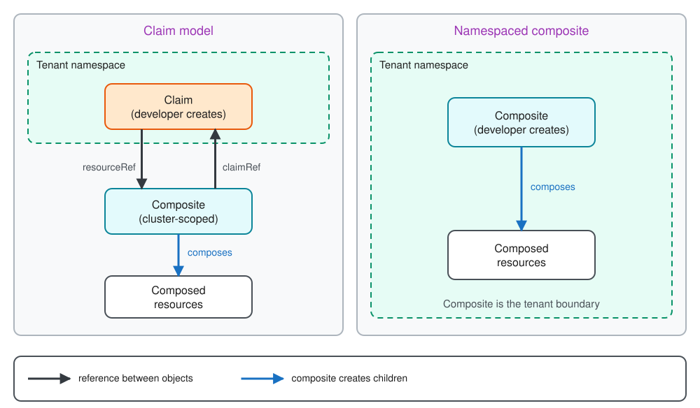
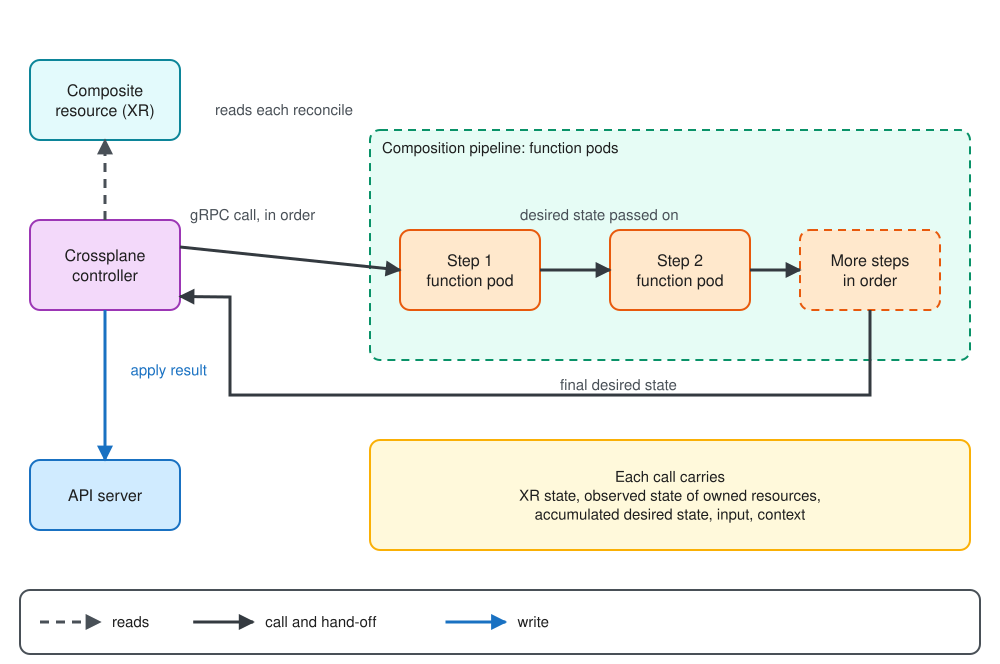
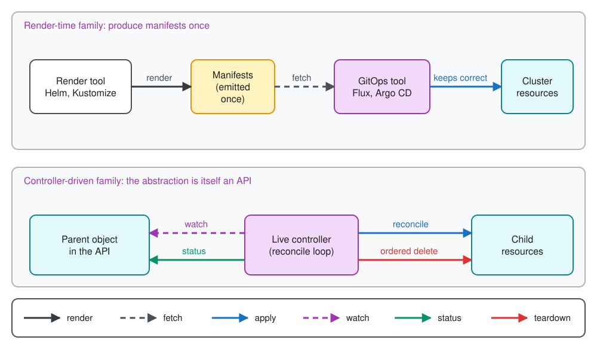
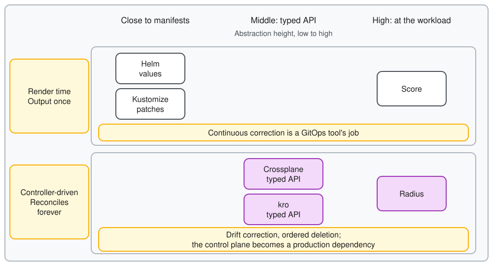

# Part 4: Platform Abstractions from Managed Resources to Resource Graphs

> [!NOTE]
> **Audience:** Engineers with real Kubernetes operating experience (pods, deployments, services, RBAC, kubectl) who have not yet worked with controllers, API machinery, or platform abstractions in depth.<br>
> **Purpose:** Teach how platform teams publish simple, owned APIs over complex infrastructure, and how Crossplane, kro, and the surrounding tools trade flexibility, operability, and expressiveness against one another.<br>
> **Status:** Active, part 4 of the tutorial series.<br>
> **Created:** 2026-11-25<br>
> **As of:** 2026-11-27<br>
> **Draws on:** The concept, example, finding, comparison, decision, and entity pages of this wiki listed under Further reading, which in turn rest on the research dossiers in `sources/`.<br>

## 1. Why platforms need abstractions: the cognitive-load problem

Imagine you are an application developer who needs a PostgreSQL database for a new service. Without a platform, you must learn what the cloud calls its database offering, which subnet group it belongs to, which security group rules let your pods reach it, how the encryption key is chosen, what backup retention your company requires, which tags finance expects on every billable object, and how to wire the resulting endpoint and password into your Deployment. None of that knowledge is about your product. All of it is cognitive load, and it multiplies across every team in the company. The usual response is a platform team, a group whose job is to absorb that complexity once and let everyone else ask for what they want in a few words.

Kubernetes gives the platform team an unusually good place to do this. Earlier parts of this series explained that Kubernetes is more than a container scheduler. Its API server, with etcd behind it, is a general database and orchestration engine, and any kind of object can be registered with it through a custom resource definition, as Part 2 of this series covers in detail. Once a kind exists, it automatically gets the machinery you already trust: authentication, RBAC, audit logging, schema validation, list and watch, and `kubectl`. A controller then watches objects of that kind and drives the real world toward what the object declares, which is the reconcile loop that Part 3 of this series describes, and it is the idea behind every tool in this tutorial. This tutorial is about what happens when a platform team uses that machinery on purpose to build a product: a small, stable, versioned API that hides a large pile of infrastructure behind it.

The Crossplane and kro documentation name the layers of that idea, and this tutorial follows them in order. At the bottom is the managed resource, a one-to-one Kubernetes object for one external thing such as a single VPC or IAM role. Delivered by a provider (a package that installs the controllers and custom resource definitions for one cloud or service), these objects teach the cluster to speak to a cloud API. Above them sits the composite resource, a higher-level, opinionated object such as a `PostgreSQLInstance` or `WebApp` that bundles many lower-level ones. The mapping from the high-level object to the low-level ones is a composition. Crossplane implements all four layers. kro, a newer project, collapses the top two into a single definition that describes a graph of resources. The tutorial then widens out to Helm, Kustomize, hand-written operators, Score, Radius, and Kratix, which attack the same cognitive-load problem from different directions and pay different prices for it.

Figure 4.1 stacks the four layers from the provider at the bottom to the composite resource at the top and shows which layers each tool covers.



*Figure 4.1. The four abstraction layers and who covers them. Read the stack from the bottom: a provider delivers managed resources, and a composition maps them to the composite resource above. Crossplane covers all four layers, while kro collapses the top two into one graph definition.*

One caution about evidence runs through the whole article. The sources behind this tutorial are public documentation, vendor and consultancy blogs, and adopter lists, with very few independent measurements or postmortems. Where a claim rests on one blog or a vendor's own announcement, the text below says so.

## 2. Managed resources: one Kubernetes object per external resource

The simplest abstraction is almost no abstraction at all. A managed resource is a Kubernetes object that stands for exactly one thing outside the cluster. The Crossplane documentation puts it this way: "Crossplane calls the object inside Kubernetes a managed resource and the external object inside the Provider an external resource." A provider's controller reads the real thing, compares it with what the object asks for, and creates, updates, or deletes the real thing to close the gap. The shortest mental model is a Deployment-style controller loop whose pods happen to be cloud resources.

Here is an illustrative managed resource for an AWS bucket. Field names follow the pattern the Crossplane documentation describes. Treat it as a sketch of the pattern rather than a copy-paste manifest, since the exact API group and fields depend on the provider you use.

```yaml
apiVersion: s3.aws.upbound.io/v1beta1
kind: Bucket
metadata:
  name: team-a-reports
  annotations:
    crossplane.io/external-name: team-a-reports-prod
spec:
  forProvider:
    region: eu-west-1
  managementPolicies: ["*"]
status:
  atProvider:
    arn: arn:aws:s3:::team-a-reports-prod
  conditions:
    - type: Ready
      status: "True"
    - type: Synced
      status: "True"
```

Read the snippet from the top. The `spec.forProvider` block is the authoritative desired state, and the Crossplane documentation calls it the "source of truth" for the external resource, which means that someone editing the bucket in the cloud console will see the edit reverted the next time the provider re-checks it. The `crossplane.io/external-name` annotation says which real bucket this object maps to. When the annotation is absent, the Crossplane managed resources page says providers give the external resource the same name as the Kubernetes object, and in Upjet-based providers (Upjet is the code generator that turns Terraform providers into Crossplane providers, covered in Section 3) a name initializer sets the external name to `metadata.name` if none is specified. Kinds whose identifiers the cloud assigns, such as an AWS VPC, which receives an identifier like `vpc-2213das`, turn that behavior off, so the provider records the identifier only after the create call returns, and that gap is what makes a restart in the middle of a create dangerous. The `status.atProvider` block is what the provider last observed, and it is written by the controller and not by you. Two conditions, explained in [[concepts/conditions]], diagnose different failures: `Synced` says whether the last reconcile succeeded, while `Ready` says whether the external thing is usable. A resource can be `Ready=True` and `Synced=False`, a quiet state in which the bucket exists but drift correction has stopped.

How soon a console edit is reverted depends on how often the provider re-checks the outside world, and that cadence is a trade-off between how quickly drift is noticed and how many calls are spent on the cloud API. Each layer of the stack, and each provider, picks its own cadence, so a drift latency quoted for a tool is only meaningful when it names the provider. The `Synced` condition has a related blind spot that every platform author should understand. It says that the last reconcile call returned without error, not that a long-running cloud operation has finished. A managed Kafka cluster whose configuration change takes an hour to apply can therefore show `Synced` as `True` the whole time, because the provider records success for the call it made while the cloud works on in the background. An additional condition that reports an ongoing asynchronous operation exists, but it sits outside the conditions most alerts watch, so a platform author should write monitors against the live object and treat a green `Synced` as meaning only that the last call succeeded ([[examples/crossplane-synced-stays-true-through-a-sixty-minute-async-msk-update]]).

The `managementPolicies` list is the main safety lever. A value of `*` means every verb and is what a resource gets when nothing narrower is said. `["Observe"]` gives read-only import or a permanent reference. A list that omits `Delete` means "manage this, but leave the real resource behind if the object is removed," and an empty list pauses reconciliation. Older advice about `deletionPolicy: Orphan` therefore needs translating, and the translation is mechanical once you know it: `ObserveOnly` becomes `["Observe"]`, an empty list is a pause, and orphan-on-delete becomes a list that leaves out `Delete`. The interaction with Kubernetes garbage collection is worth stating because it surprises people. When a cascade deletes a managed resource object, whether the cloud resource goes too is decided by `managementPolicies` and not by the owner reference: the managed reconciler deletes the external resource only when it exists and the policy set allows `Delete`, and otherwise it unpublishes connection details and removes its finalizer (a marker on the object, explained in the deletion paragraph below, that holds it in place until cleanup finishes). A composition that gives its composed resources a policy list without `Delete`, for instance observe-only references to a database another team owns, will therefore lose the Kubernetes objects when the composite is deleted while the cloud resources keep running. That is the intended behavior for a retained database and a leak for everything else ([[findings/a-managed-resource-without-delete-in-its-management-policies-is-removed-from-kubernetes-but-its-cloud-resource-stays]], [[decisions/choose-management-policies-for-an-imported-resource]]). The older deletion field survives only on legacy cluster-scoped managed resources, where a resolver combines it with the management policies so that the real resource is deleted only when both allow it. Namespaced managed resources use management policies alone. It is therefore too coarse to say that management policies simply take precedence on every resource. A related field, `spec.initProvider`, holds values applied only at creation, which lets another system own a field afterward; one documented use is letting an autoscaler own the size of a node group.

Deletion deserves its own paragraph because it is where managed resources differ most from ordinary Kubernetes objects. Deleting a Deployment removes pods you can recreate. Deleting a managed resource, by default, deletes the real database. The mechanism that makes this safe in the other direction is the finalizer, a string in `metadata.finalizers` that tells the API server not to remove the object until a controller has finished cleaning up. When you delete such an object, the API server only sets a `deletionTimestamp`; the controller sees that, deletes the external resource, removes its finalizer, and only then does the object disappear. The price is that a missing or failing controller strands objects in `Terminating`, and forcing a finalizer off skips the cleanup it guarded, which can leave billable resources running. Crossplane, ACK (AWS Controllers for Kubernetes, Amazon's per-service controllers for AWS resources), and Config Connector (Google's equivalent for Google Cloud) all delete the cloud resource by default, and each offers an opt-out under a different name. The finalizer strings themselves differ from tool to tool, and the finalizer list on a stuck object is where you look to see which controller is holding it. Each of these projects, kro included, adds its own finalizer to the objects it manages and removes it only after the external or child resources are cleaned up, and some add a second finalizer as a guard against accidental deletion. Asynchronous deletes keep the finalizer in place and requeue until the cloud confirms the resource is gone ([[findings/ack-config-connector-and-kro-each-name-their-finalizers-differently-and-remove-them-only-after-cleanup]]). A related hazard concerns credentials. A managed resource needs working credentials to run its cleanup, because the provider must authenticate to the cloud before it can delete anything. If a namespace is deleted and the Secret holding those credentials disappears before the managed resources finish terminating, the resources can no longer authenticate and sit in `Terminating` with their finalizers still in place. The lesson is that cleanup needs the same credentials as creation did, so whatever holds them has to outlive every resource that depends on them, and it is worth keeping the credentials object protected from deletion for at least as long as those resources exist ([[findings/a-credentials-secret-without-a-finalizer-can-vanish-before-managed-resources-finish-cleanup]]).

Figure 4.2 traces what happens when a managed resource is deleted, including the case in which deletion never completes.


*Figure 4.2. Finalizer-guarded deletion of a managed resource. Follow the red and purple arrows along the top row to see the controller notice the deletion and clean up the external resource, then the green arrow back to the object that lets it go. The lower row shows the two outcomes: the object disappears, or it stays stuck in Terminating when the controller or credentials are missing.*

Managed resources also handle two awkward real-world problems. The first is importing something that already exists: set the external-name annotation to the real identifier, apply with `Observe` only, read `status.atProvider`, copy the needed values into `forProvider`, and then widen the policy. The recipe has sharp edges, including the manual copying, names that are ambiguous across regions, and relaxed validation while observing. The second is a create call whose response is lost. Crossplane writes a create-pending annotation before calling the cloud and a succeeded or failed annotation afterward, so a provider that restarts in between cannot tell whether a resource exists and blocks until a person decides. That conservative stop prevents duplicate or leaked resources at the cost of manual intervention. The opposite design choice has a real cost. A controller that records the cloud identifier in status only after the create call returns can lose the response, for example when it restarts at the wrong moment. The next reconcile then either creates a second cloud resource or fails on every pass because the name is already taken, and in the second case it can retry forever while the cloud holds an object the custom resource does not know about. The usual remedy is to send a stable idempotency token with the create request, which lets the cloud recognize a repeated create as the same request and so cannot produce a second resource. Any controller that creates resources whose identifiers the cloud assigns has to choose between the pending-marker stop and the idempotency token, and the choice should be deliberate ([[findings/a-create-that-succeeds-while-the-status-write-fails-can-leak-an-external-resource]]).

## 3. Providers: generated and hand-written, families versus per-service controllers

A provider is a packaged controller plus a set of CRDs that teaches a cluster to speak to a specific external API. In Crossplane it is an installable OCI package, meaning a container-registry artifact in the same format as an image, which the cluster pulls and unpacks. A `Provider` object installs it, each upgrade creates a `ProviderRevision`, a `ProviderConfig` selects credentials, and a `DeploymentRuntimeConfig` customizes the pod. Every provider reuses the same shared managed reconciler, which walks the phases Connect, Observe, Create, Update, and Delete. A provider author implements a small external-client interface for those phases and must make create and delete idempotent, meaning safe to repeat with the same result; the contributing guide's sharpest rule is that delete must not return an error when asked to delete something that is already gone.

Writing hundreds of such clients by hand would be impractical, so most large catalogs are generated. Upjet generates Crossplane providers from Terraform providers, so that the generated controllers reuse Terraform's resource logic at runtime while users see only a Kubernetes API. ACK generates its controllers from AWS API models, and Azure Service Operator generates its CRDs from Azure Resource Manager schemas. Generation explains why catalogs grow quickly, and it also explains a recurring drawback: a generated catalog inherits the behavior and the bugs of whatever generated it. Hand-written providers have their own pitfalls, such as treating "not found" as an error and breaking the create flow.

The most instructive operational story in this area is about counts. Because each external resource type is its own CRD, a provider for a big cloud implies hundreds of CRDs, and a multi-cloud set implies thousands. Every CRD costs the API server memory and CPU to compute and serve its schema, and every client that does discovery (the step in which kubectl and other clients list every served API) has to walk all of them. Early monolithic providers reached the point where the API server became sluggish or unresponsive, especially while scaling up, and client-side discovery hit throttling. Upstream Kubernetes improvements helped, but code-generated providers outgrew them. Kubernetes' own tested scalability envelope does not include CRD count as a dimension, which is why platform tools fell into this gap. The figures behind these stories come from the vendors that measured them, so read them as illustrations of a structural limit and not as benchmarks.

Two packaging answers emerged. Crossplane split the monolith into provider families, scoped providers grouped under a family that share one configuration provider, so an operator installs only S3 and RDS and gets only those CRDs. The cost is more pods and more memory, a trade described in the provider-packaging notes. ACK took the opposite starting point and has always shipped one controller image per AWS service. The two converge on the same benefit, installing only what you use, from opposite directions. Crossplane adds a finer tool. Each managed resource type is represented by a ManagedResourceDefinition, and a ManagedResourceActivationPolicy lists exact names or prefix patterns so that only matching types become served CRDs. The tool only helps if you use it: an installation that activates every type serves every CRD, so the CRD count does not fall until you narrow the activation to the groups you actually need. Patterns match exact names or prefixes rather than regular expressions, policies are additive, and activating a type is a one-way step, so plan the set of types you need and add to it deliberately. A provider must also opt in to starting with its types inactive, so check how yours behaves before assuming nothing is served until you ask ([[examples/crossplane-managed-resource-activation-policies-install-only-the-resource-types-a-cluster-needs]]). When picking a strategy, [[concepts/provider]] and [[comparisons/crossplane-providers-versus-cluster-api-providers]] frame the options. Scaling a large provider estate means watching CRD count, worker concurrency and cloud API rate limits together, and no independent benchmark exists for any of them. Upjet itself runs Terraform in one of several execution modes, chosen per resource in its configuration, which trades the memory cost of an embedded Terraform process against start-up cost, and debugging a generated provider can mean investigating that embedded Terraform process.

A note on vocabulary will save confusion later. Cluster API also uses the word provider, but there it means an implementation of a narrow contract that lets the core controllers build whole clusters on AWS, Azure, or vSphere, not a catalog of external resources. When someone says "provider," ask which family of tools they mean.

## 4. Composite resources, XRDs, claims and the v2 namespaced model

A managed resource is faithful to the cloud, and that is precisely its problem as a user-facing API. The application developer asked for a database, not for a subnet group, a parameter group, a security group, and an instance. The composite resource, abbreviated XR, is the answer. The Crossplane documentation defines it plainly: "A composite resource, or XR, represents a set of Kubernetes resources as a single Kubernetes object." A controller expands the small object into the lower-level objects it represents, keeps them reconciled, wires values from one child into another, reports aggregate readiness, and tears the whole set down in a sensible order. It is the ordinary controller pattern applied one level up, where the world being reconciled is a set of other API objects.

To publish such a kind, Crossplane asks the platform team to write a CompositeResourceDefinition, or XRD. It declares the group, kind, plural name, versions, scope, and a schema, and Crossplane generates a CRD from it, so the platform team never hand-writes the CRD. Here is a sketch of a small database API.

```yaml
apiVersion: apiextensions.crossplane.io/v2
kind: CompositeResourceDefinition
metadata:
  name: databases.platform.example.org
spec:
  group: platform.example.org
  names:
    kind: Database
    plural: databases
  scope: Namespaced
  versions:
    - name: v1alpha1
      served: true
      referenceable: true
      schema:
        openAPIV3Schema:
          type: object
          properties:
            spec:
              type: object
              properties:
                size:
                  type: string
                  enum: [small, medium, large]
                engineVersion:
                  type: string
```

The snippet shows the central design move. The developer sees a `size` of small, medium, or large and an engine version, and nothing about instance classes or storage types. The XRD name must be `<plural>.<group>`, and group and names are immutable after creation, so changing them means deleting and recreating the XRD. That is why the group and kind are product decisions: they become the public contract, and the linked decision notes on API naming record the consequence.

The scope field leads to the difference between claims and namespaced composites, which confuses many readers of older blog posts. The tenant boundary is the composite resource itself. A composite resource can be namespaced, so a developer creates it in their own namespace and RBAC applies as it does to any namespaced object, and its composed resources live in the same namespace. The older indirection solved the same problem for cluster-scoped composites: the platform team set `claimNames` in the XRD, a developer created a namespaced claim, and Crossplane created a cluster-scoped composite behind it and linked the two through `spec.resourceRef` and `spec.claimRef`. A namespaced composite removes that second object and its cross-references, and it also means a composite cannot compose resources outside its own scope. Because so much online content describes the claim model, read the comparison of claims with namespaced composites, listed under Further reading, before you follow an older tutorial.

Figure 4.3 contrasts the two models, with the claim model on the left and the namespaced composite on the right.



*Figure 4.3. Claims versus namespaced composites. The left panel shows the claim model, where a namespaced claim and a cluster-scoped composite point at each other through resourceRef and claimRef. The right panel shows the namespaced composite, where one object and its composed resources sit together in the tenant namespace.*

A composite resource also carries per-object controls. It can pick a Composition with `compositionRef` or `compositionSelector`, follow revisions automatically or pin one, be paused with the `crossplane.io/paused` annotation, and be forced to reconcile with `crossplane.io/reconcile-requested-at`. Its `Ready` condition becomes true only when the pipeline reports that all composed resources are ready. The mechanism is more literal than that sentence suggests. Each desired resource that a function returns carries a ready value that is `READY_TRUE`, `READY_FALSE`, or `READY_UNSPECIFIED`, and the composer counts a resource as ready only for `READY_TRUE`, so an unspecified value is treated as not ready. The XR then reports `Ready` as `Available` when no composed resource is unready and as `Creating` with an "Unready resources" message that names the offenders otherwise, while `Synced` turns to `ReconcileError` with an "Unsynced resources" message if a composed resource is not synced. A pipeline that composes resources but never sets `READY_TRUE` therefore leaves the XR in `Creating` indefinitely even though every child is healthy, which is why most pipelines end with `function-auto-ready`: it leaves alone any resource that already carries explicit readiness, applies optional queries written in CEL (the Common Expression Language, a small expression language that cannot have side effects and is explained in Section 6) and built-in health checks for standard Kubernetes kinds, and falls back to the observed `Ready` condition equal to `True` last ([[findings/a-crossplane-composed-resource-counts-as-ready-only-when-the-function-sets-ready-true-so-unspecified-readiness-leaves-the-xr-creating]]). The conditions on a composite are also written from a cached copy of the object, so a briefly stale cache can flip a condition for a moment, which is why an alert should require a condition to persist and not fire on a single brief flip. A composite can also choose how its children are torn down, in the background, in the foreground, or by a pipeline that removes resources in a deliberate order, which Section 9 returns to.

Governance is the usual motive for all this. A Crossplane blog on designing compositions for organizational needs argues that the platform team should expose well understood features behind its own versioned API and not pass every provider feature through, since native provider features can break proprietary environments or weaken compliance. Inside the Composition, tags can be applied to every composed resource automatically, and namespaced tenant segregation becomes an access-control pattern. The post is advocacy and not a named deployment, but the pattern is clear.

## 5. Compositions and composition functions: pipelines that turn observed state into desired state

A Composition says how an instance of the XRD's API becomes composed resources. It is matched to an XR by `compositeTypeRef`, which names the XRD's group and kind. In Crossplane, the documentation says, "A Composition is a pipeline of composition functions." A function is installed as a package and runs as a pod. On each reconcile, Crossplane calls the steps in order over gRPC, a binary remote-call protocol. Each call carries the XR's current state, the observed state of the resources it owns, the desired state accumulated by earlier steps, per-function input, and shared context. The function returns what should exist, and the output of one step feeds the next.

Figure 4.4 shows how Crossplane walks through the function pipeline on each reconcile.



*Figure 4.4. How Crossplane runs a Composition pipeline. On each reconcile, Crossplane calls the function pods in order over gRPC, and each step passes its desired state to the next. Crossplane, not the functions, applies the final result to the API server.*

A minimal pipeline looks like this.

```yaml
apiVersion: apiextensions.crossplane.io/v1
kind: Composition
metadata:
  name: database-aws
spec:
  compositeTypeRef:
    apiVersion: platform.example.org/v1alpha1
    kind: Database
  mode: Pipeline
  pipeline:
    - step: render-resources
      functionRef:
        name: function-go-templating
      input:
        apiVersion: gotemplating.fn.crossplane.io/v1beta1
        kind: GoTemplate
        source: Inline
        inline:
          template: |
            # templates that emit an RDS instance, subnet group, and so on
    - step: mark-ready
      functionRef:
        name: function-auto-ready
```

The first step renders the composed resources from the developer's `size` and `engineVersion`, and the second, `function-auto-ready`, reports readiness once the composed resources are ready. The input details are elided because they depend on the function chosen. What matters is the contract: a function's main job is to update the desired state and hand it back, and Crossplane, not the function, talks to the API server and applies the result. Functions do not run on deletion, so Crossplane itself deletes composed resources. Functions are installed as packages, and the package manager runs each one as a long-running gRPC server in an ordinary pod behind a Service, with mutual TLS between Crossplane and the function. Because a function is a server and not a container started for each call, it can serve many composites cheaply and be scaled, secured and observed like any other workload. Do not confuse these with KRM functions in the sense of the kpt and Kustomize world. The KRM Functions Specification says a function must be implemented as a container that reads a `ResourceList` on standard input, writes one to standard output, supports YAML, can run as the non-root user `nobody`, and signals failure with a non-zero exit code; it describes itself as decoupled from the cluster and from Kubernetes API machinery, so it says how a tool runs a function over files and not how a controller runs one in a cluster. Crossplane's gRPC functions share the idea of a function that turns input objects into output objects, but they are a different contract with a different transport ([[findings/the-krm-functions-spec-requires-a-container-with-a-resourcelist-on-stdin-and-stdout-and-a-non-zero-exit-on-failure]], [[findings/the-krm-functions-spec-is-a-client-side-standard-decoupled-from-the-cluster-and-reserves-internal-annotations]]).

Why a pipeline of external programs and not a richer template language? The design document says the maintainers wanted to "avoid organically growing a new configuration Domain Specific Language." The earlier model, native patch-and-transform, was a static list of base resources plus patches. It was deliberately not Turing complete, meaning it could not express arbitrary loops or programs, and it could not branch, loop, or patch between composed resources. Imagine Learning's experience shows the cost: its patch-and-transform files for AWS RDS clusters ran past a thousand lines, with near-duplicate files for different instance counts. After moving to a function with a loop over `instanceCount`, the duplication disappeared. VSHN, a Swiss provider that sells self-service databases, queues, and object storage through its AppCat marketplace, reached the same conclusion after hitting the lack of conditionals and dynamic lookups. Patch-and-transform survives as a composition function, `function-patch-and-transform`, so existing patch-based logic can run as one step of a pipeline.

Functions bring their own failure modes. The sharpest is that a function returns the complete desired state, not an incremental patch, so a resource it omits is deleted. VSHN learned this early on: "if an object is not explicitly specified in a request payload, it will be deleted." The discipline is to start from the incoming desired state, change only your own parts, and pass everything else through. Functions are also extra moving parts that must be healthy for a composite to reconcile, and mistakes appear at reconcile time and not at definition time. Load scales with the number of composites and the number of steps in each pipeline, because every periodic reconcile of a composite makes one gRPC call per step. A large fleet of composites with long pipelines therefore keeps the function pods busy even when nothing changes. A third-party article argues that large composites can exhaust function memory, though its log excerpts are labelled as simulated, so treat that as plausible guidance and not an incident. Go templating adds a further burden: in a tutorial that built the same API two ways, the template-based Composition needed hand-written logic for creation order and for avoiding deletion of a resource when a dependency was briefly unavailable.

The recommended mitigation for most of this is testing before rollout: `crossplane render` runs a Composition locally, functions can be unit tested, and the Crossplane blog describes a loop using kind, Kuttl, and Skaffold for running a composition end to end against a throwaway cluster.

Crossplane also offers Operations, a way to run a function pipeline once, to completion and like a Kubernetes Job, for day-two tasks, in three forms called Operation, CronOperation and WatchOperation. They differ from composition functions in ways that matter for design. An Operation applies what its functions return with force and without owner references, so it can conflict with other controllers that write the same fields, and because nothing owns what it created, it does not clean up after itself. Treat an Operation as a way to perform an action and not as a way to declare lasting state, use Operations for one-off day-two tasks, and keep long-lived infrastructure in composites where ownership and cleanup are tracked.

## 6. kro: ResourceGraphDefinitions, CEL and readiness checks

kro, short for kube-resource-orchestrator, is a joint effort of Google, AWS and Microsoft. It takes a different position on the same problem: put the schema and the implementation in one object and keep logic in a restricted expression language. Its announcement describes "a Kubernetes-native framework that lets you create reusable APIs to deploy multiple resources as a single unit." kro is also available as a managed capability of Amazon EKS. The AWS overview page, Resource composition with kro, describes it as fully managed by AWS, so customers do not install, maintain or scale kro controllers, lists the ResourceGraphDefinition as the single primary resource type, and names ACK and Argo CD as the two integrations with other EKS managed capabilities, the first for composing AWS resources and the second for deploying kro custom resources across clusters. That is vendor documentation, and a managed offering does not by itself show production adoption.

A ResourceGraphDefinition, or RGD, has a `schema` block that declares the new kind in a lightweight "SimpleSchema" and a `resources` list of templates. kro converts the schema to OpenAPI v3 (the standard schema format the Kubernetes API server uses to validate custom resources), generates a CRD named `<plural>.<group>`, registers a dynamic controller for it, and reconciles instances. The following sketch follows the pattern in the AWS documentation's WebApplication examples, simplified and illustrative.

```yaml
apiVersion: kro.run/v1alpha1
kind: ResourceGraphDefinition
metadata:
  name: web-app
spec:
  schema:
    apiVersion: v1alpha1
    kind: WebApp
    spec:
      name: string
      image: string
      replicas: integer | default=2
  resources:
    - id: bucket
      template:
        apiVersion: s3.services.k8s.aws/v1alpha1
        kind: Bucket
        metadata:
          name: ${schema.spec.name}-assets
        spec:
          name: ${schema.spec.name}-assets
    - id: deployment
      template:
        apiVersion: apps/v1
        kind: Deployment
        metadata:
          name: ${schema.spec.name}
        spec:
          replicas: ${schema.spec.replicas}
          selector:
            matchLabels: { app: "${schema.spec.name}" }
          template:
            metadata:
              labels: { app: "${schema.spec.name}" }
            spec:
              containers:
                - name: app
                  image: ${schema.spec.image}
                  env:
                    - name: BUCKET_ARN
                      value: ${bucket.status.ackResourceMetadata.arn}
```

The expressions in `${...}` are CEL, the Common Expression Language. CEL is typed, has no side effects, and always terminates, which is why it is described as deliberately not Turing complete, in other words unable to express arbitrary loops or programs. The snippet shows the key mechanism: the Deployment's environment variable refers to `bucket.status.ackResourceMetadata.arn`, and from that reference kro infers that the bucket must exist first. It builds a dependency graph, creates independent resources in parallel, waits on status values that do not exist yet, and deletes in reverse order. The AWS guide stresses that "kro validates ResourceGraphDefinitions at creation time, not at runtime," so a mistyped field, a missing kind, a type error, or a cycle is rejected when the platform engineer applies the RGD, before any application team creates an instance. The same idea applies to Google's own example, in which a few parameters (a name, node pool, maximum node count, and location) produce a GKE cluster through Config Connector objects.

Figure 4.5 shows how kro turns a ResourceGraphDefinition into a running controller and an ordered graph of resources.


*Figure 4.5. How kro builds an ordered resource graph. A ResourceGraphDefinition generates a CRD and registers a dynamic controller, which reconciles the resources of each instance. Follow the ARN arrow to see why the bucket comes before the deployment, and the red arrow to see that teardown runs the other way.*

Ordering and readiness are two separate mechanisms, and the way kro reports readiness has stable and unstable parts. Dependency order comes from references. Readiness comes from `readyWhen`, a list of CEL expressions per resource that defines when it counts as ready. If `readyWhen` is omitted, kro treats a resource as ready as soon as it exists, which is a weak default for slow cloud resources. There are two ways a graph engine can treat readiness. One waits for an upstream resource to report ready before applying anything that depends on it, which is how a ResourceGraphDefinition behaves. The other applies a dependent as soon as the fields it references exist and uses readiness only to report health, which is how kro's standalone graph form behaves. The second is faster but can start a dependent before its dependency is healthy, so a team that moves between the two can lose a safeguard it relied on. The documented workaround in the second form is to reference a status field that exists only once the upstream resource is healthy. Authors can also define their own instance conditions with `runtime.newCondition()`; when they do, kro hides its built-in conditions, so the author must compose a summary `Ready` condition or generic tools have nothing to read. A caution applies to the conditions kro supplies for itself. An instance carries a summary `Ready` condition together with finer-grained conditions that explain progress through the graph. The kro documentation tells readers to depend only on `Ready`, because the finer conditions are diagnostic and the project reserves the right to change them, so a health rule in Argo CD, Flux, or an alert that reads a sub-condition directly can break on an upgrade. The sub-conditions remain useful for a person diagnosing a stuck instance. The instance state field is likewise reserved by kro and a platform author cannot redefine it, so a dashboard should treat anything other than the healthy value as unhealthy and not list only the failure values it knows today. Compare this with the Crossplane side described in Section 4, where the XR's `Ready` is a summary authored by the pipeline's functions through the `READY_TRUE` signal, while kro's controller computes the instance `Ready` itself from the graph. That contrast matters when you debug: a stuck Crossplane XR points you at the pipeline's readiness logic, and a stuck kro instance points you at the `readyWhen` expressions and the sub-conditions. kro readiness also has a flip-flop pitfall. The kro conditional-creation documentation warns that an `includeWhen` expression based on a volatile upstream status field makes the graph "flip-flop": the resource, and everything that depends on it, is created when the expression is true and deleted when it turns false, which for cloud resources means repeated creation and deletion of real infrastructure. Validation can reject an expression that can never resolve, but it cannot detect one that resolves differently from one reconcile to the next, so base the expression on fields that change in one direction ([[findings/a-kro-includewhen-on-a-volatile-upstream-status-field-makes-resources-flip-flop]]). Crossplane's conditions are fixed by the provider, while kro's are authored, a contrast drawn side by side in [[comparisons/condition-vocabularies-across-crossplane-ack-config-connector-flux-kro-and-cluster-api]].

Deletion is where kro made a deliberate departure. Default Kubernetes owner references, handled by the garbage collector described in Part 2, delete dependents without honoring order among siblings, and a cluster-scoped object cannot be owned by a namespaced one. kro therefore tracks children with an ApplySet, a labeled inventory of everything applied together, keeps its instance finalizer until all children are gone, and deletes in reverse dependency waves, each fully gone before the next begins. The kro documentation says kro does not set Kubernetes owner references on managed resources by default, and it gives the two reasons above. Ownership is instead written as labels that identify the instance and the graph node a child belongs to, together with an ApplySet label that groups everything applied together. Each child also records the dependency wave it was applied in, and kro finds children to delete from the instance's persisted ApplySet inventory and not by re-evaluating the graph, so cleanup can proceed even when an external reference is already gone. kro does use owner references in two places: it stamps a ResourceGraphDefinition owner reference on the CRD it generates and on the revision objects it keeps ([[findings/kro-sets-no-owner-references-on-instance-children-and-tracks-them-with-labels-and-an-applyset-inventory]]). The cost appears where GitOps tools meet it: Argo CD decides what it owns from tracking metadata, so the kro FAQ tells Argo CD users to add an owner reference and a tracking annotation to each templated resource, and the documentation warns that hand-added references mean resources "may be garbage collected out of order", that cross-namespace or cluster-scoped children fail validation, and that timing can conflict with kro's own reconciliation ([[decisions/give-kro-children-manual-owner-references-or-leave-them-to-applyset-labels]]). Two deletion cautions follow from this design. A controller that deletes dependents in waves must record its progress, because a crash in the middle of a teardown can otherwise leave the finalizer and some children behind. And a collection generated from a list in the instance spec can grow large enough that creating and updating it works but tearing it down in waves becomes slow or stalls, so keep generated collections to a size the controller can delete. kro also lets you opt a child out of deletion. An annotation on a resource tells kro to leave it behind whenever it would otherwise remove it, which covers deleting the instance, changing the definition, a conditional include turning false, and a collection shrinking. kro then strips its own labels and annotations from the object, so a released resource is no longer tracked and a later instance can adopt it. There are two pitfalls. The policy must already be on the live object before the removal, so set it first and wait for it to appear. And an owner reference that a template added by hand is left in place, so Kubernetes garbage collection still deletes the resource when its owner goes ([[findings/kro-deletion-policy-orphaned-releases-a-resource-by-stripping-kro-labels-but-leaves-template-owner-references-in-place]]).

Rollout matters too. Each change to an RGD becomes an immutable revision, and if the latest revision fails compilation, instances stop progressing with no fallback to an older revision. Because the latest revision applies to every instance, a single bad definition stops all instances built from it, so rollout is one decision and not a per-instance choice. Breaking schema changes, such as removing a field or adding a required one without a default, are blocked unless the author explicitly allows them with an annotation, so a platform engineer who sees the block should look for that override and not delete and recreate a definition that running instances depend on. Because a definition and the CRD generated from it are separate objects, a Ready definition does not prove that the generated CRD matches it, for example after validation is tightened on an existing field, so verify the live CRD after a schema change.

No named organization has published a postmortem or a benchmark for kro, so its scale behavior is best reasoned from its design. kro runs one dynamic controller whose work queue is shared across all the resource types it manages, so a resource type with tens of thousands of objects competes for the same workers and watch caches as everything else. Because every definition shares that queue, the pattern of the work, and not only its volume, determines latency. kro is a Kubernetes SIG Cloud Provider subproject, as first-party sources state, and it publishes no adopters file.

Several mechanics explain how kro behaves under those conditions. kro ships no admission webhook of its own and relies on the generated CRD's schema and CEL validation rules, which removes the fail-closed outage class that webhook-heavy tools such as Config Connector and Cluster API carry, at the price of being limited to what a CRD schema can express ([[comparisons/admission-webhooks-and-failure-policies-across-crossplane-kro-argo-cd-config-connector-ack-cluster-api-gatekeeper-and-kyverno]]). Those CEL rules have a cost budget: the API server estimates the worst-case cost of each rule at CRD admission, and a rule over a list or string with no declared maximum size is rejected on budget grounds, so schemas that generate CRDs from user input need those maximums set ([[findings/an-unbounded-list-or-string-makes-the-cel-cost-estimate-reject-a-crd-rule-until-maxitems-and-maxlength-are-set]]). On writes, kro applies template resources with server-side apply, a mode in which the API server records which writer (called the field manager) owns each field and rejects or, when the writer asks, overrides conflicting writes from others (Section 11 returns to this). kro forces ownership of the fields it templates and writes instance status as a separate writer, and it applies patch contributions to objects it does not own without force so that a patch claims only the fields it sets. External drift is reclaimed by the next forced apply ([[findings/kro-applies-template-resources-with-server-side-apply-and-force-and-applies-patch-contributions-without-force]]). On reads, kro keeps one shared metadata-only informer (a controller's in-memory cache of objects, kept current by a watch on the API server) per watched resource type, with a long periodic resync, so its cache memory scales with the number of watched types and objects and not with the size of each object ([[comparisons/informer-and-cache-choices-across-kro-config-connector-ack-and-cluster-api]]).

On the operational side, kro handles all instances through a shared work queue and relies on a long periodic resync as a safety net. An instance that is waiting for cluster state is requeued with a per-instance exponential backoff that resets after a clean reconcile, so a persistently not-ready instance settles into occasional retries and not a tight loop. How often a controller retries an unready object is a trade-off between how quickly it notices progress and how much load it puts on the API server, and each controller chooses its own cadence. Because the queue is shared across resource types, a very busy type can delay others, which is a trade-off of the single-controller design.

Crossplane offers function-kro, a composition function that embeds kro's graph engine as one step of a pipeline. This gives kro-style graphs what a pipeline has, such as revision pinning, further steps and local rendering with `crossplane render`. The project claims full feature parity, yet its repository also lists where a graph behaves differently from the same RGD in kro, so the sensible reading is the same engine with a documented list of differences. The differences come from running inside a pipeline, because Crossplane, not kro, applies the function's output. When an existing resource cannot be rendered, the function returns a fatal result and Crossplane applies nothing, so the composite reports a failure, where standalone kro would keep the existing resource and retry. A hard error in one resource fails the whole run. Dependents see values the cluster sets one function pass later than they would under standalone kro. The composite's status fields are not checked against the XRD, the condition types that Crossplane owns cannot be set by graph authors, and creation-time validation of the graph definition is skipped. A team choosing between standalone kro and function-kro therefore cannot assume identical failure behavior, a point the decision page on choosing kro, Crossplane or both develops ([[findings/function-kro-lists-documented-behavioral-differences-from-upstream-kro-so-its-full-parity-claim-reads-as-same-engine-with-gaps]], [[decisions/choose-kro-crossplane-or-both-for-a-platform-abstraction-layer]]).

## 7. Other models: Helm and Kustomize render-time, hand-written operators, Score, Radius, Kratix

Crossplane and kro are not the only way to hide complexity, and a fair tutorial has to place them among their alternatives. This tutorial sorts the approaches into two families. In the render-time family, a tool produces manifests once and something else, typically a GitOps tool such as Flux or Argo CD, must keep them correct afterward. In the controller-driven family, the abstraction is itself a Kubernetes API, and a live control loop reconciles children, writes status to the parent, and handles deletion order.

Figure 4.6 sets the two families side by side, with the render-time tools on the top lane and the controller-driven abstractions on the bottom lane.



*Figure 4.6. Render-time tools versus controller-driven abstractions. The top lane shows the render-time family, where a tool emits manifests once and a GitOps tool must keep the cluster correct afterward. The bottom lane shows the controller-driven family, where a live controller watches the parent object, reconciles its children, writes status back and deletes children in order.*

Helm is the best-known render-time tool. A chart is a collection of files describing a related set of Kubernetes resources, rendered with Go templates and values and installed as one tracked release. The abstraction surface is the values file, which is free-form and is not a real API schema unless the chart author adds a values schema. Nothing reconciles after install, and Helm has no native support for upgrading or deleting CRDs, so Flux's HelmRelease adds CRD policies to compensate. Kustomize takes the opposite approach: a base of ordinary manifests plus overlays and patches, with no templates and no parameter surface at all. Its project encourages fork, modify, and rebase. Consumers of an overlay still read and reason about the underlying manifests. The consequence follows directly: an abstraction is useful when its user can ignore what is below it, and Helm values and Kustomize patches expose the manifests underneath, so users still need to understand Kubernetes. That finding is the dossier author's analytical observation supported by documentation, with no incident behind it. kpt and KRM functions run containerized programs over packages of objects and sit in the same render-time family; moving Kustomize's built-in Helm inflation to KRM functions drew user objections because they need a container runtime that laptops, CI, and Argo CD often lack ([[findings/moving-kustomize-helm-inflation-to-krm-functions-needs-a-container-runtime-that-laptops-ci-and-argo-cd-often-lack]]). Both tools can run functions without a container, but only through opt-in exec extensions that sit outside the specification and that both projects discourage; both warn that executing arbitrary binaries is not secure, and Kustomize says it provides no execution sandbox of any kind ([[findings/kpt-and-kustomize-run-functions-without-containers-only-through-opt-in-exec-extensions-that-both-docs-discourage]]). The container constraints of Flux and Argo CD, and WASM or in-process function runtimes, fall outside what the sources describe.

A hand-written operator, the pattern described in [[concepts/operator-pattern]], sits at the other extreme of flexibility. You write a CRD and a controller in Go or another language, typically scaffolded with Kubebuilder or the Operator SDK, and the controller can do anything. That is the right tool when the runbook needs arbitrary logic such as database failover, backup, or schema migration; a typical example is the family of stateful data-service operators for Postgres and Elastic. The cost is that you own all the code, including its testing, upgrades, informer caches, finalizers, and RBAC. The Crossplane and kro documentation suggest that when a custom API is mostly a composition of existing resources, a Crossplane Composition or a kro RGD can stand in for a bespoke controller. That guidance is documentation-based, with no measurement of maintenance saved. Choosing the framework or language for a hand-written operator is a separate question, and here the evidence is thin in an instructive way. The project READMEs and the Kubebuilder book contain only self-descriptions and no selection criteria, so no source states a rule for choosing among Kubebuilder, the Operator SDK, Java Operator SDK, Kopf, shell-operator, Metacontroller, or composition, and no source supports the claim that a Cloud Native Computing Foundation (CNCF) white paper favors Go. The Operator SDK's capability-level model, which runs from Level 1 Basic Install to Level 5 Auto Pilot, is framed around an operator managing a workload, and it says that an operator which does not manage a workload or that delegates to off-cluster orchestration services remains at Level 1, which matters here because an operator whose job is to call a cloud API, as a Crossplane managed resource does, delegates to an off-cluster service and so falls under that rule on a strict reading. kro composes objects that live inside the cluster, so the sentence does not directly cover it. The page says nothing about composition tools, so it neither endorses nor ranks them ([[decisions/choose-an-operator-framework-or-language-from-kubebuilder-operator-sdk-josdk-kopf-shell-operator-metacontroller-or-composition]], [[findings/operator-sdk-capability-levels-keep-delegating-operators-at-level-1-and-say-nothing-about-composition-tools]]). If you do write the controller yourself, controller-runtime offers several ways to narrow its cache, namely label or field selectors, transforms that strip fields, metadata-only informers, and a `DisableFor` list that sends reads of chosen types straight to the API server, and each has a cost such as extra API calls or a stale-read tradeoff ([[findings/controller-runtime-narrows-its-cache-with-selectors-transforms-metadata-only-informers-and-disable-for-and-each-option-has-a-cost]]).

Score and Radius move the abstraction higher, from a platform-defined kind to the developer's own view of a workload. With Score, a developer writes one `score.yaml` declaring containers, ports, and abstract resources such as `type: postgres`, and implementation CLIs (`score-compose`, `score-k8s`) generate Docker Compose files or Kubernetes manifests. It generates output and runs no controller, so it belongs with the render-time tools. The only adopter evidence is testimonials on the project's own site. Radius is server-side. Developers describe an application with containers, databases, and connections, and platform engineers supply Recipes that decide what a "Redis cache" becomes in each environment. One third-party review describes Radius as leaning toward Bicep and Azure, while its README names Azure and AWS, among others, as deployment targets, and its maintainers come from a single company. Both Radius and Score are young projects with small ecosystems. What each tool does rests mainly on the projects' own READMEs and specifications and on a small amount of third-party review, so treat their descriptions as design intent ([[comparisons/score-versus-radius-as-developer-facing-workload-abstractions]]).

Kratix, from the vendor Syntasso, is an orchestration framework that sits behind a portal. Its central object is the Promise, which bundles a self-service API, embedded workflows, and fleet scheduling across Destinations. Syntasso's illustration schedules one request across a standard cluster, a PCI DSS cluster, and a Terraform destination so the requester does not choose the target. That is a vendor example and not an independent case study, but the mechanics behind it are documented. A Destination is a cluster-scoped representation of a system that Kratix can write documents to, such as a Kubernetes cluster with Flux or Argo CD pulling manifests, a Terraform runner, or even a Backstage catalog fed from a Git repository. Kratix does not apply the documents itself. It writes them to a state store, either a Git repository or an S3-compatible bucket, and the agent on the Destination reads them. Under the state store path and the Destination's own path, Kratix writes two top-level directories, `dependencies` for Promise-level items such as CRDs and `resources` for each request. Scheduling happens in two stages. In the first, a Promise's dependencies go to every Destination by default, or only to those whose labels satisfy the Promise's `destinationSelectors`, where all label pairs must match, and a Destination can be set to accept only Promises whose selectors match its labels. In the second, a resource request triggers the `resource.configure` workflow and its outputs go to a matching Destination, and when several match, Kratix selects one at random. A workflow can add selectors of its own, and on conflict the order of precedence is the Promise selectors, then the Promise workflow file, then the resource workflow file. These mechanics come from the documentation and the API type files and not from the scheduler code, and the vendor's illustration does not say whether it relied on that restriction to keep ordinary workloads off the PCI cluster ([[findings/kratix-schedules-in-two-stages-by-label-matching-and-picks-a-destination-at-random-when-several-match]]). The same vendor argues that a portal such as Backstage gives visibility but not provisioning, so ticket queues persist; read that as an attributed claim from a company with a stake. Backstage's own documentation supports a narrower version of the claim. The Backstage Scaffolder treats each run as a unique task that loads a skeleton, fills in variables and publishes the result, which is an imperative run-once tool and not a reconcile loop, and the Kubernetes plugin matches catalog entities to cluster objects by the `backstage.io/kubernetes-id` label or a label-selector annotation. No Backstage document describes an operator pattern, although no source examines the built-in Scaffolder actions, so an action that creates custom resources is not ruled out ([[findings/the-backstage-scaffolder-is-a-one-shot-task-runner-and-the-nearest-operator-style-integration-is-a-third-party-plugin]], [[findings/the-backstage-kubernetes-plugin-matches-entities-to-cluster-objects-by-label-and-no-backstage-document-describes-an-operator-pattern]]). In practice a portal fronts a platform API such as a Promise, an XRD or an RGD and does not replace it.

These tools combine more often than they compete. A consultancy post argues that mature platforms layer three: Helm installs components, Crossplane provisions cloud resources, and kro composes developer-facing APIs. The research dossier says this is described as typical and is not tied to named companies.

## 8. Industry use cases: self-service databases, cluster provisioning, service catalogs, multi-cloud

Self-service infrastructure is the dominant use case for composite resources in the adopter lists. The Crossplane adopters list, which is self-reported and unaudited, shows organizations that put composite resources between application teams and raw cloud resources. Renault lists XRDs and compositions as an abstraction layer. Wellhub, Wildlife Studios, Splash, and Millennium bcp offer self-service provisioning to engineers. Grafana Labs and Consensys run internal developer platforms. Deutsche Kreditbank reports running several EKS clusters, and Continental provides self-service ephemeral vclusters, lightweight virtual clusters that run inside a host cluster, to developers. The entries show what organizations are building and not how it performed.

The self-service database is the classic case. VSHN's AppCat is a marketplace in which customers provision databases, message queues, and object storage by creating one small object, while the platform team owns the expansion logic, backups, and maintenance, and generalizes them across service types. This is the "each composite kind is a product" pattern: the platform team publishes a catalog of kinds and other teams consume them. JFrog describes a chain of four tools for self-service cloud environments: developers ask through a Jenkins-based interface, which writes custom resources into Git; Argo CD syncs them into a cluster; and Crossplane reconciles them into cloud resources. Predefined small, medium, and large size classes prevent over-provisioning, and owner and expiry tags support cost cleanup of forgotten environments. Notice that the guardrails in that story are exactly the "few safe knobs, hide the rest" idea from Section 4.

A Crossplane Composition can include any Kubernetes resource, so one object can create infrastructure and application together. The Crossplane announcement of namespaced composites sketches a `Microservice` kind whose single namespaced object creates an RDS instance, security groups, a Deployment, a Service, an Ingress, and monitoring dashboards. The announcement presents this as an illustration from the Crossplane authors, not as a named customer. A related guide shows that an XRD can expose the `scale` subresource, so `kubectl scale`, the Horizontal Pod Autoscaler, and KEDA (an event-driven autoscaler) can scale the XR without knowing its schema, although the composition author must wire the scaling logic.

Cluster provisioning is a second major use case, and it shows that the layers overlap. Cluster API applies the same expansion idea to clusters: its ClusterClass is a reusable definition of what a cluster looks like, and a small `topology` on a Cluster object supplies the variable parts, which a controller expands into machine and infrastructure objects the framework already reconciles. Because a ClusterClass topology is applied by a controller that shares objects with other writers, one more mechanic matters: the Cluster API topology controller writes with server-side apply and forces ownership of the fields it manages, and a list field co-authored by the topology controller and another writer can reconcile forever or fail to remove items ([[findings/cluster-api-co-authored-list-slices-can-reconcile-forever-and-server-side-apply-can-fail-to-remove-list-items]]). Meanwhile the Crossplane adopters list says RTL Nederland provisions whole Kubernetes clusters on Azure and AWS with Crossplane, a self-reported entry showing that a general framework can create clusters as managed resources. Cozystack goes further and brings its own substrate, packaging Talos Linux (an operating system built only to run Kubernetes), Kubernetes, KubeVirt, and storage and network components into a PaaS for building a cloud on commodity hardware, with no adopter names in the dossier.

Scale and multi-cloud complete the picture. Adopters report running from thousands to hundreds of thousands of managed objects under a single control plane, though these are self-reported one-liners, few give numbers at all, and some describe developer environments and not production. Adobe lists ACK for global Kubernetes cluster provisioning and stateful service infrastructure, again self-reported. Some entries count workloads migrated, such as a self-service migration of production microservices, databases and caches to AWS managed services, and not managed-resource objects. Some teams also split their estate into several smaller control planes, each owning one domain such as networking or data, instead of running one monolithic instance, although that is practitioner advice and not evidence of deployments. No adopters file exists for kro, Cluster API, or Config Connector, so no named production kro adopter is known. One company blog reports that a developer survey rated kro favorably, but a sentiment rating is evidence of developer interest and not of production use, and kro itself is a Kubernetes SIG Cloud Provider subproject and not a CNCF project. These reports explain why per-type CRDs and per-resource polling matter.

## 9. Pitfalls: oversized compositions, leaky abstractions, live-edit disruption, deletion ordering, credential blast radius

The pitfalls collected across the incident reports make a general point worth remembering: serious platform failures are usually cascades in which a small change meets a controller loop, a default, or a shared dependency, and the loop amplifies it. Three mechanisms recur, namely finalizers, field ownership, and deletion propagation, and platform abstractions inherit all three. Below are the pitfalls most specific to this part.

Oversized compositions and poorly modeled APIs come first. A Polarpoint practitioner blog lists two mistakes: the "mega-Composition" that tries to compose a whole environment in one blueprint, and an API that mirrors a particular cloud's own resource names. Its advice is to start with small Compositions, model APIs by infrastructure domain, and design for the mental model of the people who will use them. A larger Composition also means more functions that must stay healthy and a bigger blast radius for any edit. The source is opinion, citing no incident or measurement, so verify it in practice. Leaky abstractions are the same problem seen from the other end, and Section 7 covered how Helm values and Kustomize patches expose what they were meant to hide.

Editing a live Composition is the most dangerous routine operation. The Crossplane upgrade guide warns that doing so could disrupt or replace resources used by existing XRs. Crossplane tracks each change as a CompositionRevision, and an XR follows the latest revision automatically unless it is told to pin one, so an edit to a shared Composition propagates to every follower and each composite then reconciles toward the new desired state. Mitigations are `compositionUpdatePolicy: Manual` with a pinned revision ref or label selector, which freezes the pipeline definition but not the function code behind a `functionRef` step, because the Crossplane documentation says that upgrading a Function affects every CompositionRevision, including revisions that XRs are pinned to with the `Manual` policy. Staged rollout of function changes needs a way to reference a function package by its OCI digest from a pipeline step, which pins the function code as well as the pipeline definition, and it is worth combining with testing by `crossplane render` ([[findings/upgrading-a-crossplane-function-changes-every-composition-revision-that-uses-functionref-including-manual-pins]]). kro's model differs. The latest GraphRevision applies to all instances and a failed compile stops them all, so rollout is a single decision and not a per-instance choice. Schema changes are a related contract problem. Crossplane relies on versioning and conversion webhooks, kro blocks breaking changes unless told otherwise, and a down conversion webhook can stall garbage collection.

Deletion ordering is where abstractions meet finalizers and the garbage collector. Background deletion, the default, removes the owner immediately and cleans dependents later with no ordering, so a database and its network may be deleted together. The composed resources of a namespaced XR carry a controller owner reference with `blockOwnerDeletion: true`, and Kubernetes only makes a foreground deletion wait for dependents that set that field to true ([[findings/foreground-deletion-waits-only-for-dependents-with-blockownerdeletion-true]]). The composite's garbage collector deletes only resources whose controller reference points back to the composite, and a namespaced composite is not allowed to compose cluster-scoped resources, which keeps tenant-owned composites from reaching beyond their namespace. Crossplane offers three composite deletion policies: `Background`; `Foreground`, which keeps the parent until children are gone; and `Pipeline`, in which a function removes resources from desired state step by step. Composition functions do not run when a composite is deleted, which is why the Pipeline policy works by having the pipeline remove resources from the desired state ([[findings/a-managed-resource-without-delete-in-its-management-policies-is-removed-from-kubernetes-but-its-cloud-resource-stays]]). Crossplane also offers Usage objects, which block deletion of a used resource until its users are gone and can protect a resource from accidental removal. Stateful data adds stakes, since deleting a database through a provider can lose data. Removing a Crossplane provider before its managed resources abandons the real resources, because the controller that would run their finalizers is gone; Crossplane offers a protection that blocks provider removal while managed resources that depend on it still exist. And a paused resource cannot be deleted until it is unpaused. Through a GitOps tool, deletion can bypass the policy you chose. A delivery tool that prunes with foreground deletion can make Crossplane ignore the composite deletion policy and emit a warning event, so configure the tool to use background propagation for those resources if you want the composite policy to apply ([[findings/argo-cd-foreground-deletion-makes-crossplane-ignore-the-composite-deletion-policy]]). There is one real named incident on the GitOps side, though it does not involve a provider controller. In 2021 an engineer at Skyscanner merged a templating change that was meant to change no behavior but left out the template markers, and within about half an hour Argo CD had reconciled every cluster against a configuration that listed no valid namespaces and began deleting every service across every region. Because the clusters pull their state, recovery meant putting correct configuration back and letting each cluster reconcile itself, and the site was serving travelers from one region within hours, with the remaining regions and non-critical services returning over the following two days. The post-incident write-up does not say which sync options were set or why no guard stopped the deletion, so this account describes the behavior without claiming a specific misconfiguration ([[examples/skyscanner-s-2021-global-outage-an-incorrect-template-change-was-reconciled-by-argo-cd-into-deleting-478-services]]). The lesson is that a reconciler applies a bad desired state as faithfully as a good one. The same prune path reaches provider-managed resources. When a delivery tool prunes a custom resource that Git no longer lists, the provider deletes the cloud resource with it unless a retain policy is in place, and a controller-wide retain setting does not help when each rendered resource carries its own explicit delete policy, because the most specific setting wins: the policy is resolved from the object first, then its namespace, then the controller as a whole ([[examples/ack-issue-3153-pruning-a-custom-resource-from-git-deletes-the-aws-resource-irreversibly]], [[findings/ack-deletion-policy-resolves-from-the-resource-then-the-namespace-then-the-controller-default-and-one-reporter-says-chart-stamped-delete-defeats-a-controller-wide-retain]]). A quieter variant occurs when the cloud resource is already gone but the controller does not treat the not-found response as success. A prune then leaves the object in `Terminating` on its finalizer, and a person has to remove the finalizer by hand, which is safe only because nothing remains to clean up ([[examples/an-argo-cd-prune-left-an-ack-wafv2-webacl-terminating-on-its-finalizer-after-the-aws-resource-was-already-gone]]). The practical protection is a provider-side retain or abandon policy together with an agent-side opt-out such as Flux's per-object prune disable or Argo CD's prune opt-out ([[decisions/protect-a-provider-managed-object-from-gitops-prune-with-a-provider-retain-policy-or-an-agent-side-prune-opt-out]]). Immutable fields have their own behavior: Crossplane does not delete and recreate, unlike Terraform, so an edit may quietly not apply.

Credential blast radius is the security pitfall. Reconciliation runs as the controller's cloud identity, not as the human who applied the manifest, so permission to create the Kubernetes object is effectively permission to change cloud resources with the controller's rights. Kubernetes RBAC on the platform API therefore becomes the cloud authorization boundary. The tools offer different mitigations, covered in Section 11. A subtler variant is ACK's cross-namespace references: disabling them is not tenant isolation. Adoption brings its own risks, since an adopt-or-create policy can take over a look-alike resource.

Finally, two operational costs apply to the whole approach. Crossplane needs a hosting cluster and Kubernetes skills, and the platform team must own the abstractions, observability, and cross-layer troubleshooting, a conclusion that appears in a competitor's article, in the project's own Terraform comparison, and in a 2022 evaluation. And stacking a GitOps agent over a controller-driven abstraction creates two reconcile loops that can hide status and drift at two layers, with generic agents unable to judge custom-resource health unless given checks.

## 10. Tradeoffs across abstraction models: a decision framework

The tools in this part differ along four axes, and naming them makes the choice less mysterious. The first axis is where the abstraction surface sits. Helm values and Kustomize patches sit close to manifests and leak them. Score and Radius sit high, at the workload, and pay with a translation or control-plane layer. Crossplane and kro sit in the middle, with a typed API the platform team designs. The second axis is whether anything keeps running. Render-time tools produce output once, and continuous correction is a GitOps tool's job. Controller-driven tools reconcile forever, which gives drift correction and ordered deletion and also makes the control plane a production dependency. The third axis is where logic runs and how it can fail. Crossplane runs functions in-cluster as gRPC services, so any language works but errors may surface at reconcile time. kro runs CEL in-process, which terminates and is type-checked at apply time but cannot express logic beyond CEL. The fourth axis is how stable the contract is and who stands behind it. Crossplane publishes versioned XRDs under a foundation, so a platform API has a defined evolution path. Newer projects offer the same pattern with a younger ecosystem, which is reasonable for a non-critical abstraction but worth weighing before you build a company-wide contract on one.

Figure 4.7 places each tool on two of those axes at once, abstraction height and whether anything keeps running.



*Figure 4.7. Abstraction height and whether anything keeps running. Columns run from close to manifests, through a typed middle API, to high at the workload. The top row holds tools that render once, and the bottom row holds tools driven by controllers that reconcile continuously.*

| Model | Surface the user sees | Logic | Keeps reconciling | Best fit |
|---|---|---|---|---|
| Helm | Free-form values | Go templates | No, needs GitOps | Packaging components |
| Kustomize | Plain YAML plus overlays | Template-free patching | No, needs GitOps | Per-environment variants |
| Hand-written operator | Any CRD you design | Any code | Yes | Domain logic such as failover and backup |
| Crossplane | Platform-defined kind from an XRD | Function pipeline | Yes, including cloud APIs | Owning cloud resources behind a platform API |
| kro | Platform-defined kind from an RGD | CEL with inferred order | Yes, Kubernetes objects | Composing resources already on the cluster |
| Score | One workload spec | CLI translation | No, output only | Developer-facing workload description |
| Radius | Application with connections | Recipes per environment | Yes, own control plane | Developer-facing apps whose infrastructure is chosen per environment by recipes |
| Kratix | Promise API | Pipelines and Destinations | Yes | Orchestration behind a portal |

The table synthesizes several single-source claims. The Score and Radius rows rest on repository READMEs, a third-party review and the projects' own sites, so treat them as descriptions of design intent. Within it, the Crossplane versus kro comparison is the one most teams must make. Crossplane separates schema (XRD) from implementation (Composition) and runs logic as external functions. kro puts both in one definition and evaluates CEL inside its own controller. Crossplane reports its readiness through pipeline steps such as `function-auto-ready`, kro through `readyWhen`. Crossplane's rollout is per-instance through revisions, and kro's is global with no fallback. The execution-model difference is flexibility against checkability. One tutorial built the same `StorageApp` API both ways, an application plus an S3 bucket plus an IAM role, and found equivalent outcomes, with kro's reference model handling creation order and dependency-missing cases more naturally. That is a single tutorial and not production evidence. Read the table as a summary of the trade-offs described in the paragraphs of this section and in Sections 7 through 9, not as a replacement for them: the one-line cells in the Score and Radius rows, for example, compress the longer discussion of how a workload-level description is translated or hosted, and the Kratix row compresses the idea that a platform team writes Promises and pipelines that fan work out to destination clusters.

A practical decision rule, from the consultancy post and echoed in the decision page on choosing kro, Crossplane or both, is to use kro when the building blocks are already Kubernetes resources, including ACK, ASO, or Config Connector objects, and Crossplane when the platform must drive cloud APIs directly. The third option is both, as separate layers or through `function-kro`. This remains an open question framed by the sources and not an outcome-tested rule, since no source gives scale numbers or incident data, so test capacity yourself. A company that sells a git-push platform as a service on Cluster API, with Hetzner bare metal as the substrate, wrote up the same choice in a blog post without having adopted kro. The author says a ResourceGraphDefinition would replace hundreds of lines of Go reconcile logic with a schema and templates, and lists what keeps the decision open: kro does not create clusters so Cluster API still supplies them, there is no built-in model for per-tenant TLS or custom domains, kro's portability across GKE, EKS and AKS is wasted on a single-substrate fleet, and kro's type checking covers only schemas it can see, so fields of platform-specific CRDs need their own validation. The recommendation is to start with a non-critical abstraction, watch how the project evolves, and keep a hand-rolled controller as the fallback for the TLS and domain logic. The post is one company's opinion with no measurement behind it, and it does not show that the company runs kro ([[examples/bex-co-weighs-a-kro-resourcegraphdefinition-against-a-hand-rolled-operator-for-a-cluster-api-paas-on-hetzner]]). Before any of this, ask whether you need a controller at all: if the API is not declarative, or the automation does not need a custom resource, a script or a Helm chart may be enough, a point the Kubernetes documentation itself makes. Finally, ordering between whole manifest sets is a different problem again. Flux `dependsOn` and Argo CD sync waves order objects that a pipeline delivers without defining a new API, so they sit beside composition and not inside it.

## 11. How cloud-vendor add-ons, Cluster API and Terraform controllers approach the same problem

The cloud vendors ship their own provisioning controllers, and they make a revealing contrast. Config Connector for Google Cloud, ACK for AWS, and Azure Service Operator for Azure each expose roughly one CRD per cloud resource. They give a direct, close-to-one-to-one view of the cloud and leave abstraction to other tools; the EKS documentation points to kro for composing ACK objects, and Google's kro announcement composes Config Connector objects. The comparison comes from a Crossplane maintainer's blog, so it is positioning and not neutral analysis. Crossplane is the multi-cloud option that adds Compositions and XRDs.

Each add-on handles the shared problems in its own way. For credentials, Crossplane uses a `ProviderConfig` per account, ACK uses `IAMRoleSelector` objects to map namespaces to AWS roles for cross-account management, and Config Connector's namespaced mode binds each namespace to its own Google service account and project, which also spreads API quota. For Google Cloud the underlying choice has three options, which are using Config Connector directly, wrapping it in Crossplane through the Kubernetes provider, or using a Crossplane GCP provider, and the decision record linked at the end of this section weighs them. For adoption, ACK offers an adopt-or-create mode and a strict adopt mode, both selected through annotations on the custom resource, so a team can take over an existing AWS resource without recreating it. Adopt-or-create can take over a look-alike resource, so prefer strict adoption when the identity of the target matters. Config Connector acquires an existing resource by name and needs an explicit resource ID when the service generates identifiers, and Crossplane uses `Observe` plus the external-name annotation. SAP's BTP provider, where identifiers are assigned by the platform, recovers a lost ID by business key and creation window to avoid blindly adopting look-alikes. For deletion, ACK deletes the AWS resource unless a retain policy is set on the object, on its namespace, or on the controller as a whole, and Config Connector offers an abandon deletion policy that leaves the cloud resource behind. Each tool also re-checks the outside world on its own cadence, which is a trade-off between how quickly drift is noticed and how many calls are spent on the cloud API. Ordering is a known gap in the per-resource model: Config Connector has no Terraform-style dependency graph, so ordering falls to whatever delivers the objects. When a parent is deleted before its child, the child's reference cannot be resolved, the reconcile reports that a dependency is missing, and the child's finalizer is never removed, which leaves it stuck. Argo CD's sync waves help on creation and, during pruning, are applied in reverse so that higher waves are pruned first, but a cascading delete of a whole Application does not follow that order. One practitioner's workaround was sync waves for creation plus a CronJob that removes the finalizers of BigQuery tables left in a failed-delete state after their dataset was deleted first, which was safe in that pair only because deleting a dataset in Google Cloud also removes its tables ([[findings/a-config-connector-design-document-says-a-child-whose-parent-was-deleted-first-sticks-on-dependencynotfound-and-no-read-documentation-describes-ordered-teardown]]). A composition layer is the usual place to encode such ordering. A typical Google Cloud shop delivers Config Connector resources from Git with Argo CD or Flux while the controller's own identity makes the cloud calls, and single-cloud teams choose between ACK per service and Azure Service Operator. Config Connector does not have one controller. A kind is served by one of three implementations: a direct controller written against the cloud API, a controller that wraps a Terraform provider, or a controller built on Google's Declarative Client Library. New resources use the direct controller, and an operator can override the choice per namespace or per resource, while labels on the live CRD show which implementation serves it. All three re-check the cloud after success on a jittered schedule, so the implementation does not change how often drift is noticed, and a resource can set its own cadence or turn periodic drift correction off. The project ships one CRD per Google Cloud resource kind, which brings the CRD-count pressure discussed in Section 3. Two Config Connector details sharpen the picture. First, it is usually installed in namespaced mode, which Google's installation page recommends for most uses because it isolates permissions better: each enabled namespace needs its own `ConfigConnectorContext` object naming that namespace's Google service account, which also carries per-namespace settings such as the billing project and an actuation mode that can pause actuation onto the cloud, while cluster mode takes exactly one credential, either a Google service account or a secret, for every resource ([[findings/config-connector-namespaced-mode-is-the-crd-default-and-needs-one-configconnectorcontext-per-namespace-while-cluster-mode-takes-exactly-one-credential]]). Second, its deletion policy offers delete or abandon, and only abandon changes the delete path. A separate deletion-defender controller adds a second finalizer, and when a resource type's CRD is being removed, as in an uninstall, it removes both finalizers and sets abandon, so uninstalling Config Connector does not delete cloud resources. There is no neutral comparison of Config Connector and Crossplane. The available positions are a Crossplane maintainer arguing that a purpose-built provider is a better experience than wrapping Config Connector, and a thinner Google-side view. The structural differences, such as scope, composition and namespacing, are visible in first-party documentation, but nobody has tested the two on one scenario or measured the cost of ownership ([[findings/no-neutral-comparison-of-config-connector-and-crossplane-was-found-so-the-evidence-is-two-vendor-positions]], [[decisions/use-config-connector-directly-wrap-it-in-crossplane-through-the-kubernetes-provider-or-use-a-crossplane-gcp-provider]]). One further first-party caution for kro users: the AWS documentation's kro guide composes an S3 bucket, a DynamoDB table and a Deployment and deletes the Deployment before the AWS resources, but no source gives a worked example of Crossplane composing ACK or Config Connector objects ([[examples/the-ack-docs-kro-guide-composes-an-s3-bucket-a-dynamodb-table-and-a-deployment-and-deletes-the-deployment-before-the-aws-resources]]).

The add-ons also differ in how they write to the objects they manage, which decides what happens when a GitOps tool or a human edits the same fields. Server-side apply records which writer owns each field, and a tool that applies with it must decide what to do when another writer owns a field it wants to set. Cluster API's topology controller applies with server-side apply and forces ownership of the fields it manages. kro forces ownership for the templates it owns and does not force for patch contributions. The ACK runtime sends merge patches and sets no field manager at all, although that conclusion rests on the absence of such calls in the runtime repository, and the source does not cover the individual service controllers. Config Connector writes with an `Update` call under its own field owner and reads fields set by other managers as user intent, which is why a field set by a GitOps tool is not reverted the way a console edit would be. Crossplane uses server-side apply to propagate a claim to a composite and to composed resources, and an external server-side writer can lose a field on a composite if the two disagree about ownership ([[comparisons/ssa-conflict-policy-across-tools]], [[findings/the-ack-runtime-sends-merge-patches-and-sets-no-server-side-apply-field-manager]], [[findings/config-connector-writes-with-update-under-cnrm-controller-manager-and-reads-other-managers-fields-as-user-intent]]). The Kubernetes maintainers' guidance is that controllers should force the fields they own and delivery tools should surface conflicts, yet Argo CD and Flux both force conflicts in the usual case and then add exemptions, and the best choice remains an open decision with no adopter evidence ([[decisions/force-conflicts-or-surface-them-to-humans]]). Config Connector adds one more guard worth knowing: unless a lease policy is set, two Config Connector objects can manage the same cloud resource, so decide deliberately whether to turn conflict prevention on ([[findings/config-connector-conflict-prevention-defaults-to-none-so-two-objects-can-manage-one-cloud-resource-unless-a-lease-policy-is-set]]). The caches differ too. kro keeps one shared metadata-only informer per resource type, Config Connector caches only its own configuration kinds and CRDs, ACK controllers narrow by watched namespaces and label selector and trigger on generation changes unless drift ignoring is enabled, and Cluster API caches only cluster-labelled Secrets and gives each workload cluster its own cache ([[comparisons/informer-and-cache-choices-across-kro-config-connector-ack-and-cluster-api]]). Admission is the other axis of difference: Config Connector and Cluster API ship many webhooks that fail closed, Crossplane core ships a single fail-closed webhook that protects resources marked as in use and relies on CEL validation in the CRDs for the rest, and kro and the ACK service controller ship none, so an outage of the webhook-heavy tools can block writes that the others would accept ([[findings/config-connector-and-cluster-api-register-many-webhooks-and-every-one-uses-failure-policy-fail]]).

Cluster API applies the same idea to Kubernetes clusters. A management cluster reconciles Cluster and Machine objects into workload clusters through infrastructure, bootstrap, and control-plane providers, and its core controllers stay generic by relying on an agreed contract. Its teardown uses owner references and stops on disruption budgets, attached volumes, and failing hooks. Centralizing authority in a management cluster also makes it a single point of failure.

Figure 4.8 draws the management cluster and the workload clusters it builds.


*Figure 4.8. How Cluster API builds clusters from a management cluster. The controllers, objects and providers all sit inside one management cluster, while the workload clusters they build sit outside it. Generic core controllers reconcile the Cluster and Machine objects and hand work to the providers through an agreed contract.*

Terraform in a cluster is the pragmatic route for teams with large existing estates. tofu-controller, from the Flux family, and Terraform Operator wrap existing Terraform code in a CRD and run plan and apply in pods, so neither removes the need to write Terraform. tofu-controller keeps state in Kubernetes Secrets, can require approval of a plan through Git, and couples to particular Terraform and Flux versions, and it is maintained by its community rather than by a single commercial vendor. Terraform Operator has seen little recent activity and depends largely on a single author, so the evidence supports calling it low-activity and dependent on one person and not abandoned ([[comparisons/tofu-controller-versus-terraform-operator-as-terraform-in-cluster-controllers]]). tofu-controller also supports a detection-only mode, which suits infrastructure where an automatic apply could be destructive. Compared with Crossplane, the core contrast is where the loop runs. The Crossplane blog says "Crossplane is a control plane, where Terraform is a command-line tool." Crossplane corrects drift automatically and gives each resource an independent API object with Kubernetes RBAC, but it has no built-in plan preview and requires Kubernetes expertise. Terraform shows drift at the next plan and offers a reviewable plan, but it needs state locking. Both main sources are partisan, and no neutral, current comparison exists. The most independent source is a consultancy evaluation that makes the structural point from the Terraform side: a plan-and-apply tool lets a person review exactly what will change before anything happens, while a reconciling control plane acts continuously, and a provider generated from Terraform leaves an embedded Terraform process to investigate when debugging. A plan is also only as accurate as the provider that produces it. An opinion post by a Terraform and OpenTofu user, who says he has not used Crossplane extensively, tells an anonymous story in which a plan showed an update while the apply recreated the resource and lost data, and he argues for a reviewable plan and a manual fallback before changing production databases, and adds that he sees no equally quick fallback for Crossplane without a disaster recovery plan. The story names no provider or date, so it limits the plan advantage and does not measure how often plans and applies diverge ([[findings/no-neutral-comparison-of-crossplane-with-terraform-or-single-cloud-operators-was-found-and-the-independent-material-is-dated]]). A plan-and-apply tool is also not safe by construction. After an earlier accidental console deletion in 2018, as Spotify described at KubeCon 2019, a review build for an unmerged pull request imported its Asia GKE cluster into a Terraform state file that production builds also used, an unrelated pull request that did not define that cluster merged first, and Terraform saw a cluster missing from configuration and deleted it. When the team widened the automation's service account permissions to recreate it, the cloud returned different properties for the other clusters under the new permissions, and Terraform deleted a second cluster. Two of three production clusters were deleted. The team credits partial migration and pod-IP service discovery with the absence of any end-user impact, which is a design lesson in itself: a service-discovery design that let services survive the loss of a cluster turned a serious deletion into a recoverable one. The guardrails the team adopted afterward were dry-run output posted on pull requests, required up-to-date branches and approving reviews, review builds that fail when the plan contains words such as destroy, and manual cluster destruction outside the shared repository. The lesson applies to any tool that deletes what its configuration no longer lists ([[findings/terraform-review-builds-that-write-a-shared-state-file-and-out-of-order-merges-deleted-production-clusters]]). Upjet bridges the two worlds by generating Crossplane providers from Terraform providers.

GitOps tools sit above all of these. Flux and Argo CD deliver desired state and keep it in place, and they judge health differently: Flux's kustomize-controller waits for health before marking a Kustomization ready, while Argo CD aggregates the health of children and uses Lua checks for CRDs, small scripts that tell it how to read health from a custom resource it does not understand natively. GitOps tools have to be taught how to read health for custom resource kinds they do not know. Older advice, including the Crossplane integration guide, tells you to write the Argo CD scripts yourself, but Argo CD ships built-in scripts for many provider groups, so a team should read the shipped script before writing its own ([[findings/argo-cd-ships-built-in-lua-health-checks-for-config-connector-ack-crossplane-upbound-kro-and-cluster-api-kinds-and-an-unhealthy-provider-object-blocks-later-sync-waves]]). The cost of any such script is that a kind it mishandles blocks every later sync wave, because Argo CD advances waves only when the current one is synced and healthy. A script can also report Healthy too early when the controller's conditions carry no `observedGeneration`, because the tool cannot tell whether the controller has seen the latest spec, and ACK's conditions are an example ([[examples/argo-cd-issue-30373-the-built-in-ack-health-check-reports-healthy-before-the-controller-observes-a-spec-change]]). Flux takes a different route and has no per-provider logic at all. A Kustomization's health checks accept built-in kinds, Flux kinds and custom resources that are kstatus compatible (kstatus is the library Flux uses to infer readiness from the standard status fields and conditions of an object), and for the rest the platform author supplies CEL expressions that describe the current, in-progress and failed states, and a dependency can wait on a custom expression too. A custom resource that never publishes a `Ready` condition can be read as ready before its controller has acted, and the remedy is for the platform author to publish the standard fields or supply an `observedGeneration` expression ([[findings/flux-judges-provider-managed-resources-through-kstatus-or-cel-health-check-expressions-and-its-cel-cheatsheet-lists-crossplane-but-not-config-connector-or-ack]]). Crossplane's own Argo CD guide asks for annotation-based resource tracking, health checks for the custom kinds, exclusion of the provider's bookkeeping objects, and a client that tolerates the large number of CRDs. The generic health logic these tools share has a documented blind spot. kstatus, the status library in cli-utils, checks a resource in a fixed order: deletion first, then whether the top-level `status.observedGeneration` matches `metadata.generation`, then the `Reconciling` and `Stalled` conditions with the first match winning, then type-specific rules, and only then a `Ready` condition. For a kind it has no rule for and that carries no `Ready` condition, its README says to "assume they are always reconciled", so a custom resource whose controller never writes `observedGeneration` or `Ready` can read as current early. The order has a useful consequence: a stale top-level `observedGeneration` overrides `Ready=True`, which is the protection a platform author gets by publishing the field. The abnormal-true pattern that kstatus favors, where a condition is present only when something is wrong, makes a stopped controller look healthy, while positive polarity, where a condition says that things are fine, lets a missing condition read as a problem. The Kubernetes API conventions recommend neither polarity as a general rule, so there is no single right answer for a new condition type and the author must choose one deliberately ([[findings/kstatus-checks-deletion-then-generation-then-reconciling-and-stalled-then-ready-so-a-stale-top-level-observedgeneration-overrides-ready-true]], [[findings/kstatus-treats-an-unknown-kind-without-a-ready-condition-as-always-reconciled]], [[findings/condition-polarity-guidance-conflicts-between-kstatus-and-the-api-conventions]], [[findings/abnormal-true-polarity-makes-a-stopped-controller-look-healthy]]). Config Connector follows that advice in the main. Each resource carries a single `Ready` condition whose reasons distinguish an update in progress, an up-to-date resource and a failed update, and a top-level `observedGeneration` is written on every status update, so a generic tool can tell a stale status from a current one. Flux and Argo CD also prune what Git no longer contains, which turns a deleted manifest into a deleted cloud resource unless guarded. A warning about sources applies here: several comparisons of Argo CD, Flux, Port, and Kratix come from vendors with no independent benchmarks.

The two agents also differ in how much of the above can hurt you, and the side-by-side comparison here draws on each project's own documentation because no neutral benchmark or CNCF comparison exists ([[comparisons/flux-versus-argo-cd-drift-and-prune-defaults]], [[findings/no-neutral-benchmark-or-cncf-comparison-of-argo-cd-and-flux-was-found-so-the-comparison-rests-on-each-project-s-own-documentation]]). Flux detects drift with a server-side apply dry run on each reconcile, reverts manual changes unless suspended, and prunes according to a setting with a per-object opt-out. Argo CD compares Git against live state and marks the application out of sync, reverts only when self-healing is enabled, and prunes only when pruning is enabled, so it can be run as a detector and not an enforcer. For fleets, a central Argo CD targets registered remote clusters, so delivery is a push from a hub even though each Application pulls from Git; a separate agent project inverts this so that lightweight agents reach back to a hub. ApplicationSets generate many Applications from generators, with documented structural limits on how generators combine, so complex fan-out needs planning. The progressive rollout strategy turns autosync off on the generated Applications and watches only Application health, not the health of the resources underneath, so it suits staged delivery across a fleet but does not replace health checks at the resource level. A pull-request generator polls the Git host and is subject to its rate limits, so supply a token. No source gives a quantified scale limit or an adopter write-up for these. Secrets are the other seam. Argo CD's documentation says it strongly recommends populating secrets on the destination cluster with an operator, such as Sealed Secrets, External Secrets Operator, the Secrets Store CSI Driver or the Vault Secrets Operator, and warns that manifest-generation plugins cache plaintext manifests in Redis; Flux's kustomize-controller decrypts only SOPS and requires `metadata`, `kind` and `apiVersion` to stay in plaintext. No source describes failure modes for either approach ([[findings/argo-cd-recommends-destination-cluster-secret-operators-and-warns-that-generation-plugins-cache-plaintext-manifests-in-redis]], [[findings/flux-kustomize-controller-decrypts-only-sops-and-requires-metadata-kind-and-apiversion-to-stay-in-plaintext]], [[decisions/supply-gitops-secrets-from-a-destination-cluster-operator-a-generation-plugin-or-controller-side-sops]]).

## 12. Design principles for good platform APIs

The preceding sections suggest a set of principles. Each is stated with its reasoning, and where the evidence is thin the text says so.

First, design the API for the consumer's mental model, not the provider's. A platform API is a product, and its group, kind, and schema become a public contract that cannot be changed lightly: XRD group and names are immutable, and kro blocks breaking schema changes unless forced. An API that mirrors a cloud's own resource names forces every user to learn the cloud, which defeats the purpose of Section 1. Expose a few safe knobs, such as size classes, and hide the rest, as JFrog's small, medium, and large classes do.

Second, keep abstractions small and composable. A mega-Composition concentrates risk and multiplies the functions that must be healthy. Smaller compositions are easier to test, review, and roll out. The evidence here is practitioner advice and not measurement, but it follows from the blast-radius argument in Section 9.

Third, make safety defaults explicit and visible. Deletion of a real resource should be a deliberate choice, expressed through `managementPolicies`, retain or abandon policies, Usages, and deletion policies, and not an accident of defaults. Where ordering matters, encode it, whether through kro's inferred reverse waves, Crossplane's Foreground or Pipeline policies, or Usages, because background deletion promises no order.

Fourth, report status truthfully. Conditions are the common language that lets GitOps tools wait, composites aggregate, and humans debug. Include `observedGeneration` so a stale status cannot look healthy, define readiness precisely instead of treating "exists" as "ready," and keep a summary `Ready` condition even when you author custom ones. The reasoning comes from how consumers read status: a generic tool checks the generation match before it believes `Ready=True`, treats a kind with no `Ready` condition as always reconciled, and cannot tell a stopped controller from a healthy one if your only signals are conditions that appear when something is wrong. Choose one polarity deliberately, because the Kubernetes conventions recommend neither as a general rule, and do not let a long cloud operation sit under a `Synced` or `Ready` that stays true, as the hour-long managed-service update described in Section 2 shows ([[decisions/choose-abnormal-true-or-positive-polarity-for-new-condition-types]], [[decisions/publish-synced-false-at-reconcile-start]]).

Fifth, treat RBAC on the platform API as the security boundary, and scope the identity behind it. Because controllers act with their own cloud identity, anyone who can create the object inherits those rights. Map namespaces to separate roles or accounts where the tool allows it, and keep trusted repositories as the source of manifests.

Sixth, choose the least expressive tool that does the job. A restricted language like CEL can be checked at apply time and always terminates, while a function in a general-purpose language can do anything and fail late. Neither is better in the abstract: the trade is checkability against flexibility, and a hand-written operator is warranted only when the runbook needs logic composition cannot express.

Seventh, make change safe. Version the schema, pin revisions where the tool allows it, test with `crossplane render` or its equivalent before changing shared definitions, and treat edits to a shared Composition or RGD as high risk, since both tools can propagate a bad change to every consumer.

Eighth, plan for scale from the beginning. Count CRDs, function calls, and reconciles. Install only the provider families or resource types you use, and remember that a stock Crossplane installation can activate every type until you narrow the activation. Understand how often each component re-checks the outside world. That cadence is a trade-off between how quickly drift is noticed and how many calls are spent on the external API, and each tool and provider picks its own, so a statement about drift latency is only meaningful once it names the component. Controllers also differ in how much work they run at once and in how they protect themselves from runaway loops, and providers define their own settings for both, so review them per component. Narrow controller caches where you write controllers, and remember that cloud API rate limits are invisible to Kubernetes and constrain these controllers in ways the cluster does not show.

Ninth, design the seam with GitOps deliberately. A controller-driven abstraction runs a second loop beneath the delivery tool's loop, so decide who owns which fields, how health is judged, and what deletion does at each layer before you go to production.

Finally, design so that the implementation behind a platform API can be replaced. The tools in this field evolve at different speeds and with different philosophies, and much online content describes older designs, so prefer designs in which the public API that application teams use is small, versioned and owned by the platform team, and the engine that implements it can change underneath. That last point is the strongest argument for the whole approach: a good platform API outlives the implementation behind it.

## Further reading

Concept pages: [[concepts/managed-resource]], [[concepts/composite-resource]], [[concepts/composition]], [[concepts/provider]], [[concepts/conditions]], [[concepts/finalizers]], [[concepts/owner-references-and-garbage-collection]], [[concepts/server-side-apply-and-field-ownership]], [[concepts/operator-pattern]], [[concepts/reconciliation-loop]], [[concepts/gitops-pull-based-delivery]], [[concepts/crd-versioning-and-storage-migration]].

Comparisons and decisions: [[comparisons/crossplane-composition-functions-versus-kro-resource-graph-execution-models]], [[comparisons/crossplane-xrds-versus-kro-resourcegraphdefinitions-as-crd-generators]], [[comparisons/crossplane-v1-claims-versus-v2-namespaced-composite-resources]], [[comparisons/crossplane-versus-cloud-vendor-add-ons-ack-config-connector-and-aso]], [[comparisons/crossplane-versus-terraform-reconciliation-versus-plan-and-apply]], [[comparisons/helm-versus-kro-versus-crossplane-as-platform-abstraction-layers]], [[comparisons/hand-written-operator-versus-crossplane-composition-versus-kro]], [[comparisons/score-versus-radius-as-developer-facing-workload-abstractions]], [[comparisons/tofu-controller-versus-terraform-operator-as-terraform-in-cluster-controllers]], [[comparisons/health-and-readiness-models-across-tools]], [[comparisons/deletion-policies-across-gitops-and-provider-tools]], [[comparisons/ordering-models-flux-argo-cd-kro-crossplane]], [[comparisons/flux-versus-argo-cd-drift-and-prune-defaults]], [[decisions/choose-kro-crossplane-or-both-for-a-platform-abstraction-layer]], [[decisions/use-config-connector-directly-wrap-it-in-crossplane-through-the-kubernetes-provider-or-use-a-crossplane-gcp-provider]], [[decisions/protect-a-provider-managed-object-from-gitops-prune-with-a-provider-retain-policy-or-an-agent-side-prune-opt-out]], [[decisions/supply-gitops-secrets-from-a-destination-cluster-operator-a-generation-plugin-or-controller-side-sops]], [[decisions/give-kro-children-manual-owner-references-or-leave-them-to-applyset-labels]].

Entities: [[entities/crossplane]], [[entities/kro]], [[entities/function-kro]], [[entities/upjet]], [[entities/ack]], [[entities/config-connector]], [[entities/azure-service-operator]], [[entities/cluster-api]], [[entities/argo-cd]], [[entities/flux]], [[entities/kstatus]], [[entities/kratix]], [[entities/radius]], [[entities/score]], [[entities/backstage]], [[entities/tofu-controller]], [[entities/terraform-operator]], [[entities/helm]], [[entities/kustomize]], [[entities/kpt]].

Source summaries: [[sources/research-gap-g3-kro]], [[sources/research-gap-g3-crossplane-v2]], [[sources/research-gap-g3-scale-recheck]], [[sources/research-gap-g3-argocd-capi]], [[sources/research-gap-g1-other-tool-pitfalls]], [[sources/research-gap-o3-gitops-provider-managed]], [[sources/research-gap-o4-config-connector-ack]], [[sources/research-gap-o5-kro-ecosystem]], [[sources/research-gap-o6-platform-landscape]], [[sources/research-gap-o7-krm-functions]].

Primary sources cited by the pages above:

- https://docs.crossplane.io/latest/composition/compositions/
- https://docs.crossplane.io/latest/composition/composite-resources/
- https://docs.crossplane.io/latest/managed-resources/managed-resources/
- https://docs.crossplane.io/latest/guides/upgrade-to-crossplane-v2/
- https://github.com/crossplane/crossplane/blob/main/design/design-doc-composition-functions.md
- https://github.com/crossplane/crossplane/blob/main/ADOPTERS.md
- https://blog.crossplane.io/function-kro-yaml-cel/
- https://blog.crossplane.io/composition-functions-in-production/
- https://blog.crossplane.io/crd-scaling-provider-families/
- https://blog.crossplane.io/announcing-crossplane-2-0/
- https://kro.run/docs/overview
- https://kro.run/docs/concepts/reconciliation/readiness
- https://docs.aws.amazon.com/eks/latest/userguide/kro-concepts.html
- https://cloud.google.com/blog/products/containers-kubernetes/introducing-kube-resource-orchestrator
- https://codingprotocols.com/blog/kro-vs-crossplane-vs-helm
- https://dev.to/aws-builders/building-an-s3-backed-app-on-eks-comparing-kro-and-crossplane-composition-4ed8
- https://helm.sh/docs/topics/charts/
- https://kustomize.io/
- https://score.dev/
- https://devopsboys.com/blog/radius-application-platform-kubernetes-review-2026
- https://docs.kratix.io/
- https://aws-controllers-k8s.github.io/community/docs/community/overview/
- https://docs.cloud.google.com/config-connector/docs/best-practices
- https://azure.github.io/azure-service-operator/
- https://cluster-api.sigs.k8s.io/user/concepts
- https://cluster-api.sigs.k8s.io/tasks/experimental-features/cluster-class/
- https://flux-iac.github.io/tofu-controller/
- https://jfrog.com/blog/how-jfrog-delivers-self-service-cloud-environments-for-our-developers/
- https://www.upbound.io/blog/scaling-kubernetes-to-thousands-of-crds
